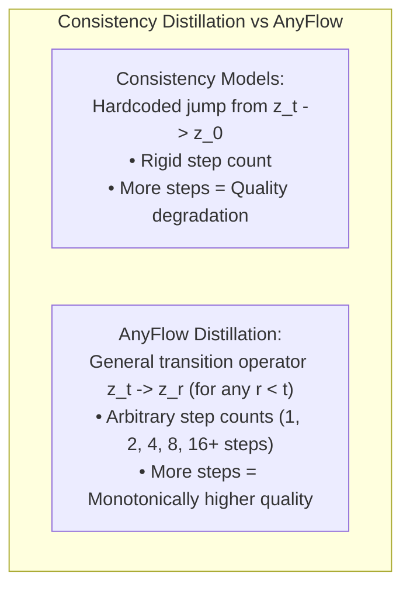

## Definition
An on-policy flow map distillation framework for diffusion models that trains a student transition operator to jump between arbitrary timesteps ($z_t \to z_r$ for any $r < t$), enabling flexible multi-step generation where visual fidelity scales monotonically with the allocated inference step budget (from 1 step up to 16+ steps).

## Why it's true
Standard diffusion models require 25 to 50 sequential denoising steps, making real-time interactive generation impossible.

To accelerate inference, earlier techniques introduced **Consistency Distillation (e.g., Consistency Models, LCM)**, training a student network to predict the final clean data point $z_0$ directly in a single leap ($z_t \to z_0$). However, consistency distillation suffers from a counterintuitive limitation: **fixed-step rigidity**.
- A consistency model distilled for 4 steps works well at 4 steps.
- If an application allocates additional compute (e.g., 8, 12, or 20 steps) hoping for higher visual quality, output quality often degrades or introduces strange structural artifacts.
- The model is locked to a specific discrete step budget and cannot scale with available hardware capacity.

**AnyFlow Distillation** overcomes this limitation by reformulating distillation:

### 1. The Continuous Flow Map Operator
Instead of forcing the student to jump all the way to $z_0$, AnyFlow trains a parameterized flow operator that maps a noisy state $z_t$ at any continuous time $t$ to an intermediate state $z_r$ at any earlier time $r < t$:
$$z_r = \Phi_\theta(z_t, t, r)$$
Because the operator is conditioned on both starting time $t$ and target time $r$, a single set of student weights natively supports any arbitrary time discretization during sampling.

### 2. On-Policy Student Rollouts
Standard distillation trains students using trajectories generated by the pre-trained teacher model (off-policy). At test time, student errors compound across steps, encountering out-of-distribution states that the teacher never visited.
AnyFlow employs **on-policy distillation**:
- The student generates its own rollouts during training, exploring the exact error-prone states it will face during fast multi-step sampling.
- Teacher trajectories supervise the student directly on these student-generated states, teaching the model how to self-correct drift across multi-step jumps.

### 3. Monotonic Scaling & Post-Adaptation
Because AnyFlow learns a general transition operator:
- **Flexible Deployment:** A single deployed model can run at 1 or 2 steps for interactive UI previews (e.g., in a creative editing tool), and seamlessly switch to 8 or 16 steps for final high-resolution rendering.
- **Continuous Domain Adaptation:** Unlike consistency models whose step-reduction collapses if fine-tuned, AnyFlow models can be continually fine-tuned on specialized domain data (e.g., autonomous driving or robotic manipulation) while retaining full few-step generation performance.

## Minimal example
An interactive design tool for video creation:
- **Scrubbing / Preview Mode:** The user scrubs through an interactive timeline. The system allocates a 2-step budget ($t = 1.0 \to 0.5 \to 0.0$), generating instant previews at 30 FPS.
- **Final Render Mode:** The user clicks "Export". The system allocates an 8-step budget ($t = 1.0 \to 0.85 \to 0.70 \to \dots \to 0.0$) using the **exact same model checkpoint**, rendering photorealistic hair textures, crisp reflections, and fine text. Quality improves smoothly with additional steps.

## Prerequisites
- [[concepts/denoising-diffusion-probabilistic-models|Denoising Diffusion Probabilistic Models]]: The baseline multi-step diffusion formulation that AnyFlow distills into few-step flow maps.

## Common confusions
- **AnyFlow is only for 1-step generation:** While AnyFlow supports 1-step generation, its primary advantage over consistency distillation is its **monotonic scalability**: extra sampling steps reliably improve visual quality rather than degrading it.

## Appears in
- [[lessons/2026-11-13-diffusion-models-sparsity-quantization-and-flow-distillation]]: introduced as a next-generation distillation framework for flexible step budgets in video diffusion.
