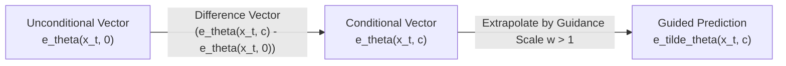

## Definition
A conditioning technique for diffusion models that amplifies prompt adherence and perceptual quality by interpolating or extrapolating between unconditional and conditional noise predictions using a single neural network trained with random condition dropout, eliminating the need for an external classifier.

## Why it's true
In conditional image generation, a diffusion model must synthesize an image matching a specific text prompt, class label, or bounding box $c$.

Early systems used **Classifier Guidance**, computing the gradient of an auxiliary image classifier trained on noisy images $\nabla_{x_t} \log p(y \mid x_t)$ to steer the trajectory. However, training a separate classifier that operates reliably across all noise levels $t \in [1, T]$ is computationally expensive, adversarial, and virtually impossible for complex open-ended text prompts.

**Classifier-Free Guidance (CFG)** integrates guidance directly into the core diffusion model:

### 1. Training with Condition Dropout
During training, the diffusion backbone $\epsilon_\theta(x_t, c)$ receives the conditioning signal $c$ most of the time, but with a fixed probability (typically $10\%$ to $20\%$), the condition is replaced with a null token $\emptyset$:
$$c_{\text{input}} = \begin{cases} c & \text{with probability } 1 - p_{\text{uncond}} \\ \emptyset & \text{with probability } p_{\text{uncond}} \end{cases}$$
This allows a single set of weights to learn both the conditional distribution $p(x \mid c)$ and the general data distribution $p(x)$ simultaneously.

### 2. Extrapolation During Sampling
At each denoising step $t$, the model evaluates two noise predictions:
1. The unconditional score: $\epsilon_\theta(x_t, \emptyset)$ (what natural images look like).
2. The conditional score: $\epsilon_\theta(x_t, c)$ (what natural images matching prompt $c$ look like).

The final guided noise prediction extrapolates along the difference vector using a guidance scale parameter $\omega \ge 1$:
$$\tilde{\epsilon}_\theta(x_t, c) = \epsilon_\theta(x_t, \emptyset) + \omega \cdot \left(\epsilon_\theta(x_t, c) - \epsilon_\theta(x_t, \emptyset)\right)$$

### 3. The Quality vs. Diversity Trade-off
- **$\omega = 1.0$:** Standard conditional generation. Output is diverse, but can be visually soft and prone to ignoring subtle prompt clauses.
- **$\omega \in [3.0, 7.5]$:** Sharply penalizes outputs that do not match the prompt, drastically boosting visual contrast, edge sharpness, and semantic adherence (lowering Fréchet Inception Distance).
- **$\omega > 15$:** Oversaturates the image, blowing out colors and causing high-frequency artifacts due to extreme score extrapolation.

Because CFG requires evaluating the network twice per timestep (once with $c$, once with $\emptyset$), it doubles the computational cost of inference.

## Minimal example
Generating an image prompted with *"A red sports car on a wet road"*:
- $\epsilon_\theta(x_t, \emptyset)$ predicts an average vehicle on an average asphalt road.
- $\epsilon_\theta(x_t, c)$ pushes the prediction toward vibrant red bodywork and rainy reflections.
- With $\omega = 7.0$, the difference vector is multiplied by 7. The guided step aggressively sharpens the wet pavement reflections and guarantees the car body is intensely red, overriding any generic gray or blue vehicle modes in the base distribution.

## Prerequisites
- [[concepts/denoising-diffusion-probabilistic-models|Denoising Diffusion Probabilistic Models]]: The underlying generative framework whose noise predictions CFG steers during sampling.

## Common confusions
- **CFG requires training two separate models:** CFG uses **a single neural network**. The unconditional and conditional predictions are generated by passing the prompt $c$ and the null token $\emptyset$ through the identical network weights.
- **Higher guidance scale is always better:** Excessively high guidance scales truncate the output distribution, causing color clipping, unnatural contrast, and plastic-like artifacts.

## Appears in
- [[lessons/2026-11-11-diffusion-models-foundations-latent-spaces-and-deep-compression]]: analyzed as the ubiquitous steering engine in text-to-image foundation models (Stable Diffusion, Sana, Flux).
