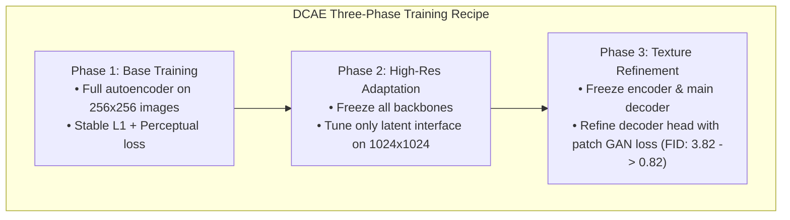

## Definition
A visual autoencoder architecture that achieves an extreme spatial downsampling factor of $f = 64$ ($4,096\times$ reduction in spatial area) while preserving high perceptual reconstruction fidelity through space-to-channel residual pathways, decoupled multi-resolution adaptation, and localized GAN refinement, slashing downstream diffusion attention compute by up to $64\times$ compared to standard $f = 8$ latent autoencoders.

## Why it's true
In Latent Diffusion Models (like Stable Diffusion), the autoencoder typically downsamples images by a spatial factor of $f = 8$:
$$\text{Latent Resolution} = \frac{H}{8} \times \frac{W}{8}$$

For a $1024 \times 1024$ image, an $f = 8$ autoencoder outputs a $128 \times 128$ latent map ($16,384$ tokens). When generating 4K images ($4096 \times 4096$), the latent map explodes to $512 \times 512 = 262,144$ tokens, crashing GPU memory during Diffusion Transformer (DiT) self-attention.

Pushing conventional autoencoders to higher compression factors ($f = 32$ or $f = 64$) causes severe visual collapse: reconstructions become blurry, warped, and distorted because standard strided convolutions cannot preserve high-frequency spatial details across aggressive downsampling bottlenecks.

**Deep Compression Autoencoder (DCAE)** overcomes this collapse through three key architectural techniques:

### 1. Residual Space-to-Channel Pathways
Standard convolutional downsampling forces the network to learn both spatial dimensionality reduction and semantic feature extraction simultaneously. DCAE introduces explicit, parameter-free **space-to-channel residual connections**:
- Spatial pixels are deterministically folded into channel depth (rearranging an $H \times W \times C$ tensor into $\frac{H}{2} \times \frac{W}{2} \times 4C$).
- This deterministic shortcut preserves spatial gradients and fine edges, bypassing deep convolutional bottlenecks and stabilizing training at aggressive compression rates.

### 2. Decoupled Three-Phase Training
Training a $64\times$ downsampling autoencoder end-to-end on high-resolution data is numerically unstable and causes memory out-of-memory errors. DCAE decouples the training into three stages:
1. **Phase 1 (Base Representation):** Train the complete autoencoder exclusively on low-resolution images ($256 \times 256$) using standard L1 and perceptual losses until convergence.
2. **Phase 2 (High-Resolution Adaptation):** Freeze the encoder and decoder backbones. Tune only a lightweight latent interface layer on high-resolution data ($1024 \times 1024$), adapting the latent distribution to high-resolution statistics at minimal compute cost.
3. **Phase 3 (Decoder Head Refinement):** Freeze all network layers except the final output decoder head. Train with an adversarial patch-GAN loss on low-resolution crops to restore crisp high-frequency textures, lowering reconstruction Fréchet Inception Distance (FID) from $3.82$ to $0.82$.

### 3. Structured Latent Channels (DCAE 1.5)
DCAE 1.5 imposes an explicit ordering across latent channels: early channels are forced to encode coarse geometric structure, while trailing channels capture high-frequency details. This channel hierarchy accelerates diffusion model training convergence.

By compressing spatial dimensions by $f = 64$ ($8\times$ smaller than standard $f = 8$ VAEs), downstream Diffusion Transformers process $64\times$ fewer spatial tokens, reducing quadratic attention operations by $(64)^2 = 4,096\times$ and enabling real-time 4K image generation.

## Minimal example
Consider generating a $4096 \times 4096$ (4K) image with a Diffusion Transformer:
- **Standard LDM ($f = 8$):**
  - Latent map: $\frac{4096}{8} \times \frac{4096}{8} = 512 \times 512 = 262,144$ tokens.
  - Computing self-attention across 262K tokens requires distributed clusters or crashes from out-of-memory.
- **DCAE ($f = 64$):**
  - Latent map: $\frac{4096}{64} \times \frac{4096}{64} = 64 \times 64 = 4,096$ tokens.
  - A sequence of 4,096 tokens fits comfortably within a single consumer GPU, executing real-time 4K diffusion inference in under one second.

## Prerequisites
- [[concepts/latent-diffusion-models|Latent Diffusion Models]]: The underlying generative paradigm that DCAE accelerates by dramatically shrinking the latent spatial grid.

## Common confusions
- **DCAE is a diffusion model:** DCAE is **purely an autoencoder** (an encoder-decoder pair). It serves as the visual compression engine for downstream diffusion models like Sana.
- **Higher compression always hurts reconstruction:** With residual space-to-channel pathways and localized GAN head tuning, DCAE at $f = 64$ achieves visual reconstruction quality matching standard $f = 8$ VAEs while operating on an 8× smaller spatial latent grid.

## Appears in
- [[lessons/2026-11-11-diffusion-models-foundations-latent-spaces-and-deep-compression]]: detailed as the core compression breakthrough behind Sana, enabling 100× faster high-resolution image synthesis.
