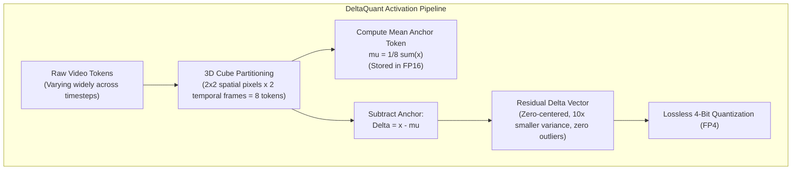

## Definition
A 4-bit weight-activation quantization technique specifically engineered for video diffusion models that handles dynamic, timestep-varying activation distributions by grouping neighboring tokens into 3D spatiotemporal cubes, preserving a high-precision mean anchor vector per cube, and quantizing only the small residual deltas ($\Delta = x - \mu$) to 4 bits.

## Why it's true
Quantizing video diffusion models to 4 bits (W4A4) encounters a severe obstacle that static image models do not face: **temporal distribution drift**.

In video diffusion, activation channel magnitudes and outlier locations change drastically across the 50 denoising timesteps:
- At timestep $t = 1,000$ (pure Gaussian noise), activations follow a diffuse, wide distribution.
- At timestep $t = 50$ (structured visual scene), activations concentrate into sharp, outlier-heavy channel spikes.
- A static smoothing scale (like [[concepts/smoothquant|SmoothQuant]]) calibrated at one timestep amplifies quantization errors at other timesteps, causing catastrophic video degradation and severe frame flickering.

**DeltaQuant** circumvents static calibration by exploiting the intrinsic physical properties of video: **intense spatiotemporal correlation**. Adjacent pixels within a frame, and corresponding pixels across consecutive video frames, are nearly identical.

### The Three-Step DeltaQuant Pipeline:
1. **3D Spatiotemporal Cubes:** Partition the 3D video activation tensor into small local blocks (e.g., 2 pixels horizontally $\times$ 2 pixels vertically $\times$ 2 consecutive frames = 8 tokens per cube).
2. **High-Precision Mean Anchor:** Compute the centroid vector $\mu \in \mathbb{R}^D$ of each cube and keep it in 16-bit floating point (FP16).
3. **Residual Delta Quantization:** Subtract the anchor from each individual token in the cube:
   $$\Delta_i = x_i - \mu$$
   Because adjacent frames and pixels share lighting, colors, and motion, the residual $\Delta_i$ is centered near zero with a dynamic range up to $15\times$ smaller than the original activation $x_i$. All outlier spikes vanish.
4. **4-Bit Encoding:** Quantize the low-magnitude residual $\Delta_i$ into 4-bit integers or NVFP4 with minimal discretization noise.

During matrix multiplication, the linear projection of the anchor vector ($\mu W$) is shared across all 8 tokens in the cube, amortizing the high-precision computation while the residual multiplications run entirely on high-throughput 4-bit tensor cores.

DeltaQuant cuts video diffusion model size by **$2.9\times$**, slashes inference memory by **$2.3\times$**, and boosts generation speed by **$4.6\times$ to $7.2\times$** across different video resolutions without temporal flickering.

## Minimal example
An activation channel across four neighboring video tokens contains raw values:
$$x = [85.2, 86.8, 84.9, 86.3]$$
- **Direct 4-Bit Quantization:** Quantizing values around $85$ into a 4-bit scale (16 discrete bins) requires a wide bin width, introducing large rounding errors that ruin subtle color gradients.
- **DeltaQuant:**
  - High-precision anchor: $\mu = 85.8$ (stored once in FP16).
  - Residual deltas:
    $$\Delta = [-0.6, +1.0, -0.9, +0.5]$$
  - The narrow $[-0.9, +1.0]$ range is quantized into 4-bit bins with microscopic quantization error, recovering the exact original values upon addition ($x_i \approx \mu + \hat{\Delta}_i$).

## Prerequisites
- [[concepts/svdquant|SVDQuant]]: The underlying W4A4 weight-activation framework that DeltaQuant extends to dynamic temporal video activations.

## Common confusions
- **DeltaQuant requires retraining the model:** DeltaQuant is a **training-free post-training quantization (PTQ)** algorithm. The anchor calculation and residual quantization occur on the fly at runtime during inference.

## Appears in
- [[lessons/2026-11-13-diffusion-models-sparsity-quantization-and-flow-distillation]]: analyzed as an adaptive quantization technique enabling real-time long-video diffusion on single GPUs.
