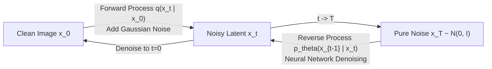

## Definition
A class of generative models that synthesizes data through a two-phase process: a forward Markov chain that gradually destroys structure by adding Gaussian noise over discrete timesteps, and a reverse neural network that learns to iteratively remove that noise step-by-step to generate clean samples from pure Gaussian noise.

## Why it's true
Generative Adversarial Networks (GANs) struggle with mode collapse and adversarial instability, while Variational Autoencoders (VAEs) suffer from blurry outputs caused by surrogate objective bounds.

**Denoising Diffusion Probabilistic Models (DDPM)** formulate generation as the physical process of reverse thermodynamic diffusion:

### 1. The Forward Process (Noise Addition)
Given a clean image $x_0 \sim q(x)$, the forward process adds Gaussian noise according to a variance schedule $\beta_1, \beta_2, \dots, \beta_T$:
$$q(x_t \mid x_{t-1}) = \mathcal{N}\left(x_t; \sqrt{1 - \beta_t} x_{t-1}, \beta_t I\right)$$

Because the sum of two independent Gaussians is another Gaussian, we do not need to simulate every intermediate step. Defining $\alpha_t = 1 - \beta_t$ and cumulative product $\bar{\alpha}_t = \prod_{s=1}^t \alpha_s$, we can sample $x_t$ at any arbitrary timestep $t$ in **one closed-form step**:
$$x_t = \sqrt{\bar{\alpha}_t} x_0 + \sqrt{1 - \bar{\alpha}_t} \epsilon, \quad \text{where } \epsilon \sim \mathcal{N}(0, I)$$
As $t \to T$, $\bar{\alpha}_T \approx 0$, and the image distribution dissolves into standard pure Gaussian noise $\mathcal{N}(0, I)$.

### 2. The Reverse Process (Learned Denoising)
The true reverse transition $q(x_{t-1} \mid x_t)$ is intractable because it depends on the unknown data distribution $q(x_0)$. However, for infinitesimal step sizes $\beta_t$, the reverse transition is also Gaussian:
$$p_\theta(x_{t-1} \mid x_t) = \mathcal{N}\left(x_{t-1}; \mu_\theta(x_t, t), \Sigma_\theta(x_t, t)\right)$$

Instead of predicting the mean $\mu_\theta$ directly, Ho et al. showed that reparameterizing the network to predict the injected noise vector $\epsilon_\theta(x_t, t)$ simplifies the variational bound to a weighted mean squared error:
$$\mathcal{L}_{\text{simple}}(\theta) = \mathbb{E}_{t, x_0, \epsilon}\left[ \|\epsilon - \epsilon_\theta(x_t, t)\|^2 \right]$$

### 3. Sampling
During generation, the model starts from pure noise $x_T \sim \mathcal{N}(0, I)$ and subtracts the predicted noise step-by-step for $t = T, T-1, \dots, 1$, creating high-fidelity, photorealistic images.

## Minimal example
Training on an image of a dog ($x_0$):
1. Sample a random timestep $t = 500$ (out of $T = 1000$) where $\bar{\alpha}_{500} = 0.5$.
2. Sample random Gaussian noise $\epsilon \sim \mathcal{N}(0, I)$.
3. Construct the noisy image:
   $$x_{500} = \sqrt{0.5} x_0 + \sqrt{0.5} \epsilon$$
4. Feed $x_{500}$ and timestep 500 into the neural network (U-Net or DiT).
5. Compute MSE loss between the network's prediction $\hat{\epsilon}$ and the true noise $\epsilon$: $\mathcal{L} = \|\epsilon - \hat{\epsilon}\|^2$.

## Prerequisites
- None

## Common confusions
- **Diffusion models must step through all forward steps during training:** Because of the closed-form identity $x_t = \sqrt{\bar{\alpha}_t} x_0 + \sqrt{1 - \bar{\alpha}_t} \epsilon$, training evaluates a single randomly sampled timestep $t$ in one forward pass. Sequential stepping is only required during reverse generation (sampling).
- **Diffusion models predict the clean image directly:** Predicting the noise $\epsilon$ produces far more stable training gradients and higher perceptual fidelity than predicting the denoised image $\hat{x}_0$ directly.

## Appears in
- [[lessons/2026-11-11-diffusion-models-foundations-latent-spaces-and-deep-compression]]: introduced as the fundamental probabilistic framework governing modern image and video synthesis.
