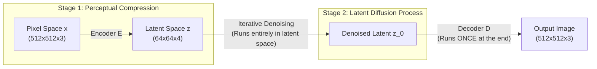

## Definition
A two-stage generative framework that separates perceptual image compression from semantic synthesis by running iterative diffusion forward and reverse processes within the compact latent space of a pre-trained autoencoder, reducing spatial token count by $64\times$ and dramatically cutting training and inference costs.

## Why it's true
Operating diffusion models directly in pixel space ($x \in \mathbb{R}^{H \times W \times 3}$) creates an extreme computational bottleneck:
- A $512 \times 512 \times 3$ image contains $786,432$ raw values.
- Generating a single image requires evaluating a large neural network over 50 to 1,000 iterative denoising steps.
- Because self-attention and high-resolution convolutional feature maps scale with the number of pixels, training pixel-space diffusion models consumes thousands of GPU days, and generating a single image takes several seconds.

However, high-resolution pixels are dominated by **high-frequency imperceptible details** (imperceptible sensor noise, microscopic textural variance) that carry near-zero semantic information.

**Latent Diffusion Models (LDM)** decouple the problem into two distinct stages:

### 1. The Perceptual Autoencoder (Stage 1)
A pre-trained autoencoder (VAE) compresses the image into a continuous latent space:
$$z = \mathcal{E}(x), \quad \hat{x} = \mathcal{D}(z)$$
Using a spatial downsampling factor of $f = 8$, a $512 \times 512 \times 3$ image compresses into a latent tensor $z \in \mathbb{R}^{64 \times 64 \times 4}$. The spatial token count drops from $262,144$ pixels to $4,096$ latent vectors—a **$64\times$ reduction in spatial elements**.

### 2. Semantic Diffusion in Latent Space (Stage 2)
The diffusion model never sees raw pixels during generation. It adds noise to $z_0$ and trains a network $\epsilon_\theta(z_t, t, c)$ to predict the latent noise:
$$\mathcal{L}_{\text{LDM}} = \mathbb{E}_{\mathcal{E}(x), \epsilon, t}\left[ \|\epsilon - \epsilon_\theta(z_t, t, c)\|^2 \right]$$

### 3. One-Shot Decoding
All 50 iterative denoising passes execute rapidly on the small $64 \times 64$ latent tensor. The heavy pixel decoder $\mathcal{D}$ runs **exactly once** at the very end to reconstruct the full-resolution image $\hat{x}_0 = \mathcal{D}(z_0)$.

## Minimal example
Generating a $1024 \times 1024$ image with a Diffusion Transformer (DiT):
- **Pixel-Space DiT:** Sequence length $N = \frac{1024 \times 1024}{16 \times 16} = 4,096$ patch tokens. Computing quadratic attention over 4,096 tokens across 50 steps requires massive GPU VRAM and takes over 10 seconds.
- **Latent-Space DiT (LDM, $f=8$):** The image is first compressed into a $128 \times 128$ latent map. With patch size $2 \times 2$, sequence length is $N = \frac{128 \times 128}{2 \times 2} = 4,096$ tokens representing a full 1K image. Downstream attention compute drops by $64\times$ compared to pixel space.

## Prerequisites
- [[concepts/denoising-diffusion-probabilistic-models|Denoising Diffusion Probabilistic Models]]: The core probabilistic framework operating inside LDM's latent space.

## Common confusions
- **The autoencoder is trained alongside the diffusion model:** The autoencoder is pre-trained and frozen. The diffusion model trains strictly on fixed pre-computed latent representations, stabilizing training and allowing fast multi-worker caching.

## Appears in
- [[lessons/2026-11-11-diffusion-models-foundations-latent-spaces-and-deep-compression]]: introduced as the architectural foundation of Stable Diffusion, Midjourney, and modern visual generative backbones.
