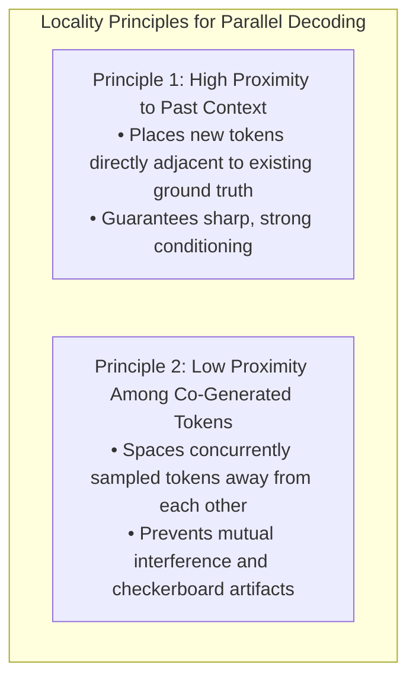

## Definition
A parallel autoregressive decoding framework for image generation that decouples context encoding from target token generation using learnable position query tokens, generating multiple tokens in parallel per forward pass while enforcing high proximity to past context and low proximity among concurrently generated tokens.

## Why it's true
Standard visual autoregressive generation mimics language models by synthesizing discrete tokens one by one in raster scan order (left-to-right, top-to-bottom).

This sequential paradigm creates an extreme latency bottleneck:
- A $256 \times 256$ image requires 256 sequential forward passes.
- A $1024 \times 1024$ image requires 4,096 sequential forward passes.
- Because each forward pass processes only a single token, execution is entirely memory-bandwidth bound, drastically underutilizing GPU tensor cores.

Naive attempts to predict multiple visual tokens simultaneously fail due to spatial correlation:
1. **The Raster Parallel Trap:** In raster order, neighboring tokens (e.g., token $i$ and token $i+1$) are physically adjacent and mutually dependent. If sampled concurrently in a single forward pass, they cannot condition on each other, producing spatial tearing and checkerboard artifacts.
2. **The Random Parallel Trap:** Scattering target positions randomly across the canvas prevents intra-step competition, but places new tokens far from previously synthesized context, resulting in weak conditioning and loss of structural coherence.

**Locality-Aware Parallel Decoding** solves this by establishing two mathematical design rules:

### Architectural Mechanics:
1. **Decoupled Roles via Position Queries:** In standard AR, every token simultaneously acts as context (via its hidden state) and generator (via output logits). Locality-Aware Parallel Decoding delegates the generation role to learnable **Position Query Tokens** ($P_k$). Feeding $M$ position queries enables the model to predict an arbitrary set of $M$ tokens anywhere on the grid in a single pass.
2. **Dual-Attention Masking:** Position query tokens attend to all previous ground-truth context (Context Attention) **and attend mutually to one another** (Query Attention), allowing the $M$ parallel tokens to harmonize their features before sampling.
3. **Fused Forward Pass:** Storing newly generated tokens into context and decoding the next round of queries are combined into a single unified matrix multiplication, eliminating redundant memory transfers.

By adhering to these locality rules, the generation process cuts decoding steps from 4,096 down to 64 steps, speeding up high-resolution generation by **$13\times$ to $21\times$** without degrading image fidelity (FID).

## Minimal example
Generating an $8 \times 8$ token image grid ($64$ tokens):
- **Raster AR:** Requires 64 sequential forward passes.
- **Locality-Aware Parallel Decoding:**
  - *Round 1 (Anchor Points):* Predicts 4 widely spaced corner anchors $(0,0), (0,4), (4,0), (4,4)$ conditioned on the class prompt.
  - *Round 2 (Context Extension):* Predicts tokens directly adjacent to Round 1 anchors (e.g., $(0,2), (2,0)$). Each new token has high proximity to an established anchor, but zero proximity to other Round 2 tokens.
  - The entire canvas is filled in just 6 parallel steps ($10\times$ fewer passes than raster generation).

## Prerequisites
- [[concepts/vector-quantization-for-images|Vector Quantization for Images]]: The discrete tokenization scheme that transforms 2D pixels into categorical grids for autoregressive modeling.

## Common confusions
- **Parallel decoding is equivalent to non-autoregressive generation (NAR):** Non-autoregressive models predict all tokens unconditionally in one shot and suffer from severe multimodality blur. Locality-aware parallel decoding is strictly autoregressive: each round conditions on all previously committed tokens and uses cross-query attention to guarantee global consistency.

## Appears in
- [[lessons/2026-11-06-vision-transformers-perception-and-autoregressive-generation]]: introduced as an inference-time accelerator that turns memory-bound visual autoregression into compute-dense parallel synthesis.
