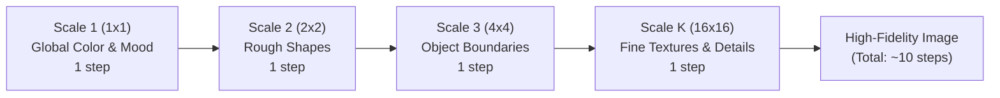

## Definition
A generative visual paradigm that replaces 1D next-token prediction with autoregressive prediction across a hierarchy of spatial scales, generating full 2D token maps in parallel at progressively finer resolutions (from coarse outlines to fine textures) in only 10 to 15 generation steps.

## Why it's true
The success of Large Language Models relies on next-token prediction: language is inherently a 1D causal stream of words unfolding forward in time.

Applying this exact formulation to vision—serializing a 2D image into a 1D raster scan from top-left to bottom-right—violates visual common sense:
1. **Unnatural 1D Inductive Bias:** There is no physical reason why pixel $(0, 0)$ must cause pixel $(0, 1)$ or why the bottom-right corner must be the final dependent token. Flattening 2D images disrupts spatial bi-directional correlations.
2. **Extreme Sequential Bottleneck:** A standard $256 \times 256$ image requires hundreds of sequential forward passes, while a $1024 \times 1024$ image requires 4,096 passes, making autoregressive visual generation unbearably slow and heavily memory-bandwidth bound.

**Next-Scale Autoregressive Modeling (Visual Autoregressive / VAR)** aligns sequence modeling with natural visual cognition: **coarse-to-fine synthesis**.

### How Multi-Scale Residual Quantization Works:
1. **Feature Map Extraction:** An image is encoded into a continuous latent feature map $Z \in \mathbb{R}^{H \times W \times D}$.
2. **Coarse Quantization:** The feature map is pooled to a $1 \times 1$ grid and mapped to its nearest codebook centroid, producing the first scale token $r_1$.
3. **Residual Extraction:** The coarse prediction is upsampled back to $H \times W$ and subtracted from the original feature map to produce a residual error:
   $$Z_2 = Z - \text{Upsample}(\hat{Z}_1)$$
4. **Progressive Refinement:** At scale 2 ($2 \times 2$), the codebook quantizes this residual error $Z_2$, capturing details that scale 1 missed. This process repeats across $K$ scales ($1 \times 1 \to 2 \times 2 \to 4 \times 4 \to \dots$).
5. **Autoregressive Generation:** Conditioned on the user prompt and all coarser scales, the transformer predicts all tokens of the next scale simultaneously in parallel.
6. **Reconstruction:** Summing the upsampled contributions from all scales recovers the complete high-fidelity latent feature map:
   $$\hat{Z} = \sum_{k=1}^K \text{Upsample}(\hat{Z}_k)$$

Because all tokens within a given scale are predicted in a single forward pass, total generation takes only 10 to 15 steps rather than thousands of sequential steps, transforming visual autoregression into a compute-dense parallel workload that outperforms both standard autoregressive models and diffusion baselines in speed and visual quality.

## Minimal example
Generating an image with 256 total tokens:
- **Raster Next-Token AR:** Executes **256 sequential forward passes**, predicting token 1, then token 2, ..., up to token 256.
- **Next-Scale AR (VAR):** Operates across 5 scale levels:
  - Scale 1 ($1 \times 1$): 1 token (1 forward pass)
  - Scale 2 ($2 \times 2$): 4 tokens in parallel (1 forward pass)
  - Scale 3 ($4 \times 4$): 16 tokens in parallel (1 forward pass)
  - Scale 4 ($8 \times 8$): 64 tokens in parallel (1 forward pass)
  - Scale 5 ($16 \times 16$): 256 tokens in parallel (1 forward pass)
- Total passes: **5 forward passes** (a **$50\times$ reduction in generation latency**).

## Prerequisites
- [[concepts/vector-quantization-for-images|Vector Quantization for Images]]: The codebook mapping mechanism used recursively at each resolution level to discretize multi-scale visual residuals.

## Common confusions
- **VAR is a diffusion model:** Diffusion models operate in continuous space by iteratively removing Gaussian noise over dozens of timesteps. VAR is a **pure discrete autoregressive transformer** trained with standard cross-entropy loss, where the autoregressive axis is spatial scale rather than raster time.

## Appears in
- [[lessons/2026-11-06-vision-transformers-perception-and-autoregressive-generation]]: detailed as a foundational shift from 1D token serialization to hierarchical coarse-to-fine visual generation.
