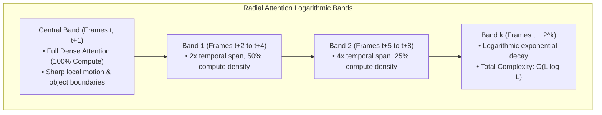

## Definition
An efficient 3D attention mechanism for video diffusion models that replaces dynamic attention masks with a static multi-band diagonal mask structured around the exponential decay of attention energy across space and time, reducing computational complexity from quadratic $O(L^2)$ to sub-quadratic $O(L \log L)$.

## Why it's true
In video diffusion transformers, generating a multi-second high-resolution video requires processing over $70,000$ spatiotemporal tokens ($L \ge 70,000$). Computing full pairwise attention across this sequence scales quadratically:
$$\text{Full 3D Attention} = O(L^2 \cdot D)$$
Self-attention consumes over 80% of total inference time, creating an insurmountable memory and latency wall.

Dynamic sparse attention methods attempt to drop low-scoring attention entries at runtime using online profiling, but online profiling introduces non-deterministic latency and scattered, irregular memory access patterns that GPUs execute inefficiently.

**Radial Attention** discovers that attention scores in video transformers naturally obey an invariant physical law: **Spatiotemporal Energy Decay**:
1. **Temporal Decay:** The magnitude of attention weights between two video frames decays exponentially as the time interval between them $|t_1 - t_2|$ grows. Adjacent frames interact strongly; distant frames interact weakly.
2. **Spatial Decay:** Within each frame, attention scores decay as the Euclidean pixel distance between patches increases.

### The Logarithmic Multi-Band Structure:
Rather than spending compute predicting dynamic masks, Radial Attention uses a **static multi-band diagonal mask**:
- **Central Diagonal Band:** Receives full 100% compute density, ensuring perfect continuity between consecutive frames.
- **Outer Logarithmic Bands:** Each subsequent band covers roughly double the temporal span of the previous band while allocating half the compute density, exactly mirroring the empirical rate of attention energy decay.

Because the number of temporal bands grows logarithmically as $O(\log L)$ and each band bounded by width $W$ requires $O(L)$ operations, total computation drops from $O(L^2)$ to:
$$\text{Radial Attention Complexity} = O(L \log L \cdot D)$$

Because the mask pattern is static and deterministic, it executes with contiguous, hardware-friendly GPU memory strides. During model fine-tuning with LoRA, Radial Attention trains a $4\times$ longer video model in under 200 GPU hours (compared to 700+ GPU hours for dense attention), accelerating inference latency by **$3.7\times$**.

## Minimal example
Consider a video sequence of $L = 65,536$ tokens:
- **Full Dense Attention:** Evaluates $(65536)^2 \approx 4.29 \times 10^9$ pairwise dot products.
- **Radial Attention ($O(L \log L)$):** With $\log_2(L) \approx 16$ logarithmic bands and a bounded band width, total evaluated pairs drop to $\approx 3.5 \times 10^8$ operations—a **$12\times$ reduction in arithmetic operations** with zero online profiling overhead and zero loss in video quality (PSNR).

## Prerequisites
- None

## Common confusions
- **Radial attention is a fixed local sliding window:** A simple sliding window completely severs connections between distant frames, causing scene identity drift over long videos. Radial Attention retains sparse outer bands extending across the entire duration of the video, maintaining global scene coherence while keeping compute strictly bounded to $O(L \log L)$.

## Appears in
- [[lessons/2026-11-13-diffusion-models-sparsity-quantization-and-flow-distillation]]: analyzed as an efficient sub-quadratic attention mechanism for long-video synthesis and context extension.
