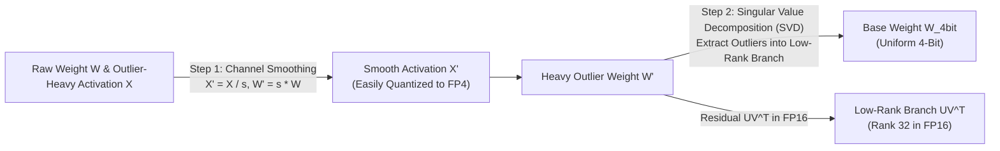

## Definition
A 4-bit weight-activation quantization (W4A4) framework for diffusion models that resolves extreme outlier channels by first migrating activation outliers into the weights via channel smoothing, and then decomposing the outlier-laden weights into a uniform 4-bit base matrix plus a high-precision low-rank residual branch ($W = W_{\text{4-bit}} + U V^T$).

## Why it's true
To fully utilize Blackwell and next-generation 4-bit floating-point (FP4 / NVFP4) tensor cores, neural network execution must be quantized in both weights and activations (**W4A4**):
$$\text{Output} = X_{\text{FP4}} \cdot W_{\text{FP4}}$$

In Diffusion Transformers (DiTs like Flux.1 and SD3), naive 4-bit quantization causes severe image degradation, facial distortion, and textural collapse.

The core challenge is the coexistence of **bidirectional outliers**:
1. **Activation Outliers:** Sharp outlier spikes exist in specific activation channels.
2. **Weight Outliers:** Outlier channels also exist in the weight matrices.
3. **The Smoothing Deadlock:** As shown in [[concepts/smoothquant|SmoothQuant]], dividing activations by a scaling factor $s$ migrates difficulty into the weights ($W' = s \cdot W$). In LLMs, weights have sufficient dynamic range to absorb this. But in 4-bit diffusion models, pushing activation outliers into weights causes the weight outliers to explode, destroying the 4-bit weight grid.

**SVDQuant** breaks this deadlock through a two-stage mathematical decomposition:

1. **Step 1: Activation Smoothing:** Smooth activations using channel-wise scaling factors $s$, migrating all activation outliers into the weight matrix so activations $X'$ can be cleanly quantized to 4 bits.
2. **Step 2: Low-Rank Outlier Decomposition:** Compute the Singular Value Decomposition (SVD) of the inflated weight matrix $W'$, extracting the dominant outlier dimensions into a compact, high-precision low-rank branch:
   $$W' \approx W_{\text{4-bit}} + U V^T$$
   where $U \in \mathbb{R}^{d_{\text{in}} \times r}$, $V \in \mathbb{R}^{r \times d_{\text{out}}}$, and rank $r$ is tiny (typically $r = 32$).
3. **Unquantized Residual:** The low-rank matrices $U$ and $V$ represent less than 5% of total parameters and remain in 16-bit precision (FP16/BF16), while the remaining smoothed base weight $W_{\text{4-bit}}$ is uniformly quantized to 4 bits.
4. **Fused Inference Kernel:** At runtime, the 4-bit GEMM ($X_{\text{4-bit}} W_{\text{4-bit}}$) and the low-rank GEMM ($X U V^T$) share the identical input and output buffers, using kernel fusion to eliminate redundant memory loads.

SVDQuant compresses 12B diffusion models (such as Flux.1) by **$3.6\times$**, cutting VRAM from 24 GB to under 8 GB and enabling real-time 12B image generation locally on laptop RTX 4090 GPUs at over $10\times$ speedup.

## Minimal example
Quantizing a linear projection layer with $d_{\text{in}} = 4096, d_{\text{out}} = 4096$:
- Full Precision (FP16): $4096 \times 4096 \times 2 \text{ bytes} = 33.55 \text{ MB}$.
- Naive 4-Bit: Model collapses, producing noisy static.
- SVDQuant ($r = 32$):
  - Base Weight (4-bit): $4096 \times 4096 \times 0.5 \text{ bytes} = 8.39 \text{ MB}$.
  - Low-Rank Outlier Branch ($U, V$ in FP16): $2 \times (4096 \times 32) \times 2 \text{ bytes} = 0.52 \text{ MB}$.
  - Total Memory: $8.91 \text{ MB}$ (a **$3.76\times$ compression**) with visual quality indistinguishable from the original FP16 model.

## Prerequisites
- [[concepts/smoothquant|SmoothQuant]]: The mathematical foundation for migrating activation outliers into weight tensors via channel-wise scaling.

## Common confusions
- **The low-rank branch is trained with LoRA:** SVDQuant's low-rank branch is **not trained with gradient descent**. It is computed analytically from pre-trained weights using Singular Value Decomposition (or low-rank residual regression) without requiring fine-tuning data.
- **SVDQuant can be merged back into 4-bit weights:** Unlike LoRA adapters merged into FP16 models, the FP16 low-rank matrices cannot be added back into 4-bit weights without reintroducing the extreme outliers that break the 4-bit grid. They run as a parallel high-precision bypass in a fused GPU kernel.

## Appears in
- [[lessons/2026-11-13-diffusion-models-sparsity-quantization-and-flow-distillation]]: introduced as the premier W4A4 quantization algorithm enabling consumer-hardware deployment of foundation diffusion models.
