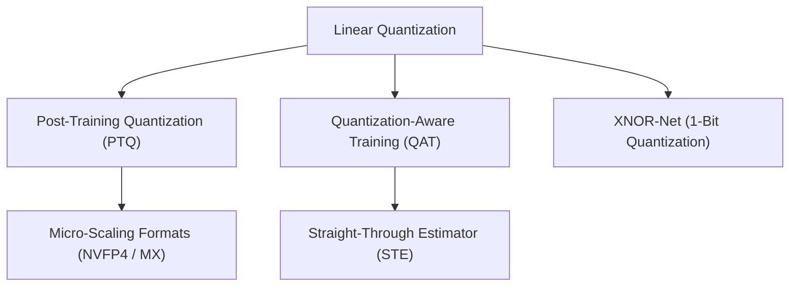

> [!abstract]
> Taking neural networks down to INT8, FP4, and 1-bit binary precision without accuracy collapse requires choosing the right quantization granularity (per-channel and micro-scaling), optimizing dynamic range clipping with KL divergence, simulating quantization in training via the Straight-Through Estimator, and reimagining arithmetic as bitwise XNOR and popcount logic.

Part of [[courses/mit-6-5940|MIT 6.5940 (Fall 2026)]], lecture 6.

## TL;DR
- **The Granularity Cure:** Using a single scale factor for an entire tensor fails because outlier channels act like giraffes next to ant-sized channels ($100\times$ dynamic range gap); per-channel and hierarchical micro-scaling (NVIDIA Blackwell NVFP4) isolate local dynamic ranges to unlock sub-byte accuracy.
- **The Zero-Derivative Barrier:** The rounding operator is a step function whose mathematical derivative is zero everywhere, which would normally kill backpropagation; Quantization-Aware Training (QAT) bypasses this via the Straight-Through Estimator (STE), treating the operator as an identity function to heal MobileNet from $0.1\%$ back to $70.4\%$ accuracy.
- **The Multiplier-Free Extreme:** When weights and activations are binarized to $\{-1, +1\}$, floating-point multiply-accumulate completely vanishes, replaced by single-cycle bitwise XNOR and hardware popcount instructions ($W \cdot X = 2 \cdot \text{popcount}(W \text{ XNOR } X) - N$) with $32\times$ memory reduction.

## Concept map

The atomic concepts in dependency order:

1. [[concepts/post-training-quantization|Post-Training Quantization]]: Quantizing weights and activations after training using calibration batches and statistical clipping without backpropagation.  
   *Needs:* [[concepts/linear-quantization|Linear Quantization]]
2. [[concepts/micro-scaling-formats|Micro-Scaling Formats]]: Group-quantized sub-byte data types (NVFP4, MX4, MX6) that share tiny local exponents across 2 to 16 elements, decoupling local outliers from global scale.  
   *Needs:* [[concepts/post-training-quantization|Post-Training Quantization]]
3. [[concepts/quantization-aware-training|Quantization-Aware Training]]: Simulating discrete numerical clamping during training to allow weights to adapt to precision loss before export.  
   *Needs:* [[concepts/linear-quantization|Linear Quantization]]
4. [[concepts/straight-through-estimator|Straight-Through Estimator]]: A backward-pass gradient substitution trick that treats non-differentiable step/rounding functions as an identity pass-through, enabling backprop through quantized nodes.  
   *Needs:* [[concepts/quantization-aware-training|Quantization-Aware Training]]
5. [[concepts/xnor-net|XNOR-Net]]: An extreme 1-bit computing architecture where both weights and activations are binarized into $\{-1, +1\}$, turning matrix multiplication into bitwise XNOR logic and popcount instructions.  
   *Needs:* [[concepts/linear-quantization|Linear Quantization]]



## First-principles rebuild

### 0. The Reality Check & Motivation

In Lecture 5, we learned how linear quantization maps continuous decimal numbers into discrete integer grids ($r = S \cdot (q - Z)$). But when engineers attempt to apply simple linear quantization to real-world models, they encounter two severe roadblocks [05:40]:

1. **The Outlier Trap:** In large language models and deep vision networks, dynamic ranges across channels vary by up to $100\times$ [08:08]. Quantizing an entire weight tensor using a single global scale factor is like using the same ruler to measure both an ant and a giraffe [08:08]. The massive giraffe (outlier channel) stretches the ruler so wide that the tiny ant (subtle feature channel) rounds to exact zero, destroying critical model capabilities.
2. **The Non-Differentiable Barrier:** When small models (like MobileNet) or aggressive bit-widths (like 4-bit) suffer catastrophic accuracy drops under post-training quantization, you cannot simply retrain them using standard backpropagation [40:45]. The mathematical rounding function $\text{round}(x)$ is a flat staircase whose derivative is zero almost everywhere. Standard gradient descent completely freezes.

Resolving these roadblocks requires rethinking quantization granularities, finding statistical sweet spots for outlier clipping, and inventing clever gradient approximations for training.

### 1. Ground Zero (PTQ Granularity & Multi-Level Scaling)

How finely should we subdivide a weight tensor when assigning scaling factors [06:25]?

| Granularity | Scale Factor Allocation | Algorithmic Accuracy | Hardware Execution |
| :--- | :--- | :--- | :--- |
| **Per-Tensor** | 1 scale factor ($S$) for the whole layer [23:00] | **Lowest:** Outliers in one channel ruin resolution for all other channels [23:34] | **Simplest:** Single scale multiply at the end of the entire layer |
| **Per-Channel** | 1 scale factor ($S_c$) per output channel [25:00] | **High:** Every channel gets its own dynamic range [30:59] | **Standard:** Supported natively in all modern INT8 engines (TensorRT, ONNX, TFLite) |
| **Group / Micro-Scaling** | 1 tiny scale factor per micro-vector (e.g. 16 elements) [31:10] | **Highest:** Local variance isolated within small blocks [32:49] | **Cutting-Edge:** Natively accelerated in NVIDIA Blackwell NVFP4 and OCP MX hardware [33:25] |

#### The Blackwell NVFP4 and OCP MX Revolution

Why has the industry pivoted toward **micro-scaling formats** in modern architectures like NVIDIA Blackwell and AMD MI300 [33:25]?

Blackwell's FP4 Tensor Cores deliver a staggering **18 PFLOPS** of peak math compute—double that of FP8 ($9\text{ PFLOPS}$) and quadruple FP16 ($4.5\text{ PFLOPS}$) [33:25]. But running pure 4-bit floating point with a single channel scale factor degrades accuracy.

The solution is **hierarchical, multi-level scaling** (such as VS-Quant and OCP Microscaling) [34:39]:
- **L1 (Global Scale):** A standard 16-bit floating-point scale factor covering the entire tensor or channel [35:14].
- **L0 (Micro-Vector Scale):** A cheap, narrow exponent shared across a tiny block of numbers [35:50].

```
┌─────────────────────────────────────────────────────────────┐
│ Global L1 Scale: FP16 Factor (Shared across entire channel) │
└──────────────────────────────┬──────────────────────────────┘
                               ▼
    ┌──────────────────────────┴──────────────────────────┐
    ▼                                                     ▼
┌───────────────────────────────┐     ┌───────────────────────────────┐
│ Micro-Block 1 (16 elements)   │     │ Micro-Block 2 (16 elements)   │
│ Local L0 Scale: 4-bit Integer │     │ Local L0 Scale: 4-bit Integer │
│ Values: 16 x 4-bit weights    │     │ Values: 16 x 4-bit weights    │
└───────────────────────────────┘     └───────────────────────────────┘
```

**What is the effective storage footprint [38:24]?**  
If a 4-bit scale factor is shared across 16 elements:
$$\text{Effective Bit-Width} = 4\text{ bits} + \frac{4\text{ bits}}{16\text{ elements}} = 4 + 0.25 = \mathbf{4.25\text{ bits per weight}}$$
By paying just a quarter of a bit in metadata overhead, the network gains fine-grained local protection against outliers, matching FP16 accuracy at full 4-bit hardware speeds [41:18]!

In the Open Compute Project's **MX4 format** [43:17]:
- Each weight has 3 bits (1 sign bit + 2 mantissa bits).
- An L0 scale provides 1 exponent bit shared across every 2 elements ($+0.5$ bits).
- An L1 scale provides an 8-bit exponent shared across every 16 elements ($+0.5$ bits).
- Total effective size: $3 + 0.5 + 0.5 = \mathbf{4.0\text{ bits per weight}}$ [44:15]!

### 2. The Idea Journey (The Breakthroughs)

#### Act 1: Dynamic Range Clipping & Outlier Pruning

When converting continuous activations into discrete integers, what should we set as the maximum range $R_{\max}$ [54:40]?

A naive developer simply sets:
$$R_{\max} = \max(|X|)$$
This is disastrous [63:28]. In neural networks, $99.9\%$ of activations cluster closely around zero, while a few rogue outliers sit far out in the tails. If you stretch the quantization grid all the way to the farthest outlier, the grid buckets become so wide that the vast majority of useful data in the center is crushed into one or two buckets [64:28].

**The Solution: Outlier Clipping**  
Intentionally clip activations to a threshold $|X| \le T$ [65:28]. Anything exceeding $T$ is clamped to $T$. While this clips the outliers, it shrinks the bucket width for the remaining $99.9\%$ of data, drastically lowering quantization noise for the core representations [65:40].

**How do we find the optimal clipping threshold $T$ [57:29]?**  
1. **Parametric closed-form:** If the distribution fits a known shape (like a Laplacian or Gaussian), optimal clipping thresholds can be computed analytically (e.g., $T \approx 2.83b$ for 2-bit, $5.03b$ for 4-bit Laplacian distributions) [58:04].
2. **Information-Theoretic (KL Divergence):** In general distributions, treat the original floating-point values as probability distribution $P$ and the quantized/de-quantized values as distribution $Q$ [59:14]. Find threshold $T$ that minimizes the Kullback-Leibler (KL) divergence [59:39]:
   $$D_{\text{KL}}(P \parallel Q) = \sum_i P(i) \log \frac{P(i)}{Q(i)}$$
   Minimizing KL divergence preserves the maximum amount of information through the bottleneck [61:22].
3. **Optimized Rounding (AdaRound):**  
   Standard round-to-nearest is mathematically sub-optimal for downstream activations [68:27]. AdaRound treats rounding as a layer-wise optimization problem: $W_{\text{quant}} = \lfloor W \rfloor + h(V)$, where $h(V) \in [0, 1]$ is optimized via gradient descent on a small calibration set to minimize output reconstruction error $\|W X - \tilde{W} X\|_2^2$ [70:28].

#### Act 2: Quantization-Aware Training & The Straight-Through Estimator (STE)

For compact models like MobileNet, post-training quantization fails catastrophically: MobileNet-v2 top-1 accuracy crashes from **$71.8\%$ down to $0.1\%$** [85:00]. The network is too small and delicate to tolerate rounding errors without adaptation.

**The Conceptual Leap: Quantization-Aware Training (QAT)**  
We simulate the low-precision integer grid *during* training [78:34]. We keep a full-precision **master copy** of the weights in FP32 [77:34]. In the forward pass, we apply a "fake quantization" operator that clamps and rounds values to representable integer levels [79:08]:
$$\tilde{w} = S \cdot \text{round}\left(\frac{w}{S}\right)$$

The forward pass runs on these clamped numbers, forcing the network to see its own discretization errors and adapt [79:34].

**The Zero-Derivative Trap**  
How do we backpropagate through $\text{round}(x)$ [80:45]?  
Look at the derivative of a rounding function:
$$\frac{d}{dw} \text{round}(w) = 0 \quad (\text{everywhere except at step edges})$$
If you apply the calculus chain rule:
$$\frac{\partial \mathcal{L}}{\partial w} = \frac{\partial \mathcal{L}}{\partial \tilde{w}} \cdot \frac{d\tilde{w}}{dw} = \frac{\partial \mathcal{L}}{\partial \tilde{w}} \cdot 0 = \mathbf{0}$$
The gradient completely disappears [81:18]! No weight can ever receive an update.

**The Breakthrough: Straight-Through Estimator (STE)**  
Proposed originally by Geoffrey Hinton, the STE makes a daring, mathematically imperfect assumption: **pretend the rounding operator is a transparent identity function on the backward pass** [81:18]!
$$\frac{d}{dw} \text{round}(w) \approx 1$$

```
Forward Pass:   w (FP32) ──► [ Quantize & Round ] ──► w_quant (Discrete) ──► Linear Layer
                                                                                 │
Backward Pass:  dL/dw (FP32) ◄── [ STE: Pass-through (grad = 1) ] ◄── dL/dw_quant
```

Loss gradients flow straight through the quantization operator without alteration [81:38], directly updating the full-precision FP32 master weights. Tiny gradient updates accumulate smoothly until a weight drifts far enough to snap into the next quantization bin.

**The Result:** QAT completely resurrects MobileNet, restoring top-1 accuracy from **$0.1\%$ all the way back to $70.4\%$** [85:37]!

#### Act 3: The 1-Bit Arithmetic Revolution (XNOR-Net)

Can we push quantization to its absolute logical extreme: **1 bit per weight and 1 bit per activation** [45:55]?

At first glance, a 1-bit neural network seems absurd: what numbers can 1 bit even hold? Only two states: $\{-1, +1\}$ [46:28].

##### The Mathematical Insight
Look at the scalar multiplication of binary states $w \in \{-1, +1\}$ and $x \in \{-1, +1\}$ [90:00]:

| Weight ($w$) | Activation ($x$) | Multiplication ($w \cdot x$) | Boolean $w$ | Boolean $x$ | Boolean $w \text{ XNOR } x$ |
| :---: | :---: | :---: | :---: | :---: | :---: |
| $+1$ | $+1$ | $+1$ | `1` | `1` | `1` |
| $+1$ | $-1$ | $-1$ | `1` | `0` | `0` |
| $-1$ | $+1$ | $-1$ | `0` | `1` | `0` |
| $-1$ | $-1$ | $+1$ | `0` | `0` | `1` |

The multiplication table of $\{-1, +1\}$ is **identical** to the truth table of a digital **XNOR logic gate** [96:28]!

##### Eliminating Multipliers and Adders
In standard hardware, computing a dot product of two $N$-dimensional vectors requires $N$ multiplications and $N-1$ additions. In **XNOR-Net** [96:00]:
1. **Multiplication** is replaced by a single-cycle bitwise `XNOR` instruction [99:28].
2. **Addition** is replaced by a hardware **popcount** (population count) instruction, which counts the number of set bits (`1`s) in a hardware register in a single cycle [1:00:51]!

The exact vector dot product reduces to a trivial formula [1:01:21]:
$$W \cdot X = 2 \cdot \text{popcount}(W \text{ XNOR } X) - N$$

```
Vector W (binary):       [ 1 , 0 , 1 , 1 ]  (represents [+1, -1, +1, +1])
Vector X (binary):       [ 1 , 1 , 0 , 1 ]  (represents [+1, +1, -1, +1])
                            │   │   │   │
Bitwise XNOR:            [ 1 , 0 , 0 , 1 ]  (matching positions output 1)
                            │
Hardware Popcount:       count_ones = 2
                            │
Final Dot Product:       2 * (2) - 4 = 0    (Exact floating-point equivalent!)
```

**The Hardware Consequence:**  
You don't need floating-point multipliers. You don't even need integer adders [1:02:24]! An entire 32-dimensional vector dot product executes inside a standard 32-bit register using two instructions (`XNOR` followed by `POPCNT`), yielding a **$32\times$ memory reduction** and over **$50\times$ theoretical energy efficiency** [1:03:58].

For models requiring slightly higher expressiveness, **Trained Ternary Quantization (TTQ)** introduces a third state $\{-\alpha_n, 0, +\alpha_p\}$, using learnable positive and negative scaling factors to bring accuracy up to $66.6\%$ on ImageNet [1:06:58].

#### Act 4: Hardware-Aware Mixed-Precision (HAQ)

Just as in pruning, different layers exhibit drastically different sensitivities to quantization [1:09:31]. Early layers (processing raw input pixels) and final classification heads require 8 bits, while middle layers easily tolerate 4 bits.

Song Han's **Hardware-Aware Quantization (HAQ)** uses an actor-critic reinforcement learning agent with an on-device simulator in the loop [1:10:58]. The agent searches the combinatorial space ($64^N$ possible bit-width combinations), discovering mixed-precision configurations that outperform uniform 8-bit or 4-bit models in both latency and accuracy [1:11:44].

### Putting it together

The complete state-of-the-art quantization pipeline:
1. **Try PTQ first:** Start with post-training quantization. Apply per-channel scaling and KL-divergence clipping.
2. **Upgrade to Micro-Scaling:** If targeting sub-8-bit precision (like FP4 or INT4), adopt micro-scaling formats (NVFP4, MX4) to decouple local outlier spikes from global scaling.
3. **Fall back to QAT when accuracy drops:** If the model has small capacity (MobileNet) or aggressive bit targets, insert fake-quantization nodes and fine-tune with the Straight-Through Estimator (STE) to heal accuracy.
4. **Deploy to Hardware:** Map quantized integers directly to INT8/FP4 Tensor Cores, or deploy 1-bit models to XNOR/popcount engines on microcontroller registers.

## Connections
- Extends [[concepts/linear-quantization|Linear Quantization]] and [[concepts/k-means-quantization|K-Means Quantization]] from Lecture 5 into modern production systems.
- Connects to [[concepts/automl-for-model-compression|AutoML for Model Compression]]: Hardware-Aware Quantization (HAQ) applies the same reinforcement-learning search principles to mixed-precision bit allocations.
- Links to [[concepts/deep-compression-pipeline|Deep Compression Pipeline]]: Quantization serves as the second phase of compression, locking pruned weights into low-bit representations before entropy coding.
- Next steps: Chapter 2 explores **Neural Architecture Search (NAS)** (Lectures 7 & 8)—designing hardware-friendly networks from the ground up rather than compressing legacy architectures.

## Review questions

> [!question]- Q1 (recall): What is the Straight-Through Estimator (STE), and why is it mandatory for Quantization-Aware Training?
> The mathematical rounding operator $\text{round}(w)$ is a piecewise constant step function whose derivative is exact zero almost everywhere. Under the calculus chain rule, backpropagating through rounding yields zero gradients ($\frac{\partial \mathcal{L}}{\partial w} = 0$), freezing all training updates. The Straight-Through Estimator substitutes the true derivative with an identity pass-through function ($\frac{d}{dw}\text{round}(w) \approx 1$) on the backward pass, allowing loss gradients to flow directly to the master FP32 weights and update them across quantization bin boundaries. See [[concepts/straight-through-estimator|Straight-Through Estimator]].

> [!question]- Q2 (explain-why): Why does per-tensor quantization perform poorly on large language models compared to per-channel and micro-scaling group quantization?
> In large language models, activation and weight distributions vary wildly across channels: a few outlier feature channels exhibit dynamic ranges over $100\times$ larger than normal channels (the "giraffe and ant" problem). A single per-tensor scale factor must stretch across the entire outlier range, making the quantization bucket width so large that normal channels round to zero or suffer massive quantization noise. Per-channel and micro-scaling group quantization assign dedicated scale factors to individual channels or 16-element micro-vectors, isolating outliers and preserving fine resolution for the rest of the network. See [[concepts/micro-scaling-formats|Micro-Scaling Formats]].

> [!question]- Q3 (apply): Two 4-element vectors in an XNOR-Net layer are $W = [+1, -1, -1, +1]$ and $X = [+1, +1, -1, +1]$. Show how hardware evaluates their dot product using boolean encoding, bitwise XNOR, and popcount.
> Encode $+1$ as `1` and $-1$ as `0`:
> - Encoded $W = [1, 0, 0, 1]_2$
> - Encoded $X = [1, 1, 0, 1]_2$
> Compute bitwise XNOR: $W \text{ XNOR } X = [1, 0, 1, 1]_2$ (positions 0, 2, and 3 match).
> Compute popcount: $\text{popcount}([1, 0, 1, 1]_2) = 3$ set bits.
> Compute final product using the XNOR-Net formula ($2 \cdot \text{popcount} - N$):
> $$W \cdot X = 2 \cdot (3) - 4 = 6 - 4 = +2$$
> Verifying with standard multiplication: $(1)(1) + (-1)(1) + (-1)(-1) + (1)(1) = 1 - 1 + 1 + 1 = +2$. The result matches exactly without using a single multiplier or adder. See [[concepts/xnor-net|XNOR-Net]].

> [!question]- Q4 (transfer): Why is clipping activations to a smaller threshold $T < \max(|X|)$ based on KL divergence beneficial, even though it permanently distorts the extreme outlier values?
> In neural networks, activation distributions follow sharp, zero-centered bell curves (Gaussian or Laplacian): over $99\%$ of values cluster tightly near zero, while only a microscopic fraction of values extend into the extreme tails. If you set the threshold to the absolute maximum, you waste quantization buckets spanning empty tail space, forcing the dense $99\%$ cluster into too few buckets with high rounding noise. Clipping the outliers distorts a few rare values, but in exchange, it drastically narrows the bucket interval for the vast majority of active data, minimizing overall information loss (KL divergence). See [[concepts/post-training-quantization|Post-Training Quantization]].

## Source notes
- [08:08](https://www.youtube.com/watch?v=_sHTMuOQY5A&t=488s): The "giraffe and ant" analogy explaining why per-tensor scaling fails when channel dynamic ranges differ by up to $100\times$.
- [13:25](https://www.youtube.com/watch?v=_sHTMuOQY5A&t=805s): NVIDIA Blackwell NVFP4 delivering 18 PFLOPS of compute via micro-tensor scaling.
- [38:24](https://www.youtube.com/watch?v=_sHTMuOQY5A&t=2304s): Calculating effective bit-width for group quantization ($4 + \frac{4}{16} = 4.25$ bits per weight).
- [44:15](https://www.youtube.com/watch?v=_sHTMuOQY5A&t=2655s): OCP MX4 and MX6 microscaling data types sharing exponent bits across 2 and 16 elements.
- [59:39](https://www.youtube.com/watch?v=_sHTMuOQY5A&t=3579s): Minimizing KL divergence between floating-point and quantized distributions to select optimal clipping thresholds.
- [70:28](https://www.youtube.com/watch?v=_sHTMuOQY5A&t=4228s): AdaRound formulating weight rounding as an optimization problem to minimize reconstruction error.
- [79:08](https://www.youtube.com/watch?v=_sHTMuOQY5A&t=4748s): Quantization-Aware Training (QAT) simulating fake quantization with full-precision master weights.
- [81:18](https://www.youtube.com/watch?v=_sHTMuOQY5A&t=4878s): The Straight-Through Estimator (STE) overcoming the zero-gradient barrier by treating rounding as an identity function.
- [85:37](https://www.youtube.com/watch?v=_sHTMuOQY5A&t=5137s): QAT restoring MobileNet-v2 accuracy from $0.1\%$ to $70.4\%$.
- [96:28](https://www.youtube.com/watch?v=_sHTMuOQY5A&t=5788s): Mathematical equivalence between binary multiplication ($\{-1, +1\}$) and boolean XNOR logic.
- [1:01:21](https://www.youtube.com/watch?v=_sHTMuOQY5A&t=3681s): The XNOR-Net dot-product formula using bitwise XNOR and hardware popcount ($2 \cdot \text{popcount} - N$).
- [1:10:58](https://www.youtube.com/watch?v=_sHTMuOQY5A&t=4258s): Hardware-Aware Quantization (HAQ) using reinforcement learning to search mixed-precision configurations.
