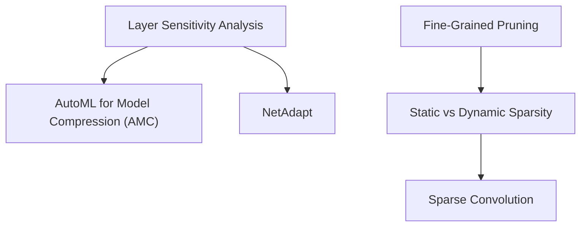

> [!abstract]
> Turning theoretical pruning into real-world speedup requires two breakthroughs: automating per-layer sparsity ratios using reinforcement learning or hardware-driven search, and bridging algorithmic zeros to silicon through specialized hardware like EIE, native 2:4 Tensor Cores, and sparse convolution.

Part of [[courses/mit-6-5940|MIT 6.5940 (Fall 2026)]], lecture 4.

## TL;DR
- **The Non-Uniform Reality:** Uniformly shrinking all layers leaves massive performance on the table; automating per-layer ratios via reinforcement learning (AMC) or hardware lookup tables (NetAdapt) cuts ResNet-50 search from an engineer's full workweek down to four hours.
- **Multiplicative Sparsity:** Static weight sparsity ($90\%$ zeros) and dynamic activation sparsity ($70\%$ zeros after ReLU) are orthogonal; combining both allows specialized hardware to skip up to $33\times$ of arithmetic multiplications.
- **The Silicon Co-Design Spectrum:** General-purpose GPUs appreciate like fine wine because neural network architectures constantly evolve; modern silicon strikes the balance through semi-structured 2:4 Tensor Cores (doubling math throughput) and adaptive grouping in sparse convolution.

## Concept map

The atomic concepts in dependency order:

1. [[concepts/layer-sensitivity-analysis|Layer Sensitivity Analysis]]: The empirical baseline that measures overall accuracy degradation when sweeping sparsity on one layer at a time.  
   *Needs:* [[concepts/magnitude-based-pruning|Magnitude-Based Pruning]], [[concepts/structured-pruning|Structured Pruning]]
2. [[concepts/automl-for-model-compression|AutoML for Model Compression]]: A reinforcement-learning framework (AMC) that formulates per-layer pruning as a continuous control problem to maximize accuracy under FLOP/latency budgets.  
   *Needs:* [[concepts/layer-sensitivity-analysis|Layer Sensitivity Analysis]]
3. [[concepts/netadapt|NetAdapt]]: A progressive, hardware-aware heuristic that iteratively removes channels layer-by-layer to meet an exact physical latency step ($\Delta R$) using on-device lookup tables and short-term fine-tuning.  
   *Needs:* [[concepts/layer-sensitivity-analysis|Layer Sensitivity Analysis]], [[concepts/structured-pruning|Structured Pruning]]
4. [[concepts/static-vs-dynamic-sparsity|Static vs Dynamic Sparsity]]: The critical distinction between compile-time zero weights (fixed for all queries) and runtime zero activations (sample-dependent), which compound multiplicatively in hardware.  
   *Needs:* [[concepts/fine-grained-pruning|Fine-Grained Pruning]]
5. [[concepts/sparse-convolution|Sparse Convolution]]: An algorithm and hardware dataflow for 3D point clouds and spatially sparse signals that confines convolutions strictly to occupied coordinates, preventing runaway densification.  
   *Needs:* [[concepts/static-vs-dynamic-sparsity|Static vs Dynamic Sparsity]]



## First-principles rebuild

### 0. The Reality Check & Motivation

In Lecture 3, we proved that deep networks can discard up to $90\%$ of their parameters through iterative magnitude pruning and fine-tuning. But that leaves two massive, practical roadblocks in real-world deployment [04:34]:

1. **The Human Tuning Bottleneck:** A modern convolutional or transformer model has dozens to hundreds of layers. If you naively prune every layer by the exact same percentage (uniform shrinking, e.g., cutting every layer by $50\%$), the model hits a miserable accuracy-latency trade-off [05:08]. Why? Because some layers are hyper-sensitive (losing $10\%$ of their weights breaks the whole network), while others are so redundant you could delete $80\%$ of their channels without consequence [05:42]. Manually sweeping thresholds layer by layer to balance this non-uniform budget takes an expert machine learning engineer over a week of trial-and-error per model [21:52].
2. **The Paper-to-Silicon Gap:** Zeroing out numbers in PyTorch doesn't automatically make your smartphone or GPU faster [40:36]. In fact, running an unstructured sparse matrix on a standard CUDA kernel often runs *slower* than the original dense network due to thread divergence and unaligned memory reads [42:32].

Closing these two gaps requires automating the search for per-layer sparsity and co-designing hardware architectures that can actually skip zeros at hardware speed.

### 1. Ground Zero (Layer Sensitivity & The Logarithmic Law)

The simplest way to discover which layers can afford heavy pruning is **Layer Sensitivity Analysis** [08:41]:
1. Take a fully trained, converged dense network.
2. Pick Layer $0$. Sweep its pruning ratio from $10\%$ up to $90\%$ while keeping every other layer at $100\%$ density.
3. Record the network's validation accuracy at each step [09:51].
4. Reset Layer $0$ and repeat the process independently for Layer $1$, Layer $2$, and so on [10:26].

When plotted, you discover stark differences:
- **Sensitive layers:** The accuracy curve drops sharply after only $30\%$ pruning [10:58].
- **Robust layers:** Accuracy stays flat even when pruned past $80\%$ [10:58].

By picking an acceptable error tolerance (say, no more than $0.5\%$ accuracy loss) and drawing a horizontal line across the graph, the intersections dictate each layer's pruning threshold [11:33].

**The Flaw in Manual Sensitivity Analysis:**  
This approach assumes layers act independently [12:40]. But neural networks are deeply coupled dynamical systems: pruning Layer 3 by $20\%$ and Layer 7 by $20\%$ simultaneously might compound errors in ways that individual single-layer sweeps never reveal [13:13].

Furthermore, accuracy does not scale linearly with computational effort. When researchers plot top-1 accuracy against compute operations, they discover an empirical **logarithmic relationship** [17:49]:

```
Accuracy
   ▲                     .---' (Diminishing returns: doubling compute barely lifts accuracy)
   │               .----'
   │           .--'
   │        .-'
   │      .'
   │    .'
   │   /
   │  / (Rapid early gains)
   └───────────────────────────────────► Compute (FLOPs)
```

At low accuracy, adding a few FLOPs gives massive performance gains. But once a model is well-trained, squeezing out an extra $1\%$ accuracy requires an exponential explosion in FLOPs [18:05]. Any automated search engine must account for this logarithmic reality.

### 2. The Idea Journey (The Breakthroughs)

#### Act 1: Automated Search — AMC and NetAdapt

Instead of paying an army of human engineers to hand-tune pruning thresholds, we can delegate the search to algorithms [14:54].

##### 1. AutoML for Model Compression (AMC)
Song Han's group formulated pruning ratio selection as a **Reinforcement Learning** continuous control problem [15:28]:
- **Agent:** Deep Deterministic Policy Gradient (DDPG), which operates over a continuous action space $a_t \in [0, 1]$ [18:56].
- **State Embedding:** Layer-specific characteristics, including layer index, channel count ($C_{\text{in}}, C_{\text{out}}$), kernel dimensions ($K \times K$), spatial feature map size, and layer FLOPs [18:22].
- **Action:** The exact continuous pruning ratio for that specific layer [18:56].
- **Reward Function:** Grounded in the logarithmic accuracy-compute law [17:14]:
  $$\text{Reward} = -\text{Error} \times \log(\text{FLOPs})$$
  or a hard penalty if a target latency lookup constraint is violated [19:31].

**What did the RL agent discover?**  
When unleashed on ResNet-50, AMC achieved in **4 hours** what took a human expert a full week of manual tuning [22:27]. It pruned ResNet-50 down to $20\%$ of its parameters without losing accuracy [22:45]. 

When analyzing the policy chosen by the agent, researchers discovered an architectural principle [25:16]:
- **$1 \times 1$ pointwise convolutions** were preserved with high density (pruned very gently) [26:27]. Because a $1 \times 1$ kernel has only a single parameter per channel, it contains very little redundancy; cutting it destroys channel mixing.
- **$3 \times 3$ spatial convolutions** were pruned aggressively (driven to low density) [27:01]. With 9 parameters per channel, $3 \times 3$ kernels contain massive spatial redundancy that the network easily sheds.

##### 2. NetAdapt: Hardware-Driven Progressive Pruning
Developed by Vivian Sze's group at MIT, **NetAdapt** takes a complementary, empirical approach to hitting exact on-device latency constraints [30:24]:
1. **Build a Device Lookup Table:** Profile the latency of individual convolution shapes directly on the target smartphone chip once [32:05].
2. **Iterative Step Budget ($\Delta R$):** Set an incremental target reduction, such as reducing total latency by $\Delta R = 1\text{ ms}$ per round [30:56].
3. **Layer-by-Layer Evaluation:** For every layer, look up how many channels must be pruned to shed that exact $1\text{ ms}$ [32:39].
4. **Short-Term Fine-Tuning Proxy:** Retrain each candidate for only $10\text{k}$ steps [33:16]. Running full retraining for every candidate would take months, but $10\text{k}$ steps reliably ranks which candidate layer recovers best [34:24].
5. **Commit & Repeat:** Prune the layer that yielded the highest post-tuning accuracy, commit the cut, and repeat until the global latency target (e.g., $3\text{ ms}$) is achieved [34:58].

#### Act 2: Fine-Tuning Secrets

Once layers are pruned, how do you restore peak accuracy during retraining [36:41]?

1. **Slash the Learning Rate ($1/100\text{th}$ to $1/10\text{th}$):**  
   Pruning begins with a fully trained model that has already converged into a deep local minimum [37:48]. Using the original training learning rate will violently knock the surviving weights out of the valley. Dropping the learning rate by $10\times$ to $100\times$ allows surviving parameters to gently adjust and heal [37:55].
2. **Apply Regularization ($L_1$ / $L_2$):**  
   Applying weight decay ($L_2$) to weights or $L_1$ penalty to learned channel scaling factors drives marginal parameters closer to zero, preparing them for the next pruning cycle [39:29].

#### Act 3: From Math to Silicon — Static vs. Dynamic Sparsity

To accelerate models on physical hardware, we must understand the fundamental difference between **weights** and **activations** [40:36]:

```
[Input X] ──► (Weights W) ──► [Pre-activation] ──► [ReLU] ──► [Output Activation]
                 ▲                                               ▲
          Static Sparsity                                 Dynamic Sparsity
     (Fixed at compile time)                            (Changes per input sample)
```

- **Static Weight Sparsity:** The zero locations in the weight matrix are decided during offline compression [45:07]. They never change whether processing a photo of a dog or a car. Compilers can pre-generate fixed indexing patterns at compile time [46:13].
- **Dynamic Activation Sparsity:** When activations pass through a ReLU, negative numbers become exact zeros [45:40]. Which neurons fire depends entirely on the specific input query. Because the pattern changes dynamically on every token or image, it cannot be hardcoded; hardware must detect and bypass zeros at runtime [46:13].

**The Multiplicative Superpower:**  
Static and dynamic sparsity are completely orthogonal [45:07]!
- Fully connected layers achieve up to **$90\%$ static weight sparsity** ($10\times$ less compute, $5\times$ less memory including indexing overhead) [43:23].
- ReLU produces up to **$70\%$ dynamic activation sparsity** ($3.3\times$ less compute) [44:00].

When an accelerator skips both zero weights and zero activations, the savings multiply [45:07]:
$$\text{Total Compute Reduction} = 10\times \times 3.3\times \approx 33\times$$
The processor performs $33\times$ fewer arithmetic operations on that layer!

#### Act 4: Hardware Realization

How do chips actually skip these zeros?

##### 1. The Efficient Inference Engine (EIE)
Published in ISCA 2016 by Han et al. (ranking among the top 5 most cited papers in 50 years of computer architecture) [53:41]:
- **SRAM-Only Architecture:** Eliminates DRAM entirely. All weights and codebooks fit inside on-chip SRAM, cutting off-chip memory energy to zero [56:32].
- **Leading-Zero Detection:** Dedicated hardware queues inspect incoming activation streams, instantly dropping zeros and broadcasting only non-zero activations to an array of Processing Elements (PEs) [49:07].
- **Relative Indexing:** Stores sparse weight coordinates as compact 4-bit relative offsets rather than 32-bit absolute addresses [46:46].

##### 2. NVIDIA Ampere 2:4 Tensor Cores
While EIE proved the power of fine-grained acceleration, building custom ASICs for every sparse pattern is economically risky. NVIDIA solved this for general-purpose GPUs with **2:4 Semi-Structured Sparsity** [59:22]:
- Every 4 contiguous numbers along a row must contain exactly **two zeros** [59:56].
- Memory stores only the 2 non-zero values and a compact **2-bit selector index** per element [1:00:30].
- Specialized hardware multiplexers in Ampere, Hopper, and Blackwell Tensor Cores read the 2-bit selectors, match the surviving weights against activation registers, and execute matrix multiplies at **$2\times$ peak math throughput** with $1.5\times$ measured end-to-end speedup in cuSPARSELt [1:03:22].

##### 3. Spatial Activation Sparsity: Sparse Convolution
In autonomous driving and robotics, 3D LiDAR point clouds are over $95\%$ empty space [1:12:33]. Standard 3D convolutions expand empty air into dense volumes.

**TorchSparse** and the **PointAcc** accelerator solve this via **Submanifold Sparse Convolution** [1:05:42]:
- Convolutions are strictly evaluated at coordinates where input points already exist, holding spatial density constant across deep layers [1:05:42].
- **Adaptive Grouping:** Standard GPU kernels suffer severe thread starvation when sparse point counts vary across voxels. Adaptive grouping dynamically bundles coordinates with similar arithmetic densities into uniform matrix tiles, minimizing wasted padding cycles while maximizing GPU warp occupancy [1:09:09].

#### Act 5: The Architectural Epiphany (Generalization vs. Specialization)

Why did EIE become an academic legend while NVIDIA GPUs captured the commercial market [51:24]?

Song Han shared a profound insight on the economics of hardware: **an NVIDIA A100 GPU produced five years ago still rents at peak prices today—appreciating like fine wine—because it generalizes** [51:58].

In computing, neural network architectures evolve every 18 months (from AlexNet $\to$ ResNet $\to$ Transformers $\to$ Diffusion $\to$ MoE). A hyper-specialized chip custom-built for one network's fine-grained sparsity becomes obsolete silicon the moment researchers invent a new layer type [51:58]. General-purpose GPUs provide fungibility: the exact same hardware runs LLMs, vision transformers, video generation, and scientific simulations [52:31]. 

The holy grail of modern efficiency is **co-design that adds specialization without sacrificing generalization**—exemplified by NVIDIA's 2:4 Tensor Cores, which accelerate sparsity without breaking standard dense GEMM compilation [53:04].

### Putting it together

The complete modern pruning workflow:
1. **Automate the Architecture:** Use reinforcement learning (AMC) or hardware-driven profiling (NetAdapt) to discover non-uniform per-layer sparsity budgets in hours instead of weeks.
2. **Train with Healing:** Interleave iterative pruning cycles with low-learning-rate fine-tuning ($1/100\text{th}$) and $L_1/L_2$ weight decay to let surviving weights absorb missing connections.
3. **Align with Silicon:** Target 2:4 semi-structured sparsity for immediate $2\times$ Tensor Core speedup on server GPUs, structured channel removal for legacy mobile CPUs, and sparse convolution for 3D point cloud streaming.

## Connections
- Expands [[concepts/fine-grained-pruning|Fine-Grained Pruning]] and [[concepts/structured-pruning|Structured Pruning]] from Lecture 3 by showing how automated search bridges the gap between both worlds.
- Implements [[concepts/algorithm-hardware-co-design|Algorithm-Hardware Co-Design]]: Explains how the Efficient Inference Engine (EIE) and NVIDIA 2:4 Tensor Cores were specifically designed around sparse tensor algebra.
- Connects to [[concepts/deep-compression-pipeline|Deep Compression Pipeline]]: Highlights how static weight pruning compounds multiplicatively with dynamic activation sparsity before feeding into quantization.
- Next steps: Lecture 5 & 6 explore **Quantization** (K-Means, linear INT8, post-training quantization, and quantization-aware training).

## Review questions

> [!question]- Q1 (recall): What is the fundamental difference between static weight sparsity and dynamic activation sparsity, and why are their arithmetic savings multiplicative?
> Static weight sparsity is fixed at compile time because the zeroed weights remain constant across all user queries, allowing compilers to pre-plan storage layouts and memory access schedules. Dynamic activation sparsity (such as zeros produced by ReLU) varies on the fly for every single input query, requiring hardware to detect and skip zeros at runtime. Because a multiplication is bypassed if *either* the weight is zero or the activation is zero, a network with $90\%$ zero weights ($10\times$ reduction) and $70\%$ zero activations ($3.3\times$ reduction) achieves $10 \times 3.3 \approx 33\times$ total arithmetic reduction. See [[concepts/static-vs-dynamic-sparsity|Static vs Dynamic Sparsity]].

> [!question]- Q2 (explain-why): Why did Song Han's AMC reinforcement learning agent automatically choose to prune 1x1 convolutions gently while pruning 3x3 convolutions aggressively?
> A $1 \times 1$ pointwise convolution contains only a single parameter per channel and serves the critical function of cross-channel information mixing; it contains virtually zero spatial redundancy, making it hyper-sensitive to parameter removal. In contrast, a $3 \times 3$ convolution has 9 parameters per channel spanning a spatial neighborhood, containing high spatial redundancy that surviving weights can easily compensate for during retraining. The RL agent discovered this structural principle automatically by observing validation rewards. See [[concepts/automl-for-model-compression|AutoML for Model Compression]].

> [!question]- Q3 (apply): An engineer wants to use NetAdapt to reduce a vision model's latency on an edge NPU. Why should they construct an on-device latency lookup table rather than using FLOPs as the optimization objective?
> Theoretical FLOP counts correlate poorly with true execution latency on modern edge silicon. Hardware speed is governed by memory access bandwidth, cache hit rates, kernel launch overheads, and vector register alignment. A layer modification that cuts FLOPs by $30\%$ might yield $0\%$ speedup if memory bandwidth remains saturated. An on-device lookup table captures real physical execution times across tensor shapes directly on the target processor, ensuring optimization steps deliver guaranteed wall-clock latency drops. See [[concepts/netadapt|NetAdapt]].

> [!question]- Q4 (transfer): Why does standard 3D convolution cause runaway computational explosion when applied to sparse LiDAR point clouds in autonomous vehicles, and how does submanifold sparse convolution prevent it?
> Standard 3D convolutions slide dense kernels across 3D voxels. Even if $99\%$ of the input space is empty air, every $3 \times 3 \times 3$ kernel dilates non-zero activations to neighboring empty voxels, rapidly turning a sparse point cloud into a dense 3D tensor within a few layers. Submanifold sparse convolution solves this by enforcing that an output feature is computed *if and only if* the center coordinate was already occupied in the input, keeping the spatial sparsity pattern constant across all network depths. See [[concepts/sparse-convolution|Sparse Convolution]].

## Source notes
- [05:08](https://www.youtube.com/watch?v=y-WU7PVj0cg&t=308s): Comparison showing uniform layer shrinking yields inferior accuracy-latency trade-offs compared to non-uniform per-layer pruning.
- [11:33](https://www.youtube.com/watch?v=y-WU7PVj0cg&t=693s): Determining layer pruning ratios by intersecting layer sensitivity curves with a horizontal error threshold.
- [17:49](https://www.youtube.com/watch?v=y-WU7PVj0cg&t=1069s): The empirical logarithmic relationship between compute operations (FLOPs) and top-1 accuracy.
- [18:56](https://www.youtube.com/watch?v=y-WU7PVj0cg&t=1136s): Formulating AutoML for Model Compression (AMC) using a continuous DDPG reinforcement learning agent.
- [22:27](https://www.youtube.com/watch?v=y-WU7PVj0cg&t=1347s): AMC compressing ResNet-50 in 4 hours, outperforming a human expert's week of manual sensitivity sweeps.
- [26:27](https://www.youtube.com/watch?v=y-WU7PVj0cg&t=1587s): AMC policy interpretation: $1 \times 1$ convolutions have low redundancy (pruned gently), whereas $3 \times 3$ convolutions have high redundancy (pruned heavily).
- [30:56](https://www.youtube.com/watch?v=y-WU7PVj0cg&t=1856s): NetAdapt progressive hardware-constrained channel pruning using on-device lookup tables and incremental latency steps ($\Delta R$).
- [37:48](https://www.youtube.com/watch?v=y-WU7PVj0cg&t=2268s): Dropping the fine-tuning learning rate by $10\times$ to $100\times$ because the pruned model starts from an already-converged local minimum.
- [45:07](https://www.youtube.com/watch?v=y-WU7PVj0cg&t=2707s): Multiplicative compute savings ($33\times$) combining $90\%$ static weight sparsity with $70\%$ dynamic activation sparsity.
- [51:58](https://www.youtube.com/watch?v=y-WU7PVj0cg&t=3118s): The economic value of hardware generalization: why NVIDIA GPUs appreciate over time while hyper-specialized ASICs risk obsolescence.
- [59:56](https://www.youtube.com/watch?v=y-WU7PVj0cg&t=3596s): NVIDIA Ampere 2:4 semi-structured sparsity: storing 2 non-zero values with 2-bit position indices for $2\times$ Tensor Core speedup.
- [1:05:42](https://www.youtube.com/watch?v=y-WU7PVj0cg&t=3942s): Submanifold sparse convolution maintaining constant spatial sparsity across layers in LiDAR point clouds.
- [1:09:09](https://www.youtube.com/watch?v=y-WU7PVj0cg&t=4149s): Adaptive grouping in TorchSparse to balance irregular point cloud workloads and maximize GPU warp occupancy.
