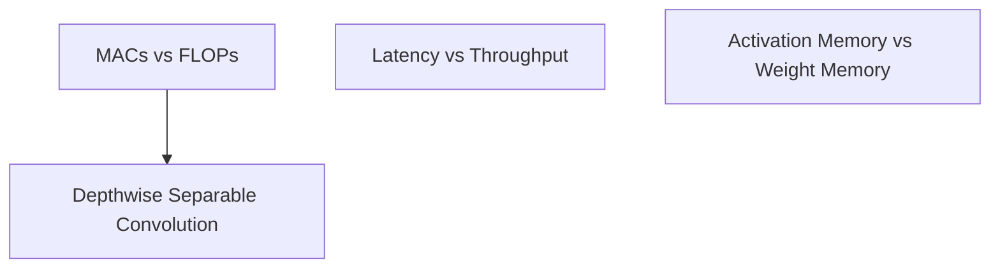

> [!abstract] Measuring how efficiently a neural network runs requires looking past simple parameter counts—evaluating real-world arithmetic (MACs vs. FLOPs), speed (latency vs. throughput), and the hidden memory trap of peak activation tensors.

Part of [[courses/mit-6-5940|MIT 6.5940 (Fall 2026)]], lecture 2.

## TL;DR
- **1 MAC = 2 FLOPs:** In neural networks, nearly every operation is a Multiply-Accumulate ($a \leftarrow a + b \times c$), which equals one multiply plus one add; an algorithm with 700 million MACs performs 1.4 billion floating-point operations.
- **Latency $\neq$ Throughput:** Latency is how long a single user waits for a result; throughput is how many items a factory finishes per second. Parallel hardware often doubles throughput while making individual latency worse.
- **The Activation Memory Trap:** Squeezing model weight size does not guarantee it will run on small chips; intermediate activation tensors (feature maps) often spike far larger than the weights themselves, creating the real memory bottleneck on edge devices.

## Concept map
The atomic concepts in **dependency order**: each one builds directly on the ideas before it.
1. [[concepts/macs-vs-flops|MACs vs FLOPs]]: Counting raw arithmetic work by recognizing that one multiply-accumulate step equals two floating-point operations.
   *Needs:* nothing
2. [[concepts/latency-vs-throughput|Latency vs Throughput]]: The fundamental trade-off between how fast a single request finishes versus how many requests batch through per second.
   *Needs:* nothing
3. [[concepts/activation-memory-vs-weight-memory|Activation Memory vs Weight Memory]]: The contrast between static parameter storage on disk and dynamic intermediate feature maps that spike during execution.
   *Needs:* nothing
4. [[concepts/depthwise-separable-convolution|Depthwise Separable Convolution]]: Slashing 3D convolution computation by separating spatial image filtering from cross-channel mixing.
   *Needs:* [[concepts/macs-vs-flops|MACs vs FLOPs]]



## First-principles rebuild

### 0. The Scorecard Problem: What Makes a Model "Good"?
Suppose an engineer shows you two neural networks:
- Model A has **10 million parameters**.
- Model B has **5 million parameters**.

Is Model B automatically faster, greener, and better suited for a smartphone?
The intuitive answer is "yes." But in real-world deployment, Model B might drain a phone's battery faster, take longer to process a frame, and run completely out of memory [33:14]!

To design and deploy efficient AI, we must move past naive parameter counting. We need to measure efficiency across three practical dimensions [34:21]:
1. **Smaller:** Does it fit on the flash drive or download quickly over an over-the-air update without hogging cell bandwidth?
2. **Faster:** Does it respond in milliseconds so users don't feel stutter or lag?
3. **Greener:** Does it minimize battery drain and fit inside a device's fixed power budget?

Every one of these goals boils down to two underlying physical constraints: **computation** (how many math operations are executed) and **memory** (how much data is stored and shuffled across the bus) [34:56].

---

### 1. Counting Arithmetic: The Difference Between a MAC and a FLOP
Let's start with a concrete example.
Consider the simplest core calculation in all of deep learning: a dot product [53:10]:
$$a = a + (w \times x)$$
Take an input $x$, multiply it by a weight $w$, and add it to an accumulator $a$.

Notice what happened?
- There is **one multiplication** ($w \times x$).
- There is **one addition** ($+ a$).

In silicon hardware, chip designers build specialized arithmetic units that execute this combined step in a single clock cycle. This single unit of work is called a **Multiply-Accumulate (MAC)** [53:10].
In theoretical mathematics and computer science benchmarks, each separate arithmetic operation counts as a **Floating-Point Operation (FLOP)** [55:28].
Therefore:
$$\mathbf{1 \text{ MAC} = 2 \text{ FLOPs}}$$

#### Example: AlexNet's Math Budget
AlexNet takes 724 million MACs to classify a single image [54:54].
If a benchmark reports its computational workload in FLOPs:
$$\text{Workload} = 724 \times 10^6 \times 2 = \mathbf{1.45 \text{ GigaFLOPs (GFLOPs)}}$$
When comparing models in research papers, watch the terminology: some papers report MACs, while others report FLOPs. A model reported as "1 GFLOP" is doing the same amount of math as a model reported as "500 MMACs."

---

### 2. Measuring Speed: The Latency vs. Throughput Trap
Suppose two systems process images [38:45]:

- **System 1 (Sequential, 1 Core):** Processes images one after another. Each image finishes in **50 milliseconds**.
  - **Latency:** How long you wait for one image $\rightarrow$ **50 ms**.
  - **Throughput:** How many images it finishes in one second $\rightarrow$ $1,000 / 50 = \mathbf{20 \text{ images/second}}$.
- **System 2 (Parallel, 4 Cores):** Runs 4 slower cores in parallel. Each image takes **100 milliseconds** to finish.
  - **Latency:** How long you wait for one image $\rightarrow$ **100 ms (2× slower!)**.
  - **Throughput:** In one second, each core finishes 10 images; across all 4 cores, it finishes $\mathbf{40 \text{ images/second}}$ (**2× higher throughput!**).

Notice the critical insight: **higher throughput does not mean lower latency** [39:29]!
- If you are building a self-driving car or robot, you care about **latency**: the braking system cannot wait for a batch of 32 images to fill up before reacting to a pedestrian.
- If you are building a photo backup service that processes billions of photos overnight, you care about **throughput**: maximizing how many total photos finish per hour per dollar of electricity.

---

### 3. The Architecture Journey: Solving Computational Waste
Over the past decade, convolutional network designs evolved to eliminate mathematical waste:

#### AlexNet (2012): The Memory-Constrained Pioneer
In 2012, GPUs had only **4 GB of memory** [26:25].
A full-resolution $224 \times 224$ image creates massive intermediate feature maps if filtered slowly. To prevent the GPU from running out of memory on the very first layer, AlexNet used an aggressive **stride of 4** with an $11 \times 11$ kernel [25:15]. This immediately slashed the spatial resolution from $224 \times 224$ down to $55 \times 55$ in a single jump, keeping activation tensors small enough to fit inside the 4 GB limit.

#### VGG16 (2014): The Regularity Trade-Off
VGG replaced large kernels with stacks of tiny **$3 \times 3$ convolutions** [27:33].
Hardware designers loved VGG because it was wonderfully regular: every layer used $3 \times 3$ kernels, and channel counts cleanly doubled ($64 \rightarrow 128 \rightarrow 256 \rightarrow 512$). But VGG was mathematically bulky: stacking uncompressed 3D convolutions resulted in over 138 million parameters, mostly locked inside heavy fully connected layers at the end [28:08].

#### ResNet (2015): The Residual Bypass
As networks grew deeper, training stalled because gradients vanished when multiplied through dozens of layers. ResNet introduced the **residual bypass connection** [29:51]:
$$y = x + F(x)$$
Instead of forcing the layer to learn the entire output from scratch, the layer only has to learn the *difference* (residual $\Delta$). Learning a small correction is mathematically much easier than learning the whole signal.

To make the block efficient, ResNet used a **bottleneck design** [30:24]:
1. A $1 \times 1$ convolution shrinks the number of channels by $4\times$.
2. The heavy $3 \times 3$ convolution does its spatial math on this compact, lightweight channel representation.
3. Another $1 \times 1$ convolution expands channels back up to match the bypass.

#### MobileNet (2017): Decoupling Space and Channels
A standard $3 \times 3$ convolution mixes both **spatial features** (pixels next to each other) and **channel features** (colors and textures) in one giant 3D operation ($K_h \times K_w \times C_{\text{in}} \times C_{\text{out}}$).

MobileNet asked: *Do we need to do both at the same time?*
This led to **Depthwise Separable Convolution** [31:29]:
1. **Depthwise step:** Filter each channel spatially on its own with a $3 \times 3$ kernel, with zero cross-channel mixing.
2. **Pointwise step:** Mix channels together using a $1 \times 1$ convolution across the depth.

*Concrete Example:*
Filtering 64 input channels to 64 output channels with $3 \times 3$ filters:
- Standard Conv: $3 \times 3 \times 64 \times 64 = \mathbf{36,864 \text{ ops}}$ per pixel.
- Depthwise Separable: $(3 \times 3 \times 64) + (1 \times 1 \times 64 \times 64) = 576 + 4,096 = \mathbf{4,672 \text{ ops}}$.
That is an **$8\times$ reduction in arithmetic** with nearly identical accuracy!

#### The Hardware Reality of Activation Functions
Even activation functions carry hidden hardware costs [21:10]:
- **Standard ReLU:** Fast to compute, but its outputs can grow infinitely large ($[0, \infty)$), making it difficult to quantize to integers without clipping.
- **ReLU6:** Clamps outputs at $6.0$ [21:46], making it easy to map into a clean integer range.
- **Swish ($x \cdot \sigma(x)$):** Smooth and improves accuracy, but computing $e^{-x}$ and division requires expensive transcendental hardware units [22:52].
- **HardSwish:** Replaces the exponential with a simple piecewise linear function ($\frac{x \cdot \text{clamp}(x+3, 0, 6)}{6}$) [23:30]. It preserves the smooth curve of Swish while running on cheap, standard integer ALU instructions!

---

### 4. The Hidden Trap: Activation Memory vs. Weight Memory
This brings us to one of the most critical lessons in edge AI deployment.

When developers inspect a model, they look at the `.pt` or `.onnx` file on disk:
$$\text{Weight Memory} = \text{Parameters} \times \text{Bytes per parameter}$$
If a model is 25 MB on disk, they assume it will fit easily on a device with 30 MB of RAM.

Then they run it, and the device crashes with an `Out Of Memory` error. Why?
Because running a model requires **Activation Memory** [49:46]: the temporary feature maps created after every layer.

#### The MobileNet Surprise
Look at the real data comparing **ResNet-50** to **MobileNetV2** [50:18]:
- **Parameters:** MobileNet dropped parameter storage by **$4.3\times$** (from 102 MB down to 25 MB).
- **Peak Activation Memory:** MobileNet's peak activation memory actually **increased by $1.8\times$**!

Why did this happen?
To make depthwise convolutions expressive, MobileNet expands channels by **$6\times$** internally before filtering them. Even though the weights are tiny, the intermediate activation tensors ballooned!

```
Where Memory Lives in a CNN:
[ Early Layers ]  High image resolution (H x W)  --> ACTIVATION MEMORY DOMINATES!
[ Late Layers  ]  Many channels (C_in x C_out)    --> WEIGHT MEMORY DOMINATES!
```

On a low-power microcontroller with only 256 KB of memory, the model's weights might fit, but the input activation tensor of the very first layer will instantly overflow the SRAM cache [50:51]. True edge optimization requires pruning and scheduling activation tensors, not just shrinking weights.

---

## Connections
- **The Energy Wall:** Ties directly back to [[lessons/2026-11-01-intro-to-tinyml-and-efficient-ai|Lecture 1]], explaining why data movement across wires dominates the power budget.
- **Quantization:** Explains why functions like ReLU6 and HardSwish were designed to make the linear integer mapping in [[lessons/2026-11-01-quantization-k-means-and-linear|Lecture 5]] computationally practical.
- **Transformers:** Sets up the upcoming lectures on attention mechanisms, where activation memory grows quadratically ($O(N^2)$) with sequence length.

## Review questions
> [!question]- Q1 (recall): If a convolutional neural network requires 500 million Multiply-Accumulate operations (500 MMACs) to process one frame, how many FLOPs does it perform?
> Exactly 1 Billion FLOPs (1 GFLOP). Every MAC operation combines one multiplication and one addition ($a \leftarrow a + b \times c$), which equals 2 floating-point operations ($500 \times 10^6 \times 2 = 1.0 \times 10^9$). Linked note: [[concepts/macs-vs-flops|MACs vs FLOPs]].

> [!question]- Q2 (explain-why): Why does batching multiple inputs together improve throughput on a server GPU, but worsen individual latency for an interactive user?
> Batching groups multiple inputs into larger matrix multiplications, which keeps parallel GPU tensor cores saturated and amortizes memory loading overhead across multiple samples (producing more total outputs per second). However, individual requests must wait in a queue for the batch to assemble and take longer to compute together, increasing the elapsed time from request arrival to response. Linked note: [[concepts/latency-vs-throughput|Latency vs Throughput]].

> [!question]- Q3 (apply): A standard $3 \times 3$ convolution takes an input with 128 channels and produces 128 output channels. Calculate how many arithmetic operations are saved per pixel if this layer is replaced with a depthwise separable convolution.
> Standard convolution requires $3 \times 3 \times 128 \times 128 = 147,456$ operations per pixel. Depthwise separable convolution requires a depthwise step ($3 \times 3 \times 128 = 1,152$) plus a pointwise $1 \times 1$ step ($1 \times 1 \times 128 \times 128 = 16,384$), totaling $17,536$ operations. This saves $147,456 - 17,536 = 129,920$ operations per pixel—an $8.4\times$ reduction in compute. Linked note: [[concepts/depthwise-separable-convolution|Depthwise Separable Convolution]].

> [!question]- Q4 (transfer): An embedded engineer compresses a vision model from 80 MB down to 15 MB to fit inside a drone's onboard RAM. When deployed, the drone's processor immediately triggers an out-of-memory crash during the first layer. Why did this occur, and where in the network does memory pressure peak?
> Model size only measures static weight memory on disk. During inference, the processor must also allocate dynamic activation memory for intermediate feature maps. In the earliest layers, image resolution ($H \times W$) is at its highest, meaning activation tensors consume far more memory than the small convolutional kernels. The model crashed because peak activation memory exceeded available RAM. Linked note: [[concepts/activation-memory-vs-weight-memory|Activation Memory vs Weight Memory]].

## Source notes
- [21:46](https://www.youtube.com/watch?v=CzGTQseaM38&t=1306s): Capping activations at 6.0 with ReLU6 to simplify quantization.
- [22:52](https://www.youtube.com/watch?v=CzGTQseaM38&t=1372s): Computational cost of Swish (exponential and division) vs. piecewise linear HardSwish.
- [25:15](https://www.youtube.com/watch?v=CzGTQseaM38&t=1515s): AlexNet's 11x11 kernel and stride of 4 to rapidly shrink activation sizes for 4 GB GPUs.
- [27:33](https://www.youtube.com/watch?v=CzGTQseaM38&t=1653s): VGG16's uniform 3x3 convolution regularity and why hardware designers loved it.
- [29:51](https://www.youtube.com/watch?v=CzGTQseaM38&t=1791s): ResNet's residual bypass connection ($y = x + F(x)$) and channel-reduction bottleneck blocks.
- [31:29](https://www.youtube.com/watch?v=CzGTQseaM38&t=1889s): MobileNet's depthwise separable convolution separating spatial filtering from cross-channel mixing.
- [34:21](https://www.youtube.com/watch?v=CzGTQseaM38&t=2061s): The three practical goals of efficiency: smaller, faster, and greener.
- [34:56](https://www.youtube.com/watch?v=CzGTQseaM38&t=2096s): Categorizing efficiency metrics into computation-related and memory-related constraints.
- [38:45](https://www.youtube.com/watch?v=CzGTQseaM38&t=2325s): Concrete walkthrough of latency vs. throughput with 1 core vs. 4 parallel cores.
- [39:29](https://www.youtube.com/watch?v=CzGTQseaM38&t=2369s): Why higher throughput does not automatically translate to lower latency.
- [42:58](https://www.youtube.com/watch?v=CzGTQseaM38&t=2578s): Memory access energy comparison: 32-bit math (0.1 to 3 pJ) vs DRAM access (640 pJ).
- [49:46](https://www.youtube.com/watch?v=CzGTQseaM38&t=2986s): The activation memory bottleneck during inference.
- [50:18](https://www.youtube.com/watch?v=CzGTQseaM38&t=3018s): MobileNetV2 vs ResNet-50: 4.3× weight reduction resulted in a 1.8× increase in peak activation memory.
- [50:51](https://www.youtube.com/watch?v=CzGTQseaM38&t=3051s): Why early layers bottleneck activation memory on 256 KB microcontrollers.
- [53:10](https://www.youtube.com/watch?v=CzGTQseaM38&t=3190s): Definition of Multiply-Accumulate (MAC): one multiply and one add.
- [55:28](https://www.youtube.com/watch?v=CzGTQseaM38&t=3328s): Why 1 MAC = 2 FLOPs, and calculating AlexNet's 1.45 GFLOP workload.
