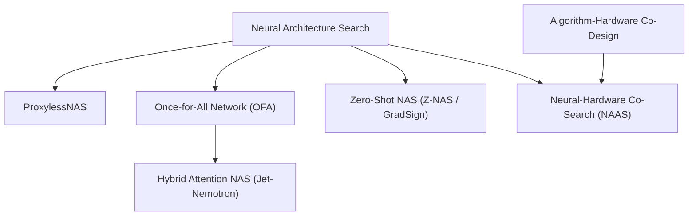

> [!abstract]
> Overcoming the massive training costs of Neural Architecture Search requires training a single Once-for-All (OFA) supernet that yields $10^{19}$ sub-networks with zero retraining, eliminating proxy tasks through direct on-device search (ProxylessNAS), co-designing silicon with neural topologies, and applying hybrid attention search to accelerate large language models by $47\times$.

Part of [[courses/mit-6-5940|MIT 6.5940 (Fall 2026)]], lecture 8.

## TL;DR
- **The Decoupled Supernet:** Re-training neural networks for every new phone, GPU, and microcontroller is economically impossible; the Once-for-All (OFA) framework trains a single supernet once using progressive shrinking, allowing $10^{19}$ sub-networks to be extracted instantaneously for any hardware profile with zero retraining.
- **Why Proxy Tasks Lie:** Optimizing models on proxy datasets (CIFAR-10) or proxy metrics (FLOPs) produces deceptive models that run slower on real hardware; ProxylessNAS binarizes architecture paths to search directly on ImageNet and physical hardware with $O(1)$ memory.
- **The LLM Hybrid Frontier:** In large language models, full self-attention causes KV-cache memory to explode, while pure linear attention sacrifices reasoning; Hybrid Attention NAS (Jet-Nemotron) automatically places full attention in just 2 or 3 critical layers while converting the rest to linear attention, delivering $47\times$ higher generation throughput.

## Concept map

The atomic concepts in dependency order:

1. [[concepts/proxylessnas|ProxylessNAS]]: Binarized direct architecture search on the target dataset and physical device, eliminating the memory and generalization failures of proxy tasks.  
   *Needs:* [[concepts/differentiable-nas|Differentiable NAS]]
2. [[concepts/once-for-all-network|Once-for-All Network]]: A super-network trained once via progressive shrinking that supports $10^{19}$ elastic sub-networks across diverse hardware targets without fine-tuning.  
   *Needs:* [[concepts/neural-architecture-search|Neural Architecture Search]]
3. [[concepts/zero-shot-nas|Zero-Shot NAS]]: Mathematical proxies that rank candidate architectures at initialization without training a single epoch (via perturbation sensitivity and gradient sign concordance).  
   *Needs:* [[concepts/neural-architecture-search|Neural Architecture Search]]
4. [[concepts/neural-hardware-co-search|Neural-Hardware Co-Search]]: Simultaneous optimization of the neural network, compiler loop schedules, and silicon accelerator parameters to maximize energy-delay efficiency.  
   *Needs:* [[concepts/neural-architecture-search|Neural Architecture Search]], [[concepts/algorithm-hardware-co-design|Algorithm-Hardware Co-Design]]
5. [[concepts/hybrid-attention-nas|Hybrid Attention NAS]]: Applying architecture search to LLMs to optimize the hybrid placement of full attention and linear state-space layers (as in Jet-Nemotron).  
   *Needs:* [[concepts/once-for-all-network|Once-for-All Network]]



## First-principles rebuild

### 0. The Reality Check & Motivation

First-generation Neural Architecture Search (NASNet) revealed a brutal economic truth: **searching for a neural network was vastly more expensive than training one** [03:26]. 

Zoph and Le's landmark 2017 paper required training over $12,000$ candidate networks from scratch, consuming **$40,000$ GPU hours**—more than $100,000$ dollars of compute and massive carbon emissions just to design an image classifier on a tiny dataset [09:06].

To bypass this cost, researchers turned to **proxy tasks** [09:42]:
1. **Proxy Datasets:** Search on CIFAR-10 ($32 \times 32$ pixels), then hope the winning cell transfers to ImageNet ($224 \times 224$).
2. **Proxy Depths:** Search on a shallow 4-layer network, then stack the discovered cell 20 times.
3. **Proxy Metrics:** Minimize theoretical FLOPs or parameter counts instead of measuring true hardware latency.

**The Proxy Trap: Why Proxy Tasks Fail on Hardware**  
When researchers actually deployed proxy-designed models to physical devices, they uncovered a startling reality [13:06]: **models with significantly lower FLOPs frequently ran *slower* than their high-FLOP baselines.**

Why? Look at how hardware executes different tensor dimensions [14:19]:
- **On a Server GPU (NVIDIA A100/H100):** Scaling channel width from 160 to 300 adds millions of FLOPs, but the measured latency curve remains completely flat [14:56]! The GPU possesses thousands of parallel SIMD/Tensor cores; widening a layer simply fills idle execution lanes without costing extra clock cycles [15:30].
- **On a Mobile CPU (Raspberry Pi):** The CPU has only 4 scalar cores. Every single channel expansion is compute-bound, causing latency to increase linearly with FLOPs [16:04].
- **Scaling Depth:** Adding extra layers triggers sequential CUDA kernel launches, driver overhead, and off-chip memory barriers, increasing GPU latency dramatically even if the added layers are narrow [14:56].

A model designed using FLOPs as a proxy cannot know whether it will execute on a wide GPU or a serial microcontroller. Hardware-aware NAS must throw out proxies and measure physical silicon directly [16:38].

### 1. Ground Zero (ProxylessNAS & The Latency Predictor)

How do you search directly on the target dataset (ImageNet) and target hardware without exploding GPU memory [10:18]?

Standard differentiable NAS (DARTS) keeps all candidate operations in memory simultaneously, requiring $>100\text{ GB}$ of GPU RAM [09:06]. 

**The ProxylessNAS Breakthrough:**  
Han et al. proposed **binarized path sampling** [10:52]:
1. **$O(1)$ GPU Memory:** In any training step, only a single candidate path (or two, for gradient estimation) is active in memory [11:26]. The memory footprint during search is identical to training a single compact network.
2. **Joint Weight & Architecture Updates:** Two sets of parameters are updated iteratively:
   - **Weight Parameters ($w$):** Trained on the training set using standard backprop [11:26].
   - **Architecture Parameters ($\alpha$):** Trained on the validation set, scaling the selection probability of winning operators [11:26].
3. **Direct Hardware Feedback:** Instead of guessing latency from FLOPs, ProxylessNAS incorporates measured device latency directly into the loss function [12:31]:
   $$\mathcal{L} = \mathcal{L}_{\text{task}} + \lambda \cdot \mathbb{E}[\text{Latency}]$$

#### Solving the Hardware Measurement Bottleneck
Connecting a physical smartphone to a search cluster and querying it thousands of times creates a mechanical bottleneck [16:38].

ProxylessNAS solves this by constructing a **Latency Lookup Table** and training a **Latency Prediction Model** [17:44]:
- Measure execution times for individual primitive blocks across various channel widths, kernel sizes, and input resolutions on the target chip once [18:19].
- For any candidate architecture, sum its pre-measured layer latencies:
  $$\text{Total Latency} \approx \sum_{l=1}^{L} \text{Latency}(op_l)$$
  The predicted latency correlates almost perfectly with real measured latency ($y = x$, $R^2 > 0.99$) [18:54].

**The Discovered Specializations [20:36]:**  
When ProxylessNAS searched for specialized models across hardware platforms:
- **GPU Model:** Selected a shallower, wider network dominated by large $7 \times 7$ kernels to maximize parallel SIMD saturation [21:42].
- **CPU Model:** Selected a deeper, narrower network dominated by $3 \times 3$ kernels to fit inside L1/L2 cache and reduce per-layer arithmetic pressure [21:42].

Each hardware target naturally demands a distinct architectural dialect.

### 2. The Idea Journey (The Breakthroughs)

#### Act 1: The Once-for-All (OFA) Revolution

While ProxylessNAS solved single-device search, enterprise AI deployment faces a massive **diversity challenge** [22:49]:
An application must deploy across 50 mobile phone models, 10 IoT microcontrollers, 5 cloud GPUs, and edge accelerators. Running NAS 60 times still requires tens of thousands of GPU hours [23:23]!

**The Conceptual Leap: Decouple Training from Search**  
Song Han's **Once-for-All (OFA)** network introduced a revolutionary principle: **Train ONE super-network once, and specialize it for ALL hardware targets with zero retraining** [23:58].

```
Traditional NAS:   Search Device 1 ──► Train Model 1 (1,200 hrs)
                   Search Device 2 ──► Train Model 2 (1,200 hrs)  ==> Total: N x 1,200 hrs
                   Search Device 3 ──► Train Model 3 (1,200 hrs)

Once-for-All:      Train Supernet ONCE (1,200 hrs) ──► Supports 10^19 sub-networks
                                                              │
                   ├──► Sample Subnet for H100 GPU (Instant, 0 training)
                   ├──► Sample Subnet for iPhone   (Instant, 0 training)
                   └──► Sample Subnet for MCU      (Instant, 0 training)
```

The OFA supernet contains over **$10^{19}$ sub-networks** embedded within its shared weight tensors [27:25]. Any sub-network can be carved out, evaluated, and deployed immediately without fine-tuning!

##### Progressive Shrinking (PS)
If you train random sub-networks simultaneously from day one, small networks interfere with the gradient updates of large networks, causing optimization collapse [27:59].

OFA solves this via **Progressive Shrinking (PS)**—training largest-to-smallest across four elastic dimensions [27:59]:
1. **Elastic Kernel Size ($7 \times 7 \to 5 \times 5 \to 3 \times 3$):**  
   The $5 \times 5$ kernel uses the center $5 \times 5$ weights of the $7 \times 7$ filter multiplied by a learnable transformation matrix, ensuring smaller kernels inherit trained weights from larger ones [28:34].
2. **Elastic Depth (4 layers $\to$ 3 $\to$ 2):**  
   Smaller sub-networks simply bypass later layers via identity skip connections [29:08].
3. **Elastic Width (Channel Pruning via Importance):**  
   Channels are sorted by their $L_2$ norm. A sub-network needing only 3 channels extracts the top 3 most important channels automatically [30:18].
4. **Elastic Resolution:** Varying input image sizes ($128\text{–}224$) during training [31:26].

**The Deployment Phase:**  
Once the OFA supernet is trained, deploying to a new edge device takes **minutes** [34:55]: run a lightweight genetic search against the device's latency table, extract the Pareto-optimal sub-network, and deploy. The extracted sub-networks consistently outperform MobileNetV3 and EfficientNet across iPhones, Samsung devices, Intel CPUs, and FPGAs [34:16].

#### Act 2: Zero-Shot NAS (Training-Free Architecture Ranking)

Can we evaluate candidate networks **without training them for even a single step** [41:43]?

Zero-Shot NAS evaluates the mathematical properties of the architecture at random initialization [42:17]:
1. **Z-NAS (Perturbation Sensitivity):**  
   Feed two slightly perturbed inputs $x$ and $x + \Delta x$ into the un-trained network [42:51]. A high-capacity network produces a distinct, sensitive output difference $\log \|\Delta y\| / \|\Delta x\|$ and exhibits large variance across batch normalization layers [43:26]. The sum of these metrics forms the **Z-score**.
2. **GradSign (Local Minima Concordance):**  
   Compute sample-wise loss gradients across random batches [43:26]. If gradients across different data samples share identical mathematical signs, the architecture has dense, coherent local minima that converge rapidly during optimization [44:00].

Evaluating these zero-cost proxies takes less than $50\text{ ms}$ on a GPU, allowing search algorithms to screen millions of architectures instantaneously [45:11].

#### Act 3: Neural-Hardware Co-Search (NAAS)

Why stop at optimizing software? The ultimate efficiency frontier is **co-searching the neural network, the compiler mapping, and the silicon accelerator simultaneously** [45:48].

In **NAAS (Neural-Accelerator Architecture Co-Search)**, an evolutionary algorithm navigates three coupled spaces [46:23]:
1. **Neural Network Space:** Layer depths, widths, kernel dimensions, and attention topologies [46:56].
2. **Compiler Mapping Space:** Loop order (which loop runs outermost), loop tiling sizes, and spatial vs. temporal parallelization [49:14].
3. **Accelerator Silicon Space:** Processing Element (PE) array dimensions (e.g. $18 \times 10$) and on-chip SRAM buffer sizes [47:30].

**The Non-Numerical Challenge:**  
Compiler loop orders (e.g. `[C, R, X, K, Y, S]`) are discrete permutations with no natural numerical distance [49:48]. NAAS solves this via **importance-based encoding**: the optimizer assigns continuous importance scores to each loop dimension, and sorting the scores establishes the physical execution schedule [50:58].

**The Result:** NAAS discovered an asymmetric dataflow parallelizing output height and channels together on an $18 \times 10$ array, reducing the **Energy-Delay Product (EDP) by $4.2\times$** while boosting ImageNet accuracy by $2.7\%$ [56:07].

#### Act 4: The Modern LLM Frontier — Hybrid Attention NAS

In large language models, standard transformer self-attention requires storing Key and Value activations for every past token in a **KV-cache** [37:06]:
- In long-context tasks ($64\text{k}$ tokens), full attention KV-caches explode to over **$1,800\text{ MB}$ per sequence**, and inference slows to a crawl ($O(N^2)$ complexity) [40:34].
- Pure linear attention models (Mamba, RWKV) keep KV-cache constant ($O(1)$) and run at blazing speeds (2,800 tokens/sec), but their MMLU reasoning accuracy collapses from $60\%$ down to $41\%$ [40:34].

**The Breakthrough: Jet-Nemotron & FlexiTron**  
Song Han's group applied Once-for-All NAS to design **Jet-Nemotron**, a hybrid LLM [35:29]:
- For every transformer layer, NAS selects between **full self-attention**, **sliding-window attention**, or **linear state-space attention (Gated DeltaNet)** [37:40].
- **The Discovery:** You do NOT need full attention across all 32 layers! Placing full attention in only **2 or 3 strategic boundary layers** restores $100\%$ of full-attention reasoning accuracy [38:48]!
- **The Result:** Jet-Nemotron shrinks KV-cache from $1,800\text{ MB}$ down to $200\text{ MB}$ and boosts throughput by **$47\times$** (from 60 tokens/sec to 2,800 tokens/sec) on NVIDIA H100 GPUs with zero accuracy loss on MMLU [40:34]!

### Putting it together

The complete modern hardware-aware NAS paradigm:
1. **Never search with proxy tasks:** Search directly on the target dataset using binarized ProxylessNAS.
2. **Train Once-for-All:** Train an elastic supernet using progressive shrinking across kernel size, depth, width, and resolution.
3. **Instant Specialization:** Extract optimal sub-networks for any hardware (from cloud H100s down to Cortex-M microcontrollers) in seconds via evolutionary search against on-device latency tables.
4. **Co-Design Up and Down the Stack:** Unify neural network topology, compiler schedules, and silicon architecture, extending all the way to hybrid attention placement in generative LLMs.

## Connections
- Builds directly on [[concepts/neural-architecture-search|Neural Architecture Search]] and [[concepts/differentiable-nas|Differentiable NAS]] from Lecture 7, scaling them from single academic models to enterprise-wide supernets.
- Deepens [[concepts/algorithm-hardware-co-design|Algorithm-Hardware Co-Design]]: Realizes full-stack co-design by searching neural graphs, compiler loop orders, and silicon PE arrays in a unified optimization loop.
- Connects to [[concepts/activation-memory-vs-weight-memory|Activation Memory vs Weight Memory]]: Demonstrates how hybrid attention NAS tames the exploding activation memory of long-context KV caches.
- Next steps: Lecture 9 explores **Knowledge Distillation**—transferring the dark knowledge of massive teacher networks into compact student architectures discovered by NAS.

## Review questions

> [!question]- Q1 (recall): Why does the Once-for-All (OFA) network use Progressive Shrinking (PS) during supernet training rather than sampling random sub-networks from the start?
> If small, medium, and large sub-networks are sampled at random from initialization, the gradient updates of small sub-networks corrupt the shared weight parameters required by large networks, leading to severe gradient conflict and catastrophic forgetting. Progressive Shrinking (PS) trains the largest network to full convergence first, then progressively enables elastic sub-dimensions (kernel sizes via linear transformation matrices, depths via skip connections, and widths via $L_2$ importance sorting). This ensures smaller networks smoothly inherit stable, pre-trained feature detectors from larger models without degradation. See [[concepts/once-for-all-network|Once-for-All Network]].

> [!question]- Q2 (explain-why): Why does scaling channel width on a server GPU produce a flat latency curve, whereas scaling width on a mobile CPU causes latency to increase linearly?
> A server GPU (like an NVIDIA A100/H100) contains thousands of parallel SIMD/Tensor execution cores. In narrow layers, the GPU's compute units are severely under-utilized. Widening channels simply fills these idle hardware lanes, allowing matrix operations to compute in parallel without costing extra clock cycles. A mobile CPU has only a few scalar cores operating in serial; every additional channel demands extra sequential arithmetic cycles, causing execution latency to scale linearly with channel width. See [[concepts/proxylessnas|ProxylessNAS]].

> [!question]- Q3 (apply): In Jet-Nemotron, why does replacing 90% of a transformer's full-attention layers with linear attention slash KV-cache memory and boost throughput, while maintaining MMLU reasoning accuracy?
> In standard transformers, full self-attention requires storing Key and Value activations for every past token, causing memory to grow quadratically ($O(N^2)$) with context length. Linear attention layers compress past context into a fixed-size recurrent state, requiring $O(1)$ constant memory and enabling fast recurrent generation. While pure linear models struggle with complex associative recall, NAS discovers that retaining full attention in just 2 or 3 critical layers provides the necessary multi-hop global context routing, allowing the remaining 90% of layers to run as ultra-fast linear blocks with an 89% reduction in KV-cache memory. See [[concepts/hybrid-attention-nas|Hybrid Attention NAS]].

> [!question]- Q4 (transfer): In Neural-Hardware Co-Search (NAAS), compiler loop orders (such as `[C, R, X, K, Y, S]`) are discrete permutations with no natural mathematical ordering. How does importance-based encoding allow gradient and evolutionary optimizers to search loop schedules?
> Standard optimizers require continuous parameters. Importance-based encoding assigns a continuous scalar importance score to each loop dimension (e.g., $S_C = 6.2, S_K = 4.1, S_X = 1.0$). The physical execution schedule is determined by sorting the dimensions by their importance scores in descending order: the highest-scoring dimensions become the outermost loops and are selected for spatial hardware parallelization, while lower-scoring dimensions become inner sequential loops. This continuous-to-ordinal mapping enables gradient descent and genetic mutations to explore discrete compiler scheduling smoothly. See [[concepts/neural-hardware-co-search|Neural-Hardware Co-Search]].

## Source notes
- [03:26](https://www.youtube.com/watch?v=IlPSXPrchrM&t=206s): Training 12,000 candidate models on CIFAR-10 requiring 22,000–40,000 GPU hours.
- [09:42](https://www.youtube.com/watch?v=IlPSXPrchrM&t=582s): The three proxy tasks: proxy datasets (CIFAR-10), proxy depths, and proxy metrics (FLOPs).
- [10:52](https://www.youtube.com/watch?v=IlPSXPrchrM&t=652s): ProxylessNAS binarizing architecture paths to achieve $O(1)$ GPU search memory.
- [14:56](https://www.youtube.com/watch?v=IlPSXPrchrM&t=896s): GPU latency scaling flat with channel width due to parallel execution lanes, but scaling linearly with depth.
- [16:04](https://www.youtube.com/watch?v=IlPSXPrchrM&t=964s): Raspberry Pi CPU latency scaling linearly with hidden dimensions due to limited compute parallelism.
- [23:58](https://www.youtube.com/watch?v=IlPSXPrchrM&t=1438s): Once-for-All (OFA) training a single super-network once to yield $10^{19}$ sub-networks with zero retraining.
- [28:34](https://www.youtube.com/watch?v=IlPSXPrchrM&t=1714s): OFA progressive shrinking across elastic kernel sizes ($7 \times 7 \to 5 \times 5 \to 3 \times 3$) using center weight sharing.
- [30:18](https://www.youtube.com/watch?v=IlPSXPrchrM&t=1818s): Elastic width selection by sorting channel importance via $L_2$ norm.
- [40:34](https://www.youtube.com/watch?v=IlPSXPrchrM&t=2434s): Jet-Nemotron hybrid attention NAS delivering $47\times$ higher throughput and reducing KV-cache from 1,800 MB to 200 MB.
- [43:26](https://www.youtube.com/watch?v=IlPSXPrchrM&t=2606s): Zero-Shot NAS evaluating architectures at initialization via perturbation Z-score and GradSign gradient concordance.
- [50:58](https://www.youtube.com/watch?v=IlPSXPrchrM&t=3058s): Neural-Hardware Co-Search using importance-based encoding to optimize compiler loop nests and accelerator array sizing.
- [56:07](https://www.youtube.com/watch?v=IlPSXPrchrM&t=3367s): NAAS co-search reducing Energy-Delay Product by $4.2\times$ while boosting ImageNet accuracy by $2.7\%$.
