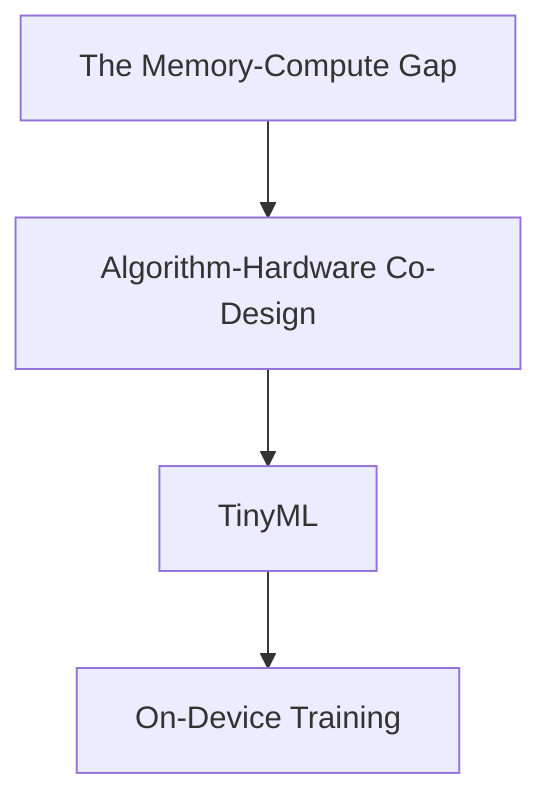

> [!abstract] As AI models grow thousands of times faster than hardware memory, model compression and algorithm-hardware co-design make it possible to run and train state-of-the-art vision and language models directly on laptops, mobile phones, and $2 microcontrollers.

Part of [[courses/mit-6-5940|MIT 6.5940 (Fall 2026)]], lecture 1.

## TL;DR
- **The Memory Wall:** AI model sizes are growing exponentially (from 60 million parameters in AlexNet to trillions today), while GPU memory is growing slowly; moving data across memory wires takes 200× more energy than the math itself.
- **The Three Tiers of AI:** We are expanding from energy-heavy Cloud AI (hundreds of gigabytes, kilowatts of power) to Mobile AI (smartphones, 5-15 watts) and TinyML (microcontrollers with only hundreds of kilobytes of memory and milliwatts of power).
- **Software is the New Hardware:** Because traditional hardware scaling (Moore's Law and clock speeds) has plateaued, future efficiency gains must come from co-designing models and software engines to match how silicon actually moves data.

## Concept map
The atomic concepts in **dependency order**: each one builds directly on the ideas before it.
1. [[concepts/the-memory-compute-gap|The Memory-Compute Gap]]: The widening divergence between exponential model parameter growth and modest hardware memory capacity.
   *Needs:* nothing
2. [[concepts/algorithm-hardware-co-design|Algorithm-Hardware Co-Design]]: Concurrently designing neural network structures and computing software to fit hardware bottlenecks.
   *Needs:* [[concepts/the-memory-compute-gap|The Memory-Compute Gap]]
3. [[concepts/tinyml|TinyML]]: Running neural network perception and intelligence on low-cost microcontrollers with only kilobytes of SRAM.
   *Needs:* [[concepts/algorithm-hardware-co-design|Algorithm-Hardware Co-Design]]
4. [[concepts/on-device-training|On-Device Training]]: Adapting and fine-tuning neural network weights locally on edge devices without cloud servers, preserving privacy.
   *Needs:* [[concepts/tinyml|TinyML]]

## First-principles rebuild

### 0. The Runaway Train: Model Size vs. Hardware Memory
In 2012, when AlexNet launched the modern deep learning revolution, it stunned the world with **60 million parameters** [02:15].
Fast-forward to today: cutting-edge models contain hundreds of billions—or even several trillion—parameters.

Now look at the hardware meant to hold them [07:33]:
- In 2017, an NVIDIA P100 GPU had **16 GB** of memory.
- Today, a top-tier B200 GPU has **192 GB** of memory.

Notice the problem? On a logarithmic chart, GPU memory has grown steadily by about 12× over eight years. But AI models have exploded by **over 10,000×** [08:08]!
There is a massive and widening **Memory-Compute Gap**. We cannot simply wait for hardware engineers to solder bigger memory chips onto boards. To deploy AI in the real world, we must learn how to compress models so they do more with less memory and less electricity.

---

### 1. The Physics of Computing: Why Moving Numbers is Ruinous
Why does model size matter so much?
Think of computing like cooking a meal in a kitchen [27:36]:
- Doing the math (chopping onions on your cutting board) is fast and cheap.
- Moving the groceries from the supermarket to your fridge, and from the fridge to your kitchen counter, takes all your time and energy.

In modern computer chips, arithmetic (multiplying two numbers inside a core) takes roughly **5 picojoules** of energy. But reading a 32-bit number from an off-chip memory chip across long copper wires takes **1,000 picojoules—200× more energy** [27:36]!
When a data center or smartphone overheats, it is not burning power by multiplying numbers. It is burning power by endlessly shuttling billions of numbers back and forth across the memory bus. If we can prune away useless connections or squeeze 32-bit decimals down to 4-bit integers, we slash that data traffic and make models run cooler, faster, and cheaper.

---

### 2. Pushing AI to the Extreme Edge: The TinyML Breakthrough
Most people think of AI as living in giant, water-cooled cloud data centers running on kilowatts of power [37:25]. But sending every camera frame and microphone recording over the internet has huge downsides:
- **Privacy:** You don't want video of your living room or hospital patients streamed to external servers.
- **Latency & Reliability:** Autonomous cars and medical devices cannot freeze because the Wi-Fi dropped.
- **Cost:** Answering millions of cloud queries every second creates staggering electricity bills.

Can we bring AI down to cheap, battery-powered chips that cost just a few dollars?
This is the mission of **TinyML**: running machine learning on low-power **microcontrollers (MCUs)** [34:23].

#### The Microcontroller Challenge
A modern smartphone has 8 to 16 gigabytes of RAM.
An ARM Cortex-M7 microcontroller (the tiny chip inside home appliances, toys, and sensors) has only a **few hundred kilobytes of memory** (SRAM)—over **10,000× less**!
Conventional AI libraries (like standard PyTorch or TensorFlow) cannot even initialize on such chips; their memory overhead alone exceeds the entire chip's capacity.

#### The Breakthrough: MCUNet
Researchers at MIT designed **MCUNet**, redesigning both the neural network architecture and the memory runtime simultaneously [34:23]:
- It fits a vision model inside just **256 KB of SRAM** and 1 MB of Flash memory.
- Running on a few milliwatts of battery, it continuously detects human faces and tracks people in real time.

#### The Next Frontier: On-Device Training under 256 KB
Running a pre-trained model (inference) is one thing. But can a chip *learn and adapt* locally on its own without the cloud [35:32]?
Training is typically much harder than inference:
- In inference, you pass numbers forward and immediately throw away intermediate layer outputs.
- In training, you must save intermediate activations for backpropagation, requiring **3× more compute** and hundreds of megabytes of memory.

MIT demonstrated an on-device training system that cut training memory from over 600 MB down to **141 KB** [38:07]!
In a live classroom demo, an ARM Cortex-M7 board with a camera and two buttons (Green = "No Person", Red = "Person") starts with completely random weights [39:43]. By pointing the camera at a person and clicking the button a few times, the chip performs backpropagation entirely locally in memory, adapting its weights to achieve high accuracy in seconds—with zero cloud connection and complete privacy [41:17].

---

### 3. Generative AI on Everyday Hardware
The need for efficiency is not limited to microcontrollers. Generative models—diffusion models, Vision Transformers (ViTs), and Large Language Models (LLMs)—are notoriously resource-hungry:
- Generating an image with Stable Diffusion initially cost $600,000 just to train, requiring 256 high-end GPUs [45:21].
- In attention mechanisms, computation scales quadratically ($O(N^2)$) with the number of tokens or pixels [47:19].

How do efficiency techniques bring these giants to everyday laptops?

1. **Vision Transformers (EfficientViT-SAM):**
   The original Segment Anything Model (SAM) from Meta ran at just 11 images per second on a GPU. By replacing heavy self-attention with hardware-friendly linear attention, **EfficientViT-SAM** reached **182 images per second** on the exact same GPU—a **48× speedup** with zero loss in segmentation quality [43:03].
2. **Interactive Photo Editing (AnyCost GAN):**
   When an artist edits an image (adjusting age, smile, or hair color), waiting seconds for every slider tick ruins the experience. AnyCost GAN trains a model that can run at coarse resolution in real time (using 5× less compute) for responsive previews, only rendering the full high-resolution output when the user releases the slider [50:36].
3. **Large Language Models on Laptops (AWQ & SmoothQuant):**
   A 7-billion parameter language model in 16-bit precision takes 14 GB of memory—too heavy for an ordinary laptop. By compressing weights down to 4 bits using **Activation-aware Weight Quantization (AWQ)**, the model shrinks to under 4 GB, running smooth chat completion at 30+ tokens per second on a lightweight MacBook or a $99 Jetson Nano [81:24].

---

### 4. The New Paradigm: Algorithm-Hardware Co-Design
For four decades, software developers relied on **Moore's Law**: wait two years, and computer chips will naturally become twice as fast and pack twice as many transistors for the same price.

Look at the 40-year microchip trends from 1970 to 2020 [49:29]:
- Single-thread CPU performance has completely plateaued.
- Chip power budgets have hit a thermal ceiling.
- Transistors cannot be driven with higher clock frequencies without melting the chip.

We can no longer treat software and hardware as separate worlds [50:02].
**Algorithm-Hardware Co-Design** means:
1. Don't invent an algorithm that looks clever on a blackboard but runs poorly on silicon (e.g. random unstructured pruning that causes cache misses).
2. Design algorithms specifically around what chips do well—like dense matrix blocks, regular memory access, and integer math.
3. Build lightweight inference runtimes (like TinyChat Engine) that exploit byte alignments and cache lines to turn theoretical math savings into real, measured wall-clock speedups [80:51].

---

## Connections
- **Quantization:** Introduced conceptually here as a way to cross the memory-compute gap; derived mathematically in [[lessons/2026-11-01-quantization-k-means-and-linear|Lecture 5 (Quantization)]].
- **Pruning & Sparsity:** How cutting away near-zero weights reduces parameter count, expanded in upcoming lectures.
- **System Engines:** Why software runtimes (like TinyChat) are just as critical as model math to unlock actual hardware speedups.

## Review questions
> [!question]- Q1 (recall): Why does moving data between memory (DRAM) and computing cores consume dramatically more energy than performing arithmetic operations?
> Wires connecting external memory chips to the processor are long, capacitive, and off-chip. Shuttling a 32-bit number across those wires consumes up to 200× more energy (~1,000 picojoules) than executing an arithmetic multiplication or addition (~5 picojoules) inside local on-chip registers. Linked note: [[concepts/the-memory-compute-gap|The Memory-Compute Gap]].

> [!question]- Q2 (explain-why): Why has Algorithm-Hardware Co-Design become mandatory for AI performance gains, rather than relying solely on chip manufacturing advances?
> Traditional chip scaling rules (Moore's Law and Dennard scaling) have plateaued: clock frequencies and single-threaded performance have hit thermal ceilings. Modern speedups can no longer come from faster clock cycles alone; they require designing neural network architectures and memory access patterns specifically tailored to silicon cache lines, tensor cores, and SIMD registers. Linked note: [[concepts/algorithm-hardware-co-design|Algorithm-Hardware Co-Design]].

> [!question]- Q3 (apply): An edge developer wants to deploy a 14 GB vision-language model onto a portable device with only 4 GB of available RAM. What compression technique should they apply, and by what factor must memory footprint shrink to fit?
> They need to reduce the model's footprint by at least $3.5\times$ (from 14 GB to under 4 GB). By applying 4-bit weight quantization (such as AWQ), each 16-bit weight is compressed from 2 bytes down to 0.5 bytes, yielding an exact $4\times$ memory reduction and bringing the model down to ~3.5 GB, comfortably fitting inside the 4 GB limit. Linked note: [[concepts/tinyml|TinyML]].

> [!question]- Q4 (transfer): In mobile photography, smartphone cameras use on-device machine learning to enhance photos in real time. Why is on-device training significantly more difficult to implement on a smartphone or drone than on-device inference?
> Inference only requires passing activations forward through the network and discarding intermediate results after each layer finishes. Training requires executing a backward pass (backpropagation), which demands storing all intermediate layer activations in memory simultaneously to compute weight gradients, requiring roughly 3× more compute and orders of magnitude more memory. Linked note: [[concepts/on-device-training|On-Device Training]].

## Source notes
- [01:37](https://www.youtube.com/watch?v=tY75czj43_4&t=97s): The physical energy cost: data movement consumes 200× more energy than computation.
- [07:33](https://www.youtube.com/watch?v=tY75czj43_4&t=453s): Growth comparison between GPU memory supply (P100 to B200) and AI model demand.
- [08:08](https://www.youtube.com/watch?v=tY75czj43_4&t=488s): Exponential parameter growth from 60M (AlexNet) to trillion-parameter models.
- [27:36](https://www.youtube.com/watch?v=tY75czj43_4&t=1656s): The cooking analogy: moving groceries from supermarket to fridge vs. cooking food.
- [34:23](https://www.youtube.com/watch?v=tY75czj43_4&t=2063s): MCUNet: bringing vision classification and detection to 256 KB ARM microcontrollers.
- [35:32](https://www.youtube.com/watch?v=tY75czj43_4&t=2132s): Motivation for on-device training: personalization, privacy, and continuous learning.
- [38:07](https://www.youtube.com/watch?v=tY75czj43_4&t=2287s): Tiny Training Engine: reducing on-device training memory from 600 MB down to 141 KB.
- [39:43](https://www.youtube.com/watch?v=tY75czj43_4&t=2383s): Live demo of on-device backpropagation on a 256 KB microcontroller board with two buttons.
- [43:03](https://www.youtube.com/watch?v=tY75czj43_4&t=2583s): EfficientViT-SAM: accelerating Segment Anything from 11 fps to 182 fps (48× speedup).
- [45:21](https://www.youtube.com/watch?v=tY75czj43_4&t=2721s): Compute cost of generative diffusion models vs vision and language models.
- [49:29](https://www.youtube.com/watch?v=tY75czj43_4&t=2969s): 40 years of microprocessor trends: the plateau of clock speed, power, and single-thread scaling.
- [50:02](https://www.youtube.com/watch?v=tY75czj43_4&t=3002s): The necessity of algorithm-hardware co-design when hardware scaling slows.
- [80:51](https://www.youtube.com/watch?v=tY75czj43_4&t=4851s): TinyChat Engine: why software runtimes are required to realize 4-bit hardware speedups.
- [81:24](https://www.youtube.com/watch?v=tY75czj43_4&t=4884s): Running 4-bit 7B and 13B language models on a laptop and a $99 Jetson Nano using AWQ.
