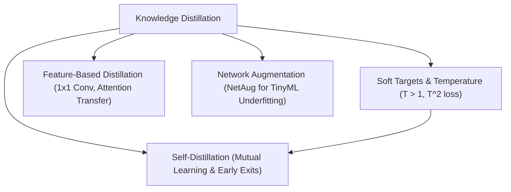

> [!abstract]
> Compressing deep neural networks without sacrificing accuracy requires transferring subtle structural relationships ("dark knowledge") from large teacher models to compact students. By softening output distributions via temperature scaling, aligning intermediate feature representations with lightweight $1 \times 1$ adapters, enabling peer and self-distillation for dynamic early exit, and overcoming tiny model underfitting through Network Augmentation (NetAug), practitioners can train compact models that rival massive baselines across vision and large language models.

Part of [[courses/mit-6-5940|MIT 6.5940 (Fall 2026)]], lecture 9.

## TL;DR
- **The Lie of Hard Labels:** Standard one-hot training vectors treat all incorrect classes as equally wrong; [[concepts/knowledge-distillation|Knowledge Distillation]] transfers the teacher's nuanced relative probabilities ("dark knowledge"), giving the student dense, informative gradients on every training sample.
- **Why Temperature Matters:** Normal softmax exponentiation buries subtle runner-up logits into negligible rounding decimals; dividing logits by temperature $T > 1$ and scaling the distillation loss by $T^2$ inflates non-target probabilities so the student absorbs inter-class similarities.
- **Deep Feature & Self-Supervision:** Beyond final output logits, students can match intermediate feature maps using $1 \times 1$ convolutional adapters (FitNets) and attention maps. In [[concepts/self-distillation|Self-Distillation]], intermediate auxiliary classifiers learn from deeper layers, boosting accuracy and enabling dynamic inference early exits.
- **NetAug Inverts Data Regularization:** While large models overfit and benefit from data corruption (Mixup, Dropout), tiny models underfit and are crippled by data augmentation; [[concepts/network-augmentation|Network Augmentation]] temporarily widens model channels during training to escape local minima, discarding the auxiliary capacity at deployment for zero added inference cost.

## Concept map

The atomic concepts in dependency order:

1. [[concepts/knowledge-distillation|Knowledge Distillation]]: Transferring learned geometric representations and dark knowledge from a high-capacity teacher to a compact student.  
   *Needs:* [[concepts/macs-vs-flops|MACs vs FLOPs]]
2. [[concepts/soft-targets-and-temperature|Soft Targets and Temperature]]: Scaling pre-softmax logits by $T > 1$ and multiplying loss by $T^2$ to reveal relative probabilities across non-target classes.  
   *Needs:* [[concepts/knowledge-distillation|Knowledge Distillation]]
3. [[concepts/feature-based-distillation|Feature-Based Distillation]]: Aligning intermediate internal activations and attention maps between teacher and student using trainable projection adapters.  
   *Needs:* [[concepts/knowledge-distillation|Knowledge Distillation]]
4. [[concepts/self-distillation|Self-Distillation]]: Eliminating external teacher overhead via online peer learning (Deep Mutual Learning) or internal multi-exit branch supervision.  
   *Needs:* [[concepts/knowledge-distillation|Knowledge Distillation]], [[concepts/soft-targets-and-temperature|Soft Targets and Temperature]]
5. [[concepts/network-augmentation|Network Augmentation]]: Temporarily expanding neural network capacity during training with shared base weights to overcome underfitting in tiny models.  
   *Needs:* [[concepts/tinyml|TinyML]], [[concepts/knowledge-distillation|Knowledge Distillation]]



## First-principles rebuild

### 0. The Underfitting Dilemma & The Lie of Hard Labels
Suppose you want to teach a child to identify animals. If every time they ask about a German Shepherd, you only give them a binary score:
- German Shepherd: $1$
- Golden Retriever: $0$
- Poodle: $0$
- Freight Train: $0$

You are discarding almost all contextual intelligence. To a loss function evaluating that hard one-hot target, guessing "Golden Retriever" is penalized just as harshly as guessing "Freight Train." Both receive a target of $0$.

When we train deep neural networks on ImageNet, we feed them hard one-hot labels: a single $1.0$ at the target index, and $0.0$ everywhere else. A massive network with 100 million parameters (like a ResNet-152 or ViT-Huge) has enough parameter capacity to brute-force parse raw pixels and discover class similarities on its own. 

However, when you shrink that network down to a tiny MobileNet or MCUNet designed for an edge device, the small model frequently struggles. It lacks the parameter count to navigate the jagged optimization landscape of raw cross-entropy.

This is the foundation of **Knowledge Distillation (KD)**. A well-trained large model ("teacher") already knows that a German Shepherd shares structural features with a Golden Retriever, fewer with a Poodle, and none with a freight train. Its pre-softmax outputs contain rich, continuous geometric relationships—what Geoffrey Hinton termed **dark knowledge**. By training the compact "student" model to match the teacher's soft probability outputs, we give the student dense, informative gradients on every training sample.

```
Ground Truth Label:
[1.0,  0.0,  0.0,  0.0,  0.0]  <-- Binary: Zero feedback on non-target classes!

Teacher Output (Softened):
[0.68, 0.22, 0.08, 0.019, 0.001] <-- Dark Knowledge: Reveals relative class geometry!
```

---

### 1. Softening Reality: Logit Distillation and Temperature Scaling
Why can't we simply take the teacher's standard softmax probabilities and train the student to match them?

In standard classification, the softmax function exponentiates raw logits $z_i$:
$$q_i = \frac{\exp(z_i)}{\sum_j \exp(z_j)}$$

Because the exponent function $\exp(x)$ grows exponentially, even modest differences in logit values create extreme probability spikes. If the teacher predicts $z_1 = 10.0$ for German Shepherd, $z_2 = 4.0$ for Golden Retriever, and $z_3 = -2.0$ for Freight Train:
- $q_1 = \frac{e^{10.0}}{e^{10.0} + e^{4.0} + e^{-2.0}} \approx 0.9975$
- $q_2 \approx 0.00247$
- $q_3 \approx 0.000006$

Even though the teacher knows that the retriever is roughly $400\times$ more likely than the freight train ($e^6 \approx 403$), both numbers are crushed down into floating-point dust next to $0.9975$.

To expose the dark knowledge hidden across non-target classes, we introduce **Temperature Scaling ($T$)**:
$$q_i^{(T)} = \frac{\exp(z_i / T)}{\sum_j \exp(z_j / T)}$$

When $T > 1$, the logits are compressed before exponentiation, smoothing out the probability distribution:

```
Logits: z = [10.0, 4.0, -2.0]

Standard Softmax (T = 1):
q = [0.9975, 0.00247, 0.000006]   (Dark knowledge buried!)

Softened Softmax (T = 4):
z / 4 = [2.5, 1.0, -0.5]
q^(4) = [0.730, 0.218, 0.052]     (Dark knowledge fully visible!)
```

Now, the student clearly observes that class 2 receives $21.8\%$ probability while class 3 receives only $5.2\%$.

#### The Mathematical Necessity of the $T^2$ Multiplier
When computing the distillation loss via Kullback-Leibler (KL) divergence between teacher probabilities $p^{(T)}$ and student probabilities $q^{(T)}$:
$$\mathcal{L}_{\text{KD}} = D_{\text{KL}}(p^{(T)} \,\|\, q^{(T)}) = \sum_i p_i^{(T)} \log \left( \frac{p_i^{(T)}}{q_i^{(T)}} \right)$$

If we compute the gradient of this loss with respect to the student's logit $z_i^{(S)}$ in the high-temperature limit ($T \to \infty$):
$$\frac{\partial \mathcal{L}_{\text{KD}}}{\partial z_i^{(S)}} \approx \frac{1}{T} \left( q_i^{(T)} - p_i^{(T)} \right) \approx \frac{1}{T} \left( \frac{1 + z_i^{(S)}/T}{K} - \frac{1 + z_i^{(T)}/T}{K} \right) = \frac{1}{K \cdot T^2} \left( z_i^{(S)} - z_i^{(T)} \right)$$

Notice the denominator: dividing by $T$ during softmax calculation causes the gradient magnitude to shrink by a factor of $1/T^2$! 

If you set $T = 4$, the gradients coming from the teacher would be $16\times$ weaker than the gradients coming from the hard ground-truth cross-entropy loss. To keep the gradient magnitudes balanced regardless of the chosen temperature, we **must multiply the distillation loss by $T^2$**:

$$\mathcal{L}_{\text{total}} = (1 - \alpha) \mathcal{L}_{\text{CE}}(y_{\text{true}}, \sigma(z^{(S)})) + \alpha T^2 \mathcal{L}_{\text{KL}}(\sigma(z^{(T)} / T), \sigma(z^{(S)} / T))$$

```
Student Training Flow:
                  +-------------------+
Input (x) ------->| Teacher (Frozen)  |----[ Logits / T ]----+
    |             +-------------------+                      |
    |                                                        v
    |             +-------------------+             [ KL Div Loss ] x T^2 x alpha
    +------------>| Student (Trained) |----[ Logits / T ]----+         |
                  +-------------------+                                |
                            |                                          v
                      [ Softmax (T=1) ]---> [ Cross-Entropy ] x (1-alpha) ---> Total Loss
                                                   ^
                                                   |
                                           Ground Truth (y)
```

---

### 2. Beyond Logits: Feature Hints, Attention Transfer, and Self-Distillation

Matching final logits supervises only the last layer of the student network. But deep neural networks learn hierarchical abstractions: early layers detect edges and textures, middle layers assemble shapes, and late layers form semantic concepts. If a compact student model has 20 layers and the teacher has 100, relying exclusively on output logits forces the student to guess how to organize all its intermediate stages.

#### FitNets: Intermediate Feature Matching
To guide the student's internal representations, **FitNets** introduces intermediate feature-map alignment. A middle layer in the teacher acts as a "hint," and the corresponding layer in the student acts as the "guided layer."

However, there is an immediate physical obstacle: **channel dimension mismatch**. A large teacher might output 256 feature channels at a spatial resolution of $14 \times 14$, while a tiny student outputs only 64 channels.

```
Teacher Feature Map:  [ 256 channels x 14 x 14 ]
                             ^
                             | (L2 Distance Loss)
                             v
Projected Student:    [ 256 channels x 14 x 14 ]
                             ^
                             | [ 1x1 Convolution Adapter: 64 -> 256 ]
Student Feature Map:  [  64 channels x 14 x 14 ]
```

By placing a lightweight, trainable $1 \times 1$ convolution on top of the student's guided layer, we project the student's 64 channels into 256 channels. The loss is simply the mean squared error (L2 distance):
$$\mathcal{L}_{\text{hint}} = \frac{1}{2} \| F_{\text{teacher}} - W_{\text{proj}} * F_{\text{student}} \|_2^2$$

During deployment, the $1 \times 1$ adapter is discarded; the student executes with its native 64 channels.

#### Attention Transfer
Instead of forcing every single activation value to match, **Attention Transfer** collapses the channel dimension into a spatial 2D attention map:
$$A = \sum_{c=1}^C |F_c|^2$$

This creates a heatmap highlighting where the teacher focuses its computational attention (e.g., the eyes and nose of a dog). The student is trained to match the teacher's normalized spatial heatmap, granting the student freedom in how it structures individual channel weights while ensuring it attends to the correct spatial regions.

#### Eliminating the External Teacher: Self-Distillation & Early Exits
Training a massive teacher before training a student requires 2 separate training phases and doubles infrastructure costs. Can models learn without a static, pre-trained teacher?

1. **Deep Mutual Learning (Online Peer Distillation):** Two identical or different student networks start from random scratch simultaneously. Each network trains on standard cross-entropy while using KL divergence to match the predictions of its peer. Because the two networks start from different random initializations, they explore different optimization trajectories and teach each other continuously. Both networks consistently finish with higher accuracy than either network trained alone!
2. **"Be Your Own Teacher" (Intermediate Exits):** We can place auxiliary classification heads at intermediate blocks inside a single network (e.g., after layer 4, layer 8, and layer 12). The final classification head at layer 12—possessing the deepest receptive field and highest capacity—acts as an online teacher for the shallower heads at layers 4 and 8.

```
Input ---> [ Layers 1-4 ] ---> Head 1 (Early Exit 1) <----+ (Distillation Loss)
                 |                                        |
           [ Layers 5-8 ] ---> Head 2 (Early Exit 2) <----+
                 |                                        |
           [ Layers 9-12 ] --> Head 3 (Final Classifier) -+ (Teacher)
```

This delivers a massive operational advantage at inference time: **Dynamic Early Exiting**.
- For an easy, unambiguous image, Head 1 predicts a confidence of $99\%$. The model exits immediately, skipping layers 5–12 and saving $67\%$ of inference latency!
- For a degraded or ambiguous image, the model computes through all 12 layers.

---

### 3. NetAug and Modern Frontiers: From Micro-CNNs to LLM Pruning

#### Why Standard Regularization Cripples Tiny Models
In conventional deep learning, practitioners routinely apply aggressive data augmentation and regularization techniques: Mixup, CutMix, AutoAugment, Dropout, and DropBlock. On large models (like ResNet-50), these techniques prevent the model from memorizing the training set, forcing it to generalize:

$$\text{Large Models:} \quad \text{Excess Capacity} \implies \text{Primary Risk: Overfitting} \implies \text{Fix: Make training harder (Data Augmentation)}$$

However, when researchers applied these exact same techniques to tiny models (e.g., MobileNetV2-0.35 or MCUNet on a microcontroller), performance degraded sharply:

$$\text{Tiny Models:} \quad \text{Starved Capacity} \implies \text{Primary Risk: Underfitting} \implies \text{Fix: Make training harder? FAILS!}$$

A tiny model has so few parameters that it cannot even fit the clean training dataset cleanly, let alone heavily distorted inputs where images are blended or large square blocks are blanked out.

#### Network Augmentation (NetAug)
To fix underfitting in tiny models, **Network Augmentation (NetAug)** flips the paradigm: **instead of augmenting the data, augment the model!**

```
Training Step with NetAug:

Base Sub-Network (16 channels) ---------> Forward Pass 1 ---> Loss_base
         || (Shared Weights)
         vv
Augmented Network (16 base + 32 aux) ---> Forward Pass 2 ---> Loss_aug
                                                                 |
Total Gradient = Grad(Loss_base) + Grad(Loss_aug) <---------------+
```

1. **Temporary Capacity:** During training, NetAug dynamically samples an expanded auxiliary network (e.g., expanding 16 channels to 48 channels).
2. **Shared Base Weights:** The base 16 channels are shared between the base model and the augmented model.
3. **Dual Gradient Optimization:** In each training step, the shared base weights receive gradient updates from both the base objective and the augmented objective. The temporary extra channels give the optimizer additional degrees of freedom to escape bad local minima.
4. **Zero Deployment Cost:** Once training finishes, the auxiliary channels are stripped away. The deployed model has the exact same tiny parameter count and latency as the original base model, but achieves substantially higher accuracy.

NetAug and Knowledge Distillation are highly complementary: NetAug expands optimization capacity, while KD provides smooth gradient directions.

#### Distillation for Large Language Models (LLMs)
In modern generative AI, distillation is central to compressing foundation models:
- **Token-to-Token Attention Distillation:** The student transformer matches the multi-head attention probability matrices ($Q K^T / \sqrt{d_k}$) of the teacher, preserving contextual token relationships.
- **Hidden State Projection:** Intermediate MLP outputs and transformer layer representations are aligned via linear projection matrices.
- **Pruning + Distillation (e.g., Minitron 15B $\to$ 8B):** NVIDIA's Minitron demonstrates that rather than training an 8B model from scratch on trillions of tokens, one can prune depth and width from a 15B model and distill knowledge from the 15B parent. The distilled 8B model matches the benchmark performance of models trained on $4\times$ more compute.

---

## Connections

- **Cross-domain analog:** Learning from a textbook vs. an apprentice working under a master craftsman. A textbook contains only final answers (hard labels: true/false). A master craftsman demonstrates nuance, hesitation between two plausible techniques, and step-by-step intermediate checks (dark knowledge, feature hints).
- **What breaks when scaled down:** Naive data augmentation. Applying Mixup, CutMix, or Dropout to microcontroller-scale models degrades accuracy because tiny models suffer from underfitting rather than overfitting; they need temporary capacity expansion (NetAug) rather than artificial task corruption.
- **Next question:** How do we deploy these highly optimized, compact neural architectures onto bare-metal microcontrollers with only 256 KB of SRAM? This requires algorithm-system co-design with **MCUNet**.

## Review questions

> [!question]- Why must the distillation loss term be multiplied by $T^2$ when using temperature scaling?
> When pre-softmax logits are divided by temperature $T$, the gradient of the softened probabilities with respect to the input logits scales inversely with $T^2$ ($\frac{\partial \mathcal{L}_{\text{KD}}}{\partial z_i} \propto \frac{1}{T^2}$). As temperature increases (e.g., $T = 4$ or $T = 5$), this causes the magnitude of the distillation gradient to shrink drastically ($16\times$ to $25\times$) relative to standard cross-entropy with hard labels. Multiplying the distillation loss by $T^2$ ensures that the supervisory gradient from the teacher maintains a consistent magnitude regardless of the chosen temperature.

> [!question]- How does FitNets resolve channel dimension mismatches when aligning intermediate feature maps between teacher and student?
> A large teacher network typically produces intermediate feature maps with significantly more channels (e.g., 256 or 512 channels) than a compact student network (e.g., 64 channels). FitNets places a trainable $1 \times 1$ convolutional layer (or linear projection matrix) on top of the student's intermediate layer. This adapter projects the student's feature maps into the teacher's channel dimension so an L2 distance or cosine similarity loss can be computed. Crucially, this adapter is used only during training and is discarded at inference time, leaving the student's runtime footprint unchanged.

> [!question]- In Deep Mutual Learning, how can two peer models of equal capacity improve each other without a larger teacher model?
> Because the two networks start from different random weight initializations, their optimization trajectories explore distinct regions of the loss landscape. On any given mini-batch, one network may be more confident or capture different feature correlations than the other. By training simultaneously with a bidirectional KL divergence loss on each other's softened outputs, they exchange complementary dark knowledge and act as regularizers for each other, consistently achieving higher validation accuracy than either network trained independently.

> [!question]- Why do data regularizations like Mixup and DropBlock harm tiny models, and how does Network Augmentation (NetAug) resolve this?
> Techniques like Mixup and DropBlock were designed to prevent overfitting in large over-parameterized models by making the training task artificially harder. Tiny models, by contrast, suffer primarily from underfitting—they lack sufficient parametric capacity to learn even the clean training distribution. Making the task harder cripples their training. NetAug resolves this by keeping the data intact and instead temporarily expanding the network's capacity during training with auxiliary channels and layers sharing base weights. This gives the optimizer extra degrees of freedom to escape local minima; at deployment, the auxiliary parameters are discarded, yielding a base model with zero extra runtime cost.

## Source notes
- Lecture: MIT 6.5940 (Fall 2026), Lecture 9: Knowledge Distillation.
- Speaker: Shanya (MIT HAN Lab, co-instructor with Prof. Song Han).
- Key references:
  - Hinton et al., "Distilling the Knowledge in a Neural Network" (NIPS 2014) — Soft targets, temperature scaling, $T^2$ multiplier.
  - Romero et al., "FitNets: Hints for Thin Deep Nets" (ICLR 2015) — Intermediate feature matching, $1 \times 1$ conv alignment.
  - Zagoruyko & Komodakis, "Paying More Attention to Attention" (ICLR 2017) — Activation-based attention transfer.
  - Zhang et al., "Deep Mutual Learning" (CVPR 2018) — Online peer distillation.
  - Zhang et al., "Be Your Own Teacher: Improve the Performance of CNN via Self-Distillation" (ICCV 2019) — Auxiliary exit classifiers.
  - Li et al., "GAN Compression: Efficient Architectures for Interactive Image Synthesis" (CVPR 2020) — Distillation for generative models.
  - Wang et al., "Network Augmentation for Tiny Deep Learning" (ICLR 2022) — NetAug addressing tiny model underfitting.
  - NVIDIA Minitron (2024) — Combining structured pruning and knowledge distillation for large language models.
