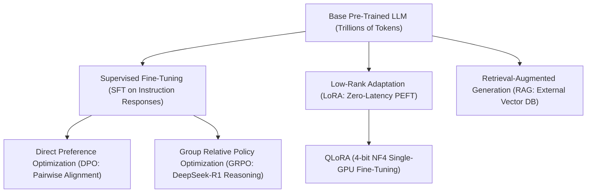

> [!abstract]
> Pre-training builds general world knowledge across trillions of tokens, but post-training transforms that raw statistical base into a safe, obedient, and mathematically capable reasoning assistant. By transitioning from fragile reinforcement learning pipelines to closed-form preference optimization (**DPO**), cultivating test-time reasoning via critic-free group-normalized reinforcement learning (**GRPO**), democratizing model adaptation through low-rank decomposition (**LoRA** and **QLoRA**), and grounding outputs in verifiable external knowledge (**RAG**), modern post-training bridges the gap between raw compute and frontier intelligence.

Part of [[courses/mit-6-5940|MIT 6.5940 (Fall 2026)]], lecture 14.

## TL;DR
- **The Post-Training Transformation:** Pre-training acts as an autocomplete engine predicting raw web text; Supervised Fine-Tuning (SFT) and alignment teach the model to follow instructions, adopt a helpful persona, and refuse harmful queries (computing cross-entropy loss strictly on response tokens, not user prompts).
- **Alignment Without the PPO Nightmare (DPO):** Traditional RLHF requires running four massive models concurrently (Policy, Value/Critic, Reward, Reference) under brittle PPO policy updates; [[concepts/direct-preference-optimization|Direct Preference Optimization]] analytically expresses the reward function via the policy's log-ratio against the reference model, reducing preference alignment to a simple, stable binary cross-entropy loss.
- **The Reasoning Frontier (GRPO):** Frontier reasoning models (DeepSeek-R1, OpenAI o1) unlock complex problem-solving through test-time thinking and self-reflection; [[concepts/group-relative-policy-optimization|Group Relative Policy Optimization]] eliminates the multi-gigabyte learned critic network by standardizing rewards across groups of sampled rollouts, accelerating reasoning exploration.
- **Democratizing Adaptation with LoRA and QLoRA:** Full-parameter fine-tuning of 70B models requires petabytes of storage and thousands of gigabytes of optimizer states; [[concepts/low-rank-adaptation|Low-Rank Adaptation]] (LoRA) freezes the base model and trains low-rank adapter matrices with zero extra inference latency, while [[concepts/qlora|QLoRA]] quantizes the base model to 4-bit NormalFloat to enable 70B parameter fine-tuning on a single consumer GPU.

## Concept map

The atomic concepts in dependency order:

1. [[concepts/direct-preference-optimization|Direct Preference Optimization]]: Closed-form pairwise preference alignment without a separate reward model or PPO loops.  
   *Needs:* None
2. [[concepts/group-relative-policy-optimization|Group Relative Policy Optimization]]: Critic-free reinforcement learning that normalizes advantages across candidate rollout groups for verifiable reasoning tasks.  
   *Needs:* None
3. [[concepts/low-rank-adaptation|Low-Rank Adaptation]]: Parameter-efficient fine-tuning decomposing weight updates into low-rank matrices with zero inference latency.  
   *Needs:* None
4. [[concepts/qlora|QLoRA]]: Combining 4-bit NormalFloat base model quantization with 16-bit LoRA adapters and paged optimizers for single-GPU fine-tuning.  
   *Needs:* [[concepts/low-rank-adaptation|Low-Rank Adaptation]], [[concepts/linear-quantization|Linear Quantization]]
5. [[concepts/retrieval-augmented-generation|Retrieval-Augmented Generation]]: Decoupling parametric reasoning from knowledge storage by retrieving external document vectors into the context window.  
   *Needs:* None



## First-principles rebuild

### 0. The Post-Training Transformation: From Autocomplete to Assistant

If you give a raw, pre-trained base model (such as base LLaMA-3 or GPT-3) the prompt:
> *"Write a Python function to compute Fibonacci numbers."*

It will frequently respond with:
> *"What is a Fibonacci sequence? Chapter 4: Loops and Recursion in Python. Exercise 4.2..."*

The base model is not broken. It was trained on trillions of web tokens to do one thing: **predict the statistically most likely next word**. On the internet, a question is often followed by a list of more forum questions, a textbook syllabus, or related links—not a concise, polite answer.

To transform a raw text completion engine into a helpful, truthful, and safe AI assistant, the model must undergo **Post-Training**:

```
+------------------------------------------------------------------------+
|                      The LLM Lifecycle Pipeline                        |
|                                                                        |
|  [ Pre-Training ]      ===> Trillions of tokens, massive GPU clusters  |
|         |                   Builds raw linguistic world knowledge      |
|         v                                                              |
|  [ Supervised SFT ]    ===> High-quality curated instruction pairs     |
|         |                   Teaches instruction formatting & tone      |
|         v                                                              |
|  [ Preference Align ]  ===> DPO / RLHF on pairwise human rankings      |
|         |                   Enforces safety, helpfulness, and style    |
|         v                                                              |
|  [ Reasoning RL ]      ===> GRPO on verifiable math & code tasks       |
|         |                   Cultivates chain-of-thought self-reflection|
|         v                                                              |
|  [ Deployed Model ]    ===> Parameter-efficient fine-tuning (LoRA)    |
|                             Augmented with external memory (RAG)       |
+------------------------------------------------------------------------+
```

#### Supervised Fine-Tuning (SFT)
SFT feeds the model curated prompt-response pairs:
- **Prompt:** *"Explain photosynthesis in two sentences."*
- **Response:** *"Photosynthesis is the process where green plants convert sunlight, water, and carbon dioxide into glucose and oxygen. It serves as the primary energy source for nearly all life on Earth."*

Crucially, **loss is calculated strictly on the response tokens**:
$$\mathcal{L}_{\text{SFT}}(\theta) = -\sum_{t=1}^{|Y|} \log P_\theta(y_t \mid X, y_{<t})$$
The prompt tokens $X$ are used purely as conditioning context and are masked out during loss computation. This trains the model to act as an assistant that responds directly rather than mimicking the user's prompt.

---

### 1. The Alignment Revolution: From PPO to DPO

While SFT teaches basic formatting, human preferences are subtle and subjective. How do you teach a model to be concise rather than verbose? How do you prevent it from giving dangerous chemical formulas while still remaining helpful?

Writing static SFT answers for every possible nuanced preference is impossible. Instead, we show human annotators two candidate responses generated by the model ($y_w$ and $y_l$) and ask: **Which response is better?**

```
Prompt: "Write a poem about the ocean."
Candidate A: [ Rhyming, lyrical poem ]  <== Human prefers Candidate A! (y_w)
Candidate B: [ Repetitive, clunky poem ] <== Human rejects Candidate B! (y_l)
```

#### The Classical RLHF Nightmare: 4 Models on One GPU Cluster
Historically, aligning models required **Reinforcement Learning from Human Feedback (RLHF)** using Proximal Policy Optimization (PPO):
1. Fit a **Reward Model** $r_\psi(x, y)$ on human preferences using the Bradley-Terry ranking probability:
   $$P(y_w \succ y_l \mid x) = \sigma(r_\psi(x, y_w) - r_\psi(x, y_l))$$
2. Optimize the active language model (**Policy $\pi_\theta$**) with PPO to maximize the reward model's score, adding a KL penalty against a frozen **Reference Model $\pi_{\text{ref}}$** so the policy doesn't exploit reward model flaws.
3. Train a **Critic (Value) Network** to estimate baseline rewards.

This required holding **four separate 70B models in GPU memory** simultaneously (Policy, Critic, Reward, Reference). PPO training was unstable, prone to mode collapse, and consumed immense infrastructure.

#### Direct Preference Optimization (DPO): Closed-Form Alignment
Rafailov et al. (2023) revolutionized alignment with a mathematical proof: **under the KL-regularized objective, the ground-truth reward can be represented directly as the log-probability ratio between the optimal policy and the reference model:**
$$r(x, y) = \beta \log \frac{\pi^*(y \mid x)}{\pi_{\text{ref}}(y \mid x)} + \beta \log Z(x)$$

When this equation is substituted into the Bradley-Terry preference model, the unknown reward function and partition function $Z(x)$ completely cancel out!

This yields the **Direct Preference Optimization (DPO)** objective:
$$\mathcal{L}_{\text{DPO}}(\theta) = -\mathbb{E}_{(x, y_w, y_l)} \left[ \log \sigma \left( \beta \log \frac{\pi_\theta(y_w \mid x)}{\pi_{\text{ref}}(y_w \mid x)} - \beta \log \frac{\pi_\theta(y_l \mid x)}{\pi_{\text{ref}}(y_l \mid x)} \right) \right]$$

- **Zero Reward Model:** The policy acts as its own implicit reward model.
- **Zero Value/Critic Network:** Eliminates the entire PPO actor-critic loop.
- **Supervised Simplicity:** Training evaluates log-probabilities of static pre-collected $(x, y_w, y_l)$ triples, backpropagating gradients with the simplicity and stability of cross-entropy.
- If the policy already assigns higher probability to $y_w$ relative to $\pi_{\text{ref}}$ than it does to $y_l$, the loss margin is satisfied and gradients vanish. If not, the loss pushes the policy toward $y_w$ and away from $y_l$.

---

### 2. The Reasoning Frontier: Test-Time Compute & GRPO

In late 2024 and early 2025, frontier AI experienced a seismic shift: the rise of **Reasoning Models** (OpenAI o1, DeepSeek-R1).

Traditional LLMs answer complex mathematical proofs or multi-turn coding queries instantaneously in a single forward pass per token. For hard reasoning, this is fundamentally insufficient—just as a human mathematician cannot solve an unsolved topology theorem without scribbling proofs, testing hypotheses, and backtracking upon finding mistakes.

Reasoning models unlock **Test-Time Compute Scaling**: given harder problems, the model generates internal, hidden reasoning chains—often spending thousands of tokens reflecting, catching its own errors, and verifying steps before presenting the final answer.

```
Question: "How many Rs are in the word strawberry?"

Standard Model (Instantaneous Output):
"There are two Rs in strawberry." (WRONG!)

Reasoning Model (Internal Chain of Thought):
<think>
Let me analyze the word 'strawberry' character by character:
1: s
2: t
3: r (First 'r')
4: a
5: w
6: b
7: e
8: r (Second 'r')
9: r (Third 'r')
10: y
Wait, let me recount: positions 3, 8, and 9 are all 'r'.
Total count is 1 + 1 + 1 = 3.
</think>
"There are 3 Rs in the word strawberry." (CORRECT!)
```

#### Group Relative Policy Optimization (GRPO)
How do we train a model to develop internal reasoning and self-reflection without human-annotated thought traces?

The open-source breakthrough came from **DeepSeek-R1** using **Group Relative Policy Optimization (GRPO)**:
1. **Eliminate the Critic Network:** In traditional PPO, training a 70B reasoning model requires a 70B critic network to estimate baseline state values $V(s)$. GRPO discards the critic network completely.
2. **Sample a Candidate Group:** For a given math or coding problem $q$, sample a group of $G$ candidate outputs: $\{o_1, o_2, \dots, o_G\}$ (e.g., $G = 16$).
3. **Deterministic Verifiable Rewards:** Instead of an imperfect neural reward model, score outputs using automated, rule-based verification:
   - Does the final math answer match the ground truth? ($r = 1$ if yes, $0$ if no).
   - Does the generated Python code pass the test suite? ($r = 1$ if passed, $0$ if failed).
4. **Group-Normalized Advantage:** Calculate advantage by standardizing rewards across the sampled group:
   $$A_i = \frac{r_i - \text{mean}(r)}{\text{std}(r)}$$
   Completions that got the right answer receive positive advantage ($A > 0$); failed completions receive negative advantage ($A < 0$).
5. **Emergent Reflection:** By penalizing policy drift with a KL divergence penalty against the reference model and reinforcing correct outcomes over many iterations, the model organically discovers self-reflection, step-by-step verification, and error backtracking without any human demonstrations!

#### Solving the Rollout Bottleneck
In GRPO training, generating candidate rollouts token-by-token accounts for **$>85\text{–}90\%$ of total clock time**. Asynchronous training and speculative decoding (such as MIT's **TOT - Taming the Long Tail**) train a lightweight draft model inside idle GPU bubbles to accelerate rollout generation by over $2\times$, keeping hardware tensor cores saturated.

---

### 3. Parameter-Efficient Fine-Tuning: LoRA, QLoRA, and RAG

When an enterprise wants to specialize a 70B foundation model for medical diagnosis or internal codebase generation, full parameter fine-tuning is economically impossible. Updating all 70B parameters requires storing optimizer states that exceed 1 Terabyte of VRAM.

#### Low-Rank Adaptation (LoRA)
Aghajanyan et al. proved that task-specific weight updates $\Delta W$ have a very low **intrinsic rank**: although a weight matrix has dimension $4,096 \times 4,096$ ($16.7\text{ million}$ parameters), the necessary adjustment vectors lie in a subspace of rank $r \le 16$.

**LoRA** freezes the pre-trained weight $W_0$ and decomposes the update into two thin matrices:
$$h = W_0 x + \Delta W x = W_0 x + \frac{\alpha}{r} B A x$$
where $A \in \mathbb{R}^{r \times k}$ and $B \in \mathbb{R}^{d \times r}$.

```
Pre-Trained Weight W0 (Frozen, d x k) ------------+
                                                  |
Input x (dim k)                                   v (Addition) ===> Output h (dim d)
   |                                              ^
   +-----> Matrix A (Trainable, r x k)            |
              |                                   |
              v (Bottleneck rank r = 8)           |
           Matrix B (Trainable, d x r) -----------+
```

- **Initialization:** $A \sim \mathcal{N}(0, \sigma^2)$ and $B = 0$. At step 0, $B \cdot A = 0$, meaning fine-tuning begins cleanly from the pre-trained model's baseline output.
- **Trainable Parameters:** Reduces trainable parameters by **$99.6\%$** (from $16.7\text{ million}$ to $65,536$ per layer).
- **Zero Extra Inference Latency:** Unlike Adapters (which insert sequential bottleneck layers that permanently slow down inference), LoRA updates are algebraically folded directly into the base weights before deployment:
  $$W_{\text{merged}} = W_0 + \frac{\alpha}{r} (B \cdot A)$$
  The deployed model runs with identical kernel speed and zero added latency!

#### QLoRA: Fine-Tuning a 70B Model on a Single GPU
Standard LoRA drastically reduces optimizer memory, but the frozen base model still requires $140\text{ GB}$ of VRAM in FP16.

**QLoRA** compresses the base model to 4-bit precision using **NormalFloat4 (NF4)**—an information-theoretically optimal non-uniform quantization grid tailored for Gaussian weight distributions. Paired with **Double Quantization** (compressing the quantization constants from 32-bit to 8-bit) and **Paged Optimizers** (paging optimizer states to CPU RAM during memory spikes), QLoRA compresses the base 70B model down to **$32\text{ GB}$ of VRAM**.

With 16-bit LoRA adapters trained on top of the 4-bit NF4 backbone, a complete 70B model fine-tuning run executes on a **single 48 GB commercial workstation GPU** (RTX 6000 Ada or A6000), achieving parity with 16-bit full fine-tuning.

#### Retrieval-Augmented Generation (RAG): External Grounding
Finally, models should not be fine-tuned simply to memorize facts. Facts change, and parametric memorization hallucinate.

**RAG** decouples reasoning from factual storage:
1. Documents are chunked and converted into dense vector embeddings stored in a vector database.
2. When a user asks a question, semantic vector search fetches the top-$k$ most relevant factual passages.
3. The passages are injected directly into the LLM prompt context.
4. The LLM acts as an analytical reader, synthesizing an accurate answer grounded strictly in verified source evidence with direct citations.

---

## Connections

- **Cross-domain analog:** Medical school graduation vs. hospital residency. Pre-training is like medical school: absorbing millions of pages of textbooks (broad knowledge, but raw and academic). Post-training (SFT and DPO) is hospital residency: practicing under senior physicians, learning bedside manner, patient empathy, and strict adherence to medical safety protocols.
- **What breaks when scaled down:** In-context reflection in reasoning models. On models under 3B parameters, GRPO struggles to cultivate coherent internal chains of thought; small models lack the representational capacity to spot their own logical fallacies and enter repetitive reasoning loops.
- **Next question:** How do we combine all these techniques—sparsity, quantization, architecture search, distillation, and post-training—into automated end-to-end deployment pipelines? That concludes the core technical curriculum of MIT 6.5940.

## Review questions

> [!question]- Why does Direct Preference Optimization (DPO) eliminate the need for a separate Reward Model and PPO value network during preference alignment?
> Under the Bradley-Terry preference model with a KL divergence constraint, the ground-truth reward can be analytically proven to equal the scaled log-ratio between the optimal policy and the reference model: $r(x, y) = \beta \log \frac{\pi^*(y|x)}{\pi_{\text{ref}}(y|x)} + \beta \log Z(x)$. When this expression is substituted directly into the pairwise preference likelihood, the reward function and partition function $Z(x)$ cancel out analytically. DPO optimizes policy log-probabilities directly on $(x, y_w, y_l)$ triples via binary cross-entropy, eliminating the reward model, the critic network, and dynamic PPO sampling loops while guaranteeing mathematical consistency. Linked note: [[concepts/direct-preference-optimization|Direct Preference Optimization]].

> [!question]- How does Group Relative Policy Optimization (GRPO) calculate advantages without a learned Value/Critic network?
> Instead of training a separate multi-gigabyte critic model to predict baseline state values $V(s)$, GRPO samples a group of $G$ candidate outputs $\{o_1, \dots, o_G\}$ for each prompt. It evaluates each output using a verifiable reward function (e.g., exact math correctness or passing code unit tests) and calculates the advantage of candidate $o_i$ by standardizing its reward against the mean and standard deviation of its peer group: $A_i = \frac{r_i - \text{mean}(r)}{\text{std}(r)}$. Above-average outputs receive positive advantages and are reinforced, while below-average outputs receive negative advantages and are penalized, cutting training VRAM in half. Linked note: [[concepts/group-relative-policy-optimization|Group Relative Policy Optimization]].

> [!question]- Why does LoRA introduce zero additional latency during deployment, whereas classic bottleneck Adapters slow down inference?
> Classic bottleneck adapters insert sequential neural network layers (down-projection, non-linearity, up-projection) between existing transformer blocks, forcing the GPU to launch extra CUDA kernels and serialize execution during every forward pass. LoRA models weight updates as a parallel linear decomposition $\Delta W = \frac{\alpha}{r} B A$. Because matrix multiplication is linear ($W_0 x + \Delta W x = (W_0 + \Delta W) x$), the adapter product $B \cdot A$ can be algebraically merged into the pre-trained weights $W_0$ prior to deployment. The deployed model executes standard linear matrix multiplications with zero architectural changes and zero added latency. Linked note: [[concepts/low-rank-adaptation|Low-Rank Adaptation]].

> [!question]- What three specific innovations allow QLoRA to fine-tune a 70B parameter model on a single 48 GB GPU without degrading output accuracy?
> QLoRA introduces: (1) 4-bit NormalFloat (NF4), an information-theoretically optimal non-uniform quantile data type that preserves Gaussian weight distributions better than INT4 or FP4; (2) Double Quantization, which quantizes the 32-bit quantization scaling constants down to 8-bit FP8, saving $0.37$ bits per parameter ($\approx 3\text{ GB}$ saved on a 70B model); and (3) Paged Optimizers, which utilize CUDA Unified Memory to automatically page optimizer state tensors between GPU VRAM and CPU RAM during gradient checkpointing memory spikes, eliminating out-of-memory crashes while training 16-bit LoRA adapters over the 4-bit frozen backbone. Linked note: [[concepts/qlora|QLoRA]].

## Source notes
- Lecture: MIT 6.5940 (Fall 2026), Lecture 14: LLM Post-Training.
- Speaker: Shanya (MIT HAN Lab, co-instructor with Prof. Song Han).
- Key references:
  - Ouyang et al., "Training language models to follow instructions with human feedback" (InstructGPT / RLHF, 2022).
  - Rafailov et al., "Direct Preference Optimization: Your Language Model is Secretly a Reward Model" (NeurIPS 2023) — Formulation of DPO.
  - Shao et al., "DeepSeekMath: Pushing the Limits of Mathematical Reasoning in Open Language Models" (2024) — Formulation of GRPO.
  - DeepSeek-R1 Technical Report (2025) — Large-scale reasoning via reinforcement learning.
  - Hu et al., "LoRA: Low-Rank Adaptation of Large Language Models" (ICLR 2022) — Formulation of LoRA.
  - Dettmers et al., "QLoRA: Efficient Finetuning of Quantized LLMs" (NeurIPS 2023) — 4-bit NF4 and Double Quantization.
  - Lewis et al., "Retrieval-Augmented Generation for Knowledge-Intensive NLP Tasks" (NeurIPS 2020) — Formulation of RAG.
  - Lin et al., "VILA: On Pre-training of Visual Language Models" (CVPR 2024) — VLM training recipes.
