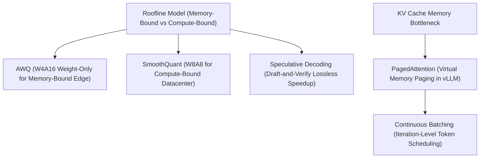

> [!abstract]
> Deploying large language models efficiently requires conquering the dual bottlenecks of memory bandwidth during interactive decoding and compute throughput during multi-tenant serving. Through activation smoothing (**SmoothQuant**), activation-aware 4-bit weight protection (**AWQ**), virtual memory paging for KV caches (**PagedAttention** in vLLM), token-level **Continuous Batching**, and draft-and-verify **Speculative Decoding**, systems can compress model footprints by up to 4× and multiply serving throughput by orders of magnitude without sacrificing mathematical accuracy.

Part of [[courses/mit-6-5940|MIT 6.5940 (Fall 2026)]], lecture 13.

## TL;DR
- **The Dual Bottlenecks of LLM Inference:** In interactive single-user decoding (batch size 1), inference is strictly memory-bandwidth bound (streaming billions of weights from VRAM to compute one token); in multi-tenant cloud serving (large batch sizes), inference shifts to compute-bound matrix multiplication on Tensor Cores.
- **Conquering Activation Outliers with SmoothQuant:** Beyond 6.7B parameters, activation outliers emerge in isolated channels, destroying naive INT8 quantization; [[concepts/smoothquant|SmoothQuant]] migrates quantization difficulty from spiky activations into uniform weights via channel-wise scaling, folding division into previous LayerNorms for zero-overhead W8A8 INT8 Tensor Core execution.
- **Protecting the Salient 1% with AWQ:** Quantizing weights to 4-bits (W4A16) slashes edge memory traffic by $4\times$; [[concepts/activation-aware-weight-quantization|Activation-Aware Weight Quantization]] (AWQ) proves that protecting just the $1\%$ of weights multiplying the largest activations recovers $100\%$ of FP16 accuracy, scaling them to avoid slow mixed-precision kernels.
- **Operating-System Level Serving:** Standard runtimes waste up to $80\%$ of GPU memory pre-allocating contiguous buffers; [[concepts/pagedattention|PagedAttention]] partitions the KV cache into non-contiguous physical pages to eliminate fragmentation, [[concepts/continuous-batching|Continuous Batching]] reschedules requests at token iteration boundaries to maximize GPU saturation, and [[concepts/speculative-decoding|Speculative Decoding]] uses a tiny draft model to verify multiple tokens in a single parallel step with zero accuracy loss.

## Concept map

The atomic concepts in dependency order:

1. [[concepts/smoothquant|SmoothQuant]]: Mathematically migrating quantization difficulty from activation outliers to uniform weights for W8A8 INT8 execution.  
   *Needs:* [[concepts/linear-quantization|Linear Quantization]]
2. [[concepts/activation-aware-weight-quantization|Activation-Aware Weight Quantization]]: Protecting the salient 1% of weight channels identified by activation magnitude for W4A16 compression.  
   *Needs:* [[concepts/linear-quantization|Linear Quantization]]
3. [[concepts/pagedattention|PagedAttention]]: Virtual memory paging for KV caches that eliminates internal and external VRAM fragmentation.  
   *Needs:* [[concepts/kv-cache|KV Cache]]
4. [[concepts/continuous-batching|Continuous Batching]]: Token iteration-level scheduling that evicts finished requests and admits new ones dynamically.  
   *Needs:* None
5. [[concepts/speculative-decoding|Speculative Decoding]]: Accelerating memory-bound decoding using a small draft model and single-pass parallel verification.  
   *Needs:* None



## First-principles rebuild

### 0. The Serving Scorecard: Memory-Bound vs. Compute-Bound Regimes

To optimize large language model inference, one must first consult the **Roofline Model**, which maps computational intensity (arithmetic operations executed per byte of memory moved) against hardware performance (TFLOPs):

```
Performance (TFLOPs)
     ^
Peak |                       +----------------------------------+ (Compute-Bound Ceiling)
TFLOPS|                      /  Large Batches (B >= 64, Datacenter Serving)
     |                     /   High Operational Intensity
     |                    /
     |                   /
     |                  /
     |                 /  Single-User / Edge Inference (Batch B = 1)
     |                /   Low Operational Intensity (Memory-Bandwidth Bound)
     |               /
     +--------------+----------------------------------------------> Operational Intensity
                    ^                                                (FLOPs / Byte)
              Memory Bandwidth
              (DRAM Slope)
```

In LLM serving, workloads occupy two completely distinct operational regimes:

1. **Interactive Single-User Decoding (Edge & Desktop, Batch $B = 1$):**
   - Generating each token requires streaming every single model parameter through the memory bus once.
   - For a 70B parameter model in FP16 ($140\text{ GB}$), generating 1 token requires reading $140\text{ GB}$ of data to perform only $140\text{ million}$ operations.
   - Computational intensity is tiny: $\frac{2 \text{ FLOPs}}{2 \text{ bytes}} = 1\text{ FLOP/Byte}$.
   - The GPU sits starved, waiting for weights to arrive from memory. The system is strictly **memory-bandwidth bound**.
   - **Solution:** Compress weights (e.g., [[concepts/activation-aware-weight-quantization|AWQ]] 4-bit weights) and apply [[concepts/speculative-decoding|Speculative Decoding]] to verify multiple tokens in a single memory fetch.

2. **Multi-Tenant Datacenter Serving (Cloud Clusters, Batch $B \ge 64$):**
   - When 64 requests are batched together, each weight fetched from VRAM is reused across all 64 requests simultaneously.
   - Computational intensity scales by $64\times$, pushing the workload onto the flat, compute-bound ceiling of the roofline.
   - Execution speed is bottlenecked by raw matrix multiplication on silicon ALUs.
   - **Solution:** Quantize both weights and activations to INT8 ([[concepts/smoothquant|SmoothQuant]]) or INT4/FP4 to leverage high-throughput Tensor Cores, and schedule memory dynamically via [[concepts/pagedattention|PagedAttention]] and [[concepts/continuous-batching|Continuous Batching]].

#### The Serving Scorecard
In production, speed is measured through four non-negotiable metrics:
- **Time to First Token (TTFT):** How long a user waits after pressing enter before the first word appears (governed by queue waiting time and prompt prefill speed).
- **Time per Output Token (TPoT):** The elapsed time between each newly generated token (governing visual reading cadence; 50–100 ms per token feels instantaneous to human readers).
- **End-to-End Latency:** $\text{TTFT} + (N - 1) \times \text{TPoT}$, total turnaround time for the complete sequence.
- **Aggregate Throughput:** Total tokens generated per second across all concurrent users, governing the financial cost of operating the cluster.

---

### 1. Taming the Activation Outlier Trap: SmoothQuant

In computer vision (CNNs), quantizing both weights and activations to INT8 (W8A8) has been standard practice for years. But when researchers applied standard INT8 quantization to large language models (like OPT-66B or LLaMA), accuracy collapsed catastrophically.

Why? **The Activation Outlier Phenomenon.**

Once foundation models scale past $6.7\text{B}$ parameters, specific isolated feature channels begin producing activation values whose magnitudes ($70\text{–}100$) are up to $100\times$ larger than normal tokens ($0.1\text{–}0.5$):

```
Normal Activation Channel:  [ 0.12,  0.45,  0.08, -0.22,  0.31 ]  <-- Fits nicely in [-128, 127]
Outlier Activation Channel: [ 0.14, 78.40,  0.11, -0.19, 84.10 ]  <-- Extreme spikes!
```

When applying symmetric INT8 quantization:
$$\Delta = \frac{\max |X|}{127} = \frac{84.1}{127} \approx 0.662$$
Every normal activation with magnitude $< 0.33$ is rounded down to **zero**. Small, subtle features across the entire sentence vanish into digital static, destroying the model's reasoning capabilities.

#### The Mathematical Migration Trick
Notice a key physical asymmetry: **while activations have severe channel spikes, weights are statically distributed, smooth, and contain zero extreme outliers.**

**SmoothQuant** exploits this by migrating the quantization difficulty from the activations into the weights:
$$Y = X W = \left( X \cdot \text{diag}(s)^{-1} \right) \cdot \left( \text{diag}(s) \cdot W \right) = \hat{X} \hat{W}$$

For each input channel $j$, calculate a per-channel smoothing scale $s_j$:
$$s_j = \frac{\max(|X_j|)^\alpha}{\max(|W_j|)^{1-\alpha}}$$
where $\alpha \approx 0.5$ balances difficulty equally between activations and weights.

```
Before Smoothing:
Activations: [ Max = 80.0 ] (IMPOSSIBLE TO QUANTIZE IN INT8)
Weights:     [ Max =  1.0 ] (TOO EASY)

Apply Smoothing Factor s = sqrt(80 / 1) = 8.94:
Activations / s: [ Max = 8.94 ] (EASILY QUANTIZED IN INT8!)
Weights * s:     [ Max = 8.94 ] (EASILY QUANTIZED IN INT8!)
```

#### Zero-Overhead Operator Fusion
How does the model divide activations by $s$ at runtime without adding an expensive extra CUDA kernel?

In modern transformers, every linear projection is preceded by a LayerNorm or RMSNorm:
$$\text{Output}_{\text{norm}} = \frac{x - \mu}{\sigma} \odot \gamma + \beta$$
SmoothQuant pre-divides the learnable normalization parameters offline during model compilation:
$$\hat{\gamma}_j = \frac{\gamma_j}{s_j}, \quad \hat{\beta}_j = \frac{\beta_j}{s_j}$$
The activations emerging from the normalization layer are **automatically scaled down for free**! The linear layer then executes directly on INT8 Tensor Cores with zero runtime overhead, cutting inference latency by $2\times$ and halving GPU count.

---

### 2. Protecting the Salient 1%: AWQ on Edge Workstations

While datacenter servers care about INT8 Tensor Core math, local workstations and edge laptops care about **memory footprint**. On an Apple Silicon MacBook or single NVIDIA RTX GPU running batch size 1, decoding speed is dictated by how fast model weights can be read from VRAM.

Quantizing weights from 16-bit to 4-bit (**W4A16**) reduces model memory from $14\text{ GB}$ to $3.5\text{ GB}$ for a 7B model, fitting it into modest consumer RAM.

However, naive 4-bit Round-to-Nearest (RTN) quantization causes perplexity to explode from $10$ to over $40$ (gibberish output).

#### The 1% Discovery
Researchers at MIT HAN Lab made a startling discovery: **preserving just 1% of salient weight channels in full precision completely recovers the model's accuracy**, returning perplexity back to the FP16 baseline ($10.2$)!

```
Perplexity on WikiText (Lower is Better):
FP16 Baseline:           10.2  (Original Model)
Naive 4-bit RTN:         43.1  (Destroyed)
Protect 1% by Weight:    39.8  (Still Destroyed!)
Protect 1% by Activation: 13.1  (Nearly Full FP16 Recovery!)
```

Why does selecting weights by weight magnitude fail, while selecting by **activation magnitude** succeeds?

In matrix multiplication $Y = X \cdot W$, the output error caused by a rounding error $\Delta W$ is directly multiplied by the input activation:
$$\Delta Y = X \cdot \Delta W$$
A weight of magnitude $0.05$ that multiplies an activation outlier of magnitude $80.0$ has a massive influence on the downstream prediction ($80.0 \times 0.05 = 4.0$). Conversely, a large weight of magnitude $2.0$ multiplying an activation of $0.001$ has virtually zero effect ($0.002$). **Activations dictate which weights matter!**

#### Eliminating Mixed Precision via AWQ Scaling
Keeping the salient 1% of channels in FP16 creates mixed-precision tensor layouts, which require messy branching and slow hardware execution lanes.

**Activation-Aware Weight Quantization (AWQ)** avoids mixed precision entirely:
1. Identify the 1% salient channels with the largest average activation magnitude $\|X_j\|$.
2. Protect those channels by multiplying the weights by an optimization scale $s > 1$ (found via a quick grid search on a small calibration set).
3. Multiplying a weight by $s > 1$ spreads its dynamic range across more integer quantization levels, reducing relative rounding error by $1/s$.
4. The inverse scale on activations is folded offline into the preceding layer.
5. All weights are then uniformly quantized to INT4.

AWQ delivers full FP16 performance at $4\times$ smaller model size, powering engines like **TinyChat** to achieve $3\times$ faster generation on edge devices.

---

### 3. Modern Serving Systems: PagedAttention, Continuous Batching, and Speculative Decoding

Compressing weights and activations solves model size, but serving multi-tenant traffic requires optimizing the runtime system.

#### 1. PagedAttention: Eradicating the 80% Memory Waste
In traditional serving systems, the [[concepts/kv-cache|KV Cache]] is allocated contiguously. Because generation length is unpredictable, the runtime pre-allocates memory for the maximum sequence length (e.g., 2,048 tokens).

A request that finishes in 50 tokens wastes 97% of its allocated memory. Across hundreds of concurrent requests, **$60\text{–}80\%$ of GPU memory is wasted on empty padding**.

**PagedAttention** borrows virtual memory paging from operating systems:
- Memory is divided into small, uniform physical blocks (e.g., 16 tokens per block).
- Each request maintains a logical page table mapping logical token sequences to non-contiguous physical blocks scattered throughout GPU VRAM.
- Blocks are allocated dynamically as tokens are generated. Memory waste is confined strictly to the final incomplete block of a request (under $4\%$ total waste).
- Enables **Zero-Copy Prefix Sharing**: multiple requests sharing the same prompt (parallel sampling, multi-turn chat) simply point their page tables to the same physical blocks, eliminating prompt memory duplication.

```
Operating System Paging:        PagedAttention in vLLM:
Virtual Memory Pages            Logical KV Token Blocks
       |                                |
[ OS Page Table ]              [ KV Page Table ]
       |                                |
Physical RAM Frames             Physical GPU VRAM Blocks (Scattered, 16 tokens/block)
```

#### 2. Continuous Batching: Iteration-Level Saturation
Traditional static batching processes groups of requests together until all finish. If one request takes 10 tokens and another takes 1,000 tokens, the short request's slot sits idle for 990 steps, wasting GPU capacity.

**Continuous Batching** operates at the **iteration boundary**:
- After every single token generation step, the scheduler inspects all active sequences.
- If a request generates `<EOS>`, it exits the batch immediately and returns its result to the user.
- A new request waiting in the admission queue immediately takes the empty slot on the very next token cycle.
- Drives GPU compute saturation to near $100\%$, multiplying cluster throughput by **$2\times$ to $5\times$**.

#### 3. Speculative Decoding: The Lossless Speedup
In single-user decoding, streaming 140 GB of weights from VRAM to generate one token is dreadfully slow.

**Speculative Decoding** pairs the large target model with a tiny, fast draft model (e.g., LLaMA-1B drafting for LLaMA-70B):
1. **Draft Phase:** The 1B draft model runs $K$ fast autoregressive steps (e.g., proposing 4 candidate tokens in $8\text{ ms}$).
2. **Verification Phase:** The 70B target model evaluates all 4 tokens in a **single parallel forward pass** (taking $32\text{ ms}$). Because the candidate tokens are known, the 70B model evaluates them all concurrently in one memory-read cycle!
3. **Acceptance Test:** Tokens are verified left-to-right via modified rejection sampling. If 3 tokens are accepted, the target model samples a 4th bonus token from its corrected distribution.
4. **Outcome:** 4 tokens produced in $40\text{ ms}$ ($10\text{ ms/token}$) vs. standard 70B decoding taking $4 \times 32 = 128\text{ ms}$ ($32\text{ ms/token}$)—an exact **$3.2\times$ acceleration with $100\%$ mathematical losslessness**.

---

## Connections

- **Cross-domain analog:** Passenger airline boarding vs. private car rides. Static batching is like an airline refusing to let anyone off the plane until the last passenger in the back row finishes gathering their luggage. Continuous batching is like a continuous subway platform: doors open at every stop, passengers step off the instant they arrive, and new passengers step on immediately without delaying the train.
- **What breaks when scaled down:** Activation outlier migration. In small models (under 1B parameters), activation outliers are small or non-existent; standard linear quantization works well without needing SmoothQuant migration. Outliers only emerge as a critical pathology at and above the 6.7B parameter threshold.
- **Next question:** Once these compressed models are deployed, how do we align them to follow human instructions and complex reasoning tasks through reinforcement learning from human feedback (RLHF) and Direct Preference Optimization (DPO)? That is the focus of **LLM Post Training** (Lecture 14).

## Review questions

> [!question]- Why do activation outliers cause naive INT8 quantization to fail in models larger than 6.7B parameters, and how does SmoothQuant resolve this?
> In large models, specific channels produce activation spikes up to $100\times$ larger than normal tokens. In symmetric INT8 quantization with 256 levels, the scale factor is dictated by the outlier, causing normal activations to round down to zero and destroying model capabilities. SmoothQuant resolves this by mathematically migrating the quantization difficulty from the activations into the weights using an exact equivalence: $Y = (X \cdot \text{diag}(s)^{-1})(\text{diag}(s) \cdot W)$. Dividing activations by $s$ scales down the outliers, while multiplying the uniform, easy-to-quantize weights by $s$ keeps them within INT8 boundaries. The division is folded offline into preceding LayerNorms, requiring zero runtime kernel overhead. Linked note: [[concepts/smoothquant|SmoothQuant]].

> [!question]- Why does selecting salient weights by activation magnitude succeed in AWQ, while selecting by weight magnitude fails?
> In matrix multiplication $Y = X \cdot W$, the output error caused by a weight quantization error $\Delta W$ is proportional to the input activation: $\Delta Y = X \cdot \Delta W$. A small weight that multiplies a massive activation outlier has a dominant impact on output activations, whereas a large weight multiplying a tiny activation has negligible effect. Selecting channels based on weight magnitude ignores this scaling and yields high perplexity ($\approx 40$), whereas selecting channels based on activation magnitude isolates the true gradient-bearing weights; protecting just that $1\%$ restores performance back to the FP16 baseline ($10.2$). Linked note: [[concepts/activation-aware-weight-quantization|Activation-Aware Weight Quantization]].

> [!question]- How does PagedAttention eliminate the 60–80% GPU memory waste present in traditional LLM serving systems?
> Traditional systems pre-allocate a contiguous memory buffer for each request sized to the maximum possible sequence length (e.g., 2,048 tokens). Because generation lengths are unpredictable, short requests leave most of their buffer empty (internal fragmentation), while interleaved request lifespans create unusable memory holes (external fragmentation), wasting $60\text{–}80\%$ of VRAM. PagedAttention divides the KV cache into fixed-size physical blocks (e.g., 16 tokens/block) and uses a logical page table to map non-contiguous physical blocks on demand. Unused slots are restricted strictly to the final incomplete block ($<4\%$ waste), and identical prompt blocks are shared across requests with zero memory duplication. Linked note: [[concepts/pagedattention|PagedAttention]].

> [!question]- Why is Speculative Decoding guaranteed to be mathematically lossless, and why does verifying multiple candidate tokens in parallel take nearly the same time as generating one token?
> During single-user decoding, execution is memory-bandwidth bound: reading the large target model's weights from VRAM takes the vast majority of execution time, while the arithmetic units sit under-utilized. Once a draft model proposes $K$ candidate tokens, the target model verifies all $K$ tokens in a single parallel forward pass (prefill-style), reading the weights from VRAM only once. Speculative decoding uses modified rejection sampling where accepted tokens match the target distribution and rejected tokens are resampled from a mathematically normalized residual distribution ($\max(0, P_{\text{target}} - P_{\text{draft}})$), provably guaranteeing that the output distribution is identical to sampling from the target model alone. Linked note: [[concepts/speculative-decoding|Speculative Decoding]].

## Source notes
- Lecture: MIT 6.5940 (Fall 2026), Lecture 13: LLM Deployment Techniques.
- Speaker: Jiaming Tang (MIT HAN Lab, advised by Prof. Song Han).
- Key references:
  - Xiao et al., "SmoothQuant: Accurate and Efficient Post-Training Quantization for Large Language Models" (ICLR 2023) — W8A8 quantization via activation-to-weight migration.
  - Lin et al., "AWQ: Activation-aware Weight Quantization for LLM Compression and Acceleration" (MLSys 2024) — Protecting salient 1% weights via activation scaling.
  - Kwon et al., "Efficient Memory Management for Large Language Model Serving with PagedAttention" (SOSP 2023) — vLLM and PagedAttention virtual memory architecture.
  - Leviathan et al., "Fast Inference from Transformers via Speculative Decoding" (ICML 2023) — Formulation of speculative sampling and verification.
  - Dao et al., "FlashAttention: Fast and Memory-Efficient Exact Attention with IO-Awareness" (NeurIPS 2022) — Tiled on-chip SRAM attention.
