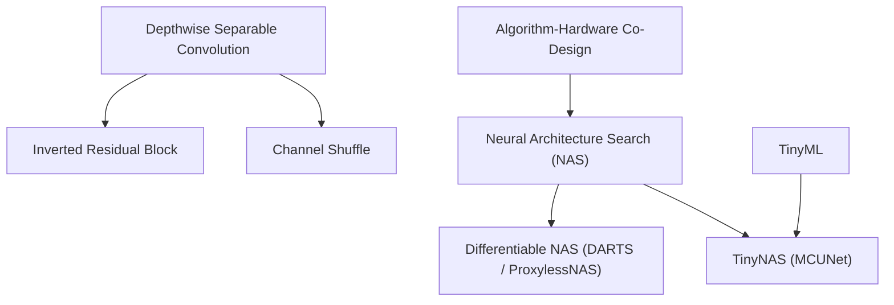

> [!abstract]
> Rather than compressing existing models after the fact, Neural Architecture Search automates the design of neural networks from the ground up—combining hardware-efficient primitive building blocks with search strategies that make latency differentiable and maximize compute under extreme SRAM limits.

Part of [[courses/mit-6-5940|MIT 6.5940 (Fall 2026)]], lecture 7.

## TL;DR
- **The Ground-Up Paradigm Shift:** Pruning and quantization take existing human-designed models and strip away redundancy, but Neural Architecture Search (NAS) designs intrinsically hardware-friendly topologies from scratch, pushing Pareto frontiers far beyond manual heuristic baselines.
- **The Inverted Bottleneck Memory Trap:** MobileNetV2's inverted residual block ($1 \times 1$ expand $\to 3 \times 3$ depthwise $\to 1 \times 1$ project) shrinks parameters by $4.6\times$ compared to ResNet-18, but its $6\times$ channel expansion inflates peak activation memory by $80\%$, creating a severe RAM bottleneck on embedded hardware.
- **The TinyML Search Principle:** On microcontrollers with only $256\text{ KB}$ of SRAM, memory is a hard brick wall while compute is cheap; TinyNAS automatically optimizes the search space by *maximizing* arithmetic compute (FLOPs) under strict memory bounds, achieving $>70\%$ ImageNet accuracy on bare-metal Cortex-M microcontrollers.

## Concept map

The atomic concepts in dependency order:

1. [[concepts/inverted-residual-block|Inverted Residual Block]]: A mobile convolutional block that expands channels into a high-dimensional space for cheap depthwise processing before projecting down to a linear bottleneck.  
   *Needs:* [[concepts/depthwise-separable-convolution|Depthwise Separable Convolution]]
2. [[concepts/channel-shuffle|Channel Shuffle]]: A zero-copy tensor transposition that interleaves channels across group convolutions, restoring cross-channel communication.  
   *Needs:* [[concepts/depthwise-separable-convolution|Depthwise Separable Convolution]]
3. [[concepts/neural-architecture-search|Neural Architecture Search]]: An automated framework that explores a defined search space to discover optimal neural network topologies under hardware objectives.  
   *Needs:* [[concepts/algorithm-hardware-co-design|Algorithm-Hardware Co-Design]]
4. [[concepts/differentiable-nas|Differentiable NAS]]: Continuous relaxation of architecture choices over an over-parameterized supernet, enabling network weights and hardware latency penalties to be optimized via gradient descent.  
   *Needs:* [[concepts/neural-architecture-search|Neural Architecture Search]]
5. [[concepts/tinynas|TinyNAS]]: A search space optimization methodology for microcontrollers that prunes memory-violating sub-spaces and maximizes arithmetic operations under a strict SRAM ceiling.  
   *Needs:* [[concepts/neural-architecture-search|Neural Architecture Search]], [[concepts/tinyml|TinyML]]



## First-principles rebuild

### 0. The Reality Check & Motivation

In the first half of this course, we explored **post-hoc compression**:
- **Pruning** cuts out useless connections [04:33].
- **Quantization** reduces bit-precision from 32-bit floating-point to INT8 or FP4 [05:07].

Both techniques assume the neural network architecture is already fixed. But what if the original human-engineered architecture was fundamentally flawed from the start [05:40]?

Human engineers rely on simplistic rules of thumb: doubling channel counts whenever spatial dimensions halve, using uniform $3 \times 3$ kernels across all layers, and chaining identical residual blocks [31:50]. These heuristics ignore the physical diversity of hardware execution engines: mobile phones are battery-constrained, edge cameras are DRAM-bandwidth-bound, and microcontrollers have only $256\text{ KB}$ of total SRAM [00:36].

**The Four-Way Trade-off:**  
Every efficient model must balance four competing dimensions [00:02]:
1. **Latency:** End-to-end execution speed and Time-To-First-Token (TTFT) [01:11].
2. **Storage:** Flash memory footprint and over-the-air (OTA) bandwidth [02:17].
3. **Energy:** Battery consumption on mobile robots and megawatts of datacenter cooling [03:24].
4. **Accuracy:** Task performance without degradation [04:33].

To navigate this 4-dimensional frontier, we need **Neural Architecture Search (NAS)**: algorithms that discover optimal, asymmetric, hardware-specialized network architectures automatically from scratch [05:40].

### 1. Ground Zero (The Primitive Operations)

Before an algorithm can design a network, we must define the primitive Lego blocks it can build with [06:48].

#### 1. Group Convolutions & Depthwise Convolutions
In a standard 2D convolution, every output channel connects to every input channel:
$$\text{MACs} = C_{\text{in}} \times C_{\text{out}} \times K_H \times K_W \times H_{\text{out}} \times W_{\text{out}}$$

In **Group Convolution**, input and output channels are split into $G$ disjoint groups [09:45]. Channels within group $g$ only interact with each other. This directly cuts computation by $G\times$ [10:19]:
$$\text{MACs}_{\text{group}} = \frac{\text{MACs}_{\text{dense}}}{G}$$

In the extreme limit where $G = C_{\text{in}} = C_{\text{out}}$, we reach **Depthwise Convolution** [10:52]: every single channel is convolved in complete spatial isolation ($K_H \times K_W$ parameters per channel).

#### 2. The Inverted Residual Block (MobileNetV2)
In classic ResNet bottleneck blocks, high-dimensional channels ($2048$) are compressed down to $512$ by a $1 \times 1$ conv, processed by a $3 \times 3$ conv, and expanded back to $2048$ [12:37].

MobileNetV2 completely **inverts** this pattern [17:54]:
1. **Expand ($1 \times 1$ Conv):** Low-dimensional input channels ($N$) are expanded by a factor of 6 ($N \to 6N$) [18:27].
2. **Depthwise ($3 \times 3$ Conv):** A lightweight spatial convolution operates in the high-dimensional $6N$ space [19:01].
3. **Linear Bottleneck ($1 \times 1$ Conv):** Projects $6N$ channels back down to $N$ output channels without a non-linear activation (preventing ReLU from destroying low-dimensional manifold representations) [19:01].

```
Input (N channels) ──► [ 1x1 Conv: Expand to 6N ] ──► [ 3x3 Depthwise Conv ] ──► [ 1x1 Conv: Project to N ] ──► Output (N channels)
        │                                                                                                        ▲
        └─────────────────────────────── Skip Connection (Residual) ─────────────────────────────────────────────┘
```

Why does this work? Depthwise convolution is mathematically cheap but has low expressive capacity [18:27]. By temporarily expanding channels into a $6\times$ wider manifold, depthwise filters can extract rich spatial features without incurring the quadratic computational cost of standard dense convolutions [19:38].

#### 3. Channel Shuffle (ShuffleNet)
In lightweight networks, $1 \times 1$ pointwise convolutions consume over $90\%$ of total FLOPs [22:31]. To reduce this cost, ShuffleNet replaces dense $1 \times 1$ convolutions with $1 \times 1$ **group convolutions** [23:05].

However, if you stack group convolutions back-to-back, channels in Group A never exchange information with Group B [23:42]. **Channel Shuffle** solves this by transposing and interleaving channels across groups [23:42]:
$$\text{Channels } C \longrightarrow \text{Reshape }(G, C/G) \longrightarrow \text{Transpose }(C/G, G) \longrightarrow \text{Flatten } C$$

Because this is a pure index reorganization, it executes with near-zero latency overhead while restoring global cross-channel communication [24:17].

### 2. The Idea Journey (The Breakthroughs)

#### Act 1: The Activation Memory Trap

Here emerges a classic systems pitfall in efficient deep learning [20:49]: **a model that reduces parameters and FLOPs can actually demand *more* memory on physical hardware.**

Compare ResNet-18 to MobileNetV2 (scaled to match accuracy) [20:49]:
- **Parameters:** MobileNetV2 shrinks model size by **$4.6\times$** [20:49].
- **Peak Activation Memory:** MobileNetV2 consumes **$80\%$ MORE memory** during inference than ResNet-18 [21:22]!

Why? Look at the expansion factor ($6\times$) [21:58]!  
In the middle of every inverted bottleneck block, the tensor inflates to $6N$ channels at high spatial resolutions ($H \times W$). Because intermediate activations must be buffered in on-chip SRAM during execution, expanding channels in early layers blows past hardware memory limits [21:58].

This proves that designing architectures based solely on FLOPs or parameter counts is deeply flawed; real systems demand multi-objective architecture search.

#### Act 2: Anatomy of the Search Space

How do you formalize the universe of possible neural networks [33:33]?

##### 1. Cell-Based Search Space (NASNet)
Inspired by building a multi-story skyscraper, search for two modular sub-networks [34:05]:
- **Normal Cell:** Preserves spatial resolution ($H \times W$) and feature depth [34:39].
- **Reduction Cell:** Halves spatial dimensions and doubles channels [34:39].

An RNN controller decides:
- Choose two input states from preceding layers ($h_{i-1}, h_{i-2}$) [36:25].
- Choose an operation for each input ($3 \times 3$ separable conv, $5 \times 5$ conv, average pooling, identity) [36:25].
- Choose how to combine them (element-wise add or concatenate) [37:03].

**The Combinatorial Explosion:**  
With $B$ blocks, $M$ candidate operations, and $N$ merge methods, the search space size is [38:13]:
$$\text{Space Size} = \left(4 \cdot M^2 \cdot N\right)^B$$
For $M=5$ operations, $N=2$ merge choices, and $B=5$ blocks, the space holds over **$10^{11}$ candidate architectures** [38:47]!

##### 2. Network-Level Search Space
Modern systems prefer network-level search, varying macro dimensions directly along a chain backbone [39:20]:
- **Depth ($D$):** Number of repeated layers per stage (e.g., 2, 3, or 4).
- **Width ($W$):** Channel counts per layer ($C \in \{64, 96, 128, 256\}$) [40:28].
- **Kernel Size ($K$):** Spatial filter size ($K \in \{3, 5, 7\}$) [40:28].
- **Resolution ($R$):** Input image resolution ($R \in \{128, 160, 192, 224\}$) [39:54].

#### Act 3: Designing the Search Space for TinyML (TinyNAS)

What happens when you run standard NAS for microcontrollers with only $256\text{ KB}$ of SRAM and $1\text{ MB}$ of Flash [44:26]?

Over $99\%$ of candidate architectures generated by mobile search spaces crash with Out-Of-Memory (OOM) errors [48:30]. A microcontroller has **three orders of magnitude less memory** than a smartphone [44:26]!

Song Han's group solved this in **MCUNet** with **TinyNAS** [42:44]:
1. **The Core Physical Principle:**  
   *Computation is cheap, but memory is expensive* [45:01]. A Cortex-M microcontroller can execute millions of arithmetic operations easily, but it cannot expand its hard $256\text{ KB}$ SRAM ceiling.
2. **Maximize Compute Under Memory Caps:**  
   Under a hard memory ceiling (peak activation $\le 256\text{ KB}$, parameters $\le 1\text{ MB}$), higher arithmetic compute (FLOPs) correlates strongly with higher model capacity and accuracy [45:36].
3. **Automated Search Space Optimization:**  
   Before running the search, TinyNAS evaluates candidate search spaces by plotting their cumulative FLOP distributions under the SRAM bound [46:44]. Search spaces that generate low FLOPs or frequently violate SRAM are eliminated.
4. **Result:** TinyNAS generated MCUNet, achieving **$70.7\%$ top-1 ImageNet accuracy** on a commercial STM32 microcontroller with just $256\text{ KB}$ SRAM—a milestone previously considered physically impossible [48:30].

#### Act 4: Search Strategies (From Brute Force to Differentiable Gradients)

Once the search space is defined, how do we find the needle in the $10^{11}$ haystack [49:40]?

| Strategy | Mechanism | Compute Cost | Pros & Cons |
| :--- | :--- | :--- | :--- |
| **Grid Search** | Brute-force Cartesian sweep across discrete steps (e.g. EfficientNet compound scaling) [50:16] | Exponential in dimensions ($O(S^D)$) [50:49] | Simple baseline, but intractable for $>3$ dimensions |
| **Random Search** | Randomly sample configurations independently [52:31] | Flexible | Essential sanity check to debug search pipelines |
| **Reinforcement Learning** | RNN controller samples architecture tokens, trained via policy gradient (REINFORCE) [53:03] | **Massive:** 800 GPUs for 28 days in original NASNet | Discovers novel topologies, but prohibitively expensive |
| **Differentiable NAS (DARTS)** | Continuous relaxation over a supernet; optimizes $\alpha$ via gradient descent [54:14] | **Low:** 1 GPU for 1 day | Fast and mathematically elegant, but supernet memory is high |
| **Evolutionary Search** | Genetic algorithm: population mutations (depth, kernel) and parent crossovers [57:42] | Moderate | Excellent multi-objective Pareto optimization |

##### Making Hardware Latency Differentiable
The true breakthrough of Differentiable NAS (like ProxylessNAS and FBNet) was making physical hardware speed differentiable [55:25]:
1. Pre-measure the latency of each candidate block on the target phone or NPU: $\text{Lat}(3 \times 3), \text{Lat}(5 \times 5), \text{Lat}(\text{Identity})$ [55:25].
2. Calculate the **expected latency** using candidate path probabilities $p_i$ [56:01]:
   $$\mathbb{E}[\text{Latency}] = \sum_i p_i \cdot \text{Lat}(op_i)$$
3. Add expected latency directly to the loss function [56:33]:
   $$\mathcal{L}_{\text{total}} = \mathcal{L}_{\text{task}} + \lambda \cdot \mathbb{E}[\text{Latency}]$$

If a $5 \times 5$ convolution is slow on that device, its path probability $p_i$ inflates the loss penalty. Backpropagation automatically drives down the selection probability of slow operators unless they provide an overwhelming accuracy improvement [56:33].

### Putting it together

The complete modern NAS workflow:
1. **Design Primitive Blocks:** Select efficient operators like Inverted Residual Blocks (MobileNetV2) and Channel Shuffling (ShuffleNet).
2. **Optimize the Search Space:** Apply TinyNAS principles—prune away memory-violating sub-spaces and maximize compute density under hardware memory ceilings.
3. **Execute Multi-Objective Search:** Use Differentiable NAS or Evolutionary Search to discover the Pareto frontier of accuracy, latency, and peak activation footprint.

## Connections
- Contrasts with [[concepts/magnitude-based-pruning|Magnitude-Based Pruning]] and [[concepts/post-training-quantization|Post-Training Quantization]]: Pruning and quantization optimize existing models; NAS automates ground-up architectural discovery.
- Connects to [[concepts/activation-memory-vs-weight-memory|Activation Memory vs Weight Memory]]: The Inverted Residual Block's $6\times$ expansion exposes why activation memory must be optimized independently of static weight parameters.
- Bridges to [[concepts/tinyml|TinyML]]: TinyNAS directly enables MCUNet by bringing deep learning into microcontroller-class SRAM envelopes ($256\text{ KB}$).
- Next steps: Lecture 8 dives deeper into **Hardware-Aware NAS (Part II)**, covering Once-for-All (OFA) networks, zero-shot NAS proxies, and joint neural-hardware co-search.

## Review questions

> [!question]- Q1 (recall): Why does MobileNetV2's inverted residual block suffer from an activation memory bottleneck despite achieving a 4.6x parameter reduction compared to ResNet-18?
> In an inverted residual block, low-dimensional input channels ($N$) are expanded by a factor of 6 ($N \to 6N$) using a $1 \times 1$ pointwise convolution before the spatial depthwise convolution. Although depthwise convolutions require very few weight parameters, the intermediate activation tensor inflates to $H \times W \times 6N$. At early layers where spatial resolution ($H \times W$) is large, buffering this expanded intermediate tensor consumes up to $80\%$ more peak activation RAM than standard ResNet architectures. See [[concepts/inverted-residual-block|Inverted Residual Block]].

> [!question]- Q2 (explain-why): How does Channel Shuffle restore cross-channel information exchange in ShuffleNet, and why does it incur near-zero latency overhead?
> When stacked $1 \times 1$ group convolutions are used to save compute, channels within separate groups remain completely isolated. Channel Shuffle reshapes the output channels from $(G, C/G)$ to $(C/G, G)$ and transposes the dimensions before flattening back to $C$. This evenly distributes channels from each group into every group of the subsequent layer. In hardware implementation, this requires no physical memory copying; compilers fuse the transpose into the index reading strides of the subsequent convolution kernel. See [[concepts/channel-shuffle|Channel Shuffle]].

> [!question]- Q3 (apply): How does Differentiable NAS (e.g. ProxylessNAS) incorporate physical on-device latency into a standard gradient descent loss function?
> Physical latency on the target chip is pre-measured for every candidate operation (e.g., $3 \times 3$ conv, $5 \times 5$ conv, identity). The expected latency of a layer is computed as the probability-weighted sum of its operator latencies: $\mathbb{E}[\text{Latency}] = \sum_i p_i \cdot \text{Lat}(op_i)$, where $p_i = \text{softmax}(\alpha_i)$. This expected latency is multiplied by a scaling coefficient $\lambda$ and added directly to the task loss: $\mathcal{L} = \mathcal{L}_{\text{task}} + \lambda \cdot \mathbb{E}[\text{Latency}]$. Backpropagation computes partial derivatives with respect to architectural parameters $\alpha$, naturally driving down the selection probability of slow operators. See [[concepts/differentiable-nas|Differentiable NAS]].

> [!question]- Q4 (transfer): Why is the primary objective of TinyNAS to *maximize* FLOPs under an SRAM limit, whereas mobile/cloud NAS typically aims to *minimize* FLOPs?
> On mobile and cloud platforms, RAM is abundant (gigabytes), while compute and battery energy are the primary costs; NAS minimizes FLOPs to reduce latency and power. On microcontrollers, SRAM is an unyielding brick wall ($256\text{ KB}$), while arithmetic compute is comparatively cheap and abundant. If a candidate network fits comfortably inside the $256\text{ KB}$ SRAM limit, maximizing its arithmetic compute (FLOPs) allows the network to pack the highest possible representational capacity and feature complexity into that tight memory budget, directly maximizing ImageNet accuracy. See [[concepts/tinynas|TinyNAS]].

## Source notes
- [00:02](https://www.youtube.com/watch?v=lPKZZyQxQXY&t=2s): The four-way trade-off of efficient AI: latency, storage, energy, and accuracy.
- [05:40](https://www.youtube.com/watch?v=lPKZZyQxQXY&t=340s): Shifting from post-hoc pruning and quantization to designing neural network architectures from scratch via NAS.
- [10:19](https://www.youtube.com/watch?v=lPKZZyQxQXY&t=619s): Group convolution reducing MAC operations by $G\times$.
- [17:54](https://www.youtube.com/watch?v=lPKZZyQxQXY&t=1074s): Inverted residual bottleneck block expanding channels by $6\times$ for depthwise processing.
- [20:49](https://www.youtube.com/watch?v=lPKZZyQxQXY&t=1249s): The activation memory trap: MobileNetV2 cuts parameters by $4.6\times$ but increases peak activation memory by $80\%$.
- [23:42](https://www.youtube.com/watch?v=lPKZZyQxQXY&t=1422s): ShuffleNet channel shuffle interleave operation restoring cross-group communication.
- [38:13](https://www.youtube.com/watch?v=lPKZZyQxQXY&t=2293s): Calculating cell-based search space combinatorial explosion ($\approx 10^{11}$ candidate architectures).
- [44:26](https://www.youtube.com/watch?v=lPKZZyQxQXY&t=2666s): Memory gap between mobile AI ($4\text{–}8\text{ GB}$) and microcontroller TinyML ($320\text{ KB}$ SRAM, $1\text{ MB}$ Flash).
- [45:01](https://www.youtube.com/watch?v=lPKZZyQxQXY&t=2701s): The TinyNAS principle: computation is cheap, memory is expensive; maximize FLOPs under a hard SRAM budget.
- [48:30](https://www.youtube.com/watch?v=lPKZZyQxQXY&t=2910s): MCUNet achieving $70.7\%$ ImageNet accuracy on commercial microcontrollers with $256\text{ KB}$ SRAM.
- [54:14](https://www.youtube.com/watch?v=lPKZZyQxQXY&t=3254s): Differentiable NAS continuous relaxation over candidate edges in a supernet.
- [56:33](https://www.youtube.com/watch?v=lPKZZyQxQXY&t=3393s): Making physical hardware latency differentiable by adding expected latency to the loss function.
- [57:42](https://www.youtube.com/watch?v=lPKZZyQxQXY&t=3462s): Evolutionary search using depth/kernel mutations and parent crossovers.
