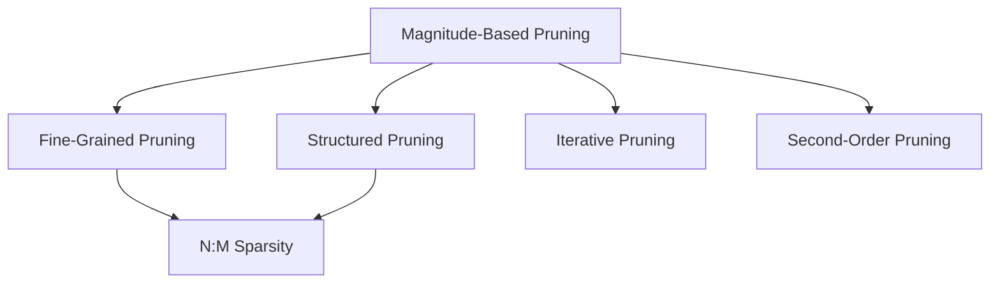

> [!abstract]
> Pruning cuts away redundant neural network weights to reduce DRAM transfers by 3×–10×, but maintaining accuracy and accelerating hardware requires cycling between pruning and fine-tuning and picking the right sparsity granularity.

Part of [[courses/mit-6-5940|MIT 6.5940 (Fall 2026)]], lecture 3.

## TL;DR
- **The Healing Cycle:** Deleting $80\%$ of parameters in a single pass destroys model accuracy, but pruning in gentle cycles interleaved with retraining lets surviving weights adapt and compensate, unlocking up to $90\%$ ($9\times$–$12\times$) parameter reduction with zero accuracy drop.
- **The Granularity Paradox:** Fine-grained (unstructured) pruning delivers the highest theoretical compression ratio but cannot run fast on standard GPUs without custom hardware; structured (channel/row) pruning shrinks tensor dimensions directly, accelerating off-the-shelf CUDA kernels at the cost of lower maximum sparsity.
- **The 2:4 Sweet Spot:** Semi-structured N:M sparsity (keeping the two largest weights out of every four) bridges the gap between algorithmic accuracy and hardware efficiency, providing native $2\times$ math throughput on modern Tensor Cores.

## Concept map

The atomic concepts in dependency order:

1. [[concepts/magnitude-based-pruning|Magnitude-Based Pruning]]: The baseline heuristic that zeros out parameters with values closest to zero because they contribute least to pre-activation sums.  
   *Needs:* nothing
2. [[concepts/fine-grained-pruning|Fine-Grained Pruning]]: Removing individual scalar weights anywhere in the matrix with zero pattern constraint; achieves maximum compression but requires custom hardware for speedup.  
   *Needs:* [[concepts/magnitude-based-pruning|Magnitude-Based Pruning]]
3. [[concepts/structured-pruning|Structured Pruning]]: Removing entire regular blocks (channels, filters, rows) so the remaining tensor remains a dense, smaller matrix that accelerates immediately on standard GPUs.  
   *Needs:* [[concepts/magnitude-based-pruning|Magnitude-Based Pruning]]
4. [[concepts/iterative-pruning|Iterative Pruning]]: Alternating between pruning small fractions of parameters and retraining the survivors, allowing the network to adapt smoothly to deep sparsity.  
   *Needs:* [[concepts/magnitude-based-pruning|Magnitude-Based Pruning]]
5. [[concepts/n-m-sparsity|N:M Sparsity]]: A semi-structured pattern (e.g., 2:4 sparsity) that requires at least $N$ zeros per block of $M$ elements, natively accelerated by modern GPU Tensor Cores.  
   *Needs:* [[concepts/fine-grained-pruning|Fine-Grained Pruning]], [[concepts/structured-pruning|Structured Pruning]]
6. [[concepts/second-order-pruning|Second-Order Pruning]]: Using the Hessian matrix from a Taylor series expansion of the loss function to measure parameter importance by local curvature ($H_{ii} w_i^2$) rather than raw magnitude.  
   *Needs:* [[concepts/magnitude-based-pruning|Magnitude-Based Pruning]]



## First-principles rebuild

### 0. The Reality Check & Motivation

Why would anyone delete parts of a functioning neural network? The answer lies in two realities: human biology and semiconductor physics [04:34].

In human biology, synaptic pruning is how the brain actually learns. A newborn infant starts with roughly $2,500$ synaptic connections per neuron. By age two to four, the brain reaches peak connectivity at roughly $15,000$ synapses per neuron [05:12]. But as the child grows into adolescence—the exact window where humans learn language, abstract reasoning, and formal education—the brain does not add connections. Instead, it aggressively cuts them back to roughly $7,000$ synapses per neuron [05:46]. The brain eliminates more than half of its connections to eliminate noise and specialize circuits. Pruning is not a degradation; it is how learning crystallizes.

In semiconductor physics, moving bits across wires is orders of magnitude more expensive than performing math [02:18]. A $32$-bit floating-point multiply-accumulate on a modern chip consumes approximately $4$ picojoules, but fetching that same number across a circuit board from off-chip DRAM consumes over $640$ picojoules—more than a **$160\times$ difference**. If a neural network contains hundreds of millions of parameters, the processor spends almost all of its battery power and execution time shuttling redundant numbers back and forth across the memory bus [02:51]. If a parameter doesn't pull its weight, eliminating it entirely saves DRAM bandwidth, cuts latency, and slashes energy consumption.

### 1. Ground Zero (The Core Primitives)

Strip away library abstractions: what is a neural network layer?

At bare metal, a fully connected or convolutional layer is a set of linear equations:
$$y = \sum_{i=1}^{K} w_i x_i + b$$

Each parameter $w_i$ is simply a scale factor determining how strongly input feature $x_i$ impacts output activation $y$. 

**What does pruning mean mathematically?**  
Pruning means setting a selected subset of weights to exact zero [03:28]. We replace the dense weight matrix $W$ with a sparse matrix $W_p$:
$$\min_{W_p} \mathcal{L}(x; W_p) \quad \text{subject to} \quad \|W_p\|_0 \le N$$

where $\|W_p\|_0$ counts the number of non-zero entries, $N$ is our parameter budget, and $\mathcal{L}$ is the task loss [03:45]. Every parameter driven to zero no longer needs to be fetched from memory, provided our hardware or format knows how to skip it.

### 2. The Idea Journey (The Breakthroughs)

#### Step 1: The Naive First Attempt and the Fine-Tuning Rescue

The obvious first way to prune is **magnitude-based pruning** [27:21]: compute the absolute value of every weight $|w_i|$, sort them, and zero out the smallest ones.

Suppose a single neuron evaluates:
$$y = 10 x_0 - 8 x_1 + 0.1 x_2$$
Dropping $w_2 = 0.1$ shifts the output by at most $0.1 \times \max|x_2|$, while shrinking parameter storage by $33\%$ [27:54].

What happens when you apply this across an entire deep network like AlexNet on ImageNet [07:33]?
- At $30\%$ to $50\%$ sparsity, accuracy holds steady.
- Beyond $50\%$, accuracy plummets off a cliff. At $80\%$ one-shot pruning, the model becomes completely unusable [08:06].

**The Conceptual Leap: Retraining (Fine-Tuning)**  
Song Han's 2015 breakthrough demonstrated that deleting the weights is only half the battle. If you take the damaged network with $80\%$ of its weights zeroed out, **freeze the zeroed weights**, and retrain the surviving $20\%$ with gradient descent, the remaining weights shift their values to absorb the missing work [08:42]. 

During retraining, the surviving weights adjust their values, redistributing the burden. In fact, fine-tuning an $80\%$-pruned network often yields *higher* accuracy than the original dense network (as seen in AlexNet) because removing redundant connections acts as a regularizer that prevents overfitting [08:55].

```
Dense Model (100% weights)
       │
       ▼ [Prune small weights]
Damaged Sparse Model (Accuracy collapses)
       │
       ▼ [Fine-tune surviving weights with backprop]
Healed Sparse Model (Accuracy restored, 80% smaller!)
```

#### Step 2: Pushing the Limit with Iterative Pruning

Can we push past $80\%$? If you try to prune $90\%$ in a single pass, even fine-tuning cannot bring the dead model back to life [30:25].

**The Solution: Iterative Pruning**  
Instead of making one massive cut, prune in gentle, repeated cycles [30:46]:
1. Prune $20\%$ of the smallest weights $\rightarrow$ retrain for 2 epochs.
2. Prune another $20\%$ of the remaining weights $\rightarrow$ retrain for 2 epochs.
3. Repeat step-by-step until reaching the target sparsity.

By giving surviving parameters time to adapt across multiple rounds, the network easily reaches **$90\%$ sparsity ($10\times$ parameter reduction)** on AlexNet and VGG, $3.5\times$ on GoogLeNet, and $3.4\times$ on ResNet-50 without any loss in ImageNet accuracy [31:21].

**Where does it break?**  
Pruning has an absolute physical limit. On an image captioning benchmark, a $90\%$-pruned model correctly generates: *"A man in a white suit is riding a wave on a beach"* [14:02]. But pushing to $95\%$ sparsity breaks the model's coherent representations [14:35]. The model "gets drunk," hallucinating impossible details: *"A man in a white red shirt and black and white black shirt is running through a field."* There is a minimum informational capacity required to solve a given task [13:27].

#### Step 3: The Hardware Reality (Fine-Grained vs. Structured Pruning)

Here arises a major practical dilemma: **an $80\%$ sparse matrix stored on disk does not automatically run faster on a GPU.**

Why? Because standard computing hardware (GPUs and CPUs) is built for dense SIMD/SIMT execution [19:05]. When you perform fine-grained pruning, zeros are scattered randomly across matrix coordinates [42:32]:

| Pruning Granularity | How It Works | Compression Ratio | GPU Acceleration |
| :--- | :--- | :--- | :--- |
| **Fine-Grained (Unstructured)** | Zeros individual weights randomly anywhere in the tensor [42:32] | **Highest** ($9\times$–$12\times$ on older nets, $2\times$ on LLMs) | **Zero speedup on stock GPUs**; requires custom hardware engines (e.g., EIE) |
| **Structured (Channel / Row)** | Deletes entire channels, rows, or convolution filters [43:28] | **Moderate** ($1.5\times$–$2\times$) | **Immediate speedup** on any standard cuBLAS / cuDNN kernel without hardware changes [44:41] |
| **N:M Semi-Structured (2:4)** | Requires at least 2 zeros in every 4 contiguous elements [50:50] | **Fixed $2\times$** parameter reduction | **Native $2\times$ math speedup** on NVIDIA Ampere+ Tensor Cores [40:20] |

In **structured pruning**, deleting an entire output channel removes an entire row from the weight matrix:
$$8 \text{ rows} \longrightarrow 5 \text{ rows}$$
The remaining $5 \times K$ tensor is completely dense. You feed it to standard PyTorch or CUDA code with zero custom indexing [44:41]. However, because you are forced to discard entire channels as an indivisible bundle, you inevitably discard useful individual weights, causing accuracy to degrade at much lower sparsity ratios ($30\%$–$50\%$) [53:35].

#### Step 4: The 2:4 Sparsity Industry Standard

To capture the best of both worlds, NVIDIA introduced **2:4 semi-structured sparsity** starting with the Ampere architecture (A100) [40:20]:
- For every four consecutive weights in a row, exactly **two must be zero** [50:50].
- The remaining two non-zero weights are packed contiguously into memory alongside a tiny 2-bit metadata index specifying their original positions.
- Dedicated hardware multiplexers in the Tensor Cores read the compressed stream, unpack the pairs on the fly, and execute matrix multiplication at **$2\times$ peak computational throughput** with up to $1.5\times$ measured end-to-end wall-clock speedup [40:20].

```
Dense row (4 values):       [ 0.1 ,  1.8 ,  0.3 , -2.5 ]
                               │      ▲      │      ▲
Select 2 largest:              │    Keep     │    Keep
                               ▼      │      ▼      │
2:4 Compressed storage:    Values: [ 1.8 , -2.5 ]  Indices: [01, 11] (2-bit)
```

Because 2:4 sparsity provides fine-grained local choice (you choose the best two out of every four rather than killing an entire channel), models like ResNet, BERT, and SSD recover $100\%$ of their dense accuracy after a brief retraining cycle [52:28].

#### Step 5: Advanced Pruning Criteria (Deciding What to Cut)

Beyond simple weight magnitude, how do we decide which channels or parameters to prune?

1. **Batch Normalization Scaling Factor ($\gamma$):**  
   In modern CNNs, every convolutional layer is followed by a BatchNorm layer that scales activations by a learnable factor $\gamma$ [65:10]:
   $$\hat{y} = \gamma \left(\frac{x - \mu}{\sqrt{\sigma^2 + \epsilon}}\right) + \beta$$
   If training drives $\gamma \approx 0$ for channel $c$, that entire feature map is effectively muted. We can rank channels by their learned $|\gamma|$ values and prune the smallest ones [63:46].

2. **Average Percentage of Zeros (APoZ):**  
   After passing inputs through a ReLU activation, many channels produce mostly zeros across the validation set [70:44]. If Channel A produces $90\%$ zeros across all images while Channel B produces only $10\%$ zeros, Channel A is performing virtually zero active feature extraction. Pruning the channel with the highest APoZ minimizes perturbation to downstream layers [73:25].

3. **Second-Order Curvature (Hessian / Optimal Brain Damage):**  
   LeCun's 1989 *Optimal Brain Damage* uses a Taylor series expansion of the loss function $\mathcal{L}$ around the trained weights [66:27]:
   $$\Delta \mathcal{L} \approx \underbrace{\mathbf{g}^T \Delta \mathbf{w}}_{\approx 0 \text{ at minimum}} + \frac{1}{2} \Delta \mathbf{w}^T \mathbf{H} \Delta \mathbf{w}$$
   Assuming off-diagonal cross-terms are negligible, the saliency of weight $w_i$ is governed by:
   $$S_i = \frac{1}{2} H_{ii} w_i^2$$
   A weight with a small magnitude $w_i$ might still be critical if its loss curvature $H_{ii}$ is steep (a narrow canyon in the loss landscape) [68:27].

4. **Regression-Based Reconstruction Error:**  
   Instead of looking at the global loss, solve a local least-squares problem per layer [74:25]. Minimize the difference between the original output tensor $Z = XW$ and the pruned output $\tilde{Z} = X(W \odot \beta)$, alternating between optimizing channel selection mask $\beta$ and retraining the weight values $W$ [81:29].

### Putting it together

Pruning serves as the foundation of model compression:
1. **Choose granularity:** Structured channel pruning for legacy server/edge CPUs, 2:4 semi-structured sparsity for modern Ampere/Hopper GPUs, or fine-grained pruning when deploying to custom accelerators.
2. **Rank parameters:** Use magnitude norms ($L_1 / L_2$) or BatchNorm scaling factors ($\gamma$) to identify the weakest connections.
3. **Iterative prune-and-retrain:** Cut weights in $15\%$–$20\%$ increments, retraining between rounds until reaching the target parameter count.

Once the network has been pruned and the surviving weights have settled into their sparse layout, the model is primed for the next stage of [[concepts/deep-compression-pipeline|Deep Compression]]: [[concepts/k-means-quantization|weight quantization]].

## Connections
- Builds directly on [[concepts/the-memory-compute-gap|The Memory-Compute Gap]]: Pruning's primary objective is eliminating off-chip DRAM accesses by reducing total parameter footprint.
- Feeds into the [[concepts/deep-compression-pipeline|Deep Compression Pipeline]]: Pruning must precede quantization so the network's degrees of freedom can heal accuracy before weight values are quantized into discrete codebooks.
- Embodies [[concepts/algorithm-hardware-co-design|Algorithm-Hardware Co-Design]]: Sparse algorithms and hardware architectures must align; fine-grained sparsity led to the Efficient Inference Engine (EIE), while hardware constraints inspired NVIDIA's 2:4 Tensor Core support.
- Next steps: Lecture 4 explores the *Lottery Ticket Hypothesis* (can we find sparse sub-networks from scratch without training the dense model first?) and automated pruning search algorithms.

## Review questions

> [!question]- Q1 (recall): Why does fine-grained (unstructured) pruning fail to provide speedup on standard GPUs despite removing 80% of parameters?
> Standard GPUs are SIMD/SIMT architectures designed around dense matrix multiplication (GEMM). Irregular, scattered zeros cause severe thread divergence (some threads in a warp finish instantly while others compute) and non-contiguous memory access patterns. Without specialized sparse hardware like the Efficient Inference Engine or native 2:4 Tensor Cores, standard GPU execution engines spend as much time processing sparse indexing overhead as doing useful arithmetic. See [[concepts/fine-grained-pruning|Fine-Grained Pruning]].

> [!question]- Q2 (explain-why): Why does iterative pruning achieve significantly higher compression ratios than one-shot pruning?
> One-shot pruning eliminates all small parameters simultaneously, inflicting a massive shock that pushes the model far outside its low-loss basin, often causing permanent accuracy collapse. Iterative pruning removes weights in gentle increments ($15\%$–$20\%$) and fine-tunes between rounds. This retraining window allows surviving non-zero weights to adjust their numerical values via backpropagation, redistributing the representational burden and healing the model before the next cut. See [[concepts/iterative-pruning|Iterative Pruning]].

> [!question]- Q3 (apply): You are deploying an image classification model to a fleet of off-the-shelf mobile devices running standard CPU inference engines. Should you use fine-grained pruning or structured channel pruning, and what trade-off must you accept?
> You should choose **structured channel pruning**. Standard mobile CPU runtime engines cannot accelerate arbitrary unstructured zeros. Structured pruning physically removes entire channels, producing a regular, smaller dense matrix that runs faster immediately on stock BLAS kernels. The trade-off is that structured pruning has a much lower maximum compression ratio: accuracy will typically begin degrading past $30\%$–$50\%$ channel removal, whereas fine-grained pruning could have removed up to $80\%$–$90\%$ of raw parameters on disk. See [[concepts/structured-pruning|Structured Pruning]].

> [!question]- Q4 (transfer): In modern Transformer architectures, the multi-head self-attention block computes $A = \text{softmax}(QK^T / \sqrt{d_k})V$, which contains no static weights. How can the principles of sparsity still be applied to accelerate this calculation?
> Although the attention matrix $A$ contains no static weights, it exhibits dynamic activation sparsity: in long contexts, each token attends strongly to only a tiny fraction of other tokens (e.g., local syntactic neighbors and key subject tokens), while the vast majority of attention weights approach zero after the softmax operation. By identifying and skipping uninformative token pairs dynamically (sparse attention), hardware can avoid computing the full $N \times N$ key-value multiplications, mirroring the memory and compute savings of weight pruning in activation space.

## Source notes
- [02:18](https://www.youtube.com/watch?v=47nNIPj3B98&t=138s): Energy comparison showing DRAM access consumes $>2$ orders of magnitude more energy than arithmetic operations.
- [03:28](https://www.youtube.com/watch?v=47nNIPj3B98&t=208s): Mathematical formulation of pruning as $\min_{W_p} \mathcal{L}(x; W_p) \text{ s.t. } \|W_p\|_0 \le N$.
- [05:12](https://www.youtube.com/watch?v=47nNIPj3B98&t=312s): Biological evidence showing human synapses peak at ages 2–4 and prune down by half during adolescence.
- [08:42](https://www.youtube.com/watch?v=47nNIPj3B98&t=522s): Retraining surviving weights recovers accuracy at $80\%$ sparsity, with some models exceeding baseline accuracy.
- [11:46](https://www.youtube.com/watch?v=47nNIPj3B98&t=706s): Iterative pruning and retraining pushes parameter reduction to $90\%$ ($9\times$–$12\times$ on AlexNet/VGG).
- [14:35](https://www.youtube.com/watch?v=47nNIPj3B98&t=875s): Pushing pruning past the informational limit ($95\%$ sparsity) causes captioning models to hallucinate ("get drunk").
- [40:20](https://www.youtube.com/watch?v=47nNIPj3B98&t=2420s): NVIDIA Ampere 2:4 semi-structured sparsity hardware support providing $2\times$ peak math throughput.
- [42:32](https://www.youtube.com/watch?v=47nNIPj3B98&t=2552s): Comparison of fine-grained unstructured sparsity versus coarse-grained structured row/channel pruning.
- [65:10](https://www.youtube.com/watch?v=47nNIPj3B98&t=3910s): Reusing learned BatchNorm scaling factors $\gamma$ as a channel selection criterion.
- [66:27](https://www.youtube.com/watch?v=47nNIPj3B98&t=3987s): Second-order Taylor series expansion and Hessian curvature ($H_{ii} w_i^2$) in Optimal Brain Damage.
- [70:44](https://www.youtube.com/watch?v=47nNIPj3B98&t=4244s): Average Percentage of Zeros (APoZ) after ReLU for identifying inactive feature maps.
- [74:25](https://www.youtube.com/watch?v=47nNIPj3B98&t=4465s): Regression-based reconstruction error minimization via alternating optimization of channel masks and weights.
