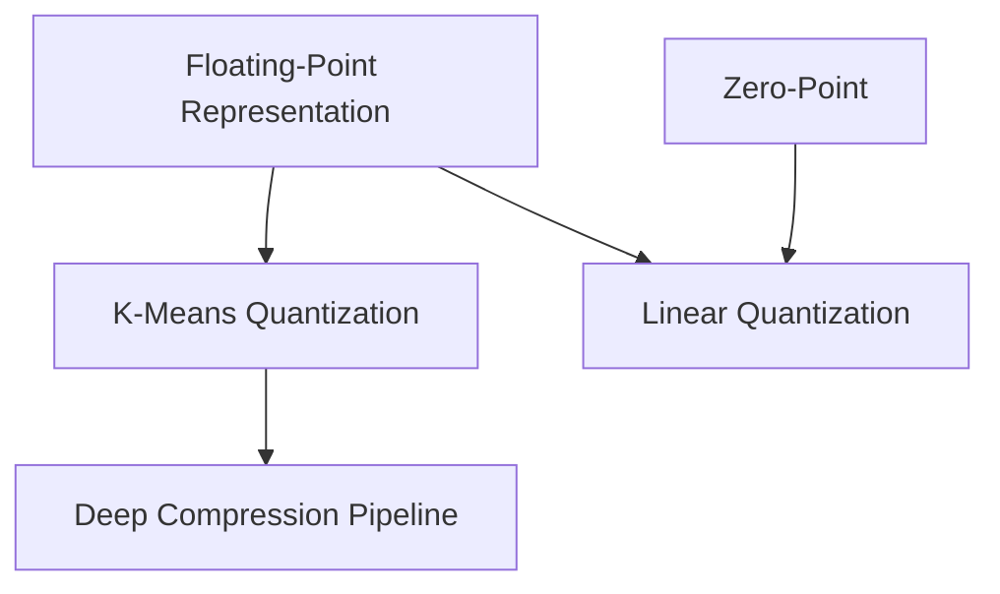
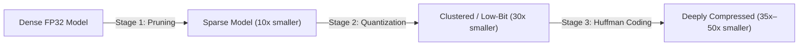

> [!abstract] Quantization transforms neural network deployment from a memory-bound, energy-draining bottleneck into lightweight execution by fundamentally rethinking how digital bits represent continuous numbers—evolving from codebook weight sharing to pure integer arithmetic.

Part of [[courses/mit-6-5940|MIT 6.5940 (Fall 2026)]], lecture 5.

## TL;DR
- **The Memory Bottleneck:** Moving 32 bits from off-chip DRAM burns up to 200× more energy than multiplying them; reducing bit-width directly attacks the primary energy cost of AI.
- **Weight Sharing vs. Integer Arithmetic:** K-means codebook quantization compresses model storage (up to 8× at 4-bit) via shared centroids but still requires floating-point math; linear affine quantization maps values to discrete integers so the entire network runs on integer-only ALUs.
- **The Deep Compression Symphony:** Pruning eliminates redundant connections first, quantization collapses the bit-width of survivors, and Huffman coding compresses index entropy, shrinking models up to 510× when paired with compact architectures.

## Concept map
The atomic concepts in **dependency order**: each one builds directly on the insights before it.
1. [[concepts/floating-point-representation|Floating-Point Representation]]: How silicon partitions finite bits into sign, exponent (dynamic range), and mantissa (precision) to approximate continuous reality.
   *Needs:* nothing
2. [[concepts/zero-point|Zero-Point]]: The integer anchor ensuring real zero is represented without quantization error, preserving zero-padding and ReLU sparsity.
   *Needs:* nothing
3. [[concepts/k-means-quantization|K-Means Quantization]]: Compressing storage by grouping weights into shared cluster centroids referenced by compact integer indices.
   *Needs:* [[concepts/floating-point-representation|Floating-Point Representation]]
4. [[concepts/linear-quantization|Linear Quantization]]: An affine mapping ($r = S(q - Z)$) enabling end-to-end integer multiplication and bit-shift scaling on hardware without floating-point units.
   *Needs:* [[concepts/floating-point-representation|Floating-Point Representation]], [[concepts/zero-point|Zero-Point]]
5. [[concepts/deep-compression-pipeline|Deep Compression Pipeline]]: The three-stage pipeline (prune, quantize, entropy-encode) that compounds structural, bit-width, and statistical redundancies.
   *Needs:* [[concepts/k-means-quantization|K-Means Quantization]]



## First-principles rebuild

### 0. The Physical Reality: Why Math is Cheap but Memory is Ruinous
When an AI model runs on a smartphone, drone, or edge sensor, what actually drains the battery?
The natural intuition is to blame arithmetic—the billions of floating-point multiplications and additions performed per second. But computer architecture reveals a stark physical reality: **fetching 32 bits from off-chip DRAM consumes up to 200× more energy than the arithmetic operation itself** [01:37]. 

The silicon wires connecting external memory to the chip are long and capacitive. Every time a full 32-bit floating-point weight is shuttled across the bus, energy is dissipated as heat. The computation is practically free; the *data traffic* is the bottleneck.

If we want to run modern neural networks locally on edge devices, we cannot simply build faster floating-point multipliers. We have to fundamentally shrink the number of bits each parameter and activation occupies.

---

### 1. Ground Zero: How Digital Computers Represent Numbers
To compress numbers, we must first ask: *What is a number inside silicon?*
In mathematics, real numbers exist on a continuous spectrum with infinite precision. In hardware, we only have discrete binary switches: bits that are either $0$ or $1$ [02:11].

#### The Integer Spectrum
With $n$ unsigned bits, you can count from $0$ to $2^n - 1$. To handle negative numbers, the naive approach is a dedicated sign bit (`0` for positive, `1` for negative). But this creates a wasteful defect: both `+0` (`0000`) and `-0` (`1000`) represent zero, squandering a valuable bit pattern [03:19]. **Two's complement** solves this by assigning the most significant bit a negative weight ($-2^{n-1}$), guaranteeing a single unique zero and granting an extra negative number. However, integers have a rigid, uniform grid—the distance between consecutive numbers is always 1.

#### The Floating-Point Compromise
Neural network gradients and weights span vastly different orders of magnitude: some are $10^{-5}$, while others are $10^2$. A fixed integer grid would either underflow small gradients to zero or overflow large weights.

The IEEE 754 floating-point standard solves this by borrowing scientific notation, partitioning 32 bits into three fields:
$$r = (-1)^s \times (1 + f) \times 2^{e - \text{bias}}$$
- **1 Sign bit ($s$):** Positive ($0$) or negative ($1$).
- **8 Exponent bits ($e$):** Dictates the dynamic range, shifted by a bias ($127$) to support negative powers of 2.
- **23 Fraction/Mantissa bits ($f$):** Dictates the resolution and precision between powers of 2.

```
FP32: [ Sign: 1 bit ] [ Exponent: 8 bits ] [ Fraction: 23 bits ]
```

#### The Subnormal Dilemma: How to Represent Zero
Look closely at the formula above: because of the normalized implicit leading one $(1 + f)$, the smallest positive value with $f=0$ is $1.0 \times 2^{e - \text{bias}}$. **You can never reach exact zero!**

To prevent programs from crashing, IEEE 754 carves out a special domain called **subnormal numbers** [09:27]. When the exponent bits are all zeros ($e = 0$), the implicit leading one is dropped:
$$r = (-1)^s \times f \times 2^{1 - \text{bias}}$$
Now, when the fraction bits are all zero ($f = 0$), we finally achieve exact mathematical zero ($0.0$). Furthermore, subnormals provide graceful underflow: as the fraction bits shrink down to a single bit ($2^{-23}$), numbers can smoothly diminish down to $2^{-149}$ before vanishing [11:07]. Conversely, when the exponent bits are all ones ($e = 255$), the format represents $\pm\infty$ (if $f = 0$) or **NaN (Not a Number)** (if $f \neq 0$) [13:26].

#### The AI Insight: Dynamic Range Trumps Precision
For decades, high-performance computing treated 64-bit and 32-bit floats as mandatory. But machine learning researchers noticed a surprising property: **neural networks are extraordinarily resilient to noise in fine precision, but highly sensitive to dynamic range** [18:04]. If a gradient underflows to zero, learning halts; if a weight has 7 bits of precision instead of 23, the network barely notices.

This insight gave birth to **Brain Floating Point (BF16)**:
- Traditional **FP16** cut the exponent to 5 bits (bias 15) and kept 10 fraction bits. It frequently suffered from numerical underflow during training.
- **BF16** kept all 8 exponent bits from FP32 (matching its massive dynamic range) and ruthlessly trimmed the fraction field to 7 bits. Models train seamlessly without loss scaling tricks.

```
FP32: [ 1 sign ] [ 8 exponent ] [ 23 fraction ]
FP16: [ 1 sign ] [ 5 exponent ] [ 10 fraction ]  <-- Limited range, prone to underflow
BF16: [ 1 sign ] [ 8 exponent ] [  7 fraction ]  <-- Same range as FP32, half the bits!
```

#### Pushing to 4-Bit: The Geometric Match
When descending to 4-bit representations, bit allocation becomes critical [26:31]:
- **INT4 (E0M3):** Linear steps between $[-8, 7]$.
- **FP4 E1M2:** 1 exponent, 2 mantissa. This format is fundamentally flawed—it produces redundant zeros, truncates range, and is merely a scaled linear grid.
- **FP4 E2M1:** 2 exponent, 1 mantissa. This creates a non-linear spacing: values cluster tightly near zero ($0, 0.5, 1, 2$) and space out broadly for larger magnitudes ($3, 4, 6$).
Why is E2M1 so powerful? Because trained neural network weights naturally form a bell-shaped Gaussian distribution centered at zero [28:46]. Most weights reside near zero and demand fine-grained resolution, while the rare outlier tails only need coarse representation.

---

### 2. The First Intuition: Weight Sharing via K-Means
Armed with our understanding of numbers, what is the most intuitive way to compress a neural network?

Consider a $4 \times 4$ weight matrix from a convolutional layer. It contains 16 weights stored as 32-bit floats:
```text
[ 2.09, -0.98,  1.48,  0.09 ]
[ 0.05, -1.08, -0.91,  0.06 ]
[-0.03,  2.12, -0.99,  2.01 ]
[ 2.02, -0.01,  1.53,  1.49 ]
```
Do all 16 weights really need to be distinct numbers?
If one weight is $2.09$ and another is $2.12$, does the network's predictive power collapse if we treat them both as $2.0$?

This is the core intuition behind **K-Means Quantization (Weight Sharing)** [32:13]:
Instead of letting every parameter take any arbitrary 32-bit float, we cluster similar weights together into $k$ discrete centroids. For $k=4$, we only need 2 bits ($2^2 = 4$) to index each cluster:
- **Centroid 0 (green):** $-1.0$
- **Centroid 1 (orange):** $0.0$
- **Centroid 2 (red):** $1.5$
- **Centroid 3 (blue):** $2.0$

Each weight in the matrix is replaced by its 2-bit cluster index:
```text
Indices (2-bit):
[ 3, 0, 2, 1 ]
[ 1, 0, 0, 1 ]
[ 1, 3, 0, 3 ]
[ 3, 1, 2, 2 ]
```

#### Calculating the Bit Savings
- **Unquantized:** $16 \text{ weights} \times 32 \text{ bits} = 512 \text{ bits} = 64 \text{ bytes}$.
- **Quantized:** 
  - Index table: $16 \text{ indices} \times 2 \text{ bits} = 32 \text{ bits} = 4 \text{ bytes}$.
  - Codebook: $4 \text{ centroids} \times 32 \text{ bits} = 128 \text{ bits} = 16 \text{ bytes}$.
  - Total: $4 + 16 = 20 \text{ bytes}$ ($3.2\times$ smaller) [35:06].

For a massive production layer with $m$ parameters and $k = 2^n$ centroids:
$$\text{Total Bits} = n \cdot m + 32 \cdot 2^n$$
As $m$ grows into millions, the codebook overhead ($32 \cdot 2^n$) vanishes into insignificance. The compression ratio approaches $\frac{32}{n}\times$. Quantizing to 4 bits delivers an **$8\times$ reduction in model storage**.

#### How to Fine-Tune Shared Centroids
When you cluster weights, accuracy takes a slight dip. How do you retrain a model whose weights are locked to indices?
You cannot update individual weights independently. Instead, during backpropagation, all weights belonging to the same centroid pool their gradients together [38:31]:
$$\Delta c_k = -\eta \sum_{w \in C_k} \frac{\partial L}{\partial w}$$
$$c_k \leftarrow c_k + \Delta c_k$$
Every gradient pulling on centroid $k$ is summed, scaled by the learning rate, and used to nudge the centroid to its optimal location on the real number line.

---

### 3. The Edge Dilemma: The Codebook Bottleneck
K-means quantization achieves remarkable compression on disk and in memory bandwidth. But when you attempt to deploy this model on a $2 edge microcontroller or embedded DSP, you hit a fundamental wall:
**The arithmetic is still floating-point** [48:19].

To compute an output activation, the hardware must:
1. Fetch the 2-bit index from memory.
2. Perform a table lookup into the codebook cache to retrieve the 32-bit float centroid.
3. Multiply the floating-point activation by the floating-point centroid using an on-chip **Floating-Point Unit (FPU)**.

On low-power edge chips, FPUs are expensive, power-hungry, or completely absent. Memory traffic was solved, but compute was not. We need a way to perform storage **and** arithmetic entirely with integers.

---

### 4. The Breakthrough: Linear (Uniform Affine) Quantization
Can we construct a direct, linear mathematical bridge between real continuous numbers $r$ and discrete integers $q$ without requiring an arbitrary codebook lookup?

We define an **affine mapping** [49:27]:
$$r = S(q - Z)$$
Where:
- $q$: The quantized integer in hardware registers (e.g., an 8-bit signed integer between $[-128, 127]$).
- $S$: A positive real **Scale Factor** (representing the continuous step size per integer tick).
- $Z$: An integer **Zero-Point** (the integer value corresponding to continuous zero).

#### Why Zero is Sacred
Why do we need $Z$ at all? Why not simply multiply $r = S \cdot q$?
In deep neural networks, zero is mathematically privileged:
1. **Zero-padding in convolutions:** Image boundaries are padded with exact real zeros.
2. **ReLU activations:** Half of all layer outputs are clamped to exact real zero.

If continuous zero maps to a non-zero floating-point approximation upon dequantization, zero-padding across every layer will inject systematic bias and corrupt features [50:33]. By enforcing:
$$0 = S(Z - Z) \implies q = Z$$
real zero maps to integer $Z$ with **exact zero quantization error**.

#### Deriving $S$ and $Z$ from Real Tensors
Given real continuous bounds $[R_{\min}, R_{\max}]$ and integer hardware bounds $[Q_{\min}, Q_{\max}]$:
1. **Scale Factor ($S$):** The continuous span divided by the discrete span [51:44]:
   $$S = \frac{R_{\max} - R_{\min}}{Q_{\max} - Q_{\min}}$$
2. **Zero-Point ($Z$):** Aligning the minimum boundary and rounding to the nearest integer [54:34]:
   $$R_{\min} = S(Q_{\min} - Z) \implies Z = \text{round}\left(Q_{\min} - \frac{R_{\min}}{S}\right)$$

*Worked Example:*
A tensor has $R_{\min} = -1.08, R_{\max} = 2.12$. Quantizing to 2-bit integers ($Q_{\min} = -2, Q_{\max} = 1$):
$$S = \frac{2.12 - (-1.08)}{1 - (-2)} = \frac{3.20}{3} \approx 1.07$$
$$Z = \text{round}\left(-2 - \frac{-1.08}{1.07}\right) = \text{round}(-2 + 1.009) = -1$$
Continuous $r = 0$ corresponds exactly to $q = -1$. When dequantized: $\hat{r} = 1.07 \times (-1 - (-1)) = 0.0$.

#### The Quantized Matrix Multiply: Eliminating the Float
Now, how does a layer execute $Y = WX + B$ using pure integer instructions [56:20]?
Substitute the affine formulation for $Y$, $W$, and $X$:
$$S_y (q_y - Z_y) = \sum_{k} S_w (q_w - Z_w) \cdot S_x (q_x - Z_x) + S_b (q_b - Z_b)$$
Rearranging for the output integer $q_y$:
$$q_y = \frac{S_w S_x}{S_y} \left[ \sum_k (q_w - Z_w)(q_x - Z_x) \right] + \frac{S_b}{S_y}(q_b - Z_b) + Z_y$$

Expanding the cross-product $(q_w - Z_w)(q_x - Z_x)$ yields four terms:
$$\sum_k q_w q_x - Z_w \sum_k q_x - Z_x \sum_k q_w + \sum_k Z_w Z_x$$

This looks daunting, but two architectural insights simplify it into pure hardware gold [59:08]:
1. **Symmetric Weights ($Z_w = 0$):** Because trained neural network weights naturally balance symmetrically around zero, we set the weight zero-point to zero. **The second and fourth terms instantly vanish!**
2. **Offline Precomputation:** In the third term, $Z_x \sum_k q_w$, the weights $q_w$ and the activation zero-point $Z_x$ are known before inference starts. The compiler precomputes this single integer offset offline.
3. **Folding the Bias:** By defining the bias scale as $S_b = S_w S_x$ and assuming symmetric bias ($Z_b = 0$), the bias folds directly into the integer accumulator [1:01:57]:
   $$\text{Accumulator} = \sum_k q_w q_x + q_b - Z_x \sum_k q_w$$
4. **Fixed-Point Bit-Shift Scaling:** The multiplier $M = \frac{S_w S_x}{S_y}$ is a floating-point constant between $0$ and $1$. Hardware approximates $M$ as an integer multiplier $M_0$ and an arithmetic right bit-shift: $M \approx M_0 \cdot 2^{-n}$ [58:01].

```
Dataflow of an INT8 GEMM / Conv Layer:
[ Quantized Input q_x ]   [ Quantized Weight q_w ]
             \             /
              \           /
            [ Integer MAC Unit ]  <-- Pure 8-bit / 32-bit integer arithmetic!
                     |
            + [ Precomputed q_bias ]
                     |
            * [ Fixed-Point Multiplier M_0 ]
                     |
            >> [ Arithmetic Right Shift (2^-n) ]
                     |
            + [ Output Zero-Point Z_y ]
                     |
            [ Quantized Output q_y ]
```
Every single calculation in the inner loop executes with integer instructions. The processor never touches a floating-point unit, achieving high throughput and minimal power consumption on edge silicon.

---

### 5. The Grand Symphony: The Deep Compression Pipeline
How do these insights unite into an end-to-end deployment strategy?
Song Han's **Deep Compression** framework demonstrated that neural network redundancy exists across three independent axes [43:48]:



1. **Stage 1: Pruning (Network Connectivity):** Small weights near zero are pruned away, leaving a sparse network that is retrained to full original accuracy (~10× compression).
2. **Stage 2: Quantization (Bit Precision):** Surviving continuous weights are clustered using K-means weight sharing or quantized to 4-bit integers, compounding the savings to 27×–31×.
   *Why prune before quantizing?* [45:00] If you quantize first, you freeze parameters into discrete centroids. Pruning afterwards destroys the shared codebook and severely restricts the degrees of freedom needed during retraining. Pruning first keeps the remaining weights continuous and flexible until the last possible moment.
3. **Stage 3: Huffman Coding (Entropy Redundancy):** In the quantized index table, certain centroid indices occur far more frequently than others. Huffman coding assigns shorter bit patterns to frequent symbols, squeezing another 1.2×–1.5× without any loss in accuracy [43:14].

When paired with compact architectures like **SqueezeNet** (which replaces large $3 \times 3$ convolutions with $1 \times 1$ squeeze-and-expand modules), Deep Compression shrinks AlexNet-level models by **510×** [47:46]—fitting an entire vision classifier into less than 0.5 MB of on-chip SRAM cache.

---

## Connections
- **Pruning:** Explores structural sparsity; quantization explores bit-width resolution along the orthogonal axis.
- **Modern LLM Quantization:** The principles of uniform scaling and outlier channels directly underpin modern quantization algorithms like SmoothQuant, AWQ, and GPTQ.
- **Next Frontier:** Binary Neural Networks (1-bit weights and activations) and Ternary Quantization ($\{-1, 0, 1\}$), where multiplication collapses into simple XNOR bitwise operations.

## Review questions
> [!question]- Q1 (recall): Why does K-means weight sharing reduce memory traffic but fail to accelerate GEMM arithmetic execution on low-power hardware?
> In K-means weight sharing, weights are stored as compact integer indices into a codebook, which saves DRAM transfer bandwidth. However, during computation, each weight must be looked up and restored to its original 32-bit floating-point centroid, meaning matrix multiplication is still executed using full floating-point arithmetic units. Linked note: [[concepts/k-means-quantization|K-Means Quantization]].

> [!question]- Q2 (explain-why): Why must the zero-point $Z$ in linear affine quantization be strictly an integer, and why is setting the weight zero-point $Z_w = 0$ mathematically justifiable?
> The zero-point lives in the quantized integer domain and must be added or subtracted directly within integer ALU registers; a fractional $Z$ would force a costly conversion back to floating point. Setting $Z_w = 0$ is justifiable because trained neural network weights naturally cluster symmetrically around zero, which eliminates two expensive cross-terms from the runtime GEMM equation. Linked note: [[concepts/zero-point|Zero-Point]] and [[concepts/linear-quantization|Linear Quantization]].

> [!question]- Q3 (apply): A activation tensor has dynamic range $R_{\min} = -2.0$ and $R_{\max} = 6.0$. Calculate the scale factor $S$ and zero-point $Z$ for standard signed 8-bit integer quantization ($Q_{\min} = -128, Q_{\max} = 127$).
> The scale factor is $S = \frac{R_{\max} - R_{\min}}{Q_{\max} - Q_{\min}} = \frac{6.0 - (-2.0)}{127 - (-128)} = \frac{8.0}{255} \approx 0.03137$. The zero-point is $Z = \text{round}\left(Q_{\min} - \frac{R_{\min}}{S}\right) = \text{round}\left(-128 - \frac{-2.0}{0.03137}\right) = \text{round}(-128 + 63.75) = \text{round}(-64.25) = -64$. Linked note: [[concepts/linear-quantization|Linear Quantization]].

> [!question]- Q4 (transfer): In digital signal processing, Vector Quantization (e.g. CELP audio codecs) clusters speech frames into codebooks to compress voice over telephone lines. How does the fine-tuning of centroids in deep learning differ from classical Lloyd-Max clustering in audio, and what would happen if you simply ran standard Lloyd-Max clustering on neural network weights after every training epoch?
> Classical Lloyd-Max clustering minimizes local Euclidean reconstruction error between original signal samples and centroids. In neural network fine-tuning, centroids are updated using task gradients from the end-to-end task loss ($\Delta c_k = -\eta \sum_{w \in C_k} \frac{\partial L}{\partial w}$) rather than Euclidean proximity. If you re-clustered weights with standard Lloyd-Max after every epoch, weights would constantly jump across cluster boundaries based purely on geometric distance, obliterating historical momentum and ignoring task-level backpropagation. Linked note: [[concepts/k-means-quantization|K-Means Quantization]].

## Source notes
- [01:37](https://www.youtube.com/watch?v=Qg_3N8pdK9s&t=97s): Memory data movement consumes up to 200× more energy than ALU computation.
- [03:19](https://www.youtube.com/watch?v=Qg_3N8pdK9s&t=199s): Signed magnitude redundancy vs Two's complement integer representation.
- [06:40](https://www.youtube.com/watch?v=Qg_3N8pdK9s&t=400s): IEEE FP32 format breakdown (sign, exponent, fraction).
- [09:27](https://www.youtube.com/watch?v=Qg_3N8pdK9s&t=567s): Subnormal floating-point numbers, gradual underflow, and zero representation.
- [18:04](https://www.youtube.com/watch?v=Qg_3N8pdK9s&t=1084s): Google BF16 rationale: trading precision for dynamic range in AI training.
- [28:46](https://www.youtube.com/watch?v=Qg_3N8pdK9s&t=1726s): Why FP4 E2M1 matches Gaussian weight distributions while E1M2 fails.
- [32:13](https://www.youtube.com/watch?v=Qg_3N8pdK9s&t=1933s): K-means weight sharing on a 4×4 weight matrix.
- [35:06](https://www.youtube.com/watch?v=Qg_3N8pdK9s&t=2106s): Bit calculation comparing unquantized matrix to index table and codebook.
- [38:31](https://www.youtube.com/watch?v=Qg_3N8pdK9s&t=2311s): Centroid fine-tuning update rule via gradient pooling.
- [43:48](https://www.youtube.com/watch?v=Qg_3N8pdK9s&t=2628s): The three stages of Deep Compression (prune, quantize, Huffman code).
- [45:00](https://www.youtube.com/watch?v=Qg_3N8pdK9s&t=2700s): Architectural reason why pruning must precede quantization.
- [47:46](https://www.youtube.com/watch?v=Qg_3N8pdK9s&t=2866s): Combining SqueezeNet with Deep Compression for 510× model reduction.
- [48:19](https://www.youtube.com/watch?v=Qg_3N8pdK9s&t=2899s): The codebook lookup bottleneck and the need for integer arithmetic.
- [50:33](https://www.youtube.com/watch?v=Qg_3N8pdK9s&t=3033s): Purpose and derivation of the zero-point ($Z$).
- [56:20](https://www.youtube.com/watch?v=Qg_3N8pdK9s&t=3380s): Derivation of fully quantized matrix multiplication ($Y = WX + B$).
- [59:08](https://www.youtube.com/watch?v=Qg_3N8pdK9s&t=3548s): Term elimination via symmetric weight distribution ($Z_w = 0$).
