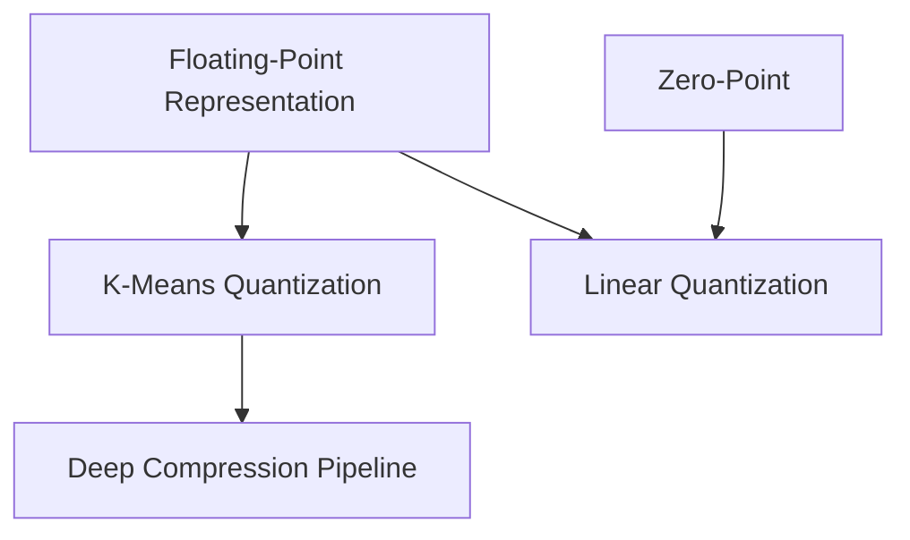
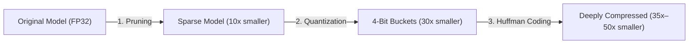

> [!abstract] Quantization shrinks neural networks by turning heavy 32-bit decimal numbers into compact 4-bit or 8-bit integers, slashing the battery-draining cost of moving data and letting cheap chips run AI without floating-point hardware.

Part of [[courses/mit-6-5940|MIT 6.5940 (Fall 2026)]], lecture 5.

## TL;DR
- **Moving data is what burns battery:** Reading a 32-bit number from memory takes up to 200× more energy than multiplying it; shrinking numbers to fewer bits directly tackles the biggest energy bottleneck in AI.
- **Two ways to shrink:** K-means groups similar weights into a tiny shared table (great for saving storage, but math is still done in decimals); linear quantization maps numbers directly to whole numbers (so cheap chips can do all the math with pure integer operations).
- **The 3-step recipe:** Cut away tiny weights first (pruning), shrink the bit-size of survivors (quantization), and use shorter binary codes for common numbers (Huffman coding), shrinking models up to 510× when paired with compact architectures.

## Concept map
The atomic concepts in **dependency order**: each one builds directly on the ideas before it.
1. [[concepts/floating-point-representation|Floating-Point Representation]]: Writing decimal numbers using a sign, an exponent (scale), and a fraction (detail), just like scientific notation.
   *Needs:* nothing
2. [[concepts/zero-point|Zero-Point]]: The integer that stands for real zero, making sure image padding and turned-off neurons stay exactly zero.
   *Needs:* nothing
3. [[concepts/k-means-quantization|K-Means Quantization]]: Grouping similar weights into a few shared values and saving short bucket IDs instead of full numbers.
   *Needs:* [[concepts/floating-point-representation|Floating-Point Representation]]
4. [[concepts/linear-quantization|Linear Quantization]]: A ruler with a scale factor and zero-point that maps decimals into whole numbers, letting processors do math without decimals.
   *Needs:* [[concepts/floating-point-representation|Floating-Point Representation]], [[concepts/zero-point|Zero-Point]]
5. [[concepts/deep-compression-pipeline|Deep Compression Pipeline]]: A three-step compression workflow: prune connections, quantize surviving weights, and entropy-encode the most common values.
   *Needs:* [[concepts/k-means-quantization|K-Means Quantization]]



## First-principles rebuild

### 0. The Battery Problem: Why Reading Memory Hurts
Imagine running an AI assistant on your smartphone.
Every time you ask a question, the phone's processor must read billions of weights from its memory chip (DRAM) into its computing core.

Here is the surprising physical reality:
- Multiplying two numbers inside the computing core costs about **5 picojoules** of energy.
- Reading that same number across the wires from the memory chip costs **1,000 picojoules**—**200× more energy** [01:37]!

Your phone gets warm and loses battery not because the math is hard, but because it is constantly moving heavy 32-bit numbers across the memory bus. If we can squeeze each 32-bit number down to 8 bits or 4 bits, we cut that memory traffic by $4\times$ to $8\times$. That is the core motivation behind quantization.

---

### 1. How Computers Store Numbers: From Whole Numbers to Decimals
To shrink numbers, we have to understand what a number looks like inside silicon. Computers only know binary switches: bits that are either $0$ or $1$ [02:11].

#### Example: Counting Whole Numbers
Suppose you have an 8-bit slot:
- If you only need positive whole numbers (unsigned), you can count from $0$ up to $255$.
- What if you need negative numbers? A natural first thought is: "Use the first bit as a plus/minus sign."
  - `0000 0001` is $+1$
  - `1000 0001` is $-1$
  - But look at zero: `0000 0000` is $+0$, and `1000 0000` is $-0$ [03:19]!
  Having two separate zeros wastes a valuable bit pattern. Computer engineers fixed this with **Two's Complement**, where the first bit represents a negative value ($-128$). This gives a single unique zero and lets you count from $-128$ to $+127$.

#### Decimals and Scientific Notation (Floating Point)
In neural networks, numbers are decimals like $0.00034$ or $45.2$. If you tried to use fixed whole numbers, small weights would round to zero and large weights would overflow.

Computers solve this using **floating-point numbers**, which work just like scientific notation ($1.25 \times 10^3$), but in base 2 [06:40]:
$$r = (-1)^{\text{sign}} \times (1 + \text{fraction}) \times 2^{\text{exponent} - 127}$$
In standard 32-bit floating point (FP32):
- **1 bit** for the Sign ($+$ or $-$).
- **8 bits** for the Exponent (the scale: how big or small the number is).
- **23 bits** for the Fraction (the fine detail).

```
FP32: [ Sign: 1 bit ] [ Exponent: 8 bits ] [ Fraction: 23 bits ]
```

#### The Zero Puzzle: Subnormal Numbers
Look at the formula: $(1 + \text{fraction})$. Because of that leading $1$, the smallest possible number (with fraction = 0) is $1.0 \times 2^{\text{exponent}-127}$. **You can never reach zero!** [09:27]

To fix this, IEEE created a special case called **subnormal numbers**:
When all 8 exponent bits are set to $0$, the computer turns off that automatic leading $1$:
$$r = (-1)^{\text{sign}} \times \text{fraction} \times 2^{-126}$$
Now, when the fraction is $0$, the result is finally true $0.0$! And as the fraction bits turn on one by one, the computer can represent tiny numbers smoothly down to $2^{-149}$ before dropping to absolute zero [11:07]. If the exponent bits are all $1$, the computer knows it represents infinity (if fraction = 0) or **NaN (Not a Number)** (if fraction $\neq 0$) [13:26].

#### Why AI Loves Range More Than Precision
In traditional scientific computing, you want as many decimal digits as possible. But machine learning researchers noticed a key pattern: **neural networks are very forgiving of fuzzy decimal precision, but very sensitive to range** [18:04]. If a gradient becomes too small, it vanishes into zero and training stops. But if a weight has 7 bits of detail instead of 23, the model barely cares.

This led to **BF16 (Brain Floating Point)**:
- Regular 16-bit float (FP16) cut the exponent to 5 bits and kept 10 bits of detail. It often failed in training because numbers fell out of range.
- Google Brain's BF16 kept the full 8-bit exponent from FP32 (giving the exact same huge dynamic range!) and cut the fraction down to just 7 bits. Models train seamlessly with half the memory.

```
FP32: [ 1 sign ] [ 8 exponent ] [ 23 fraction ]  <-- Full size
FP16: [ 1 sign ] [ 5 exponent ] [ 10 fraction ]  <-- Small range, tricky to train
BF16: [ 1 sign ] [ 8 exponent ] [  7 fraction ]  <-- Big range, half the memory!
```

#### Why 4-Bit Numbers Match the Bell Curve
When pushing down to 4 bits [26:31]:
- **INT4:** Evenly spaced steps: $-8, -7, \dots, 6, 7$.
- **FP4 E2M1 (2 exponent bits, 1 fraction bit):** Numbers cluster tightly near zero ($0, 0.5, 1, 2$) and spread out wider for big values ($3, 4, 6$) [28:46].

This non-linear spacing is a natural match for neural networks: trained weights almost always form a bell curve centered at zero. Most weights are small and need fine detail, while rare outlier weights on the edges only need rough buckets.

---

### 2. Idea 1: Grouping Weights Together (K-Means Quantization)
Now, how do we compress a real neural network?

Let's start with a concrete example from the lecture—a small $4 \times 4$ patch of 16 weights [32:13]:
```text
 2.09, -0.98,  1.48,  0.09
 0.05, -1.08, -0.91,  0.06
-0.03,  2.12, -0.99,  2.01
 2.02, -0.01,  1.53,  1.49
```
Notice how similar many of these values are:
- `2.09, 2.12, 2.01, 2.02` are all hovering around `2.0`.
- `-0.98, -1.08, -0.91, -0.99` are all hovering around `-1.0`.
- `0.09, 0.05, 0.06, -0.03, -0.01` are all hovering around `0.0`.
- `1.48, 1.53, 1.49` are all hovering around `1.5`.

Do all 16 weights really need to be separate 32-bit numbers?
What if we pick just **4 shared numbers (centroids)** [33:22]:
- **Bucket 0 (green):** $-1.0$
- **Bucket 1 (orange):** $0.0$
- **Bucket 2 (red):** $1.5$
- **Bucket 3 (blue):** $2.0$

Now, instead of saving 16 full decimal numbers, each position in the matrix only needs a **2-bit ID** ($0, 1, 2, 3$) saying which bucket it belongs to:
```text
Bucket IDs (2 bits each):
[ 3, 0, 2, 1 ]
[ 1, 0, 0, 1 ]
[ 1, 3, 0, 3 ]
[ 3, 1, 2, 2 ]
```

#### The Bit Savings
- **Before:** $16 \text{ weights} \times 32 \text{ bits} = 512 \text{ bits}$ (64 bytes).
- **After:**
  - 16 bucket IDs $\times$ 2 bits = 32 bits (4 bytes).
  - 1 shared lookup table of 4 floats $\times$ 32 bits = 128 bits (16 bytes).
  - Total = $4 + 16 = 20 \text{ bytes}$—**more than 3× smaller** [35:06]!

On a real model with millions of weights, the shared table size is negligible, and saving 4-bit indices delivers a clean **8× reduction in model size**.

#### How Do You Retrain It?
Grouping numbers into buckets causes a tiny drop in accuracy. How do you fine-tune the model when weights are locked to bucket IDs?
During backpropagation, all weights belonging to the blue bucket sum up their learning gradients together [38:31]:
$$\Delta c_{\text{blue}} = -\eta \sum_{w \in \text{blue}} \frac{\partial L}{\partial w}$$
The blue bucket value ($2.0$) simply nudges slightly left or right to heal the model's accuracy.

---

### 3. The Catch: The Codebook Bottleneck
K-means weight sharing solves the memory size problem. But when you try to run this on a $2 microcontroller inside a thermostat or smartwatch, you hit a wall:
**The arithmetic is still floating-point** [48:19].

To multiply an input by a weight, the chip must:
1. Read the 2-bit bucket ID.
2. Look up the 32-bit decimal number in the codebook table.
3. Multiply the decimals using a **Floating-Point Unit (FPU)**.

Cheap edge chips either do not have an FPU, or their FPU is slow and power-hungry. We saved memory, but we didn't simplify the math. We need a way to do math using **pure whole numbers (integers)**.

---

### 4. The Breakthrough: Integer Math via Linear Quantization
Can we build a simple mathematical ruler that turns decimals directly into integers?

We define an **affine mapping** [49:27]:
$$r = S(q - Z)$$
- $r$: The real decimal number.
- $q$: The whole number (integer) stored in hardware registers.
- $S$: The **Scale Factor** (the ruler step size: how much decimal value each integer tick represents).
- $Z$: The **Zero-Point** (the integer that represents real $0.0$).

#### Why Zero Is Sacred
Why do we need $Z$? Why not just scale numbers with $r = S \cdot q$?
In neural networks, zero is special:
1. **Zero-padding:** When processing images, the edges are padded with exact zeros.
2. **ReLU:** The most common activation function clamps all negative values to exact zero.

If real $0.0$ turns into $0.02$ when dequantized, your network will see a glowing halo of fake noise around every image border [50:33]! Setting $Z = \text{round}\left(Q_{\min} - \frac{R_{\min}}{S}\right)$ guarantees that real zero lands on an exact integer with **zero error**.

#### Example: Building the Ruler
Suppose a layer's weights range from $R_{\min} = -1.08$ to $R_{\max} = 2.12$.
We want to fit them into 2-bit signed integers: $Q_{\min} = -2, Q_{\max} = 1$ [53:25].
1. **Step size ($S$):** Divide the real range by the integer range [51:44]:
   $$S = \frac{2.12 - (-1.08)}{1 - (-2)} = \frac{3.20}{3} \approx 1.07$$
2. **Zero-Point ($Z$):** Align the bottom edge and round to a whole number [54:34]:
   $$Z = \text{round}\left(-2 - \frac{-1.08}{1.07}\right) = \text{round}(-2 + 1.009) = -1$$
Continuous $0.0$ matches integer $q = -1$ exactly:
$$\hat{r} = 1.07 \times (-1 - (-1)) = 0.0$$

#### The Magic: Multiplying Without Decimals
When computing $Y = W \times X + B$, substituting $r = S(q - Z)$ gives:
$$q_y = \frac{S_w S_x}{S_y} \sum_k (q_w - Z_w)(q_x - Z_x) + \text{bias} + Z_y$$

Multiplying out $(q_w - Z_w)(q_x - Z_x)$ creates four terms:
$$\sum q_w q_x - Z_w \sum q_x - Z_x \sum q_w + \sum Z_w Z_x$$

Here is how clever engineering makes all decimals disappear [59:08]:
1. **Weights are balanced ($Z_w = 0$):** Neural network weights are naturally centered around zero. We set $Z_w = 0$, which **instantly deletes two of the four terms**!
2. **Precompute the rest:** In the term $Z_x \sum q_w$, the weights and the input zero-point are fixed before running. The compiler calculates this number once ahead of time and saves it as a single integer constant.
3. **Turn the decimal scale into a bit-shift:** The multiplier $\frac{S_w S_x}{S_y}$ is a decimal between $0$ and $1$. Instead of doing floating-point math, the processor multiplies by a whole number and shifts the bits to the right (an arithmetic bit-shift, taking 1 clock cycle) [58:01].

```
How an Edge Chip Runs a Quantized Layer:
[ Integer Input q_x ]   [ Integer Weight q_w ]
             \             /
              \           /
        [ Integer Multiply-Accumulate (MAC) ]  <-- Pure whole-number math!
                     |
        + [ Precomputed integer offset ]
                     |
        * [ Whole-number multiplier M_0 ]
                     |
        >> [ Bit-shift to the right ]
                     |
        + [ Output Zero-Point Z_y ]
                     |
        [ Integer Output q_y ]
```
Every single calculation in the inner loop runs with simple, fast integer instructions. Cheap edge chips can run deep networks without an FPU.

---

### 5. Putting It All Together: The Deep Compression Recipe
Song Han's **Deep Compression** framework combines these ideas into a three-step pipeline [43:48]:



1. **Step 1: Pruning (Cut the dead wood):**
   Remove connections whose weights are nearly zero. Retrain the sparse network to recover full accuracy (~10× smaller) [44:19].
2. **Step 2: Quantization (Shrink the surviving numbers):**
   Group surviving weights into 4-bit shared buckets or linear integers (~3× smaller, reaching ~30× total).
   *Why prune before quantizing?* [45:00] If you quantize first, you lock the model into a small set of buckets. Pruning afterwards breaks the buckets, leaving too few parameters to recover accuracy. Pruning first keeps weights flexible until the last possible moment.
3. **Step 3: Huffman Coding (Shorten common codes):**
   Some bucket IDs appear far more often than others. Assign short binary codes to common IDs and longer codes to rare ones (~1.5× extra savings) [43:14].

When paired with clean, compact architectures like **SqueezeNet** (which uses small $1 \times 1$ convolutions instead of large $3 \times 3$ filters), this recipe shrinks models by **up to 510×** [47:46]. An AlexNet vision classifier that once required 240 megabytes shrinks to under 0.5 megabytes—small enough to live entirely inside fast on-chip SRAM cache.

---

## Connections
- **Pruning:** Removes unnecessary connections; quantization reduces the bit-size of the connections that remain.
- **Modern Large Language Models:** The linear scaling principles derived here directly power modern LLM compression techniques like SmoothQuant and AWQ.
- **Next Step:** Binary Neural Networks (1-bit weights, where multiplication becomes a simple XNOR logic gate).

## Review questions
> [!question]- Q1 (recall): Why does K-means weight sharing reduce memory traffic but fail to speed up arithmetic on low-power chips without an FPU?
> K-means stores weights as compact integer bucket IDs, saving memory transfer bandwidth. However, during computation, each ID must be looked up in a table to fetch the original 32-bit decimal centroid, meaning the processor still has to perform full floating-point arithmetic. Linked note: [[concepts/k-means-quantization|K-Means Quantization]].

> [!question]- Q2 (explain-why): Why must the zero-point $Z$ in linear quantization be an exact integer rather than a decimal number?
> The zero-point lives in the integer domain and is directly added to or subtracted from integer values inside hardware registers. If $Z$ were a decimal, the processor would be forced to convert everything back into floating-point math, defeating the goal of running pure integer arithmetic. Linked note: [[concepts/zero-point|Zero-Point]].

> [!question]- Q3 (apply): A layer has decimal values between $R_{\min} = -2.0$ and $R_{\max} = 6.0$. Calculate the scale factor $S$ and zero-point $Z$ for standard signed 8-bit integers ($Q_{\min} = -128, Q_{\max} = 127$).
> The scale factor is $S = \frac{R_{\max} - R_{\min}}{Q_{\max} - Q_{\min}} = \frac{6.0 - (-2.0)}{127 - (-128)} = \frac{8.0}{255} \approx 0.03137$. The zero-point is $Z = \text{round}\left(Q_{\min} - \frac{R_{\min}}{S}\right) = \text{round}\left(-128 - \frac{-2.0}{0.03137}\right) = \text{round}(-128 + 63.75) = \text{round}(-64.25) = -64$. Linked note: [[concepts/linear-quantization|Linear Quantization]].

> [!question]- Q4 (transfer): In voice compression, Vector Quantization clusters sound waves into codebook buckets. How does neural network K-means fine-tuning differ from standard audio clustering, and what would happen if you re-clustered weights with standard K-means after every training batch?
> Standard clustering updates centroids to minimize geometric distance to data points. Neural network fine-tuning updates centroids using task gradients from backpropagation ($\Delta c_k = -\eta \sum \frac{\partial L}{\partial w}$) to minimize task loss. Re-clustering with standard K-means every batch would randomly shuffle weights into different buckets based on distance, destroying training momentum and ignoring whether predictions are actually accurate. Linked note: [[concepts/k-means-quantization|K-Means Quantization]].

## Source notes
- [01:37](https://www.youtube.com/watch?v=Qg_3N8pdK9s&t=97s): Reading data from memory consumes up to 200× more energy than computation.
- [03:19](https://www.youtube.com/watch?v=Qg_3N8pdK9s&t=199s): Why sign-magnitude integers waste a slot on duplicate zero, and how Two's complement fixes it.
- [06:40](https://www.youtube.com/watch?v=Qg_3N8pdK9s&t=400s): IEEE FP32 format: sign bit, 8-bit exponent, and 23-bit fraction.
- [09:27](https://www.youtube.com/watch?v=Qg_3N8pdK9s&t=567s): Subnormal floating-point numbers: dropping the leading 1 to reach real zero.
- [18:04](https://www.youtube.com/watch?v=Qg_3N8pdK9s&t=1084s): Google BF16: keeping 8 exponent bits for dynamic range while cutting fraction detail to 7 bits.
- [26:31](https://www.youtube.com/watch?v=Qg_3N8pdK9s&t=1591s): Allocating bits in 4-bit representations (INT4 vs FP4).
- [28:46](https://www.youtube.com/watch?v=Qg_3N8pdK9s&t=1726s): Why FP4 E2M1 matches the bell-shaped Gaussian distribution of neural network weights.
- [32:13](https://www.youtube.com/watch?v=Qg_3N8pdK9s&t=1933s): K-means weight sharing on a 4×4 weight matrix.
- [35:06](https://www.youtube.com/watch?v=Qg_3N8pdK9s&t=2106s): Calculating bit savings: 16 weights drop from 64 bytes to 20 bytes (3.2× reduction).
- [38:31](https://www.youtube.com/watch?v=Qg_3N8pdK9s&t=2311s): Centroid fine-tuning update rule: pooling gradients by cluster color.
- [43:48](https://www.youtube.com/watch?v=Qg_3N8pdK9s&t=2628s): The three stages of Deep Compression (prune, quantize, Huffman code).
- [45:00](https://www.youtube.com/watch?v=Qg_3N8pdK9s&t=2700s): Why you must prune before quantizing rather than after.
- [47:46](https://www.youtube.com/watch?v=Qg_3N8pdK9s&t=2866s): Combining SqueezeNet with Deep Compression to achieve 510× model size reduction.
- [48:19](https://www.youtube.com/watch?v=Qg_3N8pdK9s&t=2899s): The codebook lookup bottleneck and the need for integer-only arithmetic.
- [50:33](https://www.youtube.com/watch?v=Qg_3N8pdK9s&t=3033s): Why zero is sacred (conv padding and ReLU) and the derivation of zero-point ($Z$).
- [51:44](https://www.youtube.com/watch?v=Qg_3N8pdK9s&t=3104s): Calculating the scale factor $S$ as real range divided by integer range.
- [56:20](https://www.youtube.com/watch?v=Qg_3N8pdK9s&t=3380s): Derivation of fully quantized matrix multiplication.
- [59:08](https://www.youtube.com/watch?v=Qg_3N8pdK9s&t=3548s): Setting $Z_w = 0$ because weights are symmetrically centered around zero.
