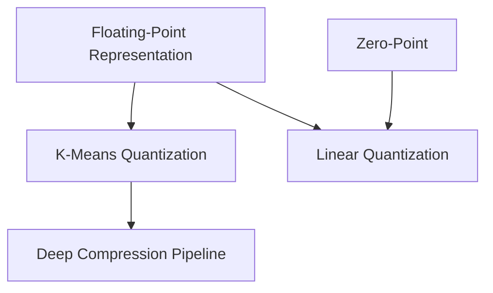

> [!abstract] Neural network quantization dramatically reduces memory traffic and energy consumption by mapping continuous parameters and activations into compact discrete representations through either codebook weight sharing or affine integer mapping.

## TL;DR
- Memory data movement is up to 200× more energy-intensive than arithmetic computation, making bit-width reduction the most impactful lever for efficient edge deployment.
- K-means quantization achieves significant storage savings (e.g., 8× reduction at 4-bit) by replacing weights with cluster indices into a shared codebook, though computation is still executed in floating-point.
- Linear (uniform affine) quantization maps continuous values to integers via a scale factor $S$ and an integer zero-point $Z$, enabling pure integer arithmetic (GEMM and convolution) without floating-point hardware.

## Concept map
The atomic concepts in **dependency order**: each one depends only on those above it.
1. [[concepts/floating-point-representation|Floating-Point Representation]]: Partitions numbers into sign, exponent (dynamic range), and fraction/mantissa (precision).
   *Needs:* nothing
2. [[concepts/zero-point|Zero-Point]]: Integer offset ensuring real zero is represented exactly with zero quantization error.
   *Needs:* nothing
3. [[concepts/k-means-quantization|K-Means Quantization]]: Clusters weights into discrete centroids and stores index pointers into a codebook.
   *Needs:* [[concepts/floating-point-representation|Floating-Point Representation]]
4. [[concepts/linear-quantization|Linear Quantization]]: Affine mapping ($r = S(q - Z)$) enabling integer storage and integer arithmetic execution.
   *Needs:* [[concepts/floating-point-representation|Floating-Point Representation]], [[concepts/zero-point|Zero-Point]]
5. [[concepts/deep-compression-pipeline|Deep Compression Pipeline]]: Three-stage workflow combining pruning, weight sharing, and entropy coding.
   *Needs:* [[concepts/k-means-quantization|K-Means Quantization]]

## First-principles rebuild
### 0. Starting assumptions
- **Data movement bottleneck:** Off-chip DRAM access and on-chip data movement consume up to 200× more energy than ALU arithmetic operations (*given by the video* [01:37]).
- **Inherent parameter overparameterization:** Deep neural networks contain high redundancy, meaning weights can tolerate discretization noise if properly retrained (*Background*).
- **Symmetric bell-shaped weight distributions:** Weight distributions across trained layers typically cluster tightly around zero (*given by the video* [29:56], [59:08]).
- **Discrete digital representation:** Real continuous numbers must be mapped onto finite bit patterns, creating an inherent trade-off between dynamic range and precision (*given by the video* [02:11]).

### 1. Floating-Point Representation
- **Question it answers:** How do modern processors represent real numbers spanning diverse scales without losing numerical stability?
- **Derivation:** Fixed-point representations have a rigid dynamic range. Floating-point formats allocate bits to a sign $s \in \{0, 1\}$, an exponent $e$, and a fraction $f$.
  - Normal numbers: $r = (-1)^s \times (1 + f) \times 2^{e - \text{bias}}$, where $\text{bias} = 2^{k-1} - 1$ for $k$ exponent bits.
  - Subnormal numbers (when $e = 0$): $r = (-1)^s \times f \times 2^{1 - \text{bias}}$. This eliminates the implicit leading 1, allowing representation of 0 and preventing catastrophic underflow near zero.
  - Allocating more bits to the exponent (e.g. BF16's 8 bits vs FP16's 5 bits) broadens the dynamic range at the expense of precision.
- **Worked example:** Representing 2.5 in BF16 (1 sign bit, 8 exponent bits, 7 fraction bits, bias = 127):
  - $2.5 = (-1)^0 \times (1 + 0.25) \times 2^1$.
  - Exponent: $1 + 127 = 128 = 10000000_2$.
  - Fraction: $0.25 = 0100000_2$ (bit values $2^{-1}=0.5, 2^{-2}=0.25$).
  - Binary BF16: `0 10000000 0100000`.
- **In the video:** [06:40] explains IEEE FP32 format; [09:27] details subnormal range and representation of zero; [18:04] contrasts BF16 with FP16 for neural network training.

### 2. Zero-Point
- **Question it answers:** Why can't we simply scale real numbers linearly to integers without an offset?
- **Derivation:** Deep neural networks rely heavily on zero values (e.g., zero padding in convolutions, zero activations from ReLU). If zero continuous values map to a non-zero integer that cannot be exactly restored to zero upon dequantization, padding will introduce systematic bias and corrupt features. Therefore, the quantized integer $Z$ corresponding to real $r = 0$ must satisfy:
  $$0 = S(Z - Z) \implies q = Z$$
  Given real bounds $[R_{\min}, R_{\max}]$ and integer bounds $[Q_{\min}, Q_{\max}]$ with scale $S$:
  $$R_{\min} = S(Q_{\min} - Z) \implies Z = \text{round}\left(Q_{\min} - \frac{R_{\min}}{S}\right)$$
  $Z$ is rounded to the nearest integer so it can be held in an integer register.
- **Worked example:** A layer has $R_{\min} = -1.08$, $R_{\max} = 2.12$. Quantizing to 2-bit signed integers ($Q_{\min} = -2$, $Q_{\max} = 1$) with $S = 1.07$:
  $$Z = \text{round}\left(-2 - \frac{-1.08}{1.07}\right) = \text{round}(-2 + 1.009) = \text{round}(-0.991) = -1$$
  Dequantizing $q = -1$ yields: $r = 1.07 \times (-1 - (-1)) = 0.0$ exactly.
- **In the video:** [50:33] introduces the zero-point hyperparameter; [54:34] derives the equation and explains why integer rounding is required.

### 3. K-Means Quantization
- **Question it answers:** How can we compress storage of high-precision weights if specialized integer arithmetic hardware is unavailable?
- **Derivation:** Instead of allowing every weight to take an arbitrary 32-bit float value, cluster $m$ weights into $k = 2^n$ centroids $\{c_0, \dots, c_{k-1}\}$ using 1D K-means. Each weight is replaced by an $n$-bit cluster index. The model stores:
  1. $m$ indices of $n$ bits each.
  2. A codebook of $2^n$ centroids in 32-bit float ($32 \times 2^n$ bits).
  For $m \gg 2^n$, total bits scale from $32m$ down to $nm$, giving a $\frac{32}{n}\times$ reduction.
  To fine-tune the quantized model, gradients are accumulated across all weights assigned to each centroid:
  $$\Delta c_i = -\eta \sum_{w \in C_i} \frac{\partial L}{\partial w}$$
  $$c_i \leftarrow c_i + \Delta c_i$$
- **Worked example:** A $4 \times 4$ matrix (16 weights) clustered into 4 centroids ($n=2$ bits):
  - Original size: $16 \times 32 \text{ bits} = 512 \text{ bits} = 64 \text{ bytes}$.
  - Quantized indices: $16 \times 2 \text{ bits} = 32 \text{ bits} = 4 \text{ bytes}$.
  - Codebook: $4 \times 32 \text{ bits} = 128 \text{ bits} = 16 \text{ bytes}$.
  - Total: $4 + 16 = 20 \text{ bytes}$ ($3.2\times$ smaller).
- **In the video:** [32:13] shows step-by-step clustering of the 4×4 matrix; [35:06] calculates bit budgets; [38:31] explains gradient grouping and centroid updates.

### 4. Linear Quantization
- **Question it answers:** How can we perform both storage and matrix arithmetic entirely using integer operations on hardware lacking floating-point units?
- **Derivation:** Define the affine mapping: $r = S(q - Z)$.
  The scale factor spans the full ranges:
  $$S = \frac{R_{\max} - R_{\min}}{Q_{\max} - Q_{\min}}$$
  For matrix multiplication $Y = WX$:
  $$S_y(q_y - Z_y) = \sum_{k} S_w(q_w - Z_w) \cdot S_x(q_x - Z_x)$$
  Rearranging for the output quantized integer $q_y$:
  $$q_y = \frac{S_w S_x}{S_y} \sum_{k} (q_w - Z_w)(q_x - Z_x) + Z_y$$
  Expanding the product:
  $$\sum_k (q_w - Z_w)(q_x - Z_x) = \sum_k q_w q_x - Z_w \sum_k q_x - Z_x \sum_k q_w + \sum_k Z_w Z_x$$
  Because neural network weights are symmetrically centered around zero, we can set $Z_w = 0$, dropping two of the terms:
  $$q_y = \frac{S_w S_x}{S_y} \left( \sum_k q_w q_x - Z_x \sum_k q_w \right) + Z_y$$
  Here:
  - $\sum_k q_w q_x$ is integer multiply-accumulate (MAC).
  - $Z_x \sum_k q_w$ is precomputable at compile time since weights are fixed.
  - The scale multiplier $M = \frac{S_w S_x}{S_y} \in (0, 1)$ is approximated as an integer multiplication followed by an arithmetic right shift: $M \approx M_0 \cdot 2^{-n}$.
  Thus, all runtime computations occur with integer instructions.
- **Worked example:** Matrix multiply with symmetric weights: $Z_w = 0$. Given input activation zero-point $Z_x = 3$, weights $[2, -1]$, inputs $[4, 5]$:
  - Integer MAC: $2 \times 4 + (-1) \times 5 = 8 - 5 = 3$.
  - Correction term: $Z_x \sum q_w = 3 \times (2 + (-1)) = 3$.
  - Intermediate accumulator: $3 - 3 = 0$.
  - Scaled and offset: $q_y = \text{shift}(0) + Z_y = Z_y$.
- **In the video:** [48:52] defines linear quantization motivation; [51:44] derives scale factor $S$; [56:20] expands matrix multiplication math; [59:08] simplifies using symmetric weight assumption $Z_w = 0$.

### 5. Deep Compression Pipeline
- **Question it answers:** How can we stack distinct model compression techniques to achieve compounding efficiency gains?
- **Derivation:** Deep Compression organizes compression into three sequential stages:
  1. **Pruning:** Identifies and eliminates weights near zero. Retraining the sparse network recovers accuracy while shrinking the model by ~10×.
  2. **K-Means Quantization:** Binds remaining continuous weights to shared discrete centroids, giving another ~3× reduction (overall ~27×–31×).
  3. **Huffman Coding:** Encodes cluster indices with variable-length prefix codes, assigning fewer bits to high-frequency indices, adding another 1.2×–1.5× compression.
  Pruning must precede quantization because pruning removes unneeded weights before the parameter space is restricted to a small discrete codebook.
- **Worked example:** On AlexNet, pruning reduces parameters by $9\times$; K-means quantization further compresses convolutional layers to 4 bits and FC layers to 2 bits ($27\times$ total); Huffman coding finalizes storage at $35\times$ with zero top-5 accuracy loss.
- **In the video:** [43:48] walks through the three stages; [45:00] addresses why pruning must happen before quantization; [47:14] combines SqueezeNet with Deep Compression.

### Putting it together
Low-bit quantization transforms deep learning inference from a memory-bound, energy-draining workload into a lightweight, cache-friendly operation. By analyzing numerical representation limits, developers can select K-means weight sharing when targeted strictly at storage compression, or linear affine quantization when targeting end-to-end integer execution on microcontrollers and DSPs. Stacking pruning, quantization, and entropy coding achieves compound compression up to 50×.

## Connections
- Builds on pruning techniques by compressing the non-zero parameter weights left after sparsification.
- Generalizes to modern low-bit formats such as NVIDIA FP8 (E4M3 for inference, E5M2 for training gradients) and sub-byte formats (INT4, FP4).
- Open question: How to handle outlier activation channels in modern Large Language Models without requiring full floating-point execution (addressed by methods like SmoothQuant and AWQ).

## Review questions
> [!question]- Q1 (recall): What is the fundamental operational difference between K-means codebook quantization and linear (affine) quantization during inference?
> In K-means codebook quantization, weights are stored as integer indices and dequantized via a lookup table, meaning arithmetic operations are still executed in floating-point. In linear quantization, both storage and arithmetic operations (multiply-accumulate) are executed directly in integer arithmetic using scale factors and zero-points. Linked note: [[concepts/k-means-quantization|K-Means Quantization]] and [[concepts/linear-quantization|Linear Quantization]].

> [!question]- Q2 (explain-why): Why must the zero-point $Z$ in linear quantization be restricted to an integer value rather than a floating-point number?
> The zero-point lives in the quantized integer domain and is directly added to or subtracted from integer activations and weights inside integer registers. If $Z$ were a floating-point number, integer arithmetic operations would require conversion back to floating-point, defeating the objective of integer-only execution. Linked note: [[concepts/zero-point|Zero-Point]].

> [!question]- Q3 (apply): A weight tensor has continuous values ranging between $R_{\min} = -3.0$ and $R_{\max} = 5.0$. Compute the scale factor $S$ and zero-point $Z$ for 8-bit signed integer linear quantization ($Q_{\min} = -128, Q_{\max} = 127$).
> The scale factor is $S = \frac{R_{\max} - R_{\min}}{Q_{\max} - Q_{\min}} = \frac{5.0 - (-3.0)}{127 - (-128)} = \frac{8.0}{255} \approx 0.03137$. The zero-point is $Z = \text{round}\left(Q_{\min} - \frac{R_{\min}}{S}\right) = \text{round}\left(-128 - \frac{-3.0}{0.03137}\right) = \text{round}(-128 + 95.625) = \text{round}(-32.375) = -32$. Linked note: [[concepts/linear-quantization|Linear Quantization]].

> [!question]- Q4 (transfer): Vector quantization in signal processing (such as audio/speech compression) clusters waveform vectors into a codebook using the Linde-Buzo-Gray (LBG) algorithm. How does fine-tuning in neural network K-means quantization differ from classical codebook updates, and why can't we simply re-run standard K-means after every training batch?
> Classical vector quantization updates centroids to minimize reconstruction error (mean squared error of signals). In neural network fine-tuning, centroids are updated using task gradients from the end-to-end loss function ($\Delta c_i = -\eta \sum_{w \in C_i} \frac{\partial L}{\partial w}$) rather than Euclidean distance to original weights. Running standard K-means every batch would re-cluster weights based on current magnitudes, destroying cluster assignments and ignoring task error gradients. Linked note: [[concepts/k-means-quantization|K-Means Quantization]].

## Source notes
- [01:37](https://www.youtube.com/watch?v=Qg_3N8pdK9s&t=97s): Data movement is up to 200× more energy consuming than computation.
- [06:40](https://www.youtube.com/watch?v=Qg_3N8pdK9s&t=400s): IEEE FP32 bit allocation and decoding formula.
- [09:27](https://www.youtube.com/watch?v=Qg_3N8pdK9s&t=567s): Subnormal floating-point numbers and zero representation.
- [18:04](https://www.youtube.com/watch?v=Qg_3N8pdK9s&t=1084s): Google BF16 vs FP16: prioritizing dynamic range over precision.
- [32:13](https://www.youtube.com/watch?v=Qg_3N8pdK9s&t=1933s): K-means weight sharing on a 4×4 weight matrix.
- [35:06](https://www.youtube.com/watch?v=Qg_3N8pdK9s&t=2106s): Compression calculation: indices vs codebook overhead.
- [38:31](https://www.youtube.com/watch?v=Qg_3N8pdK9s&t=2311s): Gradient reduction and centroid update rule for fine-tuning.
- [43:48](https://www.youtube.com/watch?v=Qg_3N8pdK9s&t=2628s): The Deep Compression pipeline (pruning, quantization, Huffman coding).
- [48:52](https://www.youtube.com/watch?v=Qg_3N8pdK9s&t=2932s): Motivation for linear integer quantization on edge hardware.
- [51:44](https://www.youtube.com/watch?v=Qg_3N8pdK9s&t=3104s): Derivation of the scaling factor $S$.
- [54:34](https://www.youtube.com/watch?v=Qg_3N8pdK9s&t=3274s): Derivation and integer rounding of the zero-point $Z$.
- [56:20](https://www.youtube.com/watch?v=Qg_3N8pdK9s&t=3380s): Expansion of quantized matrix multiplication $Y = WX + B$.
- [59:08](https://www.youtube.com/watch?v=Qg_3N8pdK9s&t=3548s): Simplification under symmetric weight distribution ($Z_w = 0$).
