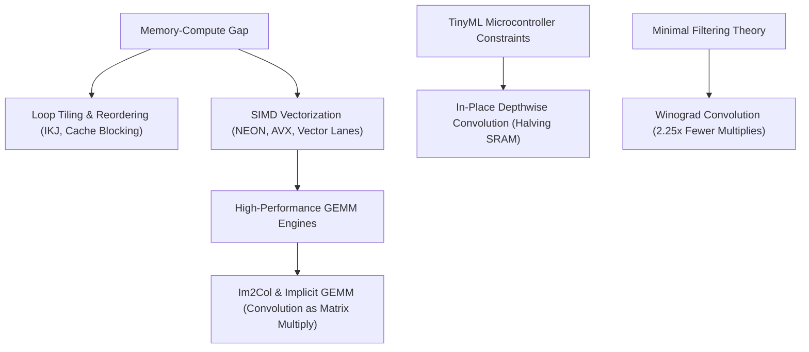

> [!abstract]
> Transforming an abstract neural network graph into blazingly fast on-device execution requires mastering compiler and runtime transformations that honor the underlying hardware. By restructuring loop hierarchies for cache locality (**reordering and tiling**), harnessing data-level parallelism via **SIMD vectorization**, and deploying mathematically exact operator transformations—such as **Implicit GEMM**, **in-place depthwise convolution**, memory layout specialization, and **Winograd minimal filtering**—systems like **TinyEngine** unlock orders-of-magnitude acceleration on bare-metal microcontrollers, CPUs, and GPUs with zero accuracy degradation.

Part of [[courses/mit-6-5940|MIT 6.5940 (Fall 2026)]], lecture 11.

## TL;DR
- **The Stride Penalty and Loop Surgery:** Memory is dramatically slower than compute; reordering matrix multiplication loops from $I \to J \to K$ to $I \to K \to J$ turns jumping column accesses into sequential stride-1 memory reads, delivering a $12\times$ speedup, while loop tiling partitions data into L1/L2 cache blocks to yield a further $20\times$ gain.
- **Hardware Parallelism Across Scales:** Single-core performance scales via [[concepts/simd-vectorization|SIMD Vectorization]] (packing 4 to 16 data elements into vector registers), multi-core CPUs scale via OpenMP thread distribution, and GPUs utilize thread hierarchies, shared memory tiling, and specialized Tensor Core Matrix-Multiply-Accumulate (MMA) intrinsics.
- **In-Place Depthwise Halving:** Standard depthwise convolution allocates separate input and output tensors ($2CHW$); TinyEngine allocates only a single $1 \times H \times W$ scratchpad slice and computes channel outputs in-place, slashing peak activation SRAM by nearly $50\%$.
- **Zero-Loss Mathematical Speedups:** [[concepts/im2col-and-implicit-gemm|Implicit GEMM]] fuses coordinate calculations to run convolutions on peak GEMM hardware without allocating intermediate memory matrices, while [[concepts/winograd-convolution|Winograd Convolution]] uses linear polynomial transforms to reduce $3 \times 3$ convolution multiplications by $2.25\times$.

## Concept map

The atomic concepts in dependency order:

1. [[concepts/loop-tiling-and-reordering|Loop Tiling and Reordering]]: Cache-conscious nested loop transformations that maximize temporal and spatial locality.  
   *Needs:* [[concepts/the-memory-compute-gap|The Memory-Compute Gap]]
2. [[concepts/simd-vectorization|SIMD Vectorization]]: Exploiting vector registers (SSE, AVX, NEON) to compute multiple data points per instruction cycle.  
   *Needs:* [[concepts/the-memory-compute-gap|The Memory-Compute Gap]]
3. [[concepts/im2col-and-implicit-gemm|Im2Col and Implicit GEMM]]: Reformulating multi-dimensional convolutions into matrix multiplications without intermediate memory bloat.  
   *Needs:* [[concepts/the-memory-compute-gap|The Memory-Compute Gap]], [[concepts/macs-vs-flops|MACs vs FLOPs]]
4. [[concepts/in-place-depthwise-convolution|In-Place Depthwise Convolution]]: Cutting peak activation SRAM from $2CHW$ to $(1+C)HW$ using a single-channel circular buffer.  
   *Needs:* [[concepts/depthwise-separable-convolution|Depthwise Separable Convolution]], [[concepts/tinyml|TinyML]]
5. [[concepts/winograd-convolution|Winograd Convolution]]: Minimal filtering algorithm slashing $3 \times 3$ convolution multiplications by $2.25\times$ via linear tile transforms.  
   *Needs:* [[concepts/macs-vs-flops|MACs vs FLOPs]]



## First-principles rebuild

### 0. The Software Execution Gap: Why Great Models Crawl
In earlier lectures, we explored model-level optimizations: pruning weights, quantizing bits, and searching for compact architectures like MCUNet. 

However, an efficient neural network graph is just a mathematical specification. How that graph executes on silicon determines whether it runs at 60 frames per second or crawls at 1 frame per minute.

Consider what happens inside a general-purpose runtime (such as Python, or generic interpreters like TensorFlow Lite Micro):
- The runtime parses graph operators dynamically during execution, introducing interpreter overhead.
- Intermediate activation tensors are allocated dynamically on a heap, leading to memory fragmentation and cache misses.
- Naive loops traverse multi-dimensional arrays without respecting physical cache lines, causing the processor to spend $95\%$ of its clock cycles stalled waiting for data from DRAM.

To deploy neural networks onto resource-starved chips, we must bridge the **software execution gap**. We need an inference engine—such as **TinyEngine**—that compiles models down to bare-metal C code, optimizes every memory access pattern, and leverages every hardware register.

---

### 1. The Three Pillars of Loop Surgery: Reordering, Tiling, and Unrolling

Every deep neural network layer—whether dense, convolutional, or attentional—is composed of nested loops executing multiply-accumulate operations.

Consider standard matrix multiplication: computing $C = A \cdot B$, where $A$ and $B$ are $N \times N$ matrices:
```c
// Naive Matrix Multiplication (I-J-K)
for (int i = 0; i < N; i++) {
  for (int j = 0; j < N; j++) {
    for (int k = 0; k < N; k++) {
      C[i][j] += A[i][k] * B[k][j];
    }
  }
}
```

#### Pillar 1: Loop Reordering (Interchange)
How does hardware store a 2D array in memory? In C/C++, matrices are stored in **row-major order**: row 0 is stored consecutively, followed by row 1, then row 2.

When the CPU reads a memory address, it doesn't fetch a single 4-byte float. It fetches a whole **64-byte cache line** containing 16 contiguous floats:

```
Row-Major Storage in RAM:
[ Row 0: B[0][0], B[0][1], B[0][2] ... ] [ Row 1: B[1][0], B[1][1], B[1][2] ... ]
```

Now trace the naive inner loop: `C[i][j] += A[i][k] * B[k][j]`:
- Matrix $A[i][k]$: $i$ is constant, $k$ increments by 1. This reads consecutively across row $i$ (stride-1). Excellent!
- Matrix $B[k][j]$: $j$ is constant, $k$ increments by 1. **This jumps an entire row of $N$ elements on every single iteration!**
  - Iteration 0: reads `B[0][j]`
  - Iteration 1: reads `B[1][j]` (jumps ahead by $N \times 4$ bytes)
  - Iteration 2: reads `B[2][j]` (jumps ahead by $N \times 4$ bytes)

Because each read jumps far beyond the 64-byte cache line, almost every single access to matrix $B$ triggers a **cache miss**. The processor stalls, waiting hundreds of cycles for DRAM.

**The Fix:** Swap the inner two loops so that the order is $I \to K \to J$:
```c
// Optimized Loop Order (I-K-J)
for (int i = 0; i < N; i++) {
  for (int k = 0; k < N; k++) {
    for (int j = 0; j < N; j++) {
      C[i][j] += A[i][k] * B[k][j];
    }
  }
}
```
Now look at the innermost loop over $j$:
- $A[i][k]$ is constant with respect to $j$—it can be loaded once into a register!
- $B[k][j]$ increments $j$ by 1—it reads **consecutively across row $k$ in stride-1**!
- $C[i][j]$ increments $j$ by 1—it writes consecutively across row $i$!

Every cache line fetch now supplies 16 consecutive values consumed across the next 16 clock cycles. This simple two-line loop swap delivers an immediate **$12\times$ speedup**!

#### Pillar 2: Loop Tiling (Blocking)
When matrices grow large (e.g., $1024 \times 1024$ floats $= 4\text{ MB}$), they dwarf the fast L1 cache (typically $32\text{ KB}$). 

Even in $I \to K \to J$ order, by the time the outer loop finishes row 0 and comes back to row 1, the previously loaded rows of matrix $B$ have long been evicted from cache.

**Loop Tiling** partitions the $N \times N$ matrix into small sub-blocks of size $B_{\text{tile}} \times B_{\text{tile}}$ chosen to fit completely inside the cache. The CPU loads a sub-block of $A$ and a sub-block of $B$ into L1 cache and multiplies them thoroughly, exhausting all temporal data reuse before moving to the next tile:

```
Full Matrix N x N                     Tiled Sub-Blocks (Fit in L1 Cache)
+-----+-----+-----+-----+             +-----+
| B00 | B01 | B02 | B03 |             | B00 |  <-- Kept in L1 Cache!
+-----+-----+-----+-----+   ====>     +-----+      All inner products computed
| B10 | B11 | B12 | B13 |                          before evicting!
+-----+-----+-----+-----+
```
On a $1024 \times 1024$ matrix, loop tiling cuts DRAM memory traffic by orders of magnitude, providing a further **$20\times$ acceleration** (over $200\times$ cumulative speedup over naive code).

#### Pillar 3: Loop Unrolling
Every iteration of a loop incurs invisible CPU housekeeping:
1. Incrementing loop index pointers (`k++`).
2. Evaluating loop boundary conditions (`k < N`).
3. Executing conditional branch jumps (`goto start`).

In high-performance kernels, these housekeeping instructions can consume $30\text{–}50\%$ of CPU instruction cycles. **Loop Unrolling** replicates the loop body multiple times (e.g., factor of 4):
```c
for (int k = 0; k < N; k += 4) {
  sum += A[i][k]     * B[k][j];
  sum += A[i][k + 1] * B[k + 1][j];
  sum += A[i][k + 2] * B[k + 2][j];
  sum += A[i][k + 3] * B[k + 3][j];
}
```
This reduces pointer arithmetic and branch predictions by $4\times$, delivering another **$3\times$ speedup**.

---

### 2. Hardware Parallelism: From SIMD to GPU Tensor Cores

Beyond loop transformations, modern silicon provides dedicated parallel hardware execution units.

#### SIMD Vectorization
In scalar processing, the CPU ALU computes one 32-bit addition or multiplication per clock cycle.

**SIMD (Single Instruction, Multiple Data)** equips the core with wide vector registers (128-bit on ARM NEON / SSE; 256-bit on AVX2; 512-bit on AVX-512):
```
Scalar ALU (1 element per cycle):
[ a0 ] * [ b0 ] ===> [ c0 ]

128-bit SIMD Vector Unit (4 elements per cycle):
[ a3 | a2 | a1 | a0 ] * [ b3 | b2 | b1 | b0 ] ===> [ c3 | c2 | c1 | c0 ]
```
A single vector instruction (e.g., `_mm_mul_ps` on x86 or `vmulq_f32` on ARM) executes 4 parallel floating-point multiplications in a single cycle. For 8-bit quantized neural networks on microcontrollers, a 128-bit vector register processes **16 operations simultaneously**, multiplying arithmetic throughput by $16\times$.

#### Multi-Threading & Shared Memory GPUs
When scaling to multi-core CPUs, tasks are partitioned across threads using tools like **OpenMP**:
```c
#pragma omp parallel for
for (int i = 0; i < N; i++) {
  // Rows of A are computed concurrently across distinct CPU cores!
}
```

On GPUs, parallelism expands to thousands of concurrent threads organized into **Thread Blocks** and **Grids**. GPUs manage a 3-tier memory hierarchy:
1. **Global DRAM (Slow, 80 GB):** Accessible by all threads across the entire chip.
2. **Shared Memory (Ultra-Fast, 100 KB per block):** User-managed on-chip scratchpad shared among threads in the same block. Threads cooperatively load tiles of $A$ and $B$ from global memory into shared memory, synchronize via `__syncthreads()`, and compute tile dot products directly from shared memory at terabyte-per-second speeds.
3. **Registers (Single-cycle, Private):** Private to each individual thread.

#### Tensor Cores & MMA Intrinsics
Standard GPU CUDA cores execute general floating-point scalar instructions. **Tensor Cores** (introduced in Volta and evolved through Hopper/Blackwell) are dedicated hardwired matrix multipliers:
- A single **Matrix Multiply-Accumulate (MMA)** hardware instruction multiplies small matrix tiles (e.g., $16 \times 8 \times 16$) in a single clock cycle.
- Tensor Cores boost matrix throughput by up to **$60\times$** compared to standard FP32 CUDA cores (reaching over $4,000\text{ TFLOPs}$ on NVIDIA H100).

---

### 3. Operator Alchemy: Exact Mathematical Acceleration for Convolutions

Convolutions are computationally heavy sliding windows. Can we accelerate them without sacrificing a single decimal place of mathematical accuracy?

#### 1. Im2Col and Implicit GEMM
Hardware accelerators love General Matrix Multiply (GEMM) because silicon designers have spent decades perfecting GEMM micro-architectures. 

**Im2Col (Image to Column)** converts a 2D convolution into a GEMM:
- Every overlapping $K \times K \times C_{\text{in}}$ receptive field patch in the image is flattened into a single column of an intermediate matrix.
- The convolutional filters are flattened into rows of a weight matrix.
- Multiplying the two matrices via standard BLAS produces the output feature map in one shot.

```
Input Image (Sliding Window):         Im2Col Matrix:
+---+---+---+                         [ Patch 1 (Pixel 0,0)  ]
| a | b | c |                         [ Patch 2 (Pixel 0,1)  ]
+---+---+---+  == Flatten Patches ==> [ Patch 3 (Pixel 0,2)  ]
| d | e | f |                         ...
+---+---+---+
```

**The Memory Trap & Implicit GEMM:** Because adjacent sliding windows overlap, naive Im2Col duplicates pixels $K \times K$ times ($9\times$ memory explosion for $3 \times 3$ kernels), requiring hundreds of megabytes of intermediate RAM.

**Implicit GEMM (Fused GEMM)** eliminates this buffer: instead of creating the intermediate matrix in memory, the CUDA or C kernel calculates image coordinate offsets $(y + ky, x + kx)$ on-the-fly directly inside registers during the GEMM accumulation loop. It delivers $100\%$ of GEMM hardware throughput with **zero intermediate memory allocation**.

#### 2. In-Place Depthwise Convolution in TinyEngine
In MobileNetV2 and MCUNet, depthwise separable convolutions are the core computational block. A depthwise convolution applies a spatial filter to each channel independently:
$$\text{Output}(c, y, x) = \sum_{ky} \sum_{kx} W(c, ky, kx) \cdot \text{Input}(c, y + ky, x + kx)$$

Standard frameworks allocate two full 3D tensors simultaneously:
$$\text{Standard Buffer Allocation} = \text{Input}(C \times H \times W) + \text{Output}(C \times H \times W) = 2 \cdot C \cdot H \cdot W$$

On microcontrollers where $C$ is expanded to 192 channels, holding both tensors exceeds the $256\text{ KB}$ SRAM ceiling.

**TinyEngine's In-Place Solution:**
Because channel $c$ of the output depends **strictly on channel $c$ of the input**, channel $c$ is never needed again once computed!
1. TinyEngine allocates a tiny scratchpad buffer of size **$1 \times H \times W$** (a single 2D channel slice).
2. Compute channel 0 into the scratchpad buffer.
3. Overwrite the memory originally occupied by input channel 0 with the contents of the scratchpad.
4. Repeat for channel 1, 2, ..., $C-1$.

```
Input Tensor:   [ Ch 0 ] [ Ch 1 ] [ Ch 2 ] ... [ Ch C-1 ]
                    |
                    v (Compute into 1-channel scratchpad)
Scratchpad:     [ Output 0 ]
                    |
                    v (Direct in-place overwrite!)
Tensor Buffer:  [ Output 0 ] [ Ch 1 ] [ Ch 2 ] ... [ Ch C-1 ]
```

This simple, elegant schedule cuts peak activation memory from $2CHW$ down to $(1 + C)HW$—a **$50\%$ reduction in SRAM usage**!

#### 3. Memory Layout Specialization: NHWC vs. NCHW
Does memory ordering matter for convolutions? Yes!
- **Pointwise ($1 \times 1$) Convolution:** Multiplies all channels at a single spatial pixel location $(y, x)$. Therefore, storing channels contiguously—**NHWC layout**—ensures that the inner loop accesses memory consecutively (stride-1), maximizing CPU cache hits and SIMD vector loads.
- **Depthwise Convolution:** Operates on all spatial pixels $(y, x)$ within a single channel in isolation. Therefore, storing spatial pixels contiguously—**NCHW layout**—maximizes spatial cache locality during depthwise filtering.

TinyEngine dynamically specializes data layouts across operators, using NHWC for $1 \times 1$ pointwise layers and NCHW for depthwise layers.

#### 4. Winograd Minimal Filtering
For small convolutional filters (like $3 \times 3$), direct convolution requires $2 \times 2 \times 3 \times 3 = 36$ multiplications to produce a $2 \times 2$ output patch.

**Winograd Convolution $F(2 \times 2, 3 \times 3)$** transforms the $4 \times 4$ input patch and $3 \times 3$ filter using linear matrices:
$$Y = A^T \left[ (G g G^T) \odot (B^T d B) \right] A$$

- The filter transform $G g G^T$ is pre-computed offline when compiling the model.
- The input transform $B^T d B$ and output transform $A^T \dots A$ contain only coefficients of $\pm 1, \pm \frac{1}{2}, 0$, meaning they execute using cheap additions and bitwise shifts.
- The core computation is an element-wise multiplication ($\odot$) of two $4 \times 4$ matrices—requiring **only 16 multiplications**!

The number of multiplications drops from **$36$ down to $16$**—an exact **$2.25\times$ arithmetic acceleration** without altering output values by a single bit.

---

## Connections

- **Cross-domain analog:** A high-speed automotive assembly line. If mechanics have to walk to the far side of a warehouse for every single bolt (cache misses from row-major stride penalties), the factory grinds to a halt. Loop tiling and sequential memory layouts arrange every part within arm's reach of the robotic arm (L1 cache), keeping the assembly line moving continuously.
- **What breaks when scaled down:** Dynamic memory allocators (`malloc` / `free`). On a server with gigabytes of RAM, garbage collectors and heap allocation are taken for granted. On a microcontroller with $256\text{ KB}$ of SRAM, heap fragmentation causes fatal out-of-memory crashes; bare-metal engines like TinyEngine must pre-compute static memory offsets for every tensor at compile time.
- **Next question:** How do these hardware principles and memory scheduling techniques apply when we move beyond convolutional vision models to **Transformers and Large Language Models (LLMs)**? That is the focus of Lecture 12.

## Review questions

> [!question]- Why does changing matrix multiplication loop ordering from $I \to J \to K$ to $I \to K \to J$ improve execution speed by over $10\times$ without using extra memory?
> In C/C++, 2D matrices are stored in row-major order, where elements of the same row are adjacent in physical memory. In the naive $I \to J \to K$ loop order, the inner loop accesses $B[k][j]$, where the row index $k$ increments on every cycle, causing memory accesses to jump across entire rows (stride-$N$). Each jump misses the CPU cache, forcing stalls. In $I \to K \to J$ order, the inner loop increments column index $j$, accessing memory in sequential stride-1 order ($B[k][j]$). A single 64-byte cache line fetch loads multiple adjacent floats that are consumed in consecutive clock cycles, dramatically increasing cache hits and accelerating execution by $>10\times$. Linked note: [[concepts/loop-tiling-and-reordering|Loop Tiling and Reordering]].

> [!question]- How does In-Place Depthwise Convolution reduce peak activation memory, and why can't dense convolutions use this technique?
> Depthwise convolution applies spatial filters to each channel independently; channel $c$ of the output depends strictly on channel $c$ of the input, with zero cross-channel interaction. By allocating a single $1 \times H \times W$ scratchpad buffer, TinyEngine computes output channel $c$ into the scratchpad and immediately overwrites input channel $c$ in-place, reducing peak SRAM from $2CHW$ down to $(1 + C)HW$ (saving $\approx 50\%$ SRAM). Dense standard convolutions cannot execute in-place because every output channel requires all input channels; overwriting input channel 0 immediately would destroy data needed by output channels 1 through $C_{\text{out}}-1$. Linked note: [[concepts/in-place-depthwise-convolution|In-Place Depthwise Convolution]].

> [!question]- What is the difference between explicit Im2Col and Implicit GEMM, and why is Implicit GEMM critical for resource-constrained inference?
> Explicit Im2Col extracts every overlapping spatial receptive field patch from an image and unrolls it into columns of a 2D matrix so convolution can be solved using standard GEMM. However, because sliding windows overlap, pixels are duplicated up to $K \times K$ times, causing a massive memory blowup ($9\times$ for $3 \times 3$ kernels) that can easily exceed device RAM. Implicit GEMM avoids materializing this gigantic intermediate matrix; instead, threads compute input tensor coordinate offsets mathematically on-the-fly inside registers during the GEMM accumulation loop, achieving $100\%$ of GEMM hardware performance with zero intermediate buffer allocation. Linked note: [[concepts/im2col-and-implicit-gemm|Im2Col and Implicit GEMM]].

> [!question]- How does Winograd minimal filtering reduce arithmetic multiplications for $3 \times 3$ convolutions, and what operations replace them?
> Standard direct convolution computing a $2 \times 2$ output tile using a $3 \times 3$ kernel requires $2 \times 2 \times 3 \times 3 = 36$ multiplications. Winograd minimal filtering transforms the $4 \times 4$ input patch and $3 \times 3$ kernel into an intermediate domain using pre-defined transformation matrices ($B, G, A$), where the computation becomes an element-wise matrix multiplication requiring only $4 \times 4 = 16$ multiplications—a $2.25\times$ multiplication reduction. The pre- and post-transformations involve simple matrix multiplications with coefficients of $\pm 1, \pm \frac{1}{2}, 0$, replacing expensive hardware multiplications with cheap additions, subtractions, and bitwise arithmetic shifts. Linked note: [[concepts/winograd-convolution|Winograd Convolution]].

## Source notes
- Lecture: MIT 6.5940 (Fall 2026), Lecture 11: TinyEngine and Parallel Processing.
- Speaker: Shanya (MIT HAN Lab, co-instructor with Prof. Song Han).
- Key references:
  - Lin et al., "MCUNet: Tiny Deep Learning on IoT Devices" (NeurIPS 2020) — TinyEngine static memory scheduling and direct code generation.
  - Chetlur et al., "cuDNN: Efficient Primitives for Deep Learning" (2014) — Im2Col and Implicit GEMM formulation.
  - Lavin & Gray, "Fast Algorithms for Convolutional Neural Networks" (CVPR 2016) — Winograd minimal filtering for small convolution kernels.
  - TinyEngine Open Source Project — github.com/mit-han-lab/tinyengine.
