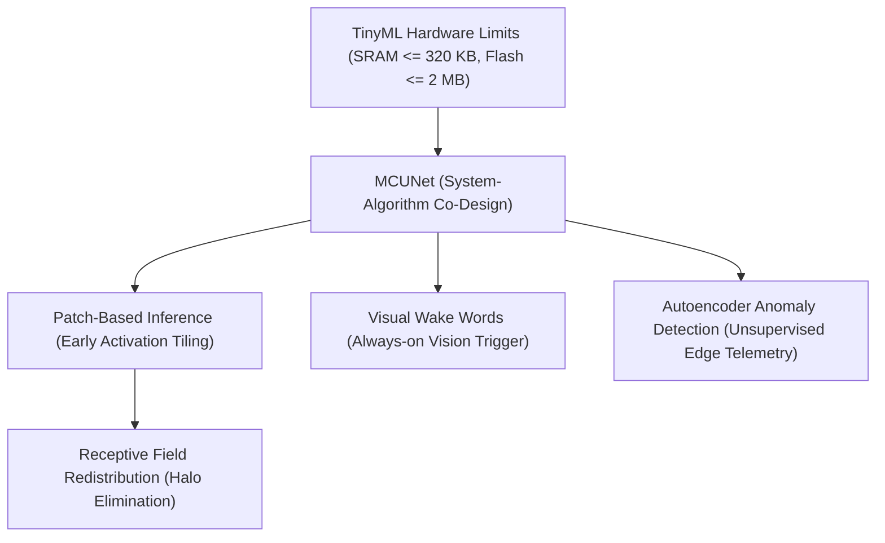

> [!abstract]
> Bringing deep neural networks to bare-metal microcontrollers with only hundreds of kilobytes of SRAM requires breaking the activation memory bottleneck. Through system-algorithm co-design (**MCUNet**), automated search space tuning (**TinyNAS**), and tile-by-tile execution (**Patch-Based Inference** with **Receptive Field Redistribution**), edge devices can achieve over 70% ImageNet accuracy and run always-on vision, audio, and anomaly detection workloads at milliwatt power budgets.

Part of [[courses/mit-6-5940|MIT 6.5940 (Fall 2026)]], lecture 10.

## TL;DR
- **The Activation Memory Wall:** While model weights live comfortably in 1–2 MB of non-volatile Flash, dynamic activations must fit inside ultra-fast on-chip SRAM (typically 256–320 KB); early high-resolution convolutional layers cause massive activation spikes that immediately crash standard mobile models like MobileNetV2.
- **System-Algorithm Co-Design (MCUNet):** Neither neural architecture search nor compiler optimization alone can bridge the microcontroller gap; [[concepts/mcunet|MCUNet]] co-designs [[concepts/tinynas|TinyNAS]] (optimizing architecture search spaces to flatten peak layer memory) and TinyEngine (eliminating runtime interpretation with static memory scheduling) to achieve $>70\%$ ImageNet accuracy on commercial microcontrollers.
- **Tiling Space with Patch-Based Inference:** In standard execution, an entire high-resolution intermediate feature map must reside in memory; [[concepts/patch-based-inference|Patch-Based Inference]] breaks early layers into spatial patches, reducing peak activation SRAM by $4\times$ to $8\times$.
- **Solving the Halo Overhead:** Spatial convolution on patches creates overlapping boundary regions ("the halo problem") that inflate duplicated arithmetic; [[concepts/receptive-field-redistribution|Receptive Field Redistribution]] shifts spatial kernels from early patch-based layers to downsampled late layers, slashing redundant computation from $>40\%$ to $<5\%$.

## Concept map

The atomic concepts in dependency order:

1. [[concepts/mcunet|MCUNet]]: System-algorithm co-design combining TinyNAS architecture search with TinyEngine bare-metal compilation for microcontrollers.  
   *Needs:* [[concepts/tinyml|TinyML]], [[concepts/tinynas|TinyNAS]], [[concepts/algorithm-hardware-co-design|Algorithm-Hardware Co-Design]]
2. [[concepts/patch-based-inference|Patch-Based Inference]]: Dividing early high-resolution activation maps into spatial patches to eliminate SRAM activation memory spikes.  
   *Needs:* [[concepts/activation-memory-vs-weight-memory|Activation Memory vs Weight Memory]], [[concepts/mcunet|MCUNet]]
3. [[concepts/receptive-field-redistribution|Receptive Field Redistribution]]: Eliminating redundant overlapping boundary computation (halo effect) by using small kernels early and large kernels late.  
   *Needs:* [[concepts/patch-based-inference|Patch-Based Inference]]
4. [[concepts/visual-wake-words|Visual Wake Words]]: Low-power, always-on binary person detection benchmark for microcontroller vision.  
   *Needs:* [[concepts/tinyml|TinyML]]
5. [[concepts/autoencoder-anomaly-detection|Autoencoder Anomaly Detection]]: Unsupervised machine telemetry monitoring by measuring reconstruction error through an information bottleneck.  
   *Needs:* [[concepts/tinyml|TinyML]]



## First-principles rebuild

### 0. The Kilobyte Chasm: Why Cloud & Mobile AI Fail on Microcontrollers
To understand the extreme challenge of TinyML, consider the memory hierarchy across computing platforms:

| Metric | Cloud Server (A100 / H100) | Smartphone (iPhone / Galaxy) | Microcontroller (STM32 / Cortex-M7) |
| :--- | :--- | :--- | :--- |
| **System Memory (RAM/SRAM)** | $80\text{ GB}$ HBM | $6\text{–}16\text{ GB}$ LPDDR | **$256\text{–}320\text{ KB}$ SRAM** |
| **Storage (SSD/Flash)** | Terabytes NVMe | $128\text{–}512\text{ GB}$ UFS | **$1\text{–}2\text{ MB}$ Flash** |
| **Power Consumption** | $300\text{–}700\text{ W}$ | $1\text{–}5\text{ W}$ | **$10\text{–}50\text{ mW}$** |
| **Cost** | $\$10,000+$ | $\$800+$ | **$\$2\text{–}\$5$** |

A smartphone has **$13,000\times$ more RAM** than a microcontroller; a cloud server has over **$100,000\times$ more memory**. 

Yet microcontrollers (MCUs) are the nervous system of modern civilization: over 250 billion microcontrollers operate inside vehicles, thermostats, industrial drills, medical pacemakers, and household appliances. If we can run machine learning models directly on these tiny chips, we achieve:
1. **Zero Cloud Latency & Independence:** Real-time feedback without Wi-Fi or cellular connectivity.
2. **Ironclad Privacy:** Personal sensor data (microphones, cameras, bio-sensors) is processed on bare metal and never transmitted over the internet.
3. **Milliwatt Always-On Sensing:** Devices run for months or years on small coin batteries or harvested solar energy.

#### The Physical Trap: Flash vs. SRAM
On a microcontroller, memory is divided into two rigid physical domains:
1. **Flash Storage ($1\text{–}2\text{ MB}$):** Non-volatile, read-only memory. This is where compiled binary code and static neural network weights live.
2. **SRAM Computation Memory ($256\text{–}320\text{ KB}$):** Volatile, high-speed on-chip static RAM. This is where the runtime call stack, OS buffers, input activations, and output activations must reside during execution.

```
+--------------------------------------------------------------+
| Microcontroller Silicon                                      |
|                                                              |
|   +------------------------------------------------------+   |
|   | Flash Memory (1 MB)                                  |   |
|   |  - Firmware executable code                          |   |
|   |  - Quantized INT8 weights (Static, Read-Only)        |   |
|   +------------------------------------------------------+   |
|                                                              |
|   +------------------------------------------------------+   |
|   | SRAM Memory (256 KB)                                 |   |
|   |  - System stack & variables                          |   |
|   |  - Layer Input Activation:  [ H x W x C_in  ]        |   |
|   |  - Layer Output Activation: [ H' x W' x C_out ]      |   |
|   +------------------------------------------------------+   |
+--------------------------------------------------------------+
```

When engineers compress neural networks, their initial instinct is to prune and quantize weights so the model fits in Flash. But fitting inside Flash is only half the battle—and often the easier half!

The lethal bottleneck is almost always **peak activation memory in SRAM**. During a convolution layer, the microcontroller must store both the input feature map and the output feature map in SRAM simultaneously:
$$\text{SRAM Required} \ge \text{Size}(\text{Input Activation}) + \text{Size}(\text{Output Activation})$$

In MobileNetV2, an input image of $224 \times 224 \times 3$ produces an early activation map of $112 \times 112 \times 32$. At 1 byte per activation (INT8), this single tensor consumes **$401\text{ KB}$**, and the subsequent expansion layer requires **$1,340\text{ KB}$**. On a microcontroller with $320\text{ KB}$ of total SRAM, the chip crashes with an immediate hardware fault before layer 1 even finishes!

---

### 1. MCUNet: Co-Designing Algorithm and Bare-Metal Runtime

Why can't existing tools solve this?
- Machine learning researchers design architectures (like MobileNetV3 or ProxylessNAS) assuming mobile runtimes with gigabytes of RAM.
- Embedded systems engineers optimize runtimes (like TensorFlow Lite Micro or CMSIS-NN) around fixed, standard architectures.

Neither approach works in isolation. **MCUNet** solves this through full system-algorithm co-design, coupling **TinyNAS** with **TinyEngine**.

```
                           +----------------------+
                           |  Hardware Profiler   |
                           |  (SRAM, Flash, MACs) |
                           +----------+-----------+
                                      |
                     +----------------v----------------+
                     |            TinyNAS              |
                     |  - Search Space Optimization    |
                     |  - Two-Stage Memory Bounding    |
                     |  - Uniform Memory Balancing     |
                     +----------------+----------------+
                                      |
                               Optimal Architecture
                                      |
                     +----------------v----------------+
                     |          TinyEngine             |
                     |  - Full Static Memory Planning  |
                     |  - Direct Codegen (No Runtime)  |
                     |  - In-Place Tensor Overwrites   |
                     +----------------+----------------+
                                      |
                            Deployable C Binary
                                      |
                     +----------------v----------------+
                     | Commercial MCU (< 256 KB SRAM)  |
                     |   70.7% ImageNet Top-1 Accuracy |
                     +---------------------------------+
```

#### TinyNAS: Automated Search Space Optimization
A traditional neural architecture search (NAS) explores billions of candidate configurations (depth, width, kernel size). However, when evaluated under microcontroller budgets, over $99\%$ of candidate networks in standard mobile search spaces fail the SRAM constraint.

TinyNAS introduces a two-stage approach:
1. **Search Space Optimization:** Rather than searching directly for individual layers, TinyNAS first searches over macroscopic scaling parameters: input resolution $R$ and global width multiplier $W$. It evaluates candidate search spaces by plotting their cumulative FLOP distributions under the hard memory budget. 
   - A critical discovery: **Compute is cheap, but memory is expensive.** On microcontrollers, clock cycles are fast enough to run tens of millions of operations, but SRAM is rigidly fixed. Under a hard SRAM ceiling, a network that fits more FLOPs into that memory window achieves higher capacity and higher accuracy.
2. **Model Specialization via One-Shot Supernet:** Once the search space is scaled to the device envelope, TinyNAS trains a weight-sharing supernet. From this supernet, sub-networks are specialized for specific hardware profiles (e.g., $256\text{ KB}$ vs $320\text{ KB}$ SRAM).

#### Uniform Memory Utilization
In standard networks (like MobileNetV2), memory usage is spiky: layer 2 consumes $1,300\text{ KB}$ of SRAM, while layer 15 consumes only $30\text{ KB}$. This is terrible engineering: the peak memory forces the engineer to buy a massive chip, leaving hardware under-utilized for $90\%$ of the computation.

TinyNAS actively penalizes memory spikes, discovering architectures with **uniform memory utilization**: every layer consumes near the maximum allowable SRAM budget (e.g., hovering steadily around $240\text{ KB}$). This flattens the memory curve and packs maximum representational power into every layer.

MCUNet was the first system to break the $70\%$ ImageNet top-1 accuracy barrier ($70.7\%$) on off-the-shelf commercial microcontrollers without external memory.

---

### 2. MCUNetV2 & Patch-Based Inference: Breaking the Activation Wall

Even with TinyNAS, microcontrollers remained constrained to low input resolutions (such as $112 \times 112$ or $128 \times 128$). But real-world vision tasks—like detecting a pedestrian down a hallway or reading a license plate—critically depend on spatial resolution. A tiny $96 \times 96$ image blurs a distant human into an unrecognizable smudge of 4 pixels.

Can we process a high-resolution image ($160 \times 160$ or $224 \times 224$) on a chip with only $256\text{ KB}$ of SRAM?

#### The Per-Layer Execution Flaw
Standard deep learning frameworks use **per-layer execution**:
$$\text{Full Input } (H \times W \times C_{\text{in}}) \xrightarrow{\text{Layer 1}} \text{Full Feature Map } (H \times W \times C_1) \xrightarrow{\text{Layer 2}} \text{Full Feature Map } (H' \times W' \times C_2)$$
Because the entire intermediate tensor must be fully computed and stored before the next layer begins, the high resolution of early layers forces SRAM usage through the roof.

#### The Patch-Based Execution Solution
In **Patch-Based Inference**, the execution schedule is flipped from breadth-first to depth-first:
1. Divide the high-resolution input into a grid of spatial tiles (e.g., $2 \times 2$ patches).
2. Take Patch 1 (e.g., top-left corner) and propagate it through layers 1, 2, 3, and 4 in sequence.
3. Because each layer applies spatial downsampling (strided convolution or pooling), by layer 4 the spatial dimensions of Patch 1 have shrunk to a tiny fraction of their original size.
4. Save the tiny downsampled output patch in SRAM and repeat the pipeline for Patches 2, 3, and 4.
5. Once all patches have passed through the early layers, assemble the compact feature map in SRAM and continue the rest of the network using standard per-layer execution!

```
Standard Per-Layer Inference:
[ Full Image 160x160 ] ===> [ Full Feature Map 160x160 ] (SRAM Peak: > 450 KB -- CRASH!)

Patch-Based Inference (2x2 Patches):
[ Patch 1: 80x80 ] ===> Layer 1 ===> Layer 2 ===> Layer 3 ===> [ Downsampled Patch: 10x10 ]
[ Patch 2: 80x80 ] ===> Layer 1 ===> Layer 2 ===> Layer 3 ===> [ Downsampled Patch: 10x10 ]
[ Patch 3: 80x80 ] ===> Layer 1 ===> Layer 2 ===> Layer 3 ===> [ Downsampled Patch: 10x10 ]
[ Patch 4: 80x80 ] ===> Layer 1 ===> Layer 2 ===> Layer 3 ===> [ Downsampled Patch: 10x10 ]
                                                                             |
                                      Stitch assembled compact map (20x20) <-+
                                      (Continues per-layer execution; SRAM Peak < 120 KB!)
```

By holding only a single spatial patch in memory during early layers, peak SRAM usage is reduced by **$4\times$ to $8\times$**!

#### The Halo Problem: Receptive Field Explosion
Patch-based inference is elegant in theory, but encounters a physical obstacle: **the Halo Problem**.

When a $3 \times 3$ convolution operates on the pixels along the edge of Patch 1, it requires context from the neighboring pixels belonging to Patch 2. To avoid degrading numerical precision, the input patch must be expanded with a border region called the **halo**:

```
+---------------+---------------+
|               |               |
|    Patch 1    |    Patch 2    |
|        +------+------+        |
|        | Halo | Halo |        |
|        | Reg- | Reg- |        |
|        | ion  | ion  |        |
|        +------+------+        |
|               |               |
+---------------+---------------+
```

If early layers contain multiple $3 \times 3$ or $5 \times 5$ convolutions, the required halo width expands cumulatively with each consecutive layer:
$$\text{Cumulative Halo Expansion} = \sum_{l=1}^L \frac{K_l - 1}{2}$$

Over 4 layers of $3 \times 3$ convolutions, each patch requires an extra 8 pixels of padding on all sides. When patches overlap, the hardware is forced to recompute the exact same convolutions over the overlapping halo region multiple times. In naive patch inference, **redundant duplicated arithmetic can exceed $+40\text{–}60\%$**, drastically increasing latency and battery drain.

#### The Architectural Remedy: Receptive Field Redistribution
MCUNetV2 solves the halo problem through **Receptive Field Redistribution**:
1. **Early Patch-Based Layers:** The architecture search space is restricted to $1 \times 1$ pointwise convolutions and depthwise kernels with minimal spatial extent. Because a $1 \times 1$ convolution has a kernel size of $K = 1$, its spatial receptive field expansion is **zero**. Halo expansion stops completely, cutting redundant arithmetic from $+42\%$ down to under $+5\%$.
2. **Later Per-Layer Layers:** Once spatial resolution has been downsampled and the model returns to per-layer execution, larger kernels ($3 \times 3$, $5 \times 5$) and higher expansion ratios are freely deployed. Because per-layer execution does not tile feature maps, large kernels in late layers produce **zero halo redundancy**.

```
Layer Sequence:
Early Layers (Patch-Based):     1x1 Conv  ==> Depthwise 1x1 ==> Minimal Kernel  (Halo = 0!)
                                                 || (Spatial Downsampling)
Late Layers (Per-Layer):        5x5 Conv  ==> 3x3 Conv      ==> Wide Expansion   (Zero Overlap!)
```

By co-designing the network topology around the inference schedule, MCUNetV2 pushed the SRAM requirement down to an astounding **$30\text{ KB}$** while maintaining $90\%$ accuracy on vision benchmarks—achieving a $4\times$ reduction in SRAM at identical accuracy.

---

### 3. Edge Primitives: From Visual Wake Words to Unsupervised Anomaly Detection

What can you actually build when deep neural networks run inside a $300\text{ KB}$ chip?

#### 1. Visual Wake Words (VWW)
Voice assistants (like Siri or Alexa) use acoustic keyword spotting: a tiny microphone processor listens continuously for "wake words" using under 5 milliwatts, waking the main application processor only when triggered.

**Visual Wake Words (VWW)** provides the exact same capability for vision:
- Rather than running heavy multi-class object detection continuously, an always-on image sensor and microcontroller monitor the scene for a binary signal: **is a person present?**
- Evaluated on the VWW benchmark (derived from COCO), a positive image contains a person occupying $>2.5\%$ of the frame.
- High resolution enabled by patch-based inference is critical here: distant people occupying tiny spatial areas are detected accurately, avoiding false negatives without draining power.
- Application: Automated elevator lighting (turning green when vacant, red when occupied) consuming milliwatts of power without video data ever leaving the sensor.

#### 2. Keyword Spotting (KWS) via Spectrogram CNNs
In audio processing, continuous acoustic waveforms are converted into overlapping short-time Fourier transform (STFT) frames, producing a 2D time-frequency spectrogram.
- Traditional fully-connected networks treat each frequency bin independently, ignoring spatial correlations.
- 2D Convolutional Neural Networks on spectrograms excel at keyword spotting because convolutions provide **translation invariance**: whether a user speaks with a slightly higher pitch or pauses briefly between syllables, the convolutional kernels identify the acoustic pattern.
- MCUNet applied to KWS achieves superior accuracy and lower latency on microcontrollers compared to standard mobile networks.

#### 3. Unsupervised Anomaly Detection via Autoencoders
In predictive maintenance (monitoring high-speed industrial fans, conveyor belts, railway bearings, or patient heartbeats), supervised learning is impossible because failures occur rarely and in unpredictable modes.

The solution is an **Autoencoder with an Information Bottleneck**:
1. An encoder compresses multi-axis vibration or acoustic telemetry into a low-dimensional latent code $z = f_\theta(x)$.
2. A decoder reconstructs the original sensor readings: $\hat{x} = g_\phi(z)$.
3. The network is trained **exclusively on healthy operational data** to minimize reconstruction error:
   $$\mathcal{L} = \| x - \hat{x} \|_2^2$$
4. At deployment on an MCU, the model continuously computes reconstruction error:
   $$\text{Anomaly Score} = \| x - \hat{x} \|_2^2$$
   - Under normal operation: error is near zero ($< 0.05$).
   - When a screwdriver interferes with an industrial fan blade or a ball-bearing cracks, the unfamiliar sensor frequencies cannot pass through the trained bottleneck; reconstruction error spikes above threshold $\tau$, immediately lighting a yellow warning LED.

---

## Connections

- **Cross-domain analog:** Moving furniture through a narrow doorway. If you try to carry an assembled king-size bed through a tiny door (standard per-layer execution with high-resolution tensors), it gets wedged and blocked by the doorframe (SRAM wall). Patch-based inference disassembles the bed into modular components, carries them through the doorway one piece at a time, and reassembles them inside the room.
- **What breaks when scaled down:** The assumption of decoupled algorithm and software design. On cloud servers, neural network designers and compiler writers rarely communicate. On microcontrollers, where peak SRAM is measured in kilobytes, an algorithm designed without awareness of compiler buffer reuse or patch scheduling crashes immediately.
- **Next question:** How do we build the bare-metal runtime that executes these search-optimized architectures without operating system support or dynamic memory allocators? That is the domain of **TinyEngine and Parallel Processing** (Lecture 11).

## Review questions

> [!question]- Why is peak SRAM activation memory, rather than Flash model size, the primary barrier to running deep learning on microcontrollers?
> Model weights are static, read-only parameters stored in non-volatile Flash memory, which typically offers 1–2 MB of capacity—sufficient for aggressive INT8 or INT4 quantized models. SRAM, by contrast, is high-speed on-chip volatile memory offering only 256–320 KB. SRAM must dynamically hold runtime stack variables, input activations, and output activations for every layer simultaneously. In early convolutional layers operating on high-resolution inputs, intermediate activation tensors easily exceed 1 MB, causing the microcontroller to suffer an immediate out-of-memory crash regardless of how small the weights are in Flash.

> [!question]- How does Patch-Based Inference reduce peak SRAM activation memory in convolutional networks?
> Standard per-layer inference requires computing and holding the entire spatial output feature map in SRAM before the subsequent layer can begin. Patch-Based Inference divides the high-resolution input into spatial patches (e.g., $2 \times 2$) and computes multiple early layers depth-first for one patch at a time. Because each early layer downsamples spatial resolution via strided convolutions, by the end of the patch-based stage the feature patch has shrunk to a fraction of its original dimensions. Storing only a single spatial patch at a time slashes peak activation memory in SRAM by $4\times$ to $8\times$, allowing microcontrollers to handle high-resolution inputs within tiny SRAM budgets.

> [!question]- What causes the "Halo Problem" in patch-based execution, and how does Receptive Field Redistribution resolve it?
> Convolving on a spatial patch requires neighboring context pixels along its borders. Across consecutive patch-based layers with spatial kernels ($3 \times 3$), this border requirement (the "halo") expands cumulatively, forcing overlapping patches to redundantly compute identical pixels and inflating duplicated arithmetic by $40\text{–}60\%$. Receptive Field Redistribution solves this by restricting early patch-based layers to $1 \times 1$ pointwise convolutions (which have zero spatial extent and zero halo expansion). It then places larger spatial kernels ($3 \times 3$, $5 \times 5$) in later downsampled layers that execute using standard per-layer inference, preserving overall receptive field while reducing redundant computation to $<5\%$.

> [!question]- Why is an Autoencoder preferred over a supervised binary classifier for industrial edge anomaly detection?
> Industrial equipment operates normally $>99.99\%$ of the time, making failure data exceedingly rare, and machinery can break in infinite unexpected ways that cannot be anticipated during training. A supervised classifier requires labeled negative examples for all failure modes, which is practically impossible to collect. An autoencoder is trained strictly unsupervised on abundant normal data. By forcing normal telemetry through a low-dimensional bottleneck, it learns only the regularities of healthy operation; when an unexpected mechanical failure occurs, the unfamiliar frequencies fail to reconstruct, causing reconstruction error to spike and triggering an immediate local alert.

## Source notes
- Lecture: MIT 6.5940 (Fall 2026), Lecture 10: MCUNet: TinyML on Microcontrollers.
- Speaker: Shanya (MIT HAN Lab, co-instructor with Prof. Song Han).
- Key references:
  - Lin et al., "MCUNet: Tiny Deep Learning on IoT Devices" (NeurIPS 2020) — Two-stage TinyNAS and TinyEngine co-design achieving $>70\%$ ImageNet accuracy on microcontrollers.
  - Lin et al., "MCUNetV2: Memory-Efficient Patch-based Inference for Tiny Deep Learning" (NeurIPS 2021) — Patch-based inference and receptive field redistribution reducing SRAM to $30\text{ KB}$.
  - Chowdhery et al., "Visual Wake Words Dataset" (2019) — Formulation of binary always-on person presence detection on low-power edge hardware.
  - Zhang et al., "Hello Edge: Keyword Spotting on Microcontrollers" (2017) — 2D CNN spectrogram processing for edge audio.
