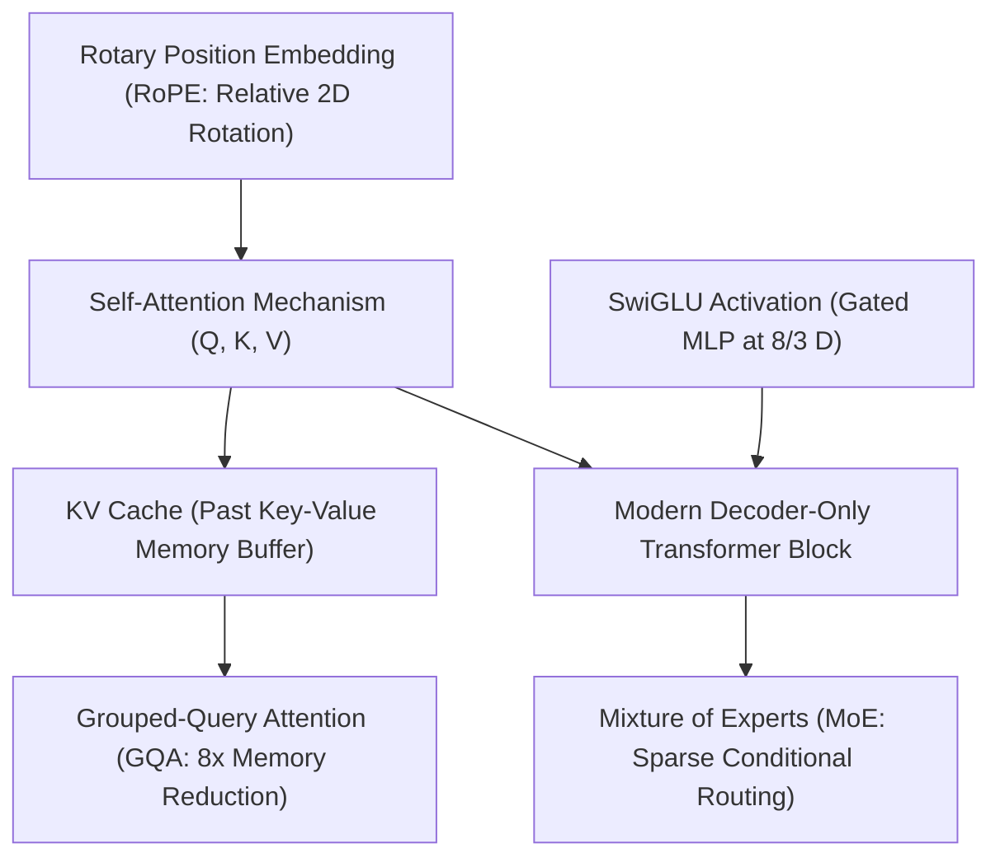

> [!abstract]
> Large language models have replaced recurrent sequences with parallel self-attention, establishing direct $O(1)$ communication paths across all context tokens. Scaling these models from small experimental blocks to frontier foundation systems requires resolving critical efficiency bottlenecks: eliminating redundant decoding with the **KV Cache**, taming memory traffic via **Grouped-Query Attention (GQA)**, enabling relative context extrapolation with **Rotary Position Embeddings (RoPE)**, enhancing representational power with **SwiGLU** MLPs, and decoupling parameter capacity from inference latency through **Mixture of Experts (MoE)**.

Part of [[courses/mit-6-5940|MIT 6.5940 (Fall 2026)]], lecture 12.

## TL;DR
- **From Recurrence to Direct Attention:** While RNNs compress history into a fragile hidden state across $O(N)$ sequential steps (causing long-distance forgetting and preventing parallel GPU training), self-attention gives every token an immediate $O(1)$ path to every other token using Query-Key-Value retrieval.
- **The Modern Foundation Architecture:** Modern open-weight LLMs (LLaMA, Mistral) converge on a refined decoder-only recipe: Pre-Layer Normalization for gradient stability, [[concepts/swiglu-activation|SwiGLU Activation]] for non-linear gating at parameter parity ($\frac{8}{3} D$), and [[concepts/rotary-position-embedding|Rotary Position Embedding]] (RoPE) to ensure attention scores depend purely on relative token distances.
- **Taming the KV Cache Memory Explosion:** Caching past Key and Value activations during autoregressive generation cuts per-token compute from $O(N^2)$ to $O(N)$; however, the [[concepts/kv-cache|KV Cache]] quickly balloons past model weight size. [[concepts/grouped-query-attention|Grouped-Query Attention]] (GQA) groups query heads to share key-value tensors, slashing KV cache memory and bandwidth by $8\times$ with zero accuracy degradation.
- **Sparse Conditional Scaling (MoE):** Rather than evaluating all parameters on every token, [[concepts/mixture-of-experts|Mixture of Experts]] uses dynamic gating routers to dispatch each token to only a sparse top-$k$ subset of expert sub-networks, expanding model knowledge capacity while running at a fraction of dense inference FLOPs.

## Concept map

The atomic concepts in dependency order:

1. [[concepts/rotary-position-embedding|Rotary Position Embedding]]: Complex plane 2D rotations of queries and keys that encode relative token displacement.  
   *Needs:* None
2. [[concepts/swiglu-activation|SwiGLU Activation]]: Gated feed-forward network combining Swish activations with linear projections at $\frac{8}{3} D$ parameter calibration.  
   *Needs:* None
3. [[concepts/kv-cache|KV Cache]]: Runtime memory storage of past token keys and values that eliminates redundant $O(N^3)$ autoregressive generation.  
   *Needs:* [[concepts/the-memory-compute-gap|The Memory-Compute Gap]]
4. [[concepts/grouped-query-attention|Grouped-Query Attention]]: Sharing key and value heads across groups of query heads to reduce KV cache size and memory traffic by $8\times$.  
   *Needs:* [[concepts/kv-cache|KV Cache]]
5. [[concepts/mixture-of-experts|Mixture of Experts]]: Dynamic routing of individual tokens to specialized sub-networks, decoupling model capacity from per-token compute.  
   *Needs:* None



## First-principles rebuild

### 0. The Long-Distance Amnesia: Why Recurrence Lost to Attention

Before the Transformer revolution, natural language processing relied on **Recurrent Neural Networks (RNNs)** and LSTMs.

Imagine playing a game of "telephone" down a line of 1,000 people. Person 1 whispers a secret to Person 2, Person 2 incorporates it into their memory and whispers to Person 3, and so on. By the time the message reaches Person 1,000:
1. **Long-Distance Forgetting:** The fixed-size memory vector has been overwritten 999 times. Early context is completely obliterated. Passing information from token 1 to token $N$ requires **$O(N)$ sequential steps**.
2. **The Hardware Paralysis:** You cannot compute Person 50's state until Person 49 finishes. GPUs—which contain thousands of parallel tensor cores designed to multiply giant matrices simultaneously—sat idle, crippled by the sequential dependency chain of recurrent training.

```
RNN Sequential Pipeline (O(N) sequential steps, zero training parallelism):
Token 0 ---> [ State 0 ] ---> [ State 1 ] ---> [ State 2 ] ... ===> [ State N ]
                 ^                ^                ^                    ^
                 |                |                |                    |
              Input 0          Input 1          Input 2              Input N

Self-Attention Direct Crossbar (O(1) direct communication between ANY two tokens!):
Token 0 <=======================================================> Token N
Token 0 <======================> Token 2
Token 1 <======================> Token N
(All tokens attend simultaneously in a single parallel matrix multiplication!)
```

#### Self-Attention: The Query-Key-Value Crossbar
In **Self-Attention**, every token is granted an immediate, single-hop $O(1)$ telephone wire to every other token in the sequence.

The interaction is modeled as a database information retrieval system:
- **Query ($Q$):** What the current token is searching for (e.g., the pronoun *"it"* searching for its antecedent noun).
- **Key ($K$):** The label or indexing tag describing what each token contains (e.g., the noun *"the dog"* broadcasting its semantic tags).
- **Value ($V$):** The raw semantic content payload transferred if a Query and Key match.

To compute attention:
1. Measure the compatibility (inner product) between Query $q_i$ and all Keys $k_j$: $S_{i, j} = q_i \cdot k_j^T$.
2. Scale by $\sqrt{d_k}$ to prevent variance from exploding with high dimensions (which would push softmax into flat regions with vanishing gradients).
3. Apply Softmax to convert compatibility scores into normalized probabilities.
4. Compute the output as the weighted sum over all Value vectors:
   $$\text{Attention}(Q, K, V) = \text{Softmax}\left(\frac{Q K^T}{\sqrt{d_k}}\right) V$$

This mathematical operation has an arithmetic complexity of $O(N^2)$ with respect to sequence length, but it is **$100\%$ parallelizable during training**. GPUs can process millions of tokens across entire books in parallel.

---

### 1. The Modern Foundation Blueprint: RoPE, Pre-Norm, and SwiGLU

While the original 2017 Transformer used an encoder-decoder architecture for translation, modern foundation LLMs (like LLaMA-3, Mistral, and GPT-4) converged onto an optimized, elegant **decoder-only causal recipe**:

```
Input Tokens
     |
[ Tokenizer ] ===> Input Embeddings (Lookup Table)
     |
+----+---------------------------------------------------------------+
| Transformer Block (Repeated L times)                               |
|                                                                    |
|    +----------------------------------------------------------+    |
|    |  RMSNorm (Pre-Norm Layer Normalization)                  |    |
|    +----------------------------+-----------------------------+    |
|                                 |                                  |
|    +----------------------------v-----------------------------+    |
|    |  Causal Self-Attention with RoPE (Rotary Embeddings)      |    |
|    |  + Grouped-Query Attention (GQA)                         |    |
|    +----------------------------+-----------------------------+    |
|                                 |                                  |
|                               ( + ) <--- Residual Add Connection   |
|                                 |                                  |
|    +----------------------------v-----------------------------+    |
|    |  RMSNorm (Pre-Norm Layer Normalization)                  |    |
|    +----------------------------+-----------------------------+    |
|                                 |                                  |
|    +----------------------------v-----------------------------+    |
|    |  SwiGLU Gated Feed-Forward Network (Intermediate = 8/3 D)|    |
|    +----------------------------+-----------------------------+    |
|                                 |                                  |
|                               ( + ) <--- Residual Add Connection   |
+----+----------------------------+----------------------------------+
     |
[ Final RMSNorm ]
     |
[ LM Head (Un-embedding Projection) ] ===> Next Token Probabilities
```

#### 1. Pre-Norm vs. Post-Norm
In the original Transformer, Layer Normalization was applied *after* the residual addition (**Post-Norm**). In deep networks ($L > 30$), gradients passing through un-normalized residual additions compounded instability, requiring warm-up schedules and delicate learning rates.

Modern LLMs use **Pre-Norm** (or **RMSNorm**): normalization is applied to inputs *before* they enter the attention and FFN blocks. The main residual stream passes unimpeded through pure additions ($x_{l+1} = x_l + F(x_l)$), guaranteeing stable gradient highways from the final layer down to the initial embeddings.

#### 2. Rotary Position Embedding (RoPE)
Self-attention is mathematically permutation-invariant: if you shuffle the input words randomly, the dot product scores remain identical.

Earlier approaches added fixed absolute position vectors ($x_m + p_m$). But if a model was trained on 2,048 tokens, position 2,049 had no trained vector; the model broke immediately on long inputs.

**RoPE** injects position by rotating 2D coordinate pairs in the complex plane:
- Token $m$'s query is rotated by angle $m \theta$.
- Token $n$'s key is rotated by angle $n \theta$.
- When their dot product is evaluated:
  $$\langle R_m q_m, R_n k_n \rangle = q_m^T R_{n - m} k_n$$
The absolute positions cancel out entirely! The resulting attention weight depends **strictly on the relative separation $(n - m)$**.

Furthermore, RoPE unlocks **Position Interpolation**: to extend context from 2K to 32K tokens without re-training from scratch, developers simply downscale rotation angles by $16\times$, allowing pre-trained models to ingest 32,000 tokens immediately.

#### 3. SwiGLU Activation
The Feed-Forward Network (FFN) processes semantic features within each token. Original models used a 2-layer perceptron with ReLU: $\text{ReLU}(x W_1) W_2$, with intermediate dimension $4D$.

Modern LLMs replace this with **SwiGLU**:
$$\text{SwiGLU}(x) = \left( (x W_{\text{gate}}) \cdot \text{sigmoid}(x W_{\text{gate}}) \right) \odot (x W_{\text{up}}) W_{\text{down}}$$
- The gating branch acts as a continuous non-linear filter controlling how much of the content branch passes through.
- To prevent adding parameters (since SwiGLU uses 3 projection matrices instead of 2), the intermediate width is calibrated to **$\frac{8}{3} D$** (e.g., $11,008$ instead of $16,384$ in LLaMA-7B). This matches the exact $8D^2$ parameter budget of a standard FFN while delivering strictly superior reasoning capabilities.

---

### 2. The KV Cache Wall and Attention Topologies

During inference, decoder-only LLMs generate text **autoregressively**, one token at a time.

```
Step 1: Input "The capital of France is" ===> Predicts "Paris"
Step 2: Input "The capital of France is Paris" ===> Predicts "."
```

At Step 2, do we really need to re-run the words *"The capital of France is"* through all 80 transformer layers? 

Because the model is causal, past tokens cannot see future tokens. Their Key ($K$) and Value ($V$) representations are fixed and will **never change**.

#### The KV Cache
By storing the Key and Value tensors of past tokens in GPU memory (the **KV Cache**):
- When a new token arrives, the model computes only its single query $q_t$, key $k_t$, and value $v_t$.
- $k_t$ and $v_t$ are appended to the cache.
- $q_t$ computes attention against all cached keys in $O(N)$ operations.
- Per-token generation compute drops from quadratic $O(N^2)$ to linear $O(N)$!

#### The Memory Wall: When KV Cache Dwarfs Model Weights
However, the KV cache introduces a severe memory crisis:
$$\text{KV Cache Size} = 2 \times B \times N \times L \times H \times D \times \text{bytes per element}$$

On LLaMA-2 70B ($L=80, H=64, D=128$) running FP16 with batch size 16 and context length 4,096:
$$\text{KV Cache Memory} = 2 \times 16 \times 4096 \times 80 \times 64 \times 128 \times 2\text{ bytes} \approx \mathbf{175.9\text{ GB}}$$

The dynamic KV cache consumes more GPU memory than the static weights of the 70B model itself ($140\text{ GB}$)! On long contexts (e.g., 32K or 128K tokens), serving even a single user causes GPU memory to crash.

#### Grouped-Query Attention (GQA)
How can we slash the KV cache memory footprint?

```
Multi-Head Attention (MHA):     Grouped-Query Attention (GQA):      Multi-Query Attention (MQA):
8 Query Heads, 8 KV Heads       8 Query Heads, 2 KV Heads (Groups)  8 Query Heads, 1 KV Head
Q1 Q2 Q3 Q4 Q5 Q6 Q7 Q8         [Q1 Q2 Q3 Q4]     [Q5 Q6 Q7 Q8]     Q1 Q2 Q3 Q4 Q5 Q6 Q7 Q8
 |  |  |  |  |  |  |  |           \  \  /  /        \  \  /  /       \   \   \  |  /   /   /
K1 K2 K3 K4 K5 K6 K7 K8                K1                K2                     K1
 |  |  |  |  |  |  |  |                |                 |                      |
V1 V2 V3 V4 V5 V6 V7 V8                V1                V2                     V1
(100% KV Cache Size)            (25% KV Cache Size, Full Acc)       (12.5% KV Cache, Quality Drops)
```

1. **Multi-Head Attention (MHA):** Every query head has its own private key and value head ($H$ keys, $H$ values). Full expressivity, but maximum memory consumption.
2. **Multi-Query Attention (MQA):** All query heads share a single key and value head ($1$ key, $1$ value). Slashes KV cache by $H\times$, but damages reasoning benchmarks.
3. **Grouped-Query Attention (GQA):** Query heads are partitioned into $G$ groups (e.g., 8 groups for 64 query heads). All query heads in a group share a single key and value head.

In LLaMA-2 70B and LLaMA-3, setting 8 query heads per group **slashes KV cache size and memory-loading traffic by $8\times$** (from $176\text{ GB}$ down to $22\text{ GB}$), allowing higher batch sizes and faster generation throughput with zero loss in benchmark accuracy.

---

### 3. Frontier Scaling: In-Context Emergence, Multimodality, and Sparse MoE

#### Emergent Abilities & Chinchilla Scaling
When language models are scaled up across compute, parameters, and training tokens, two phenomena occur:
1. **In-Context Few-Shot Learning:** Rather than fine-tuning model weights with backpropagation for every downstream task, a sufficiently large foundation model adapts in real time simply by providing task descriptions and a few demonstration examples in the prompt.
2. **Emergent Capabilities:** Specific complex skills (such as multi-step arithmetic, symbolic code execution, and translation) demonstrate near-zero accuracy on models under 10B parameters, but rise sharply once model capacity passes critical scale thresholds.
3. **Chinchilla Optimal Scaling:** Kaplan et al. originally suggested scaling parameters faster than training data. Hoffmann et al. (Chinchilla) proved that for compute-optimal training, **model parameters and training data must be scaled in equal proportion**: a 70B model requires at least 1.4 trillion tokens, whereas LLaMA-3 demonstrated that scaling high-quality tokens even further (15 trillion tokens) continues to yield massive gains on compact models.

#### Multimodal Language Models (VLMs)
How do language models ingest vision, audio, and robotics?
- **Perceiver Cross-Attention (Flamingo):** A frozen vision encoder processes an image into spatial feature maps. A Perceiver Resampler compresses them into a fixed number of visual tokens, which are injected into the frozen LLM using gated cross-attention layers.
- **Unified Token Embeddings (PaLM-E & RT-2):** Images and robotic sensor states are projected directly into the same continuous embedding space as text words. In RT-2, robot actions (arm coordinates, gripper angles) are represented as text tokens (`"move_arm_x_25_y_10"`), allowing a single model trained on web text and vision to directly control robotic hardware.

#### Mixture of Experts (MoE): Decoupling Parameters from FLOPs
As models grow past 100B parameters, dense inference costs become economically unsustainable.

**Mixture of Experts (MoE)** replaces the dense FFN with $E$ specialized sub-networks:
- A learned linear router evaluates the incoming token $x$ and selects the top-$k$ experts (e.g., top-2 out of 8 experts).
- The token is computed only by those 2 experts; the remaining 6 experts remain completely idle.

```
Token x ---> [ Router ] ===> Selects Top-2 Experts: [ Expert 2 (0.7) ] and [ Expert 5 (0.3) ]
                 |
                 +-------------------> Computes Expert 2 ----+
                 |                                           v
                 +-------------------> Computes Expert 5 ---> Weighted Sum ===> Output
                 |
                 [ Experts 0, 1, 3, 4, 6, 7 are SKIPPED! Zero compute cost! ]
```

In **Mixtral 8x7B**, the model holds $47\text{B}$ total parameters in memory, but activates only **$13\text{B}$ parameters per token**, achieving the intelligence of a 70B model at the inference latency and cost of a 13B model.

---

## Connections

- **Cross-domain analog:** The Library Index vs. Reading Every Book. An RNN is like an archivist who must read every book in chronological order, trying to hold all history in their head. Self-Attention with a KV Cache is like an index catalog: when you have a question (Query), you look up the specific cards (Keys) and pull only the relevant book excerpts (Values) immediately.
- **What breaks when scaled down:** In-context learning and reasoning. Small language models (under 1B parameters) lack the parametric memory capacity to perform reliable in-context few-shot learning; they require supervised fine-tuning or distillation (Lecture 9) to master specific tasks.
- **Next question:** How do we take these massive 70B+ LLM architectures and compress their multi-gigabyte weights down into 4-bit integers so they can run locally on consumer workstations and mobile devices? That is the focus of **LLM Quantization and Deployment** (Lecture 13).

## Review questions

> [!question]- Why does autoregressive token generation without a KV Cache scale cubically $O(N^3)$ in cumulative compute, and how does the KV Cache reduce this to $O(N^2)$?
> In decoder-only models, generating token $t$ requires computing attention over all $t-1$ preceding tokens. Without a KV Cache, the entire sequence must be passed through the transformer layers from scratch at every step, requiring $O(t)$ operations for step $t$, leading to a cumulative sum of $\sum_{t=1}^N O(t^2) = O(N^3)$ operations. With a KV Cache, Key and Value vectors for past tokens are saved in memory; at step $t$, only the new single token is projected, and its Query computes attention across the cached vectors in $O(N)$ operations, reducing cumulative sequence compute to $\sum_{t=1}^N O(t) = O(N^2)$. Linked note: [[concepts/kv-cache|KV Cache]].

> [!question]- How does Grouped-Query Attention (GQA) reduce KV Cache memory traffic by $8\times$, and why does it outperform Multi-Query Attention (MQA) in reasoning quality?
> Multi-Head Attention (MHA) allocates independent Key and Value heads for every Query head ($H$ keys, $H$ values). Multi-Query Attention (MQA) collapses all Query heads into a single shared Key and Value head ($1$ key, $1$ value), which severely degrades reasoning because a single key-value projection cannot represent multiple semantic aspects simultaneously. GQA groups Query heads into $G$ groups (e.g., $G = 8$ groups for $H = 64$ queries), where each group shares a Key and Value head. This reduces the number of Key and Value tensors by an exact factor of $H / G = 8\times$, saving $8\times$ memory and bandwidth while matching full MHA accuracy on large models. Linked note: [[concepts/grouped-query-attention|Grouped-Query Attention]].

> [!question]- Why do Rotary Position Embeddings (RoPE) enable relative position modeling despite being applied to individual Query and Key vectors independently?
> RoPE divides each Query and Key vector into 2D coordinate pairs and rotates the $i$-th pair by angle $m \theta_i$ for position $m$ and $n \theta_i$ for position $n$. When computing attention via the inner product $\langle R_m q_m, R_n k_n \rangle$, the rotation matrices multiply as $R_m^T R_n = R_{n - m}$. The absolute position indices $m$ and $n$ cancel out, leaving a transformation matrix that depends purely on the relative distance $(n - m)$. This allows the network to model relative word displacement while computing attention scores via standard dot products. Linked note: [[concepts/rotary-position-embedding|Rotary Position Embedding]].

> [!question]- How does a Mixture of Experts (MoE) architecture decouple a model's total parameter capacity from its per-token computational cost?
> In standard dense models, all parameters are activated for every token. MoE replaces dense feed-forward blocks with $E$ parallel expert sub-networks and uses a lightweight gating router to dynamically select only the top-$k$ experts (e.g., $k = 2$ out of $E = 8$) for each token. The remaining $E - k$ experts are skipped. While the total model footprint in memory reflects all $E$ experts (e.g., $47\text{B}$ parameters), each forward pass computes only the active parameters (e.g., $13\text{B}$ parameters), allowing the model to store vast knowledge while executing at the speed of a much smaller network. Linked note: [[concepts/mixture-of-experts|Mixture of Experts]].

## Source notes
- Lecture: MIT 6.5940 (Fall 2026), Lecture 12: Transformer and LLM.
- Speaker: Shanya (MIT HAN Lab, co-instructor with Prof. Song Han).
- Key references:
  - Vaswani et al., "Attention Is All You Need" (NeurIPS 2017) — Original Transformer architecture.
  - Su et al., "RoFormer: Enhanced Transformer with Rotary Position Embedding" (2021) — Formulation of RoPE.
  - Shazeer, "GLU Variants Improve Transformer" (2020) — SwiGLU activation and parameter calibration.
  - Ainslie et al., "GQA: Training Generalized Multi-Query Transformer Models from Multi-Head Checkpoints" (EMNLP 2023) — Grouped-Query Attention.
  - Touvron et al., "LLaMA: Open and Efficient Foundation Language Models" (2023) — Modern decoder-only LLM recipe.
  - Shazeer et al., "Outrageously Large Neural Networks: The Sparsely-Gated Mixture-of-Experts Layer" (ICLR 2017) — Formulation of MoE.
  - Hoffmann et al., "Training Compute-Optimal Large Language Models" (Chinchilla, 2022) — Scaling laws.
