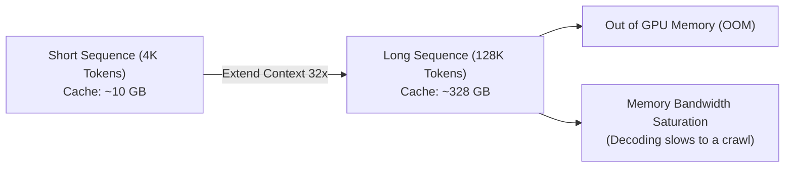
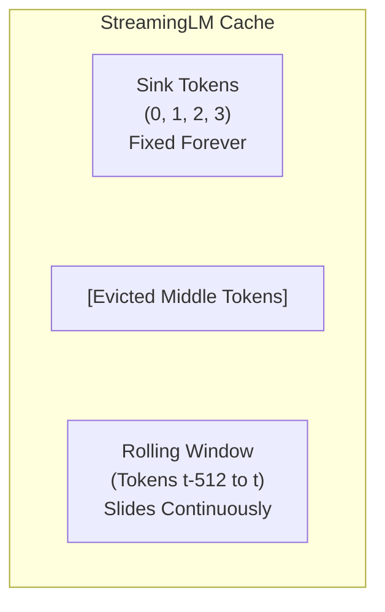
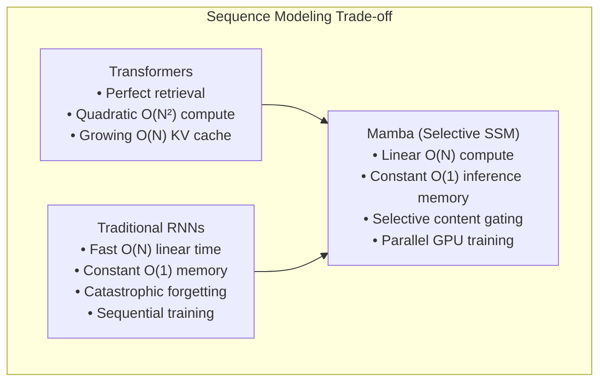

> [!abstract] Scaling language models to read entire books, vast codebases, and hour-long videos requires defeating the twin dragons of self-attention: quadratic $O(N^2)$ computational explosion and linear $O(N)$ KV cache memory growth. By exploiting attention sinks for infinite streaming, shifting sparse blocks during fine-tuning, dynamically fetching only query-relevant memory pages, and transitioning to selective state space models (Mamba), modern systems unlock million-token reasoning on accessible hardware.

Part of [[courses/mit-6-5940|MIT 6.5940 (Fall 2026)]], lecture 15.

## TL;DR
- **The Context Memory Wall:** A 70B parameter model serving a batch of 16 users at 4K context consumes 60 GB of GPU memory for its KV cache alone; at 32K or 128K context, the KV cache easily eclipses the model's physical weights, blowing out GPU capacity.
- **Attention Sinks Keep Streaming Alive:** Softmax forces attention probabilities to sum to 1. When a query needs no prior context, it dumps excess probability into the universally visible initial tokens. Dropping token 0 in a naive sliding window destroys generation stability; preserving just 4 initial sink tokens alongside a rolling window stabilizes generation infinitely with $O(1)$ memory.
- **LongLoRA with Shifted Sparse Attention ($S^2$-Attn):** Fine-tuning long contexts is prohibitively expensive because quadratic attention acts on large sequences. Splitting heads into local chunk groups and half-chunk shifted groups lets information propagate across the entire sequence layer-by-layer, enabling 32K context fine-tuning on a single 8-GPU node.
- **The "Lost in the Middle" Illusion:** Models can accept 128K tokens without crashing while remaining functionally blind to facts buried in the middle 20% to 80% of the document. Benchmarks like Needle In A Haystack (NIAH) and LongBench prove that context acceptance does not equal contextual understanding.
- **Selective Retrieval (Dual Attention & QUEST):** Dual Attention divides heads into dense retrieval heads and streaming heads to slash cache by 60%+ without losing distant facts. QUEST keeps the full cache in memory but selectively reads only the top ~1% of pages per query using fast min/max key bound estimations.
- **Beyond Attention with Mamba:** State Space Models replace quadratic self-attention with continuous linear dynamical systems discretized into selective recurrent states ($h_t = \bar{A} h_{t-1} + \bar{B} x_t$). Selective gating filters out noise, while hardware-accelerated associative parallel scans allow parallel GPU training.

## Concept map
The atomic concepts in **dependency order**: each one builds directly on the ideas before it.
1. [[concepts/attention-sinks|Attention Sinks]]: Recognizing that initial tokens act as an overflow valve for excess softmax probability, explaining why naive sliding-window caches collapse.
   *Needs:* [[concepts/kv-cache|KV Cache]]
2. [[concepts/shifted-sparse-attention|Shifted Sparse Attention]]: Splitting attention heads into regular and half-shifted local chunks so information diffuses globally across layers during long-context fine-tuning.
   *Needs:* [[concepts/low-rank-adaptation|Low-Rank Adaptation]]
3. [[concepts/lost-in-the-middle|Lost in the Middle]]: The U-shaped performance curve where language models retrieve information accurately at the beginning or end of prompts, but fail in the middle.
   *Needs:* nothing
4. [[concepts/dual-attention|Dual Attention]]: Partitioning attention heads into dense retrieval heads (storing full history) and streaming heads (retaining only sinks and local windows) to halve cache memory.
   *Needs:* [[concepts/kv-cache|KV Cache]], [[concepts/attention-sinks|Attention Sinks]]
5. [[concepts/query-aware-sparsity|Query-Aware Sparsity]]: Preserving the entire KV cache in RAM while dynamically fetching only the top-scoring key-value pages required for each query token.
   *Needs:* [[concepts/kv-cache|KV Cache]]
6. [[concepts/state-space-models|State Space Models]]: Formulating sequence processing as continuous linear systems with input-dependent selection, achieving linear compute and constant recurrent memory.
   *Needs:* nothing

---

## First-principles rebuild

### Act 1: The Context Bottleneck and Extension Limits

Imagine trying to read a 1,000-page legal case or debug an enterprise codebase across 50 source files. You need the model to hold all 100,000 tokens in its working memory simultaneously.

In a standard Transformer, two physical walls immediately block this:
1. **The Compute Wall:** Every token must compare itself against every other token. A sequence of length $N$ requires an $N \times N$ attention matrix. Scaling from 4,000 to 128,000 tokens ($32\times$) increases pairwise attention dot products by $32^2 = 1,024\times$.
2. **The KV Cache Memory Wall:** During autoregressive generation, past Key and Value vectors are saved in GPU High-Bandwidth Memory (HBM) so they don't need to be recomputed:
   $$\text{KV Memory} = 2 \times B \times L \times H_{KV} \times d_{\text{head}} \times N \times \text{bytes per element}$$
   For a 70-billion parameter model (LLaMA-2 70B, 80 layers, 8 KV heads under GQA, head dimension 128) running a batch size of 16:
   - At $N = 4,096$ tokens: $\text{KV Cache} \approx 10.5 \text{ GB}$ (manageable).
   - At $N = 32,768$ tokens: $\text{KV Cache} \approx 84 \text{ GB}$ (exceeds an entire 80 GB A100 GPU).
   - At $N = 128,000$ tokens: $\text{KV Cache} \approx 328 \text{ GB}$ (requires a cluster of 5 H100 GPUs solely for intermediate cache).



#### How Do We Extend Pre-trained Contexts?
When a base model was pre-trained on only 4,096 tokens, feeding it 32,000 tokens causes immediate numerical failure:
- **Rotary Position Embedding (RoPE) Interpolation:** As established in [[concepts/rotary-position-embedding|Rotary Position Embedding]], token positions are encoded as rotational frequencies on the 2D complex plane. When sequence index $m > 4,096$, the rotation angles enter unexplored domains never seen during pre-training. By applying **Position Interpolation (PI)**, developers divide position indices by a scale factor $S = 32\text{K}/4\text{K} = 8$:
  $$m' = \frac{m}{S}$$
  This squeezes 32,000 tokens into the rotational angle spectrum of the original 4,096 tokens. The model only needs light fine-tuning to adapt to the denser representations.

#### The Fine-Tuning Bottleneck: LongLoRA
Fine-tuning with full dense attention on 32K+ sequences still causes catastrophic activation out-of-memory errors on standard developer servers. Standard [[concepts/low-rank-adaptation|LoRA]] reduces parameter gradient memory, but does not reduce the $O(N^2)$ self-attention activation memory.

**LongLoRA** overcomes this through **[[concepts/shifted-sparse-attention|Shifted Sparse Attention ($S^2$-Attn)]]**:
- The model splits its attention heads into two equal halves.
- **Head Group 1 (Regular):** Tokens are split into non-overlapping chunks of size $G$ (e.g., 1,000 tokens). Each token attends only to neighbors in its local chunk.
- **Head Group 2 (Shifted):** The entire sequence is cyclically shifted by half a chunk ($G/2 = 500$ tokens) before grouping into local chunks of size $G$.

Because the two head groups overlap by 500 tokens, tokens near block boundaries bridge adjacent blocks. Within 2 or 3 transformer layers, information diffuses smoothly across the entire 32,000-token sequence. LongLoRA fine-tunes a 7B model up to 32K tokens on a single 8-GPU node—matching full fine-tuning perplexity while cutting compute and memory overhead dramatically.

---

### Act 2: The Evaluation Trap — Lost in the Middle & Benchmarks

Just because an extended model ingests 100,000 tokens without an out-of-memory error does not mean it actually reads or comprehends the text.

#### The "Lost in the Middle" Phenomenon
Human readers remember the opening chapter and the final twist of a novel far better than details in Chapter 14. Modern LLMs exhibit an identical, severe cognitive flaw called **[[concepts/lost-in-the-middle|Lost in the Middle]]**:
- **Primacy Effect:** Initial tokens define system prompts and formatting. Because of causal masking, they receive constant gradient updates from every subsequent token in every layer throughout pre-training.
- **Recency Effect:** Tokens right next to the question have minimal relative distance under RoPE, maintaining sharp dot-product attention without positional decay.
- **The Middle Chasm:** Information placed between 20% and 80% of document depth suffers from diffuse attention. The model produces fluent, perfectly structured English, but completely hallucinates or ignores facts located in the interior.

```mermaid
xychart-beta
    title "Lost in the Middle: Accuracy vs Document Depth"
    x-axis "Position of Evidence in Context" [0%, 20%, 40%, 60%, 80%, 100%]
    y-axis "Retrieval Accuracy (%)" 0 --> 100
    line [98, 45, 20, 24, 49, 94]
```

#### Stress-Testing Long Contexts: NIAH and LongBench
To rigorously separate real comprehension from fluent hallucination, the community relies on two gold-standard benchmarks:
1. **Needle In A Haystack (NIAH):** A synthetic stress test that constructs an enormous text corpus (the "haystack", from 1K to 128K+ tokens) and hides an arbitrary factual sentence (the "needle", e.g., *"The best thing to do in San Francisco is eat a sandwich in Dolores Park"*) at varying depths from 0% to 100%. The model is prompted: *"What is the best thing to do in San Francisco?"* A perfect model produces an all-green grid across every length and depth; flawed models turn red throughout the middle.
2. **LongBench:** A realistic multi-task benchmark comprising 21 datasets across multi-hop question answering, long-form summarization, codebase navigation, and few-shot learning in English and Chinese, verifying that long-context models solve genuine real-world reasoning problems.

---

### Act 3: Efficient Sparse Attention & Streaming Inference

In customer-service chatbots, autonomous agents, and persistent co-pilots, interactions run indefinitely. If every past token is kept in the KV cache, the system inevitably crashes from out-of-memory errors.

#### The Sliding Window Illusion and Attention Sinks
A simple intuitive solution is a **sliding window cache**: keep only the most recent $L$ tokens (e.g., the last 1,024 words) and discard everything older.
- *The Shocking Failure:* When researchers tested sliding window caching, generation worked fine for the first 1,024 tokens. But the moment token 1,025 was generated and token 0 was evicted, the model's perplexity shot from 5.4 to over 1,000—output collapsed into repetitive gibberish!
- *Why did this happen?*
  The culprit is the **Softmax operator**:
  $$\text{Softmax}(z_i) = \frac{e^{z_i}}{\sum_j e^{z_j}}$$
  Softmax requires all attention weights to sum strictly to 1. During generation, queries frequently generate filler tokens ("the", "is", commas) that have no semantic connection to past text. But softmax cannot assign zero to everything—it *must* dump the excess probability somewhere.
  Because token 0 is visible to every subsequent token in causal attention, the model learned during pre-training to use token 0 as an **[[concepts/attention-sinks|Attention Sink]]** (a dumping ground for excess probability).
  When sliding window eviction drops token 0, the denominator of softmax is abruptly amputated. The excess probability is forced into nearby local tokens, completely deranging the attention distribution.

**StreamingLM** solves this with breathtaking simplicity:
- Retain the **first 4 sink tokens** (tokens 0, 1, 2, 3) in the KV cache forever.
- Maintain a rolling sliding window of the most recent $W$ tokens (e.g., 512 tokens).
- Evict all intermediate tokens between the sink and the window.



By keeping just 4 sink tokens, StreamingLM enables infinite autoregressive generation across millions of tokens with **zero perplexity degradation** and completely constant, bounded memory.

#### Dual Attention: Specializing Heads for 1M+ Contexts
StreamingLM supports infinite continuous generation, but once a token is evicted from the middle, its factual content can never be retrieved. What if the user asks a question about something discussed 50,000 tokens ago?

**[[concepts/dual-attention|Dual Attention]]** solves this by observing that not all attention heads in a transformer do the same job:
- **Retrieval Heads (~30% of heads):** Specialize in associative lookup and long-range factual retrieval.
- **Streaming Heads (~70% of heads):** Specialize in local syntax, grammatical transitions, and phrase rhythm.

Through a lightweight distillation phase (tuning only ~1,000 gating scalars across the network), Dual Attention assigns each head a permanent role:
- **Retrieval Heads** store the full, unabridged KV cache for all tokens.
- **Streaming Heads** store only 4 attention sinks plus a local sliding window.

This simple architectural split reduces KV cache memory by over 60% and doubles decoding throughput, allowing a model to process **1.8 million to 3.3 million tokens on a single GPU** with 100% NIAH retrieval accuracy.

#### Query-Aware Sparsity: QUEST and LServe
What if we cannot afford to lose a single token, but our decoding speed is crippled by memory bandwidth?
During decoding, generating one token requires loading the entire KV cache from GPU HBM into SRAM. At 128K context, 99% of time is spent transferring memory, not doing math.

**[[concepts/query-aware-sparsity|Query-Aware Sparsity (QUEST)]]** keeps 100% of the KV cache in GPU memory (zero permanent eviction), but changes how queries read it:
1. The cache is divided into pages (e.g., 16 tokens).
2. For each page, compact minimum and maximum key vectors are maintained in fast SRAM.
3. When query $q_t$ arrives, it checks the min/max bounds to compute an upper-bound estimate of the highest possible attention score in that page.
4. The GPU fetches only the top 1% to 5% highest-scoring pages over the memory bus to perform exact attention.

**LServe** scales this to enterprise serving systems by introducing **hierarchical paging**:
- **Physical Pages (Hardware-Friendly):** Large continuous blocks (64 tokens) stored in DRAM for maximum hardware memory throughput.
- **Logical Pages (Algorithm-Friendly):** Fine-grained sub-blocks (16 tokens) evaluated during importance estimation. Taking the maximum score across logical sub-pages ensures that no isolated, critical needle is smoothed out by surrounding noise.

---

### Act 4: Beyond Transformers — State Space Models & Hybrid Architectures

Can we break free from the quadratic attention bottleneck entirely?

#### The Fundamental Trade-off of Transformers
Transformers trade computation for memory: they achieve near-perfect retrieval by storing every past token and comparing against all of them. Recurrent Neural Networks (RNNs) do the opposite: they compress all history into a single fixed-size hidden state $h_t$, processing tokens in $O(N)$ linear time with $O(1)$ constant memory. But traditional RNNs suffer from catastrophic forgetting and cannot be trained in parallel on GPUs.



#### Mamba: Selective State Spaces
**[[concepts/state-space-models|State Space Models (SSMs)]]**, culminating in **Mamba**, synthesize the strengths of RNNs and Transformers:
1. **Continuous Linear Dynamical System:** The model tracks a hidden state $h(t)$ governed by differential equations:
   $$\dot{h}(t) = A h(t) + B x(t), \quad y(t) = C h(t)$$
   Discretizing this continuous system with step size $\Delta$ produces a linear recurrence:
   $$h_t = \bar{A} h_{t-1} + \bar{B} x_t, \quad y_t = C h_t$$
2. **Selectivity (Input-Dependent Gating):** Classical SSMs used fixed $A, B, C$ matrices, making them linear time-invariant (LTI) systems equivalent to convolutions. They could not choose what to remember. Mamba makes $B, C,$ and $\Delta$ dynamic functions of the current token $x_t$. When an uninformative token arrives, the model dials $\Delta \to 0$, freezing the hidden state and filtering out the noise.
3. **Hardware-Efficient Parallel Scan:** If recurrence is sequential, how can Mamba train in parallel?
   Because linear recurrences are associative:
   $$(A_2, b_2) \circ (A_1, b_1) = (A_2 A_1, A_2 b_1 + b_2)$$
   Mamba evaluates the entire sequence using a **parallel prefix scan** (tree reduction) across GPU cores in $O(\log N)$ time, training just as fast as FlashAttention while running inference with a constant recurrent state that never grows with sequence length!

#### The Future: Hybrid Architectures (Jamba)
Pure SSMs compress infinite history into finite-dimensional vectors, which can struggle with exact verbatim multi-needle retrieval across millions of tokens.
Modern frontier architectures adopt **hybrid designs** (such as AI21's Jamba):
- **Interleaved Layers:** 7 out of 8 layers use Mamba SSMs (providing massive throughput and linear scaling).
- **Periodic Attention:** 1 out of 8 layers uses standard Transformer attention (providing exact long-distance retrieval).
- **Mixture-of-Experts (MoE):** Applied to feedforward blocks to maximize parameter capacity while keeping active FLOPs low.

This hybrid synthesis allows a model to ingest 256,000 tokens on a single 80 GB GPU with the speed of an RNN and the precision of a Transformer.

---

## Connections
- Extends [[lessons/2026-11-01-transformers-llms-and-attention-mechanisms]]: addresses the quadratic computational wall and KV cache explosion inherent to standard Transformer architectures.
- Builds upon [[concepts/rotary-position-embedding|Rotary Position Embedding]]: explains how position interpolation (PI) scales rotational angle frequencies to represent long contexts.
- Complements [[concepts/low-rank-adaptation|Low-Rank Adaptation]] and [[concepts/qlora|QLoRA]]: LongLoRA demonstrates how low-rank adaptation must be coupled with shifted sparse attention to prevent out-of-memory errors during long-context fine-tuning.
- Connects to [[concepts/pagedattention|PagedAttention]] and [[lessons/2026-11-01-llm-quantization-and-deployment-techniques]]: LServe extends paged memory allocation into hierarchical physical and logical paging specifically optimized for block-sparse attention.

---

## Review questions

> [!question]- Q1: Why does a standard sliding-window KV cache cause an LLM's perplexity to explode, and how does preserving just 4 initial tokens solve the problem?
> In autoregressive Transformers, the softmax function normalizes attention weights across the sequence such that they must sum strictly to 1:
> $$\sum_{j=1}^{i} \text{Softmax}\left(\frac{q_i k_j^T}{\sqrt{d}}\right) = 1$$
> When an autoregressive query token does not need context from earlier tokens (e.g., punctuation, syntax words, or formatting tokens), it cannot assign zero to all tokens. Because token 0 (and initial prompt tokens) is visible to every single token in the sequence under causal masking, the model learns during pre-training to use these early positions as universal "attention sinks" to absorb excess probability mass.
> In a naive sliding-window cache, when token 0 is evicted to make room for newer tokens, this learned probability overflow valve vanishes. The softmax denominator is amputated, abruptly forcing massive attention weight onto arbitrary local tokens. The attention distribution collapses, and perplexity spikes past 1,000.
> Preserving just 4 initial sink tokens (StreamingLM) maintains this overflow destination, perfectly stabilizing the softmax denominator and enabling infinite streaming generation with constant memory.

> [!question]- Q2: Explain the "Lost in the Middle" phenomenon from first principles. Why does a model with 100% syntax fluency fail to answer factual questions buried in the middle of a 64K prompt?
> "Lost in the Middle" refers to a U-shaped performance curve where retrieval and reasoning accuracy is high when evidence is located near the start (0%–15%) or end (85%–100%) of a long document, but plummets when evidence is situated in the middle (20%–80%).
> This occurs due to structural architectural biases:
> 1. **Primacy Bias:** The prompt opening contains system instructions and role descriptions. Because of causal masking, every subsequent token in every layer attends to these initial positions, giving them persistent, high-gradient representation throughout pre-training.
> 2. **Recency Bias:** Tokens adjacent to the question have minimal relative distance under RoPE positional encodings. Their key vectors undergo sharp, undispersed dot products with the query, and their representations have not experienced repeated dilution through multiple causal aggregation layers.
> 3. **Middle Dispersion:** Middle tokens lack both the universal visibility of the beginning and the positional sharpness of the end. In long contexts, softmax distributions over thousands of intermediate keys flatten into background noise. The model remains syntactically fluent because local language modeling depends on recent tokens, but it becomes functionally blind to intermediate factual evidence.

> [!question]- Q3: How does Dual Attention achieve a 60%+ reduction in KV cache memory without losing the ability to retrieve needles hidden anywhere in a 1-million-token document?
> Dual Attention exploits the empirical discovery that individual attention heads in multi-head attention exhibit functional specialization:
> - **Retrieval Heads (~30%):** Responsible for global associative memory, cross-document referencing, and needle retrieval.
> - **Streaming Heads (~70%):** Responsible for local grammar, phrasing, and next-token semantic continuity.
>
> Using a lightweight distillation process with an L1 regularization penalty on head gating factors ($\alpha_h$), Dual Attention identifies which heads require full history versus streaming history.
> At inference time, Dual Attention decouples the cache layout:
> - Retrieval heads retain the complete KV cache across all $N$ tokens, ensuring that distant facts are never discarded.
> - Streaming heads retain only 4 attention sink tokens and a local sliding window (e.g., 512 tokens), evicting all intermediate keys and values.
>
> Because over two-thirds of the heads store only a tiny, fixed-size buffer ($4 + 512$ tokens instead of $1,000,000$), total KV memory drops by over 60%, fitting multi-million token contexts onto single GPUs while retaining 100% accuracy on Needle In A Haystack retrieval tests.

> [!question]- Q4: Contrast how Transformers and Mamba (State Space Models) scale with sequence length during training and inference. How does Mamba overcome the sequential training bottleneck of traditional RNNs?
> **Scaling Comparison:**
> - **Transformers:**
>   - *Training Compute:* Scales quadratically as $O(N^2)$ due to full pairwise self-attention.
>   - *Inference Memory:* Scales linearly as $O(N)$ because the KV cache must store past vectors for every token in the sequence.
> - **Mamba (SSM):**
>   - *Training Compute:* Scales linearly as $O(N)$ with sequence length.
>   - *Inference Memory:* Remains strictly constant at $O(1)$ because all historical context is compressed into a fixed-size continuous recurrent state vector $h_t \in \mathbb{R}^{d \times d_{\text{state}}}$.
>
> **Overcoming Sequential Training:**
> Traditional RNNs compute $h_t = \sigma(W h_{t-1} + U x_t)$ sequentially step-by-step, which underutilizes parallel GPU tensor cores.
> Mamba's discretized state equation is linear:
> $$h_t = \bar{A}_t h_{t-1} + \bar{B}_t x_t$$
> Linear recurrences satisfy the **associative property**:
> $$(A_2, B_2 x_2) \circ (A_1, B_1 x_1) = (A_2 A_1, A_2 B_1 x_1 + B_2 x_2)$$
> Because matrix composition is associative, computing the state trajectory over $N$ tokens does not require waiting for token $t-1$. Instead, it is solved using a **parallel prefix scan** (tree reduction) in $O(\log N)$ parallel steps directly in GPU SRAM, enabling Mamba to train with the massive parallel throughput of FlashAttention while generating with the constant memory of an RNN.

---

## Source notes
- Lecture: MIT 6.5940 (Fall 2026), Lecture 15: Long Context LLM.
- Instructor: Prof. Song Han (MIT HAN Lab).
- Source video: [EfficientML.ai Lecture 15 - Long-Context LLM](https://www.youtube.com/watch?v=q0WQyW1inqk) (uploaded Nov 4, 2026).
- Slides reference: [MIT 6.5940 Lecture 15 Slides](https://www.dropbox.com/scl/fi/2m80agerzvq7vnl36r48a/Lec15-Long-Context-LLM.pdf?rlkey=iw8ajsaih4i6pjleut2i3j7ip&st=ei9rvfmi&dl=0).
- Key papers cited:
  - Xiao et al., "Efficient Streaming Language Models with Attention Sinks" (StreamingLM), ICLR 2024.
  - Chen et al., "LongLoRA: Efficient Fine-tuning of Long-Context Large Language Models", ICLR 2024.
  - Liu et al., "Lost in the Middle: How Language Models Use Long Contexts", TACL 2024.
  - Bai et al., "LongBench: A Bilingual, Multitask Benchmark for Long Context Understanding", 2023.
  - Tang et al., "Dual Attention: Compressing Long-Context Large Language Models", 2024.
  - Tang et al., "QUEST: Efficient Long-Context LLM Decoding via Query-Aware Sparsity", 2024.
  - Gu & Dao, "Mamba: Linear-Time Sequence Modeling with Selective State Spaces", 2023.
  - Lieber et al., "Jamba: A Hybrid Transformer-Mamba Language Model", 2024.
