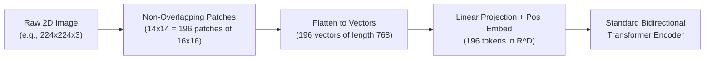
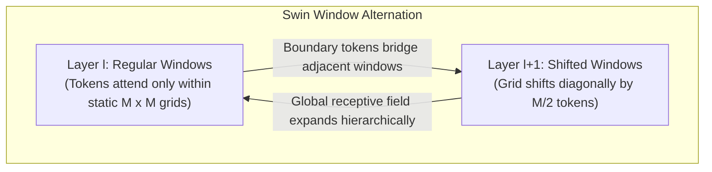
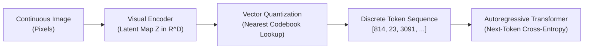
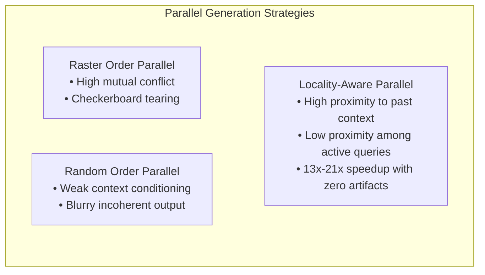
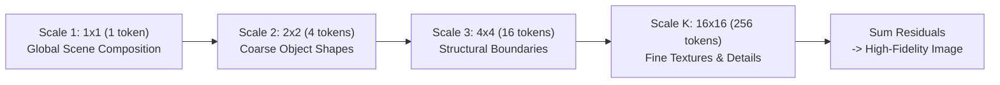

> [!abstract] Applying Transformers to vision requires conquering two distinct frontiers: perceiving dense 2D images with linear computational complexity, and generating high-resolution images without suffering from thousands of slow, sequential token steps. By replacing quadratic softmax attention with shifted windows and linear associative kernels, and replacing raster-order next-token generation with locality-aware parallel queries and next-scale coarse-to-fine pyramids, modern Vision Transformers achieve real-time perception and synthesis at scale.

Part of [[courses/mit-6-5940|MIT 6.5940 (Fall 2026)]], lecture 16.

## TL;DR
- **Images as Token Sequences:** Vision Transformers (ViT) chop a 2D image into non-overlapping square patches (e.g. $16 \times 16$), flatten them into vectors, and project them through a linear layer into token embeddings, processing vision with the same bidirectional attention used in NLP.
- **The High-Resolution Scaling Wall:** For dense prediction (medical segmentation, autonomous driving), downsampling destroys tiny critical boundaries. However, doubling image resolution quadruples token count $N$, expanding pairwise attention compute by $16\times$ ($O(N^2)$).
- **Three Paths to Linear-Cost Perception:**
  1. *Shifted Window Attention (Swin):* Confines attention to fixed local $M \times M$ windows for $O(N)$ cost, shifting window grids across layers to let information cross boundaries.
  2. *Linear Attention (EfficientViT):* Replaces softmax with ReLU feature maps, exploiting matrix multiplication associativity ($Q(K^T V)$ instead of $(Q K^T) V$) to drop cost to $O(N D^2)$, accelerating Segment Anything (SAM) by $49\times$.
  3. *SparseViT:* Prunes low-magnitude activation windows dynamically and searches layerwise sparsity configurations via evolutionary algorithms under latency budgets.
- **The Discrete Tokenizer Bridge:** Continuous feature vectors cannot be generated with language model cross-entropy loss. Vector Quantization (VQ) maps continuous vectors to nearest learned codebook centroids, creating a discrete vocabulary of visual tokens.
- **Breaking Sequential Generation:** Raster-order next-token generation requires hundreds or thousands of memory-bound forward passes (one per token). Two architectures turn this into parallel, compute-bound generation:
  1. *Locality-Aware Parallel Decoding:* Decouples context from target queries; samples tokens with high proximity to past context and low proximity to co-generated tokens ($13\times$ to $21\times$ faster).
  2. *Next-Scale Autoregressive (VAR):* Predicts full 2D token maps progressively across 10–15 coarse-to-fine spatial scales via multi-scale residual quantization.

## Concept map
The atomic concepts in **dependency order**: each one builds directly on the ideas before it.
1. [[concepts/shifted-window-attention|Shifted Window Attention]]: Partitioning 2D feature maps into local windows and alternating grid boundaries across layers to achieve linear-complexity vision perception.
   *Needs:* nothing
2. [[concepts/linear-attention|Linear Attention]]: Swapping softmax for positive linear feature kernels, switching matrix multiplication order from $(QK^T)V$ to $Q(K^T V)$ to eliminate quadratic scaling.
   *Needs:* nothing
3. [[concepts/vector-quantization-for-images|Vector Quantization for Images]]: Converting continuous spatial image patches into discrete codebook indices so transformers can model visual distributions with cross-entropy.
   *Needs:* [[concepts/k-means-quantization|K-Means Quantization]]
4. [[concepts/locality-aware-parallel-decoding|Locality-Aware Parallel Decoding]]: Decoupling context encoding from generation queries and generating non-adjacent visual tokens simultaneously in parallel.
   *Needs:* [[concepts/vector-quantization-for-images|Vector Quantization for Images]]
5. [[concepts/next-scale-autoregressive-modeling|Next-Scale Autoregressive Modeling]]: Reframing visual generation as a coarse-to-fine multi-scale residual pyramid, generating entire images in 10–15 parallel scale steps.
   *Needs:* [[concepts/vector-quantization-for-images|Vector Quantization for Images]]

---

## First-principles rebuild

### Act 1: The Visual Tokenization and Resolution Crisis

Language is naturally broken into discrete, sequential units: letters combine into words, and words follow a unidirectional temporal order. Images, however, are continuous 2D grids of pixels. How does a Transformer—designed to operate on sequences of 1D vectors—process a photograph?

#### The Vision Transformer (ViT) Recipe
The foundational Vision Transformer (ViT) introduces a simple, elegant conversion:
1. **Patch Partitioning:** Take a 2D image of resolution $H \times W$ with 3 color channels ($C = 3$). Divide it into a grid of non-overlapping square patches of size $P \times P$ (typically $16 \times 16$).
2. **Flattening:** Each patch contains $P \times P \times 3$ raw values. For a $16 \times 16$ patch, this is $16 \times 16 \times 3 = 768$ numbers.
3. **Linear Projection:** Multiply the flattened 768-dimensional patch vector by a learned projection matrix $W_E \in \mathbb{R}^{768 \times D}$ to project each patch into the model's hidden dimension $D$ (e.g., 768).
4. **Position Embeddings:** Add learned 1D position embeddings to each patch token so the Transformer knows where each patch sits in the 2D layout.
5. **Bidirectional Self-Attention:** Unlike autoregressive language models, there is no causal mask. Because the entire image is available at once, every patch attends freely to every other patch across the entire canvas.

#### The High-Resolution Quadratic Trap
For simple image classification (like recognizing whether an image contains a dog), downsampling the image to $224 \times 224$ pixels produces $14 \times 14 = 196$ patch tokens—well within modern GPU compute limits.

However, real-world vision demands **dense perception**:
- **Medical Diagnostics:** Identifying tiny micro-tumors in a $2048 \times 2048$ MRI scan.
- **Autonomous Driving:** Spotting distant pedestrians or lane markers in a multi-camera $1920 \times 1080$ video feed.
- **Interactive Segmentation (Segment Anything / SAM):** Predicting precise pixel-level boundaries for any clicked object.

If you aggressively downsample the input to 224 pixels, small objects are permanently erased before the first layer even executes. But if you keep the native high resolution:
$$\text{Tokens } N = \frac{H \times W}{P^2}$$
Increasing resolution from $256 \times 256$ to $2048 \times 2048$ ($8\times$ in each dimension) increases token count $N$ by $64\times$ (from 256 to 16,384 tokens). Because self-attention evaluates pairwise dot products between all tokens, computation explodes quadratically:
$$\text{Attention FLOPs} = 2 \times N^2 \times D = 2 \times 64^2 \times \text{Base} \approx 8,192\times \text{ compute!}$$

We cannot simply downsample, and we cannot afford quadratic self-attention. We need architectures that perceive images with **linear $O(N)$ complexity**.

---

### Act 2: Efficient Visual Perception

Three major architectures break the quadratic perception bottleneck:

#### 1. Shifted Window Attention (Swin Transformer)
Instead of allowing every patch to attend to every other patch across the entire million-pixel canvas, **Swin Transformer** divides the token map into fixed local windows containing $M \times M$ tokens (typically $M = 7$):
- Attention is computed strictly inside each window.
- The cost per window is $(M^2)^2 \cdot D = M^4 D$.
- Total computation scales as:
  $$\text{Window Complexity} = \left(\frac{N}{M^2}\right) \times M^4 D = O(N \cdot M^2 \cdot D)$$
Because window size $M$ is fixed, computation scales strictly **linearly** with token count $N$!

*The Window Boundary Problem:* If window borders remain static across all layers, tokens in neighboring windows are completely isolated. An object that crosses a window seam is severed in half.
Swin solves this with **[[concepts/shifted-window-attention|Shifted Window Attention]]**:
- **Layer $l$:** Uses a standard regular window partition.
- **Layer $l+1$:** Shifts the window grid diagonally by $(\lfloor M/2 \rfloor, \lfloor M/2 \rfloor)$ tokens.
Because the new windows overlap the boundaries of four previous windows, visual information propagates across the entire image within a few layers while maintaining strict $O(N)$ computation.

#### 2. Linear Attention (EfficientViT & EfficientViT-SAM)
Can we retain global, image-wide attention while eliminating the quadratic $N^2$ matrix entirely?
Standard softmax attention is trapped by its non-linear exponential operator:
$$\text{Attn}(Q, K, V) = \text{Softmax}\left(\frac{Q K^T}{\sqrt{D}}\right) V$$
Because softmax normalizes row-by-row, we are forced to compute the $N \times N$ matrix $Q K^T$ before multiplying by $V$.

**[[concepts/linear-attention|Linear Attention]]** replaces softmax with a positive linear feature mapping $\phi(x) = \text{ReLU}(x)$:
$$\text{Output} = \frac{\phi(Q) \left(\phi(K)^T V\right)}{\phi(Q) \sum_j \phi(k_j)^T}$$
Because all operations are linear, matrix multiplication is associative:
- Instead of computing $(Q K^T) \in \mathbb{R}^{N \times N}$ first, we compute $\left(\phi(K)^T V\right) \in \mathbb{R}^{D \times D}$ first!
- Since hidden dimension $D$ (e.g. 64) is tiny compared to sequence length $N$ (e.g. 16,384), the intermediate context matrix takes negligible memory ($64 \times 64 = 4,096$ values).
- Multiplying $\phi(Q) \in \mathbb{R}^{N \times D}$ by this compact $D \times D$ matrix scales as $O(N D^2)$—pure **linear time**!

*Restoring Fine Details:* ReLU linear attention diffuses attention broadly, losing local sharpness. **EfficientViT** fixes this by pairing linear attention with lightweight local depthwise convolutions ($3 \times 3$), providing sharp local pixel edges alongside global linear context.
When applied to Meta's Segment Anything model (**EfficientViT-SAM**), replacing SAM's heavy ViT-H encoder with EfficientViT achieves a **$49\times$ speedup** (from 11 FPS to 182 FPS on an A100 GPU) with zero drop in zero-shot segmentation accuracy!

#### 3. SparseViT: Window Activation Pruning
Not all regions of an image require equal compute. In an autonomous driving scene, an empty stretch of asphalt or blank sky contains almost zero informative signal compared to a distant pedestrian or crossing cyclist.

**SparseViT** allocates compute dynamically:
1. **Window L2 Pruning:** Measures the L2 magnitude of activations across $M \times M$ windows. Low-magnitude windows (empty backgrounds) are pruned entirely from the attention computation.
2. **Sparsity-Aware Adaptation:** During training, diverse layerwise sparsity ratios are randomly sampled so the network adapts to missing activations without accuracy collapse.
3. **Evolutionary Architecture Search:** An evolutionary search finds the optimal pruning ratio for each layer under a strict hardware latency budget (e.g., exactly 19 ms on an edge GPU).

---

### Act 3: From Seeing to Creating — The Autoregressive Image Bottleneck

We know how to perceive images efficiently. But how do we generate them?

#### Perception vs. Generation
- **Discriminative Perception:** Ingests an entire 2D image at once with bidirectional attention and outputs a single label or segmentation mask.
- **Autoregressive Generation:** Starts from a prompt or class label and synthesizes a novel image from scratch by predicting visual tokens sequentially, factoring the joint probability using the causal chain rule:
  $$p(x_1, x_2, \dots, x_N) = \prod_{i=1}^N p(x_i \mid x_1, \dots, x_{i-1})$$

#### The Discretization Bridge: Vector Quantization (VQ)
Language models operate on a discrete dictionary of words. But pixels are continuous real numbers. If we project patches into continuous vectors, how can an autoregressive model predict them using categorical softmax cross-entropy?

**[[concepts/vector-quantization-for-images|Vector Quantization (VQ)]]** bridges continuous vision and discrete language:
1. An autoencoder encodes an image into a continuous 2D feature grid $Z \in \mathbb{R}^{h \times w \times D}$.
2. A learned codebook contains $K$ vector centroids (e.g., 4,096 prototype visual patterns).
3. Every spatial vector is replaced by the integer index of its nearest codebook centroid.
4. The image is now represented as a sequence of integer tokens: `[814, 23, 3091, ...]`.
5. An autoregressive Transformer learns to predict these visual tokens exactly like predicting words in a sentence!

#### The Sequential Raster Bottleneck
Once an image is discretized, traditional models generate tokens in **raster order** (row by row, left to right).
This creates an intolerable latency crisis:
- A modest $256 \times 256$ image with $16 \times 16$ latent patches requires **256 sequential generation steps**.
- A $1024 \times 1024$ image requires **4,096 sequential generation steps**.
- Even with a KV cache, each step fetches gigabytes of weights and keys from memory to predict just **one token**. Execution is severely memory-bandwidth bound, running $100\times$ slower than GPU silicon is capable of.

---

### Act 4: Breaking the Sequential Barrier — Parallel & Hierarchical Generation

To make visual autoregression practical, we must predict **multiple tokens per forward pass**, shifting execution from memory-bound sequential stepping to compute-dense parallel batching.

#### 1. Locality-Aware Parallel Decoding
Why can't we simply predict 16 consecutive tokens at once in raster order?
Because adjacent visual tokens have intense spatial correlation. If tokens $(0, 1)$ and $(0, 2)$ are sampled independently in the same forward pass without conditioning on each other, they generate conflicting textures, causing checkerboard tearing and visual collapse.
If you scatter tokens randomly to prevent conflict, they sit too far from previous context, resulting in weak conditioning and blurry output.

**[[concepts/locality-aware-parallel-decoding|Locality-Aware Parallel Decoding]]** solves this through three breakthroughs:
1. **Decoupled Roles via Position Queries:** In standard AR, every token acts as both context and generator. The model decouples these: input tokens provide context, while learnable **Position Query Tokens** ($P_k$) specify target positions to generate in the current pass.
2. **Dual Attention Masking:** Position query tokens attend to all previous context (Context Attention) **and attend mutually to one another** (Query Attention), coordinating their representations before sampling.
3. **The Two Locality Principles:**
   - *High proximity to past context:* New tokens are placed adjacent to existing context for sharp, grounded conditioning.
   - *Low proximity among co-generated tokens:* Concurrently generated tokens are spaced apart from each other to prevent spatial competition.

Adhering to these locality rules shrinks 4,096 generation steps down to 64 parallel steps, accelerating high-resolution synthesis by **$13\times$ to $21\times$** with zero degradation in visual fidelity (FID).

#### 2. Next-Scale Autoregressive Modeling (Visual Autoregressive / VAR)
Can we discard the artificial 1D serialization of images entirely?

Human artists don't paint a portrait by finishing the top-left corner before sketching the eyes and mouth. They begin with broad strokes (coarse composition), sketch intermediate forms (shapes and lighting), and finish with fine brushwork (eyelashes and textures).

**[[concepts/next-scale-autoregressive-modeling|Next-Scale Autoregressive Modeling (VAR)]]** formalizes this visual intuition:
1. **Multi-Scale Residual Quantization:**
   - The latent feature map is pooled to a $1 \times 1$ grid and quantized to a single token (global color and theme).
   - This coarse token is upsampled and subtracted from the original feature map to produce a residual error.
   - At scale 2 ($2 \times 2$), the codebook quantizes this residual error into 4 tokens.
   - This repeats across 10 progressive scales ($1 \times 1 \to 2 \times 2 \to 4 \times 4 \to \dots \to 16 \times 16$).
2. **Scale-Level Autoregression:**
   - Instead of predicting one token at a time, the Transformer predicts an **entire scale's token map in parallel** in a single forward pass, conditioned on all coarser scales.
   - Generating a full image requires only **10 to 15 forward passes** in total!

Because total generation steps drop from hundreds to just 10, VAR achieves lightning-fast inference while surpassing both raster-order autoregressive models and modern Diffusion models in visual quality (FID).

---

## Connections
- Extends [[lessons/2026-11-01-basics-of-neural-networks-and-efficiency-metrics]]: shows how high-resolution vision pushes arithmetic and activation memory to extreme limits, demanding specialized non-quadratic attention.
- Builds upon [[concepts/k-means-quantization|K-Means Quantization]] and [[concepts/linear-quantization|Linear Quantization]]: Vector Quantization extends scalar weight quantization to multi-dimensional visual feature vectors for generative modeling.
- Connects to [[concepts/shifted-sparse-attention|Shifted Sparse Attention]]: Swin's 2D spatial window shifting directly inspired LongLoRA's 1D sequence shifted sparse attention ($S^2$-Attn).
- Complements [[lessons/2026-11-04-long-context-llms-context-extension-and-sparse-attention]]: contrasts how long context is handled in language (KV cache streaming and SSMs) versus high-resolution vision (window partitioning and linear associative attention).

---

## Review questions

> [!question]- Q1 (recall): Why does changing the similarity function from softmax to ReLU in Linear Attention reduce computational complexity from $O(N^2 D)$ to $O(N D^2)$?
> Standard attention uses softmax: $\text{Attn}(Q, K, V) = \text{Softmax}(Q K^T / \sqrt{D}) V$. The row-wise exponential normalization forces the full $N \times N$ matrix $Q K^T$ to be computed first, requiring $O(N^2 D)$ operations and massive intermediate storage.
> Linear Attention replaces softmax with positive linear feature maps $\phi(x) = \text{ReLU}(x)$:
> $$\text{Output} = \frac{\phi(Q) \left(\phi(K)^T V\right)}{\phi(Q) \sum_j \phi(k_j)^T}$$
> Because all operations are linear, matrix multiplication is associative: $(AB)C = A(BC)$. We can compute $\phi(K)^T V$ first. Since $\phi(K)^T \in \mathbb{R}^{D \times N}$ and $V \in \mathbb{R}^{N \times D}$, their product produces a compact global context matrix of size $D \times D$. Multiplying $\phi(Q) \in \mathbb{R}^{N \times D}$ by this $D \times D$ matrix requires only $O(N D^2)$ arithmetic. Because hidden dimension $D$ (e.g. 64) is tiny and fixed, computation scales strictly linearly with token length $N$. Linked note: [[concepts/linear-attention|Linear Attention]].

> [!question]- Q2 (explain-why): In Swin Transformer, why is standard window attention insufficient on its own, and how does shifted window partitioning ($S$-W-MSA) solve the problem without increasing complexity?
> Confining self-attention to local $M \times M$ windows achieves linear $O(N)$ complexity, but static window boundaries isolate adjacent pixels that sit on opposite sides of a border. Visual features cannot propagate across boundaries, severing connected objects and preventing the model from building global context.
> Shifted window partitioning ($S$-W-MSA) solves this by shifting the window grid diagonally by $(\lfloor M/2 \rfloor, \lfloor M/2 \rfloor)$ tokens in alternating layers. A single shifted window in Layer $l+1$ spans across parts of four separate windows from Layer $l$. Across stacked layers, visual information diffuses across the entire image, expanding the effective receptive field globally while maintaining strict $O(N M^2)$ linear computation. Linked note: [[concepts/shifted-window-attention|Shifted Window Attention]].

> [!question]- Q3 (apply): In parallel visual autoregressive generation, explain why sampling adjacent tokens concurrently causes severe visual artifacts, and state the two locality principles that prevent this failure.
> Adjacent visual tokens (e.g., token $t$ and token $t+1$ in raster scan) have strong physical and statistical mutual dependencies. In standard autoregression, token $t+1$ conditions directly on token $t$. If they are sampled concurrently in a single forward pass without causal conditioning on one another, their sampling processes are independent and mutually conflicting, producing severe spatial tearing and checkerboard artifacts.
> The two locality principles that resolve this are:
> 1. **High proximity to previously generated context:** Newly sampled tokens must be positioned directly adjacent to already established, committed tokens, ensuring strong, grounded conditioning.
> 2. **Low proximity among co-generated tokens:** Tokens sampled within the same parallel round must be spaced apart from one another, eliminating mutual competition and intra-round visual conflict. Linked note: [[concepts/locality-aware-parallel-decoding|Locality-Aware Parallel Decoding]].

> [!question]- Q4 (transfer): Contrast the generative formulation of Visual Autoregressive (VAR) next-scale prediction with traditional language model next-token prediction. Why does VAR reduce decoding steps by over $50\times$?
> Language models operate on 1D sequences that naturally unfold forward in time, predicting one token at a time sequentially. Applying this 1D raster serialization to 2D images forces an artificial causal direction and requires hundreds (or thousands) of sequential forward passes, each bound by memory bandwidth.
> Visual Autoregressive (VAR) models images as a coarse-to-fine spatial hierarchy:
> 1. It decomposes the latent feature map into multi-scale residuals ($1 \times 1 \to 2 \times 2 \to 4 \times 4 \to \dots \to 16 \times 16$).
> 2. The autoregressive condition acts across **spatial scales** rather than raster scan positions.
> 3. Conditioned on all coarser scales, all tokens within a given scale (e.g., all $16 \times 16 = 256$ tokens) are predicted **simultaneously in parallel** in a single forward pass.
> Because an entire image requires only 10 to 15 scale levels, total generation finishes in 10 to 15 forward passes rather than 256 to 4,096 sequential passes—achieving a $>50\times$ speedup while matching or exceeding diffusion visual fidelity. Linked note: [[concepts/next-scale-autoregressive-modeling|Next-Scale Autoregressive Modeling]].

---

## Source notes
- Lecture: MIT 6.5940 (Fall 2026), Lecture 16: Vision Transformer.
- Instructor: Joan Jang & Prof. Song Han (MIT HAN Lab).
- Source video: [EfficientML.ai Lecture 16 - Vision Transformer](https://www.youtube.com/watch?v=6nVaH8cZDqU) (uploaded Nov 6, 2026).
- Slides reference: [MIT 6.5940 Lecture 16 Slides](https://www.dropbox.com/scl/fi/g8nn84f1rjfyazgrcpp2l/Lec16-Vision-Transformers.pdf?rlkey=hpw1qczlprdx4xd4izdj7z44g&st=cx06257q&dl=0).
- Key papers cited:
  - Dosovitskiy et al., "An Image is Worth 16x16 Words: Transformers for Image Recognition at Scale" (ViT), ICLR 2021.
  - Liu et al., "Swin Transformer: Hierarchical Vision Transformer using Shifted Windows", ICCV 2021.
  - Liu et al., "EfficientViT: Lightweight Multi-Scale Attention for High-Resolution Dense Prediction", ICCV 2023.
  - Zhang et al., "EfficientViT-SAM: Accelerated Segment Anything at 182 FPS", 2024.
  - Chen et al., "SparseViT: Revisiting Activation Sparsity for Efficient Vision Transformers", CVPR 2023.
  - Kirillov et al., "Segment Anything" (SAM), ICCV 2023.
  - Van den Oord et al., "Neural Discrete Representation Learning" (VQ-VAE), NeurIPS 2017.
  - Tian et al., "Visual Autoregressive Modeling: Scalable Image Generation via Next-Scale Prediction" (VAR), NeurIPS 2024.
  - Jang et al., "Locality-Aware Parallel Decoding for Autoregressive Image Generation", 2024.
  - Tang et al., "HART: Efficient Visual Generation with Hybrid Autoregressive Transformers", 2024.
