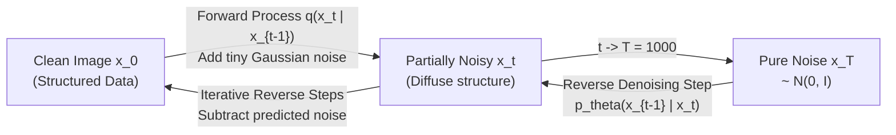
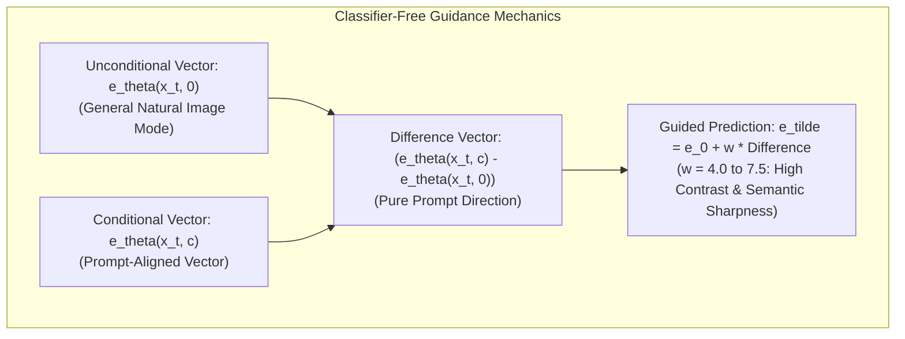
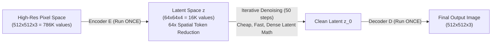
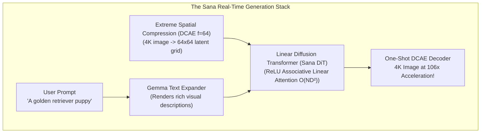

> [!abstract] Generating photorealistic images and videos by gradually reversing thermodynamic noise is conceptually brilliant but computationally brutal. Iterative multi-step denoising across millions of raw pixels crushes hardware memory bandwidth. By shifting diffusion into compact latent spaces (LDM), pushing spatial compression to an extreme 64× ratio with space-to-channel residual autoencoders (DCAE), and replacing quadratic softmax attention with associative linear kernels (Sana), modern diffusion systems transform slow multi-minute rendering into real-time 4K image and video generation.

Part of [[courses/mit-6-5940|MIT 6.5940 (Fall 2026)]], lecture 17.

## TL;DR
- **Thermodynamic Generative Modeling:** Denoising Diffusion Probabilistic Models (DDPM) corrupt images with Gaussian noise in a forward process, then train a neural network to predict and subtract the added noise step-by-step to turn pure static into crisp images.
- **The Closed-Form Training Shortcut:** Thanks to Gaussian convolution algebra, training does not simulate intermediate noise steps; a single closed-form formula ($x_t = \sqrt{\bar{\alpha}_t} x_0 + \sqrt{1 - \bar{\alpha}_t} \epsilon$) constructs any arbitrary noisy timestep in one forward pass.
- **Classifier-Free Guidance (CFG):** Randomly dropping prompt text during training allows a single network to learn conditional and unconditional distributions. Extrapolating along the difference vector during sampling trades diversity for sharp prompt alignment without requiring external classifiers.
- **The Pixel-Space Compute Trap:** Running 50 iterative denoising passes directly on raw pixels wastes 90% of compute on imperceptible high-frequency noise. Latent Diffusion Models (LDM) compress images by $f=8$ using a VAE, reducing spatial tokens by $64\times$ and running all iterative denoising in compact latent space.
- **DCAE: Pushing Compression to $f = 64$:** Traditional autoencoders collapse past $8\times$ downsampling. Deep Compression Autoencoders (DCAE) use space-to-channel residual pathways, decoupled three-stage training, and patch-GAN head refinement to achieve $64\times$ spatial compression, shrinking downstream attention compute by up to $64\times$.
- **Real-Time 4K with Sana:** Pairing DCAE with linear associative attention ($\text{ReLU}(Q) \text{ReLU}(K)^T V \to Q(K^T V)$) enables 4K image generation at a peak speedup of $106\times$ on an A100 GPU, extending seamlessly to streaming 45 FPS long-context video (LongLive).

## Concept map
The atomic concepts in **dependency order**: each one builds directly on the ideas before it.
1. [[concepts/denoising-diffusion-probabilistic-models|Denoising Diffusion Probabilistic Models]]: The core mathematical formulation of forward noise addition and learned reverse denoising.
   *Needs:* nothing
2. [[concepts/classifier-free-guidance|Classifier-Free Guidance]]: Steering the generative reverse trajectory toward user prompts via unconditional score extrapolation.
   *Needs:* [[concepts/denoising-diffusion-probabilistic-models|Denoising Diffusion Probabilistic Models]]
3. [[concepts/latent-diffusion-models|Latent Diffusion Models]]: Decoupling perceptual compression from generative modeling by confining iterative denoising to a low-dimensional autoencoder latent space.
   *Needs:* [[concepts/denoising-diffusion-probabilistic-models|Denoising Diffusion Probabilistic Models]]
4. [[concepts/deep-compression-autoencoder|Deep Compression Autoencoder]]: Pushing spatial compression to an extreme $f=64$ ratio via residual space-to-channel shortcuts to slash downstream diffusion token counts.
   *Needs:* [[concepts/latent-diffusion-models|Latent Diffusion Models]]
5. [[concepts/linear-attention|Linear Attention]]: Replacing quadratic softmax attention in Diffusion Transformers with linear associative operations to unlock real-time 4K rendering.
   *Needs:* nothing

---

## First-principles rebuild

### Act 1: The Thermodynamic Metaphor — Adding Noise to Create Order

Imagine dropping a drop of blue ink into a glass of clear water.
At $t = 0$, you have a structured, distinct shape. Over time ($t = 1, 2, \dots$), water molecules collide with the ink particles in random brownian motion. By $t = 1,000$, the ink has diffused completely: the water is a uniform, pale blue liquid. Information has been destroyed; entropy has maximized.

Now, imagine reversing the arrow of time: what if you could train a neural network to observe the dispersed liquid and nudge each molecule backward, step by step, until the original droplet is magically reconstructed?

This is the foundational insight of **[[concepts/denoising-diffusion-probabilistic-models|Denoising Diffusion Probabilistic Models (DDPM)]]**.

#### The Forward Process (Noise Addition)
Given a clean image $x_0$, the forward process adds tiny increments of Gaussian noise over $T$ steps (e.g., $T = 1,000$) according to a variance schedule $\beta_1, \dots, \beta_T$:
$$q(x_t \mid x_{t-1}) = \mathcal{N}\left(x_t; \sqrt{1 - \beta_t} x_{t-1}, \beta_t I\right)$$

*The Mathematical Miracle (The Closed-Form Diffusion Kernel):*
Must we simulate all 1,000 steps one by one during training?
No! Because the sum of independent Gaussians is another Gaussian, we can express $x_t$ directly in terms of the original image $x_0$.
Let $\alpha_t = 1 - \beta_t$, and define $\bar{\alpha}_t = \prod_{s=1}^t \alpha_s$:
$$x_t = \sqrt{\bar{\alpha}_t} x_0 + \sqrt{1 - \bar{\alpha}_t} \epsilon, \quad \text{where } \epsilon \sim \mathcal{N}(0, I)$$

This closed-form shortcut is profound:
- To train a diffusion model on step $t = 732$, we don't need 732 sequential forward passes.
- We pick clean image $x_0$, look up pre-computed constant $\bar{\alpha}_{732}$, sample random noise $\epsilon$, and generate $x_{732}$ in **a single matrix operation**!

#### The Reverse Process (Learned Denoising)
During inference, we sample pure Gaussian noise $x_T \sim \mathcal{N}(0, I)$.
If step size $\beta_t$ is small enough, the reverse distribution $q(x_{t-1} \mid x_t)$ is also Gaussian. We train a neural network (a U-Net or Diffusion Transformer) to estimate this transition.
Instead of predicting the mean image directly, Jonathan Ho et al. showed that training the network $\epsilon_\theta(x_t, t)$ to predict the **exact noise vector $\epsilon$** that was injected into $x_t$ produces remarkably stable training:
$$\mathcal{L}(\theta) = \mathbb{E}_{x_0, \epsilon, t} \left[ \|\epsilon - \epsilon_\theta(x_t, t)\|^2 \right]$$

Training is simple: pick an image, add random noise, and train the model with mean squared error to guess what noise was added.
During generation, the model inspects noisy tensor $x_t$, predicts the noise $\epsilon_\theta(x_t, t)$, subtracts it, and steps backward from $t = 1,000 \to 0$ to reveal a brand-new, photorealistic image!

---

### Act 2: Directing the Noise — Classifier-Free Guidance

Pure unconditioned diffusion creates plausible images, but they are completely random: one run generates a sailboat, the next a sunflower.
How do we force the model to generate exactly what the user asks for (e.g., *"A cat wearing sunglasses on a skateboard"*), and how do we ensure it doesn't wander off into vague, washed-out compromises?

#### The Classifier Guidance Trap
Early models used an external image classifier $p(c \mid x_t)$ to guide generation. At every step, the classifier evaluated noisy image $x_t$, and its gradient $\nabla_{x_t} \log p(c \mid x_t)$ was added to push the denoising direction toward class $c$.
However, training an auxiliary classifier that works accurately on severely noisy images across all 1,000 timesteps is extremely fragile, and cannot scale to open-ended natural language prompts.

#### Classifier-Free Guidance (CFG): The Dual-Path Solution
**[[concepts/classifier-free-guidance|Classifier-Free Guidance (CFG)]]** solves this without any extra classifier:
1. **Condition Dropout During Training:**
   When training the diffusion model $\epsilon_\theta(x_t, c)$, the prompt $c$ is replaced with an empty null token $\emptyset$ roughly $10\%$ to $20\%$ of the time. The same network learns both:
   - What natural images look like in general: $\epsilon_\theta(x_t, \emptyset)$
   - What natural images matching prompt $c$ look like: $\epsilon_\theta(x_t, c)$
2. **Extrapolation at Inference Time:**
   During sampling, the model runs two forward passes at each step: one unconditional ($\epsilon_\emptyset$), and one conditional ($\epsilon_c$).
   It then extrapolates along the difference vector using guidance scale $\omega$:
   $$\tilde{\epsilon}_\theta(x_t, c) = \epsilon_\theta(x_t, \emptyset) + \omega \cdot \left(\epsilon_\theta(x_t, c) - \epsilon_\theta(x_t, \emptyset)\right)$$

- When $\omega = 1$: Standard conditional sampling. Images are soft, natural, and sometimes ignore complex clauses in the prompt.
- When $\omega > 1$ (e.g., $\omega = 4$ to $7.5$): The model aggressively amplifies the prompt's influence, boosting visual contrast, sharpness, and prompt compliance.
- *The Computational Cost:* CFG requires evaluating the diffusion model twice per timestep, doubling the arithmetic work of sampling.

---

### Act 3: Escaping Pixel Space — Latent Diffusion and Deep Compression

Now we hit the physical reality of hardware: **Pixel-space diffusion is computationally unsustainable.**

#### The Pixel-Space Compute Trap
Consider generating a standard $512 \times 512$ image:
- An RGB image has $512 \times 512 \times 3 = 786,432$ numbers.
- Generating the image requires 50 iterative denoising passes.
- Every single pass evaluates millions of convolutional and self-attention operations across all 786,432 values.

Yet, cognitive science and signal processing show that natural images are dominated by **high-frequency imperceptible details** (imperceptible sensor noise, microscopic textural variance) that carry zero semantic meaning. Spending 50 heavy neural network passes denoising individual microscopic pixels is a massive waste of energy.

#### Latent Diffusion Models (LDM / Stable Diffusion)
**[[concepts/latent-diffusion-models|Latent Diffusion Models (LDM)]]** break the problem into two distinct stages:
1. **Perceptual Compression (The Autoencoder):** A pre-trained Variational Autoencoder (VAE) compresses the $512 \times 512 \times 3$ image by a spatial downsampling factor of $f = 8$ into a compact latent grid:
   $$z \in \mathbb{R}^{64 \times 64 \times 4}$$
   The spatial token count drops from $262,144$ pixels to $4,096$ latent vectors—a **$64\times$ reduction in spatial elements**!
2. **Semantic Denoising (In Latent Space):** All 50 expensive iterative denoising steps happen entirely within this compact $64 \times 64$ latent space.
3. **One-Shot Decoding:** The heavy VAE decoder runs **only once** at the very end ($t = 0$) to convert clean latent $z_0$ back into full-resolution RGB pixels.

#### DCAE: Pushing Spatial Compression from $f=8$ to $f=64$
Standard $f=8$ compression was a huge breakthrough for $512 \times 512$ images. But for 4K resolution ($4096 \times 4096$), an $f=8$ latent map is still massive:
$$\text{Latent Size} = \frac{4096}{8} \times \frac{4096}{8} = 512 \times 512 = 262,144 \text{ tokens!}$$
Feeding 262K tokens into a modern Diffusion Transformer (DiT) crashes GPU memory because self-attention scales quadratically with token count.

Why couldn't we simply push the VAE from $f=8$ to $f=32$ or $f=64$?
Because standard autoencoders collapse at high compression ratios: deep convolutions erase fine edges, and end-to-end training at $64\times$ downsampling is numerically unstable.

**[[concepts/deep-compression-autoencoder|Deep Compression Autoencoder (DCAE)]]** shatters this barrier through three breakthroughs:
1. **Residual Space-to-Channel Pathways:** In addition to learned convolutions, DCAE adds explicit, parameter-free space-to-channel shortcuts, deterministically folding spatial pixels directly into channel depth ($H \times W \times C \to \frac{H}{2} \times \frac{W}{2} \times 4C$). This deterministic pathway preserves spatial gradients and fine lines without forcing deep layers to relearn pixel shuffling.
2. **Decoupled Three-Phase Training:**
   - *Phase 1 (Base):* Train the complete autoencoder on low-resolution $256 \times 256$ images for stability.
   - *Phase 2 (High-Res Adaptation):* Freeze almost the entire network; tune only a tiny latent interface layer on $1024 \times 1024$ images.
   - *Phase 3 (Perceptual Refinement):* Freeze the encoder and main decoder; train only the final decoder head with a patch-GAN discriminator to restore high-frequency crispness (slashing reconstruction FID from $3.82$ down to $0.82$).
3. **Structured Latents (DCAE 1.5):** Imposes an explicit ordering across latent channels: early channels encode coarse geometry, while trailing channels capture fine details, speeding up downstream diffusion convergence.

With $f = 64$ compression, a 4K image ($4096 \times 4096$) condenses into just $64 \times 64 = 4,096$ latent tokens! Downstream attention compute drops by $(64/8)^2 = 64\times$, allowing 4K images to fit on a single GPU.

---

### Act 4: Real-Time High-Resolution Diffusion — Sana & Video Generation

With token counts compressed by DCAE, what architecture should process the remaining latent tokens?

#### Sana: Linear Diffusion Transformers
Standard Diffusion Transformers (DiT) use softmax self-attention. Even with DCAE, scaling to extreme batch sizes or ultra-high resolutions triggers quadratic memory bottlenecks.

**Sana** replaces quadratic softmax attention with **[[concepts/linear-attention|Linear Attention]]**:
- Softmax exponential similarity is replaced by non-negative $\text{ReLU}(Q) \text{ReLU}(K)^T$.
- Thanks to matrix multiplication associativity, Sana evaluates $\phi(K)^T V$ first to build a compact $D \times D$ global context matrix, then multiplies by $\phi(Q)$.
- Arithmetic complexity drops from $O(N^2 D)$ to $O(N D^2)$—scaling **linearly** with resolution.
- Coupled with a small Gemma-based text prompt expander, Sana generates 4K images with **$106\times$ higher throughput** than standard diffusion baselines on a single A100 GPU!

#### Sana-Video and LongLive: Streaming Video at 45 FPS
Video generation is much harder than image generation: every second of video contains 24 to 60 frames, generating tens of thousands of tokens and causing KV caches to explode.

MIT HAN Lab extends these principles to video with **Sana-Video** and **LongLive (1.0 & 2.0)**:
1. **Block Linear Attention:** Maintains a compact, fixed-size recurrent KV state across video chunks, keeping memory consumption strictly constant regardless of video length.
2. **Temporal Convolutions:** Adds local temporal convolutions between adjacent frames to capture rapid fluid motion while linear attention handles global cross-frame scene consistency.
3. **Frame-Level Attention Sinks:** Just as [[concepts/attention-sinks|Attention Sinks]] stabilize long text in StreamingLM, LongLive retains anchor frame tokens at the start of a video clip and at shot transitions (Multi-Shot Sinks). This prevents visual identity drift across minute-long interactive video generation.
4. **NVFP4 Full-Stack Quantization:** LongLive 2.0 quantizes weights, activations, and KV cache to 4-bit floating point (NVFP4), achieving real-time streaming video synthesis at **over 45 frames per second** on a single GPU.

---

## Connections
- Extends [[lessons/2026-11-06-vision-transformers-perception-and-autoregressive-generation]]: contrasts autoregressive next-token image generation with iterative continuous denoising diffusion.
- Re-applies [[concepts/linear-attention|Linear Attention]]: demonstrates how the associative kernel trick introduced for perception in EfficientViT also accelerates generative diffusion backbones in Sana.
- Directly builds upon [[concepts/attention-sinks|Attention Sinks]]: shows how the softmax probability sink phenomenon in autoregressive language models applies to frame-level video diffusion anchors in LongLive.
- Links to [[concepts/micro-scaling-formats|Micro-Scaling Formats]]: LongLive 2.0 leverages NVFP4 microscopic floating-point quantization to compress video diffusion weights, activations, and KV caches to 4 bits.

---

## Review questions

> [!question]- Q1 (recall): How does the closed-form diffusion kernel $x_t = \sqrt{\bar{\alpha}_t} x_0 + \sqrt{1 - \bar{\alpha}_t} \epsilon$ enable fast training of DDPM models?
> In forward diffusion, each step adds Gaussian noise with variance $\beta_t$: $x_t = \sqrt{1 - \beta_t} x_{t-1} + \sqrt{\beta_t} \epsilon$.
> If training required simulating every intermediate step, training on timestep $t = 800$ would require 800 sequential forward evaluations for every single training image.
> However, because the sum of independent Gaussians is another Gaussian, substituting $\alpha_t = 1 - \beta_t$ recursively yields the closed-form kernel:
> $$x_t = \sqrt{\bar{\alpha}_t} x_0 + \sqrt{1 - \bar{\alpha}_t} \epsilon, \quad \text{where } \bar{\alpha}_t = \prod_{s=1}^t \alpha_s$$
> This allows training to sample an arbitrary timestep $t \sim \mathcal{U}(1, T)$ and instantly construct the noisy target tensor $x_t$ from clean image $x_0$ in a single matrix operation, completely bypassing step-by-step simulation during training. Linked note: [[concepts/denoising-diffusion-probabilistic-models|Denoising Diffusion Probabilistic Models]].

> [!question]- Q2 (explain-why): Explain why Classifier-Free Guidance (CFG) requires evaluating the diffusion model twice per timestep during sampling, and describe how the guidance scale $\omega$ alters the output distribution.
> CFG trains a single model $\epsilon_\theta(x_t, c)$ with random condition dropout, replacing prompt $c$ with a null token $\emptyset$ 10%–20% of the time.
> During sampling, to steer the generative trajectory toward prompt $c$, the model must evaluate both the conditional noise score $\epsilon_\theta(x_t, c)$ and the unconditional baseline score $\epsilon_\theta(x_t, \emptyset)$. This requires two separate forward passes per timestep (doubling inference compute).
> The final guided update extrapolates along the difference vector:
> $$\tilde{\epsilon} = \epsilon_\emptyset + \omega (\epsilon_c - \epsilon_\emptyset)$$
> When guidance scale $\omega = 1$, generation matches standard conditional sampling (diverse, but often soft and lacking prompt adherence). When $\omega > 1$ (e.g. 4 to 7.5), the model strongly amplifies the probability gradient pointing toward prompt $c$, sharply boosting visual contrast, edge sharpness, and semantic adherence while reducing sample diversity. Linked note: [[concepts/classifier-free-guidance|Classifier-Free Guidance]].

> [!question]- Q3 (apply): A vision lab wants to generate $4096 \times 4096$ (4K) images with a Diffusion Transformer. Calculate the sequence length under standard $f=8$ latent compression versus DCAE $f=64$ compression (assuming $2 \times 2$ latent patch embedding). Why does DCAE make 4K generation feasible on a single GPU?
> - Under standard $f=8$ VAE downsampling:
>   The latent map has spatial dimensions $\frac{4096}{8} \times \frac{4096}{8} = 512 \times 512$.
>   With $2 \times 2$ patch tokens, sequence length is $N = \frac{512 \times 512}{2 \times 2} = 65,536$ tokens.
>   Self-attention across 65K tokens requires calculating a $(65536)^2 \approx 4.29 \times 10^9$ element pairwise attention matrix per head per layer, causing out-of-memory crashes on single GPUs.
> - Under DCAE $f=64$ downsampling:
>   The latent map has spatial dimensions $\frac{4096}{64} \times \frac{4096}{64} = 64 \times 64$.
>   With $2 \times 2$ patch tokens, sequence length is $N = \frac{64 \times 64}{2 \times 2} = 1,024$ tokens.
>   Self-attention across 1,024 tokens requires only $1024^2 \approx 1.05 \times 10^6$ pairwise dot products—a **$4,096\times$ reduction in attention compute**, comfortably fitting 4K generation inside a single consumer or edge GPU. Linked note: [[concepts/deep-compression-autoencoder|Deep Compression Autoencoder]].

> [!question]- Q4 (transfer): How does LongLive apply the attention sink phenomenon (originally discovered in autoregressive language models) to maintain identity and scene consistency across long video generation?
> In autoregressive language generation (StreamingLM), initial tokens act as attention sinks that absorb excess softmax probability, and retaining them in the KV cache prevents perplexity collapse under rolling sliding windows.
> LongLive transfers this principle to video diffusion:
> In long video generation, storing all past video frames in memory causes KV cache exhaustion, but discarding past frames causes rapid visual drift (characters change clothes, backgrounds morph inconsistently).
> LongLive introduces **frame-level attention sinks**:
> 1. It keeps a small set of early anchor frames permanently visible in the attention memory even after intervening frames are evicted from the local temporal window.
> 2. At scene transitions, it introduces **multi-shot attention sinks** that anchor new shot boundaries.
> This provides a permanent reference anchor for character identity, lighting, and global scene context, maintaining strict visual consistency across minute-long interactive video generation without requiring an unbounded KV cache. Linked note: [[concepts/attention-sinks|Attention Sinks]].

---

## Source notes
- Lecture: MIT 6.5940 (Fall 2026), Lecture 17: Diffusion Model (Part I).
- Instructor: Joan Jang & Prof. Song Han (MIT HAN Lab).
- Source video: [EfficientML.ai Lecture 17 - Diffusion Model (Part I)](https://www.youtube.com/watch?v=Vpztdp3O0cg) (uploaded Nov 11, 2026).
- Slides reference: [MIT 6.5940 Lecture 17 Slides](https://www.dropbox.com/scl/fi/yuh3j4w9420tvdv7hsv7u/Lec17-Diffusion-Model-Part-I.pdf?rlkey=v6j8s0h21tphz6r7t4b5iog0p&st=j9544wep&dl=0).
- Key papers cited:
  - Ho et al., "Denoising Diffusion Probabilistic Models" (DDPM), NeurIPS 2020.
  - Ho & Salimans, "Classifier-Free Diffusion Guidance", NeurIPS Workshop 2021.
  - Rombach et al., "High-Resolution Image Synthesis with Latent Diffusion Models" (Stable Diffusion), CVPR 2022.
  - Chen et al., "Deep Compression Autoencoder for Efficient High-Resolution Diffusion Models" (DCAE), 2024.
  - Xie et al., "Sana: Efficient High-Resolution Image Synthesis with Linear Diffusion Transformers", 2024.
  - Zhang et al., "LongLive: Real-Time Interactive Long Video Generation with Streaming Diffusion", 2024.
