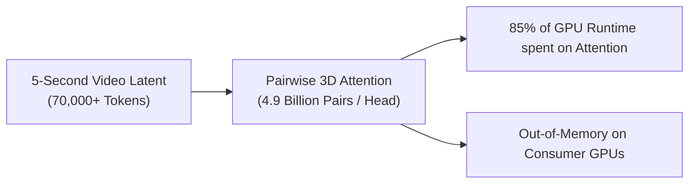
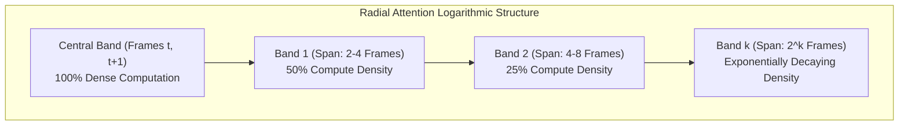
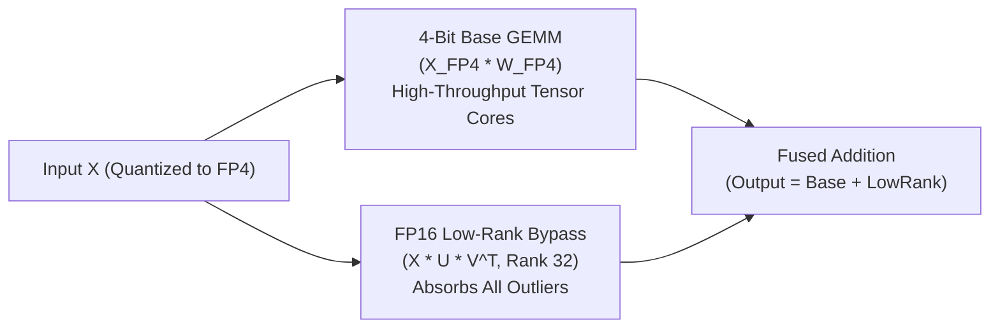
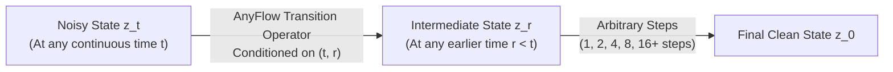

> [!abstract] Generating multi-second high-resolution video pushes neural network execution into extreme bottlenecks: over 70,000 spatiotemporal tokens create a crushing 3D attention wall, dynamic activation outliers break standard low-bit quantization, and 50 iterative denoising steps make interactive generation impossible. By exploiting spatiotemporal energy decay with logarithmic radial attention, absorbing activation and weight outliers with low-rank SVD branches (SVDQuant) and spatiotemporal delta quantization (DeltaQuant), and replacing rigid multi-step simulation with on-policy flow map distillation (AnyFlow), modern diffusion pipelines achieve real-time, consumer-hardware synthesis.

Part of [[courses/mit-6-5940|MIT 6.5940 (Fall 2026)]], lecture 18.

## TL;DR
- **The 3D Video Attention Bottleneck:** A 5-second video contains over 70,000 spatiotemporal tokens. Pairwise 3D self-attention scales quadratically, consuming over 80% of total inference latency.
- **Sparsity via Spatiotemporal Energy Decay (Radial Attention):** Video attention decays exponentially across time and space. Structuring 3D attention into logarithmic diagonal bands drops attention complexity from $O(L^2)$ to $O(L \log L)$, training $4\times$ longer videos in under 200 GPU hours.
- **SVDQuant for 4-Bit DiTs (W4A4):** Next-gen Blackwell FP4 tensor cores require quantizing both weights and activations to 4 bits. SVDQuant migrates activation outliers into weights via channel smoothing, then factors out weight outliers into a high-precision low-rank branch ($W = W_{\text{4-bit}} + U V^T$), running 12B Flux.1 on a laptop RTX 4090 GPU at over $10\times$ speedup.
- **DeltaQuant for Dynamic Video Activations:** Video activations drift dynamically across denoising timesteps, causing static smoothing to fail. DeltaQuant groups tokens into 3D spatiotemporal cubes, keeps a high-precision mean anchor vector, and quantizes only the tiny residual delta ($\Delta = x - \mu$) to 4 bits with zero frame flickering.
- **QuantVideoGen (2-Bit KV Cache):** Compresses autoregressive video diffusion KV cache by $7\times$ (from 34 GB down to 5 GB) using semantic clustering and progressive residual quantization, allowing 8B models to run on single consumer GPUs.
- **AnyFlow On-Policy Flow Map Distillation:** Consistency models are hardcoded to fixed step budgets and degrade if given more compute. AnyFlow learns a continuous transition operator between arbitrary timesteps ($z_t \to z_r$) via on-policy rollouts, enabling flexible generation where visual quality scales monotonically with whatever step budget is available (from 1 step up to 16+ steps).

## Concept map
The atomic concepts in **dependency order**: each one builds directly on the ideas before it.
1. [[concepts/smoothquant|SmoothQuant]]: Migrating activation outliers into weight tensors via channel-wise scaling factors.
   *Needs:* [[concepts/linear-quantization|Linear Quantization]]
2. [[concepts/radial-attention|Radial Attention]]: Structuring 3D video attention into logarithmic diagonal bands matching physical energy decay to achieve sub-quadratic $O(L \log L)$ scaling.
   *Needs:* nothing
3. [[concepts/svdquant|SVDQuant]]: Absorbing weight outliers into a high-precision low-rank branch while quantizing base weights and smoothed activations to 4 bits (W4A4).
   *Needs:* [[concepts/smoothquant|SmoothQuant]]
4. [[concepts/deltaquant|DeltaQuant]]: Mitigating temporal activation drift in video diffusion by quantizing residual deltas around spatiotemporal cube anchors.
   *Needs:* [[concepts/svdquant|SVDQuant]]
5. [[concepts/anyflow-distillation|AnyFlow Distillation]]: Learning an on-policy flow transition operator to jump across arbitrary timesteps with monotonic compute-to-quality scaling.
   *Needs:* [[concepts/denoising-diffusion-probabilistic-models|Denoising Diffusion Probabilistic Models]]

---

## First-principles rebuild

### Act 1: The Video Attention Wall & Spatiotemporal Sparsity

In static image diffusion, a single $1024 \times 1024$ image compressed by an $f=8$ VAE produces $128 \times 128 = 16,384$ tokens.
Now consider a 5-second video running at 24 frames per second:
- Total frames: $5 \times 24 = 120$ frames.
- Even with 3D video autoencoders compressing space by $8\times$ and time by $4\times$, the resulting latent representation contains **over 70,000 spatiotemporal tokens** ($L \ge 70,000$).

When a Video Diffusion Transformer (such as CogVideoX or Wan2.1) computes full 3D self-attention, every token compares itself against all 70,000 tokens:
$$\text{Attention Pairs} = (70,000)^2 = 4,900,000,000 \text{ dot products per head per layer!}$$
Latency profiling reveals a stark reality: **Self-attention accounts for over 80% to 90% of total video generation runtime.**

#### Exploiting Spatiotemporal Attention Patterns: SparseVideoGen
Are all 4.9 billion token pairs equally important?
Inspecting empirical video attention maps reveals heavy structure:
1. **Spatial Heads:** Certain attention heads focus strictly within individual frames, capturing object geometry, color, and local boundaries.
2. **Temporal Heads:** Other attention heads focus strictly across frames, tracking the same spatial coordinate forward and backward through time.

**SparseVideoGen (SVG v1)** profiles each attention head dynamically at runtime using a 1% query sample, assigning each head its optimal sparse pattern. It then introduces a **Token Layout Transformation**: because temporal tokens are strided across memory (separated by thousands of intervening spatial pixels), SVG transposes the memory layout to make temporal tokens contiguous in GPU memory, speeding up attention by **$1.8\times$ to $2.3\times$**.

**SparseVideoGen v2** goes a step further with **Semantic Permutation**:
In standard block-sparse attention, rectangular blocks are defined by physical pixel coordinates. However, semantically related objects (e.g., a person walking across a field) move across pixel coordinates. To capture them, block-sparse kernels must compute large, mostly empty blocks (where only 28% of computation is useful).
SVG v2 runs fast K-means clustering on query and key vectors, grouping semantically similar tokens into contiguous blocks. This concentrates scattered attention spikes into tight, dense blocks, raising effective computation efficiency from **28% to over 86%**.

#### Radial Attention: Logarithmic $O(L \log L)$ Scaling
Can we eliminate dynamic profiling entirely?
MIT HAN Lab researchers discovered an invariant physical law governing video transformers: **Spatiotemporal Energy Decay**:
- **Temporal Decay:** Attention energy between two frames decays exponentially as the time distance $|t_1 - t_2|$ grows.
- **Spatial Decay:** Attention energy between two pixels within a frame decays with Euclidean distance.

**[[concepts/radial-attention|Radial Attention]]** maps this physical decay directly to a **static multi-band diagonal mask**:
- The central band receives full 100% compute density for consecutive frames.
- Each outer band covers twice the temporal span at half the compute density.
- Because the number of bands scales logarithmically ($O(\log L)$) and each band requires $O(L)$ work, total attention complexity drops from quadratic $O(L^2)$ to **sub-quadratic $O(L \log L)$**!

Because the mask is static and deterministic, it executes with contiguous GPU memory access, accelerating video generation by **$3.7\times$** and enabling a $4\times$ longer video model to be fine-tuned in under 200 GPU hours.

---

### Act 2: Taming Outliers in 4-Bit Diffusion — SVDQuant

Once attention is pruned, the computational bottleneck shifts back to the feedforward and linear projection layers.
On modern hardware (such as NVIDIA Blackwell architectures), 4-bit floating point (FP4 / NVFP4) tensor cores deliver **double the throughput of FP8** and **$4\times$ the throughput of FP16**.

However, to use FP4 tensor cores, both weights and activations must be quantized to 4 bits (**W4A4**):
$$\text{Output} = X_{\text{FP4}} \cdot W_{\text{FP4}}$$

#### The W4A4 Deadlock in Diffusion Transformers
When researchers applied naive 4-bit quantization to 12-billion-parameter Diffusion Transformers (like Flux.1 or SD3), the models collapsed completely, outputting grotesque noise and warped artifacts.

Why?
- **Activation Outliers:** Activations exhibit massive outlier channels (values spiking past $\pm 100$).
- **Weight Outliers:** The weight matrices also contain sensitive outlier channels.
- In [[concepts/smoothquant|SmoothQuant]], activation outliers are smoothed out by dividing activations by a scaling factor $s$ and multiplying the corresponding weights by $s$. In 8-bit LLMs, weights have enough bit-depth to absorb this inflation. But in 4-bit diffusion models, inflating the weights pushes weight outliers past the dynamic range of 4-bit numbers, destroying the weight representation!

#### SVDQuant: The Low-Rank Outlier Bypass
**[[concepts/svdquant|SVDQuant]]** resolves this impasse by recognizing that outliers lie in a low-dimensional subspace:
1. **Activation Smoothing:** Use channel-wise scaling factors $s$ to migrate all activation outliers into the weights. Now activations are smooth and easily quantized to 4 bits.
2. **Singular Value Decomposition (SVD):** Decompose the inflated weight matrix $W'$ into a uniform base matrix plus a high-precision low-rank branch:
   $$W' \approx W_{\text{4-bit}} + U V^T$$
   where $U \in \mathbb{R}^{d_{\text{in}} \times r}$, $V \in \mathbb{R}^{r \times d_{\text{out}}}$, and rank $r = 32$.
3. **High-Precision Bypass:** The low-rank matrices $U$ and $V$ represent less than 5% of total parameters and remain in unquantized 16-bit precision (FP16). They absorb 100% of the severe weight outliers!
4. **Fused Kernel Execution:** The 4-bit base GEMM and the FP16 low-rank GEMM share the identical input and output buffers in a single fused GPU kernel.

SVDQuant compresses the 12B Flux.1 model by **$3.6\times$**, cutting VRAM from 24 GB to under 8 GB and enabling real-time generation locally on a laptop RTX 4090 GPU at over **$10\times$ speedup**!

---

### Act 3: Dynamic Temporal Quantization — DeltaQuant & 2-Bit Video Caches

When we extend 4-bit quantization from static images to dynamic video, a new failure emerges: **temporal distribution drift**.

#### Why Static Smoothing Fails in Video Diffusion
In image diffusion, activation channel magnitudes are relatively stable. In video diffusion, activations change dramatically across the 50 denoising timesteps:
- At timestep $t = 1,000$ (pure noise), activations are diffuse and broad.
- At timestep $t = 50$ (clean video), activations concentrate into sharp, outlier-heavy channel spikes.
- A static smoothing scale calibrated at $t = 1,000$ amplifies errors at $t = 50$, producing severe video flickering.

#### DeltaQuant: Spatiotemporal Residual Deltas
**[[concepts/deltaquant|DeltaQuant]]** bypasses static calibration by exploiting **spatiotemporal continuity**: adjacent pixels and consecutive frames are nearly identical.
1. **3D Spatiotemporal Cubes:** Partition the video activation tensor into small 3D cubes ($2 \times 2$ spatial pixels $\times 2$ adjacent frames = 8 tokens).
2. **High-Precision Mean Anchor:** Compute the average vector $\mu = \frac{1}{8} \sum x_i$ for each cube in FP16.
3. **Residual Delta Quantization:** Subtract the anchor from each token:
   $$\Delta_i = x_i - \mu$$
   Because neighboring video tokens share color, lighting, and motion, the residual $\Delta_i$ is centered at zero with a dynamic range $15\times$ smaller than the raw activation.
4. **Lossless 4-Bit Encoding:** Quantize the low-magnitude residual $\Delta_i$ into 4 bits with near-zero rounding error.

DeltaQuant reduces model size by $2.9\times$, cuts memory by $2.3\times$, and delivers up to **$7.2\times$ acceleration** across video resolutions with zero frame flickering.

#### QuantVideoGen: 2-Bit KV Cache Compression
In autoregressive video diffusion models, storing past frames in the KV cache consumes massive memory (over 34 GB for a short clip).
**QuantVideoGen** compresses the KV cache to **2 bits per element** ($7\times$ memory reduction):
1. **Semantic Clustering:** Groups related tokens across frames using K-means clustering and subtracts cluster centroids to center the residual distribution near zero.
2. **Progressive Residual Quantization:** Quantizes the residual in coarse-to-fine 2-bit stages. The first 2-bit stage captures primary components; the second stage captures subtle fine details.

On an 8B video model, QuantVideoGen drops the KV cache from **34 GB down to 5 GB**, allowing high-resolution long-video generation to run comfortably on a single consumer RTX 4090 GPU.

---

### Act 4: Stepping Across Time — AnyFlow On-Policy Flow Map Distillation

We have solved the attention wall with Radial Attention and the parameter/memory wall with SVDQuant and DeltaQuant.
Yet, one fundamental bottleneck remains: **the multi-step simulation barrier**.
Even an optimized model takes several seconds if it must evaluate 25 to 50 sequential denoising steps.

#### The Failure of Consistency Distillation
To achieve few-step generation (e.g. 4 steps), earlier methods used **Consistency Distillation**: training a student model to predict the final clean data $z_0$ directly in a single leap ($z_t \to z_0$).
However, consistency models suffer from **fixed-step collapse**:
- A model distilled for 4 steps works well at 4 steps.
- If you give it 8 or 16 steps hoping for higher quality, the output quality degrades!
- The model is locked to a specific step budget and cannot scale with available GPU compute.

#### AnyFlow: On-Policy Flow Map Distillation
**[[concepts/anyflow-distillation|AnyFlow Distillation]]** reframes distillation from a single-endpoint leap into a **continuous transition operator between arbitrary timesteps**:
$$z_r = \Phi_\theta(z_t, t, r) \quad \text{for any } r < t$$

### The Three Pillars of AnyFlow:
1. **Arbitrary Flow Map Formulation:** The student learns the flow field mapping from any time $t$ to any earlier time $r$. This allows a single trained checkpoint to support **any sampling budget**:
   - 1 step: Instant 60 FPS live preview.
   - 4 steps: Real-time generation.
   - 8 or 16 steps: Full cinematic quality.
   Unlike consistency models, visual quality scales **monotonically** with additional compute.
2. **On-Policy Student Rollouts:** Traditional distillation uses trajectories generated by the teacher (off-policy). At test time, student errors accumulate, pushing the model into unfamiliar territory. AnyFlow trains the student on its own rollouts, exposing it to realistic intermediate errors and teaching it to self-correct drift across multi-step jumps.
3. **Continued Adaptability:** AnyFlow checkpoints can be continually fine-tuned on specialized domain data (e.g. robotics manipulation or autonomous driving) while retaining their few-step generation capabilities.

---

## Connections
- Builds upon [[lessons/2026-11-11-diffusion-models-foundations-latent-spaces-and-deep-compression]]: accelerates the multi-step denoising loop established in DDPM and Latent Diffusion.
- Directly extends [[concepts/smoothquant|SmoothQuant]]: SVDQuant solves the limitation where migrating activation outliers into weights causes 4-bit weight grids to collapse.
- Parallels [[concepts/kv-cache|KV Cache]]: QuantVideoGen shows how semantic clustering and progressive residual quantization reduce video diffusion KV cache footprints to 2 bits.
- Connects to [[concepts/attention-sinks|Attention Sinks]]: video generation models leverage temporal anchor frames to prevent identity drift over long sequences.

---

## Review questions

> [!question]- Q1 (recall): What is the core mechanism of SVDQuant, and why is SmoothQuant alone insufficient for 4-bit weight-activation quantization (W4A4) in Diffusion Transformers?
> SmoothQuant divides activation channels by scaling factors $s$ and multiplies the corresponding weight columns by $s$, migrating activation outliers into the weight matrix. In 8-bit models, weights have sufficient precision to absorb this. However, in 4-bit quantization (W4A4), Diffusion Transformers have severe outliers in both activations and weights; migrating activation outliers into weights causes the weight outliers to explode, exceeding the dynamic range of 4-bit representation and causing severe visual degradation.
> SVDQuant resolves this by decomposing the smoothed weight matrix into two components:
> $$W' \approx W_{\text{4-bit}} + U V^T$$
> The bulk of the matrix ($W_{\text{4-bit}}$) is uniformly quantized to 4 bits, while the dominant outlier dimensions are factored into a high-precision low-rank branch ($U, V$ in FP16, rank 32). This absorbs 100% of the outliers in under 5% parameter overhead, enabling fast fused execution on 4-bit tensor cores without quality loss. Linked note: [[concepts/svdquant|SVDQuant]].

> [!question]- Q2 (explain-why): Why does static activation quantization fail in video diffusion models, and how does DeltaQuant's 3D spatiotemporal cube residual solve the problem?
> In video diffusion, activation distributions exhibit temporal drift: activations at timestep $t = 1,000$ (pure noise) follow a broad diffuse distribution, while activations at $t = 50$ (clean structure) concentrate into sharp, outlier-heavy channel spikes. A static smoothing scale calibrated at one timestep amplifies errors at other timesteps, causing severe video flickering.
> DeltaQuant solves this by exploiting spatiotemporal continuity:
> 1. It groups neighboring video tokens into local 3D spatiotemporal cubes ($2 \times 2$ spatial pixels $\times 2$ consecutive frames = 8 tokens).
> 2. It computes a high-precision mean anchor vector $\mu \in \mathbb{R}^D$ per cube in FP16.
> 3. It quantizes only the residual difference $\Delta = x - \mu$ to 4 bits.
> Because adjacent pixels and frames share lighting and motion, residual deltas have an order-of-magnitude smaller dynamic range and zero outlier spikes, enabling lossless 4-bit quantization without temporal flickering. Linked note: [[concepts/deltaquant|DeltaQuant]].

> [!question]- Q3 (apply): In video diffusion models, explain why full 3D self-attention scales quadratically, and show how Radial Attention's logarithmic multi-band structure reduces complexity to $O(L \log L)$.
> A multi-second video contains over 70,000 spatiotemporal tokens ($L \ge 70,000$). Standard 3D attention computes pairwise dot products between all tokens, scaling as $O(L^2 \cdot D)$ and consuming over 80% of total inference time.
> Radial Attention exploits the physical observation of spatiotemporal energy decay: attention weights decay exponentially with temporal frame distance and spatial pixel distance.
> Instead of calculating all pairs, it divides the attention matrix into a static multi-band diagonal structure:
> - Central diagonal band: 100% compute density for consecutive frames (distance $\le 1$).
> - Band $k$: covers an exponentially wider temporal span ($2^k$ frames) with exponentially sparser sampling ($2^{-k}$ density).
> Because the number of logarithmic bands grows as $O(\log L)$ and each band performs $O(L)$ work bounded by width $W$, total computation scales as:
> $$\text{Total Operations} = O(L \log L \cdot D)$$
> This sub-quadratic complexity reduces attention compute by over $10\times$ with contiguous, hardware-friendly GPU memory access. Linked note: [[concepts/radial-attention|Radial Attention]].

> [!question]- Q4 (transfer): Why do consistency models suffer from fixed-step collapse, and how does AnyFlow's on-policy flow map formulation achieve monotonic quality scaling across arbitrary step budgets?
> Consistency models are trained to map any noisy state directly to the final clean state $z_0$ in a single leap ($z_t \to z_0$). They are hardcoded to a specific discrete step partition (e.g. exactly 4 steps). If given more steps (e.g. 8 or 16 steps), the model encounters out-of-distribution states, causing output quality to degrade.
> AnyFlow overcomes this by training a continuous flow map operator that predicts transitions between arbitrary timesteps:
> $$z_r = \Phi_\theta(z_t, t, r) \quad \text{for any } r < t$$
> Furthermore, AnyFlow trains on **on-policy student rollouts**: the student generates its own multi-step trajectories during training, learning to self-correct the exact intermediate errors it will encounter at test time under teacher supervision.
> Because the transition operator is conditioned on arbitrary starting and target times $(t, r)$, a single deployed checkpoint supports 1-step previews, 4-step real-time generation, or 16-step high-fidelity rendering, with visual quality improving monotonically as more compute steps are allocated. Linked note: [[concepts/anyflow-distillation|AnyFlow Distillation]].

---

## Source notes
- Lecture: MIT 6.5940 (Fall 2026), Lecture 18: Diffusion Model (Part II).
- Instructor: Prof. Song Han & MIT HAN Lab team.
- Source video: [EfficientML.ai Lecture 18 - Diffusion Model (Part II)](https://www.youtube.com/watch?v=211AhMi_Yds) (uploaded Nov 13, 2026).
- Slides reference: [MIT 6.5940 Lecture 18 Slides](https://www.dropbox.com/scl/fi/g18m45k0h1nfxp01l29h7/Lec18-Diffusion-Model-Part-II.pdf?rlkey=3t6g12d1b7j24a4y0q9m8wz6p&st=91km4a4q&dl=0).
- Key papers cited:
  - Li et al., "SVDQuant: Absorbing Outliers by Low-Rank Components for 4-Bit Diffusion Models", 2024.
  - Zhang et al., "DeltaQuant: Temporal-Adaptive 4-Bit Video Diffusion Quantization", 2024.
  - Tang et al., "SparseVideoGen: Exploiting Spatiotemporal Sparsity for Video Diffusion Models", 2024.
  - Chen et al., "Radial Attention: Sub-Quadratic Video Attention via Spatiotemporal Energy Decay", 2024.
  - Wang et al., "QuantVideoGen: 2-Bit KV Cache Compression for Video Generation", 2024.
  - Song et al., "Consistency Models", ICML 2023.
  - Liu et al., "AnyFlow: Any-Step Video Diffusion Model with On-Policy Flow Map Distillation", 2024.
